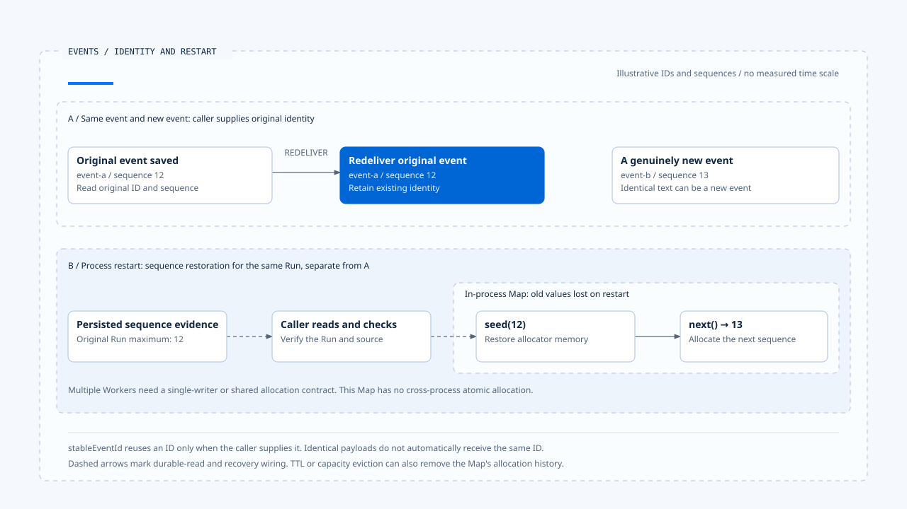

# Runtime 事件与顺序

[English](./01-runtime-events-and-ordering.md) | [繁體中文](./01-runtime-events-and-ordering-zh-TW.md) | [简体中文](./01-runtime-events-and-ordering-zh-CN.md)

> 以下内容所提到的
> CCB 为 [claude-code-best](https://github.com/claude-code-best/claude-code) 的简称。
> Chat Gun 为 [chat-gun](https://github.com/HsienW/chat-gun)。

[回到导览](./README-zh-CN.md) · 下一篇：[事件保存与结果交付](./02-event-persistence-and-delivery-zh-CN.md)

> 工具结果已返回，前端先收到 sequence 12，再收到 11。接着同一份结果因重送抵达两次。若 consumer 只按抵达时间更新画面，可能重复累加内容，或把后来的完成状态改回先前的执行中。

**事件需要可辨认的身份、明确的语义与有范围的顺序。**

三者分别回答：这是不是同一件事、发生了什么，以及交错抵达时应如何处理。Timestamp 只记录时间，仍需搭配事件身份与顺序判断。

## 事件描述哪一层事实

一个 Agent 系统可能同时输出模型文字、工具进度、Task 状态与产品卡片。这些数据虽然都称为 event，却可能使用不同的 Schema、保存方式与 consumer。

| 表示 | 用途 | 需要分开核对 |
|---|---|---|
| Agent Runtime Event | plan、tool、context、answer stream 等产品事件。 | 可选 correlation 与旧类型。 |
| Task Event | Task／Step 及互动流程的事件记录。 | repository 字段与持久化。 |
| Runtime Event Envelope | 事件版本、ID、Run 内 sequence、可信 context 与 payload。 | producer／adapter 是否启用及 consumer 验证。 |
| Provider stream event | 模型响应区块与增量。 | 不自动代表 Runtime 状态已保存。 |

Chat Gun 的旧 Agent 事件、Task Event 与标准 envelope 各有接点。CCB 的 query／API 消息也有自己的控制与输出语义，比较时应保留这些层次，不能只因同名便互换。

## Envelope 保留什么

Chat Gun 的契约位于安装的 `@gun-ai/harness-contracts`。核心字段如下：

| 字段 | 责任 | 解读限制 |
|---|---|---|
| `schemaVersion` | 指定事件契约版本。 | 版本格式合法不等于 consumer 支持。 |
| `eventId` | 辨认同一事件。 | 每次重送重新产生 ID，便失去同事件去重依据。 |
| `sequence` | 表达指定 Run 内的事件次序。 | 不提供跨 Run 的全局时钟。 |
| `type` | 指定事件语义。 | 仍须验证该类型的 payload。 |
| `emittedAt` | 记录输出时间。 | 不单独证明外部效果或数据库提交时间。 |
| context | 关联 Request、Thread、Run、Task、Step 与可信 scope。 | 不能采用模型自报的身份取代。 |
| payload | 事件本身的结构化内容。 | 内容格式及权威依具体事件契约。 |

`projectExecutionEventContext()` 从验证后的 Execution Context 投影数据，包含必要关联、attempt，以及可选 Tool Call、Tool Execution、parent Run 与 agent。投影保存查证所需字段，不会把模型输出升格成可信授权。

## 外层与 payload 分开验证

Backend envelope Schema 检查 semver 形式、ID、正整数 sequence、时间与 context，payload 则先接受 unknown，但要求该字段存在。`parseRuntimeEventPayload()` 再依事件类型套用 payload Schema，未知类型会拒绝。

因此只调用 envelope parser，不足以证明特定事件内容可用。正式入口要核对它是否也执行类型辨认及 payload 验证。

Frontend 另有 parser。查读的 `runtime-event-envelope.ts` 会拒绝不支持的 major version，并区分 invalid_envelope、unsupported_schema_version 与 unknown_type。Backend 检查版本字符串格式，Frontend 则另行判断是否支持该版本；两个入口的验证范围要分开核对。

## 同一事件与下一个事件

`stableEventId()` 在 caller 提供既有 ID 时重用它，否则建立新 UUID。它不会自己查找上次投递，也不会从相同 payload 自动判定是同一事件。

重送时应从已保存的记录取得原 ID。真正的新事件即使文字相同，也可能需要新的身份；例如两次独立工具进度不能只因内容一致便合并。

Legacy Adapter 缺少 event ID 时会以事件的 JSON 表示导出哈希 ID。这是该 adapter 的特定识别规则，并非业务语义去重器；字段、时间或序列化表示改变，都需要核对会否改变结果。

## Sequence 的作用范围

Kernel 的 `RunSequenceAllocator` 使用进程内 Map，以 runId 保存目前序号。`next()` 递增；`seed()` 可加载已保存最大序号，并拒绝比当前值更低的 seed。

### 淘汰、重启与多 Worker

Map 有 TTL 与最大项目数，过期或容量淘汰会移除条目。程序重启也会失去这份内存状态。若后续没有恢复 seed，就可能从较小序号开始，与 consumer 已看过的范围冲突。

这个类别没有跨 Worker 的原子共享配置。多 producer 要为同一 Run 配号时，需要另定唯一写入者或共享序号契约。时间排序、数据库查询排序与 Run sequence 各有依据，遇到乱序或重送时，应按 consumer 的契约选用。

[开启 HTML 图解](../../assets/agent-runtime/events-and-operations/01-runtime-events-and-ordering/01-event-identity-and-restart-seed-en.html)

上区对照同一事件重送与真正的新事件，下区另说明重启后的配号恢复。持久记录的读取及 seed 接线由 caller 负责；进程内 Map 的存在，仍需搭配多 Worker 的协调契约。

## Legacy 过渡的实际条件

`LegacyRuntimeEventAdapter` 受设置控制；未启用时直接返回原事件。数据已有 schemaVersion 时，会验证 envelope 与 payload；一般 legacy 事件则先做类型映射、建立必要内容，再交给 `emitEnvelope()`。

未知 legacy type、缺少必要 Step ID 或无法序列化的数据，可能阻止这条转换。Adapter 存在不表示所有 producer 都已使用新版，也不表示旧 consumer 可直接理解新 payload。

Frontend 的 `runtimeEnvelopeToAgentRuntimeEvent()` 会把 run.terminal 等标准事件转成产品事件，保存 status、reason 与部分 correlation。转换后的表示不必包含原 envelope 每个字段，因此去重与排序要确认发生在信息仍完整的位置。

## 如何验证事件契约

- 分别移除 context、payload 与必要 ID，确认外层及 payload 验证各有预期出口。
- 以未知类型及不支持的 major version 测试 consumer，避免默默当成成功事件。
- 重送相同 event ID，再送文字相同但不同 ID 的事件，核对两者处理差异。
- 对 allocator 执行淘汰、重建与 seed，检查已用序号不被误当新事件。
- 让两个 producer 对同一 Run 配号，验证实际协调策略，而非只测单一 Map。

源代码查读 Backend 契约、kernel 与 Frontend parser／转换接点，未执行跨程序配号或版本兼容性测试。

## 本篇的工程判断

我会先为每种事件指定语义、producer 与 consumer，再安排 ID 和顺序。这样才能知道重送应重用哪份记录、哪种缺口需要补查，以及兼容转换在哪里削掉后续判断需要的数据。

## 实现参照与适用范围

- Chat Gun Backend：`runtime/event-envelope.ts`、`event-sequence.ts`、`legacy-event-adapter.ts`、`platform/agent-runtime-events.ts`，路径相对 `backend/src/`。
- 套件：contracts／kernel 的 `src/events.ts`；Frontend：`frontend/src/lib/runtime-event-envelope.ts`、`agent-runtime-events.ts`。
- [来源与文件指纹](./README-zh-CN.md#来源与查证状态)记录所列版本内容，本文没有宣称所有正式入口已切换相同契约。

## 接续阅读

下一篇[事件保存与结果交付](./02-event-persistence-and-delivery-zh-CN.md)追查事件建立后，如何区分保存、传输与 consumer 套用。
