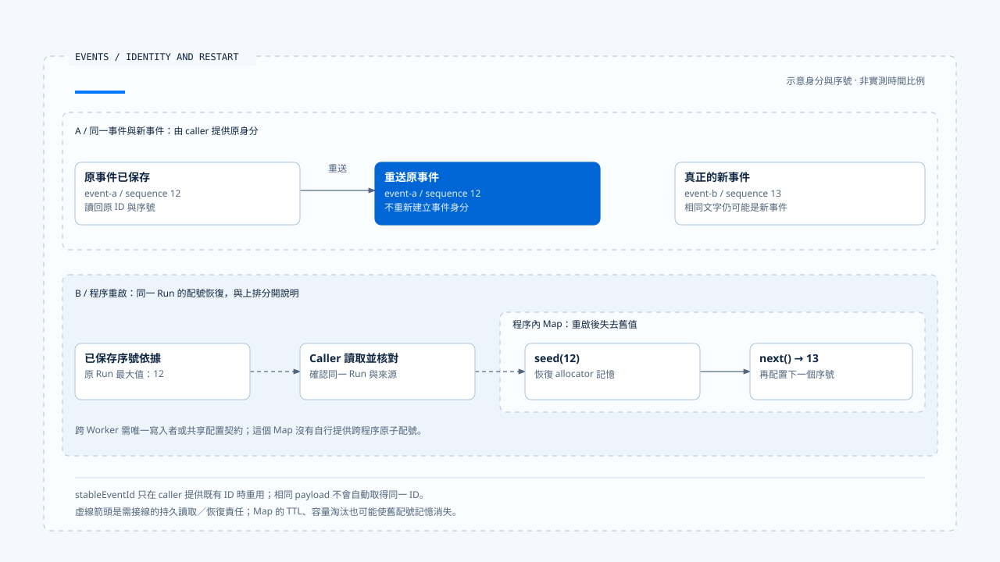

# Runtime 事件與順序

[English](./01-runtime-events-and-ordering.md) | [繁體中文](./01-runtime-events-and-ordering-zh-TW.md) | [简体中文](./01-runtime-events-and-ordering-zh-CN.md)

> 以下內容所提到的
> CCB 為 [claude-code-best](https://github.com/claude-code-best/claude-code) 的簡稱。
> Chat Gun 為 [chat-gun](https://github.com/HsienW/chat-gun)。

[回到導覽](./README-zh-TW.md) · 下一篇：[事件保存與結果交付](./02-event-persistence-and-delivery-zh-TW.md)

> 工具結果已返回，前端先收到 sequence 12，再收到 11。接著同一份結果因重送抵達兩次。若 consumer 只按抵達時間更新畫面，可能重複累加內容，或把後來的完成狀態改回先前的執行中。

**事件需要可辨認的身分、明確的語意與有範圍的順序。**

三者分別回答：這是不是同一件事、發生了什麼，以及交錯抵達時應如何處理。Timestamp 只記錄時間，仍需搭配事件身分與順序判斷。

## 事件描述哪一層事實

一個 Agent 系統可能同時輸出模型文字、工具進度、Task 狀態與產品卡片。這些資料雖然都稱為 event，卻可能使用不同的 Schema、保存方式與 consumer。

| 表示 | 用途 | 需要分開核對 |
|---|---|---|
| Agent Runtime Event | plan、tool、context、answer stream 等產品事件。 | 可選 correlation 與舊型別。 |
| Task Event | Task／Step 及互動流程的事件紀錄。 | repository 欄位與持久化。 |
| Runtime Event Envelope | 事件版本、ID、Run 內 sequence、可信 context 與 payload。 | producer／adapter 是否啟用及 consumer 驗證。 |
| Provider stream event | 模型回應區塊與增量。 | 不自動代表 Runtime 狀態已保存。 |

Chat Gun 的舊 Agent 事件、Task Event 與標準 envelope 各有接點。CCB 的 query／API 訊息也有自己的控制與輸出語意，比較時應保留這些層次，不能只因同名便互換。

## Envelope 保留什麼

Chat Gun 的契約位於安裝的 `@gun-ai/harness-contracts`。核心欄位如下：

| 欄位 | 責任 | 解讀限制 |
|---|---|---|
| `schemaVersion` | 指定事件契約版本。 | 版本格式合法不等於 consumer 支援。 |
| `eventId` | 辨認同一事件。 | 每次重送重新產生 ID，便失去同事件去重依據。 |
| `sequence` | 表達指定 Run 內的事件次序。 | 不提供跨 Run 的全域時鐘。 |
| `type` | 指定事件語意。 | 仍須驗證該型別的 payload。 |
| `emittedAt` | 記錄輸出時間。 | 不單獨證明外部效果或資料庫提交時間。 |
| context | 關聯 Request、Thread、Run、Task、Step 與可信 scope。 | 不能採用模型自報的身分取代。 |
| payload | 事件本身的結構化內容。 | 內容格式及權威依具體事件契約。 |

`projectExecutionEventContext()` 從驗證後的 Execution Context 投影資料，包含必要關聯、attempt，以及可選 Tool Call、Tool Execution、parent Run 與 agent。投影保存查證所需欄位，不會把模型輸出升格成可信授權。

## 外層與 payload 分開驗證

Backend envelope Schema 檢查 semver 形式、ID、正整數 sequence、時間與 context，payload 則先接受 unknown，但要求該欄位存在。`parseRuntimeEventPayload()` 再依事件型別套用 payload Schema，未知型別會拒絕。

因此只呼叫 envelope parser，不足以證明特定事件內容可用。正式入口要核對它是否也執行型別辨認及 payload 驗證。

Frontend 另有 parser。查讀的 `runtime-event-envelope.ts` 會拒絕不支援的 major version，並區分 invalid_envelope、unsupported_schema_version 與 unknown_type。Backend 檢查版本字串格式，Frontend 則另行判斷是否支援該版本；兩個入口的驗證範圍要分開核對。

## 同一事件與下一個事件

`stableEventId()` 在 caller 提供既有 ID 時重用它，否則建立新 UUID。它不會自己查找上次投遞，也不會從相同 payload 自動判定是同一事件。

重送時應從已保存的紀錄取得原 ID。真正的新事件即使文字相同，也可能需要新的身分；例如兩次獨立工具進度不能只因內容一致便合併。

Legacy Adapter 缺少 event ID 時會以事件的 JSON 表示導出雜湊 ID。這是該 adapter 的特定識別規則，並非業務語意去重器；欄位、時間或序列化表示改變，都需要核對會否改變結果。

## Sequence 的作用範圍

Kernel 的 `RunSequenceAllocator` 使用程序內 Map，以 runId 保存目前序號。`next()` 遞增；`seed()` 可載入已保存最大序號，並拒絕比當前值更低的 seed。

### 淘汰、重啟與多 Worker

Map 有 TTL 與最大項目數，過期或容量淘汰會移除條目。程序重啟也會失去這份記憶體狀態。若後續沒有恢復 seed，就可能從較小序號開始，與 consumer 已看過的範圍衝突。

這個類別沒有跨 Worker 的原子共享配置。多 producer 要為同一 Run 配號時，需要另定唯一寫入者或共享序號契約。時間排序、資料庫查詢排序與 Run sequence 各有依據，遇到亂序或重送時，應按 consumer 的契約選用。

[開啟 HTML 圖解](../../assets/agent-runtime/events-and-operations/01-runtime-events-and-ordering/01-event-identity-and-restart-seed.html)

上區對照同一事件重送與真正的新事件，下區另說明重啟後的配號恢復。持久紀錄的讀取及 seed 接線由 caller 負責；程序內 Map 的存在，仍需搭配多 Worker 的協調契約。

## Legacy 過渡的實際條件

`LegacyRuntimeEventAdapter` 受設定控制；未啟用時直接返回原事件。資料已有 schemaVersion 時，會驗證 envelope 與 payload；一般 legacy 事件則先做型別映射、建立必要內容，再交給 `emitEnvelope()`。

未知 legacy type、缺少必要 Step ID 或無法序列化的資料，可能阻止這條轉換。Adapter 存在不表示所有 producer 都已使用新版，也不表示舊 consumer 可直接理解新 payload。

Frontend 的 `runtimeEnvelopeToAgentRuntimeEvent()` 會把 run.terminal 等標準事件轉成產品事件，保存 status、reason 與部分 correlation。轉換後的表示不必包含原 envelope 每個欄位，因此去重與排序要確認發生在資訊仍完整的位置。

## 如何驗證事件契約

- 分別移除 context、payload 與必要 ID，確認外層及 payload 驗證各有預期出口。
- 以未知型別及不支援的 major version 測試 consumer，避免默默當成成功事件。
- 重送相同 event ID，再送文字相同但不同 ID 的事件，核對兩者處理差異。
- 對 allocator 執行淘汰、重建與 seed，檢查已用序號不被誤當新事件。
- 讓兩個 producer 對同一 Run 配號，驗證實際協調策略，而非只測單一 Map。

原始碼查讀 Backend 契約、kernel 與 Frontend parser／轉換接點，未執行跨程序配號或版本相容性測試。

## 本篇的工程判斷

我會先為每種事件指定語意、producer 與 consumer，再安排 ID 和順序。這樣才能知道重送應重用哪份紀錄、哪種缺口需要補查，以及相容轉換在哪裡削掉後續判斷需要的資料。

## 實作參照與適用範圍

- Chat Gun Backend：`runtime/event-envelope.ts`、`event-sequence.ts`、`legacy-event-adapter.ts`、`platform/agent-runtime-events.ts`，路徑相對 `backend/src/`。
- 套件：contracts／kernel 的 `src/events.ts`；Frontend：`frontend/src/lib/runtime-event-envelope.ts`、`agent-runtime-events.ts`。
- [來源與檔案指紋](./README-zh-TW.md#來源與查證狀態)記錄所列版本內容，本文沒有宣稱所有正式入口已切換相同契約。

## 接續閱讀

下一篇[事件保存與結果交付](./02-event-persistence-and-delivery-zh-TW.md)追查事件建立後，如何區分保存、傳輸與 consumer 套用。
