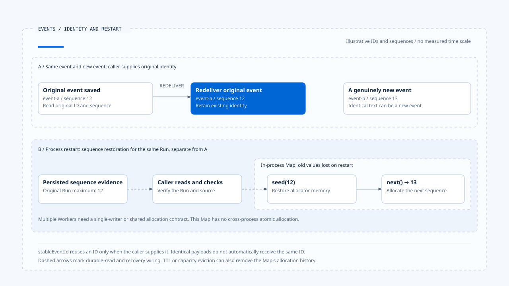

# Runtime events and ordering

[English](./01-runtime-events-and-ordering.md) | [繁體中文](./01-runtime-events-and-ordering-zh-TW.md) | [简体中文](./01-runtime-events-and-ordering-zh-CN.md)

> In the following content:
> CCB is short for [claude-code-best](https://github.com/claude-code-best/claude-code).
> Chat Gun refers to [chat-gun](https://github.com/HsienW/chat-gun).

[Back to the guide](./README.md) · Next: [Event persistence and result delivery](./02-event-persistence-and-delivery.md)

> A tool result has returned, but the frontend receives sequence 12 before 11. Redelivery then causes the same result to arrive twice. If the consumer updates the screen by arrival time alone, it may append content twice or replace a completed state with an earlier running state.

**Events need recognizable identity, explicit semantics, and ordering with a defined scope.**

These answer different questions: is this the same event, what happened, and how should out-of-order arrivals be handled? A timestamp records time; event identity and ordering are still needed to interpret it.

## Which layer of fact does an event describe?

An Agent system may emit model text, tool progress, Task state, and product cards at the same time. Although all of these may be called events, they can use different schemas, persistence mechanisms, and consumers.

| Representation | Purpose | Check separately |
|---|---|---|
| Agent Runtime Event | Product events such as plan, tool, context, and answer stream. | Optional correlation and legacy types. |
| Task Event | Event records for Tasks, Steps, and interaction flows. | Repository fields and persistence. |
| Runtime Event Envelope | Event version, ID, sequence within a Run, trusted context, and payload. | Producer/adapter enablement and consumer validation. |
| Provider stream event | Model response blocks and deltas. | Whether Runtime state has been persisted requires separate evidence. |

Chat Gun has separate integration points for legacy Agent events, Task Events, and standard envelopes. CCB query/API messages also have their own control and output semantics. Comparisons need to preserve these layers; a shared name is insufficient grounds for substituting one representation for another.

## What does the envelope retain?

Chat Gun's contract resides in the installed `@gun-ai/harness-contracts` package. Its core fields are:

| Field | Responsibility | Interpretation limit |
|---|---|---|
| `schemaVersion` | Identify the event contract version. | Valid version syntax does not establish consumer support. |
| `eventId` | Identify the same event. | Generating a new ID on each redelivery removes the basis for deduplicating that event. |
| `sequence` | Express event order within a specified Run. | Provides no global clock across Runs. |
| `type` | Identify event semantics. | The payload still needs validation for that type. |
| `emittedAt` | Record emission time. | Alone, it establishes neither external effect timing nor database commit timing. |
| context | Correlate Request, Thread, Run, Task, Step, and trusted scope. | Model-reported identity cannot replace this context. |
| payload | Carry the event's structured content. | Format and authority depend on the specific event contract. |

`projectExecutionEventContext()` projects data from a validated Execution Context, including required correlations, attempt, and optional Tool Call, Tool Execution, parent Run, and agent. It retains fields needed for investigation without promoting model output into trusted authorization.

## Validate the envelope and payload separately

The backend envelope schema checks semver syntax, IDs, a positive integer sequence, time, and context. It initially accepts the payload as unknown, while requiring the field to exist. `parseRuntimeEventPayload()` then applies a payload schema for the event type and rejects unknown types.

Calling only the envelope parser is therefore insufficient to establish that a particular event's content is usable. Check whether the production entry point also identifies the type and validates the payload.

The frontend has a separate parser. The reviewed `runtime-event-envelope.ts` rejects unsupported major versions and distinguishes invalid_envelope, unsupported_schema_version, and unknown_type. The backend checks version string syntax, while the frontend separately determines support for that version. Check the validation scope of each entry point.

## The same event and the next event

`stableEventId()` reuses an existing ID supplied by the caller; otherwise, it creates a UUID. It neither looks up the previous delivery nor automatically identifies an event from an identical payload.

Redelivery should retrieve the original ID from the persisted record. A genuinely new event may need a new identity even when its text is identical. Two independent tool progress updates, for example, should not be merged solely because their content matches.

When an event ID is missing, the Legacy Adapter derives a hash ID from the event's JSON representation. This is an adapter-specific identification rule. Business-level semantic deduplication needs a separate contract; changes to fields, time, or serialization must be checked for their effect on the derived ID.

## The scope of sequence

The kernel's `RunSequenceAllocator` uses an in-process Map to store the current sequence by runId. `next()` increments it; `seed()` can load the persisted maximum and rejects a seed lower than the current value.

### Eviction, restart, and multiple Workers

The Map has a TTL and a maximum entry count. Expiration or capacity eviction removes entries, and a process restart also loses this memory state. Without restoring the seed, subsequent allocation may start at a lower sequence and conflict with the range the consumer has already seen.

The class provides no atomic shared allocation across Workers. Multiple producers allocating for the same Run need a single-writer or shared sequence contract. Time order, database query order, and Run sequence each have a basis; choose according to the consumer contract when handling reordering or redelivery.

[Open the HTML diagram](../../assets/agent-runtime/events-and-operations/01-runtime-events-and-ordering/01-event-identity-and-restart-seed-en.html)

The upper section compares redelivery with a genuinely new event. The lower section separately explains sequence restoration after restart. The caller must read the persisted record and wire it into seeding; an in-process Map still needs a coordination contract when multiple Workers are involved.

## Conditions for the legacy transition

`LegacyRuntimeEventAdapter` is configuration-controlled and returns the original event when disabled. Data that already has schemaVersion undergoes envelope and payload validation. Ordinary legacy events first undergo type mapping and content construction, then pass to `emitEnvelope()`.

An unknown legacy type, missing required Step ID, or unserializable data can stop this conversion. The adapter's existence establishes neither that all producers use the new version nor that old consumers understand the new payload.

The frontend's `runtimeEnvelopeToAgentRuntimeEvent()` converts standard events such as run.terminal into product events, retaining status, reason, and some correlation. The converted representation may omit original envelope fields, so verify that deduplication and ordering occur while the necessary information is still present.

## How to validate the event contract

- Remove context, payload, and required IDs separately, checking the expected envelope and payload validation outcomes.
- Test consumers with unknown types and unsupported major versions to avoid silently treating them as successful events.
- Redeliver the same event ID, then send identical text with a different ID, and compare handling.
- Evict, rebuild, and seed the allocator, checking that used sequence values are not mistaken for new events.
- Have two producers allocate for the same Run to validate the actual coordination strategy beyond a single Map.

This review covered backend contracts, the kernel, and frontend parser/conversion integration points. It did not run cross-process allocation or version compatibility tests.

## Engineering judgment

I would define each event's semantics, producer, and consumer before assigning identity and ordering. That establishes which record redelivery should reuse, which gaps need investigation, and where compatibility conversion removes data needed for later decisions.

## Implementation references and scope

- Chat Gun backend: `runtime/event-envelope.ts`, `event-sequence.ts`, `legacy-event-adapter.ts`, and `platform/agent-runtime-events.ts`, relative to `backend/src/`.
- Packages: contracts/kernel `src/events.ts`; frontend: `frontend/src/lib/runtime-event-envelope.ts` and `agent-runtime-events.ts`.
- [Sources and file fingerprints](./README.md#sources-and-verification-status) record the reviewed material. This article does not claim that all production entry points have adopted the same contract.

## Further reading

Next, [Event persistence and result delivery](./02-event-persistence-and-delivery.md) follows event creation through persistence, transport, and consumer application.
