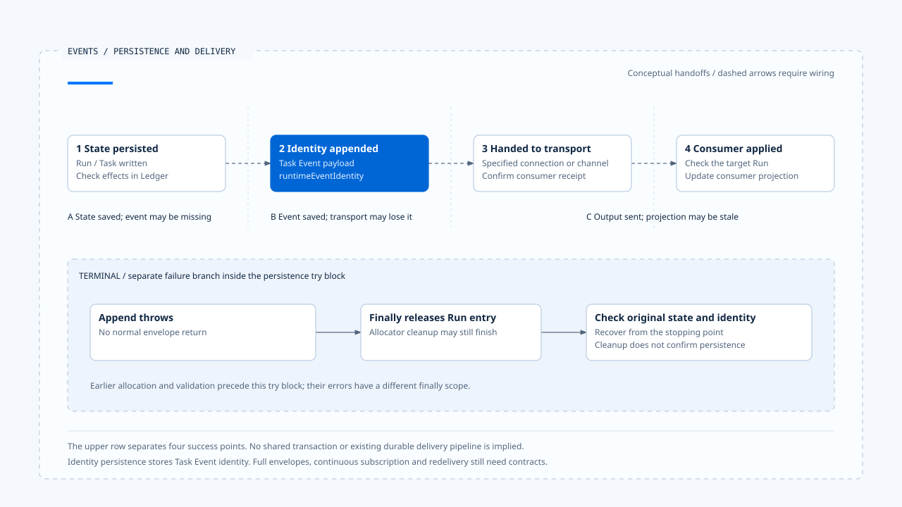
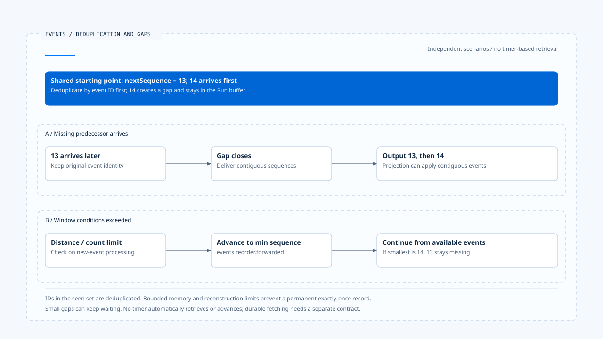

# 事件保存与结果交付

[English](./02-event-persistence-and-delivery.md) | [繁體中文](./02-event-persistence-and-delivery-zh-TW.md) | [简体中文](./02-event-persistence-and-delivery-zh-CN.md)

> 以下内容所提到的
> CCB 为 [claude-code-best](https://github.com/claude-code-best/claude-code) 的简称。
> Chat Gun 为 [chat-gun](https://github.com/HsienW/chat-gun)。

[回到导览](./README-zh-CN.md) · 前一篇：[Runtime 事件与顺序](./01-runtime-events-and-ordering-zh-CN.md) · 下一篇：[追踪、审计与数据边界](./03-tracing-audit-and-data-boundaries-zh-CN.md)

> Task 已完成，Terminal identity 也写进数据库，但连接在前端接收前中断。重新加载画面后，consumer 只有较早的状态；用户按下重试，反而触发第二次业务操作。

**保存事件、交付事件与套用结果需要分别确认。**

每一层的成功都有确认范围。后续出现缺口时，应先查回既有状态与结果，再决定如何补送；是否重做原工作，仍需依执行与效果证据判断。

## 四个成功位置

| 位置 | 能确认什么 | 仍不能确认什么 |
|---|---|---|
| 权威状态保存 | 指定 Run／Task 状态已写入。 | 相应事件已保存或送达。 |
| Event append | 事件记录进入指定 repository。 | 传输端与所有 consumer 都收到。 |
| 传输输出 | 数据交给指定通道。 | 画面已依正确 Run 套用。 |
| Consumer 套用 | 该 consumer 的投影已更新。 | 外部业务效果因此成立或需要重做。 |

这些位置可以设计更强的交易与重送契约，但需要实际接线。一次函数返回、HTTP 200 或 socket 尚未关闭，都不能单独覆盖整条路径。

## `emitEnvelope()` 的保存政策

Chat Gun 在功能未启用时直接返回 legacy event。启用后，`emitEnvelope()` 取得 event ID、配置 sequence、解析 payload，再验证 envelope。

默认政策对 run.terminal 要求 identity persistence，其他类型则为 none；caller 仍可明确提供政策。

### Required 保存的前提

Required 路径需要 Event Repository，以及明确提供或能由 legacy 数据转出的 Task Event。

必要数据缺失或 append 失败时，函数抛错，不会正常返回该 envelope。它保存的是带有 `runtimeEventIdentity` 的 Task Event payload；不能由这个动作推论整份新版 envelope 已成为可直接订阅的持久事件流。

## Terminal 清理与保存窗口

在保存与返回的 try／finally 区段，Terminal 会释放 allocator 的 Run 条目。Append 失败也可能走到这个 release，不能以条目已清理推论最后事件已交付。

另有较早的配置与验证步骤位于该 try 之前，它们抛错时不能套用相同 finally 说明。恢复需依真正停止位置，读回已保存 identity 及最大 sequence，再决定如何补接。

若 Terminal 状态写入和事件 append 分属两个调用，可能形成「状态已完成、事件未存」的窗口。本篇不假设它们已与外部提交共用 transaction；前区的 Ledger 和生命周期记录仍是各领域的权威来源。

[开启 HTML 图解](../../assets/agent-runtime/events-and-operations/02-event-persistence-and-delivery/02-state-event-and-delivery-windows-en.html)

上排分开呈现四个成功位置，下排另列保存 try 范围内的 append 失败分支。即使 allocator 已释放，仍要查回状态与原事件身份；四个位置之间的虚线交接需要具体契约支持。

## Repository 的 stream 做了什么

`PgEventRepository.append()` 直接 INSERT Task Event。Migration 将 event_id 定义为 primary key，append 没有用 ON CONFLICT 把重复写入改成成功，因此重送保存要有自己的冲突处理。

`findByTaskId()` 依 created_at、event_id 排序。这是 repository 的查询顺序，不能直接改述为原 Run sequence。

`streamByTaskId()` 的核心是列举一次查询结果。它不等待下一笔事件，没有提供持续订阅或重连 cursor。要建立 durable delivery，需要明确设计 producer、传输、补送来源与 consumer 的确认范围。

## Frontend 的有界去重与重排

Chat Gun `BoundedRuntimeEventBuffer` 先依 event ID 去重，再依 Run 的 nextSequence 处理过旧或同序号事件。可连续输出的事件才往下交付；遇到缺口会先放在 buffer。

当序号距离或 buffer 数量超过 window 条件，程序会向前移到目前可用的最小序号，并记录 `events.reorder.forwarded`。它让投影能继续前进，没有把遗失事件补回。

[开启 HTML 图解](../../assets/agent-runtime/events-and-operations/02-event-persistence-and-delivery/02-sequence-gap-and-bounded-forwarding-en.html)

两列从相同起点出发，代表独立情境。A 等到 13 后连续输出；B 超过 window 条件后从可用序号继续，13 仍然缺失。持久补取与重连确认位置需要另外设计。

### 容量与重建的限制

Seen ID、Run 状态与 buffer 都有容量条件，且位于内存。画面重新建立或项目被淘汰后，不能把它视为永久的 exactly-once 记录；小于门槛的缺口也可能持续等待，这个类别没有靠时间到期自动向前的保证。

### App 的事件处理顺序

`App.tsx` 的这条路径依序执行：

1. 解析 versioned 事件。
2. 核对目前 authoritative Run。
3. 将事件 push 到 buffer，等待可输出的次序。
4. 将输出的事件转成产品事件。

这确认了一段实际 consumer 接线，但没有证明 Backend 到该入口之间已完成持久补送。

## 展示用时间轴与正式数据来源

`AgentTaskTimeline/useTaskEvents.ts` 在本文参照的版本中，以 mock events 与 timer 推进 reducer。这段程序可展示 Task／Step 如何更新画面，不能当作它已从 Event Repository 持续订阅的证据。

同一项目中，真实事件 consumer、展示数据及类型共用可能并存。查证时要追到实际来源与调用位置，不能从画面组件名称推论它代表整条正式执行流程。

CCB 的 transcript 可用来对照保存与加载的用途；它的消息链也不能直接当成 Chat Gun Task Event 的重送队列。不同 consumer 各有数据契约。

## 重连需要明确契约

若产品要求中断后可接续，至少要说明从哪份持久记录补取、如何辨认最后确认位置、如何保留 event ID，以及版本、顺序缺口与已终止状态如何处理。

Outbox 可以是其中一种设计：将事件交付责任与状态提交建立可恢复关联，再由独立 dispatcher 投递。但未查得一条涵盖所有入口的完整 Outbox 流程，因此将它保留为设计选项，不能写成现成保证。

补送既有结果也需核对可信 scope 与目标 Run。晚到事件能补证据，不能自动让 superseded 或 Terminal 的旧执行重新取得控制权。

## 如何验证事件交付

- 分别让状态保存、事件 append、传输及 consumer 套用失败，核对四层事实。
- 对相同 event ID 重复 INSERT，验证冲突处理与已保存身份的重用。
- 制造小缺口、超过 window 的缺口及重复 sequence，检查等待与向前跳过的差异。
- 重建前端 buffer，再补送旧事件，验证投影与去重责任。
- 中断后查回 Terminal 与原结果，确认修复交付没有重做外部操作。

源代码查读 emit、repository、migration 与 Frontend 接点，未执行数据库、真实断线或 E2E 重连测试。

## 本篇的工程判断

我会先列出交付路径中每层可确认的事实，再设计补送。让画面恢复一致，通常需要重用既有结果；若把所有未收到都当成未执行，事件问题就会变成副作用问题。

## 实现参照与适用范围

- Backend：`runtime/emit-envelope.ts`、`runtime/persistence/event-repository.ts`、`runtime/persistence/migrations/003_create_task_events.sql`，路径相对 `backend/src/`。
- Frontend：`frontend/src/App.tsx`、`lib/runtime-event-envelope.ts` 与 `components/AgentTaskTimeline/useTaskEvents.ts`，后两项相对 `frontend/src/`。
- [来源与文件指纹](./README-zh-CN.md#来源与查证状态)保留适用范围；正式部署的传输与补送仍需沿入口验证。

## 接续阅读

下一篇[追踪、稽核与数据边界](./03-tracing-audit-and-data-boundaries-zh-CN.md)说明事件之外，还能使用哪些诊断数据查明一次执行。
