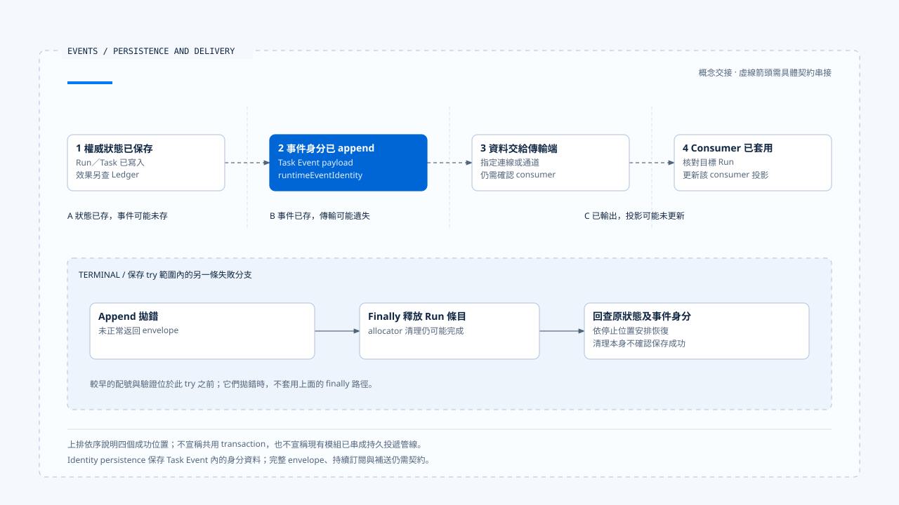
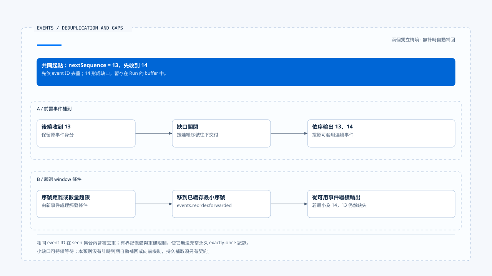

# 事件保存與結果交付

[English](./02-event-persistence-and-delivery.md) | [繁體中文](./02-event-persistence-and-delivery-zh-TW.md)

> 以下內容所提到的
> CCB 為 [claude-code-best](https://github.com/claude-code-best/claude-code) 的簡稱。
> Chat Gun 為 [chat-gun](https://github.com/HsienW/chat-gun)。

[回到導覽](./README-zh-TW.md) · 前一篇：[Runtime 事件與順序](./01-runtime-events-and-ordering-zh-TW.md) · 下一篇：[追蹤、稽核與資料邊界](./03-tracing-audit-and-data-boundaries-zh-TW.md)

> Task 已完成，Terminal identity 也寫進資料庫，但連線在前端接收前中斷。重新載入畫面後，consumer 只有較早的狀態；使用者按下重試，反而觸發第二次業務操作。

**保存事件、交付事件與套用結果需要分別確認。**

每一層的成功都有確認範圍。後續出現缺口時，應先查回既有狀態與結果，再決定如何補送；是否重做原工作，仍需依執行與效果證據判斷。

## 四個成功位置

| 位置 | 能確認什麼 | 仍不能確認什麼 |
|---|---|---|
| 權威狀態保存 | 指定 Run／Task 狀態已寫入。 | 相應事件已保存或送達。 |
| Event append | 事件紀錄進入指定 repository。 | 傳輸端與所有 consumer 都收到。 |
| 傳輸輸出 | 資料交給指定通道。 | 畫面已依正確 Run 套用。 |
| Consumer 套用 | 該 consumer 的投影已更新。 | 外部業務效果因此成立或需要重做。 |

這些位置可以設計更強的交易與重送契約，但需要實際接線。一次函式返回、HTTP 200 或 socket 尚未關閉，都不能單獨覆蓋整條路徑。

## `emitEnvelope()` 的保存政策

Chat Gun 在功能未啟用時直接返回 legacy event。啟用後，`emitEnvelope()` 取得 event ID、配置 sequence、解析 payload，再驗證 envelope。

預設政策對 run.terminal 要求 identity persistence，其他型別則為 none；caller 仍可明確提供政策。

### Required 保存的前提

Required 路徑需要 Event Repository，以及明確提供或能由 legacy 資料轉出的 Task Event。

必要資料缺失或 append 失敗時，函式拋錯，不會正常返回該 envelope。它保存的是帶有 `runtimeEventIdentity` 的 Task Event payload；不能由這個動作推論整份新版 envelope 已成為可直接訂閱的持久事件流。

## Terminal 清理與保存窗口

在保存與回傳的 try／finally 區段，Terminal 會釋放 allocator 的 Run 條目。Append 失敗也可能走到這個 release，不能以條目已清理推論最後事件已交付。

另有較早的配置與驗證步驟位於該 try 之前，它們拋錯時不能套用相同 finally 說明。恢復需依真正停止位置，讀回已保存 identity 及最大 sequence，再決定如何補接。

若 Terminal 狀態寫入和事件 append 分屬兩個呼叫，可能形成「狀態已完成、事件未存」的窗口。本篇不假設它們已與外部提交共用 transaction；前區的 Ledger 和生命週期紀錄仍是各領域的權威來源。

[開啟 HTML 圖解](../../assets/agent-runtime/events-and-operations/02-event-persistence-and-delivery/02-state-event-and-delivery-windows.html)

上排分開呈現四個成功位置，下排另列保存 try 範圍內的 append 失敗分支。即使 allocator 已釋放，仍要查回狀態與原事件身分；四個位置之間的虛線交接需要具體契約支持。

## Repository 的 stream 做了什麼

`PgEventRepository.append()` 直接 INSERT Task Event。Migration 將 event_id 定義為 primary key，append 沒有用 ON CONFLICT 把重複寫入改成成功，因此重送保存要有自己的衝突處理。

`findByTaskId()` 依 created_at、event_id 排序。這是 repository 的查詢順序，不能直接改述為原 Run sequence。

`streamByTaskId()` 的核心是列舉一次查詢結果。它不等待下一筆事件，沒有提供持續訂閱或重連 cursor。要建立 durable delivery，需要明確設計 producer、傳輸、補送來源與 consumer 的確認範圍。

## Frontend 的有界去重與重排

Chat Gun `BoundedRuntimeEventBuffer` 先依 event ID 去重，再依 Run 的 nextSequence 處理過舊或同序號事件。可連續輸出的事件才往下交付；遇到缺口會先放在 buffer。

當序號距離或 buffer 數量超過 window 條件，程式會向前移到目前可用的最小序號，並記錄 `events.reorder.forwarded`。它讓投影能繼續前進，沒有把遺失事件補回。

[開啟 HTML 圖解](../../assets/agent-runtime/events-and-operations/02-event-persistence-and-delivery/02-sequence-gap-and-bounded-forwarding.html)

兩列從相同起點出發，代表獨立情境。A 等到 13 後連續輸出；B 超過 window 條件後從可用序號繼續，13 仍然缺失。持久補取與重連確認位置需要另外設計。

### 容量與重建的限制

Seen ID、Run 狀態與 buffer 都有容量條件，且位於記憶體。畫面重新建立或項目被淘汰後，不能把它視為永久的 exactly-once 紀錄；小於門檻的缺口也可能持續等待，這個類別沒有靠時間到期自動向前的保證。

### App 的事件處理順序

`App.tsx` 的這條路徑依序執行：

1. 解析 versioned 事件。
2. 核對目前 authoritative Run。
3. 將事件 push 到 buffer，等待可輸出的次序。
4. 將輸出的事件轉成產品事件。

這確認了一段實際 consumer 接線，但沒有證明 Backend 到該入口之間已完成持久補送。

## 展示用時間軸與正式資料來源

`AgentTaskTimeline/useTaskEvents.ts` 在本文參照的版本中，以 mock events 與 timer 推進 reducer。這段程式可展示 Task／Step 如何更新畫面，不能當作它已從 Event Repository 持續訂閱的證據。

同一專案中，真實事件 consumer、展示資料及型別共用可能並存。查證時要追到實際來源與呼叫位置，不能從畫面元件名稱推論它代表整條正式執行流程。

CCB 的 transcript 可用來對照保存與載入的用途；它的訊息鏈也不能直接當成 Chat Gun Task Event 的重送佇列。不同 consumer 各有資料契約。

## 重連需要明確契約

若產品要求中斷後可接續，至少要說明從哪份持久紀錄補取、如何辨認最後確認位置、如何保留 event ID，以及版本、順序缺口與已終止狀態如何處理。

Outbox 可以是其中一種設計：將事件交付責任與狀態提交建立可恢復關聯，再由獨立 dispatcher 投遞。但本輪沒有查得一條涵蓋所有入口的完整 Outbox 流程，因此將它保留為設計選項，不能寫成現成保證。

補送既有結果也需核對可信 scope 與目標 Run。晚到事件能補證據，不能自動讓 superseded 或 Terminal 的舊執行重新取得控制權。

## 如何驗證事件交付

- 分別讓狀態保存、事件 append、傳輸及 consumer 套用失敗，核對四層事實。
- 對相同 event ID 重複 INSERT，驗證衝突處理與已保存身分的重用。
- 製造小缺口、超過 window 的缺口及重複 sequence，檢查等待與向前跳過的差異。
- 重建前端 buffer，再補送舊事件，驗證投影與去重責任。
- 中斷後查回 Terminal 與原結果，確認修復交付沒有重做外部操作。

本輪查讀 emit、repository、migration 與 Frontend 接點，未執行資料庫、真實斷線或 E2E 重連測試。

## 本篇的工程判斷

我會先列出交付路徑中每層可確認的事實，再設計補送。讓畫面恢復一致，通常需要重用既有結果；若把所有未收到都當成未執行，事件問題就會變成副作用問題。

## 實作參照與適用範圍

- Backend：`runtime/emit-envelope.ts`、`runtime/persistence/event-repository.ts`、`runtime/persistence/migrations/003_create_task_events.sql`，路徑相對 `backend/src/`。
- Frontend：`frontend/src/App.tsx`、`lib/runtime-event-envelope.ts` 與 `components/AgentTaskTimeline/useTaskEvents.ts`，後兩項相對 `frontend/src/`。
- [來源與檔案指紋](./README-zh-TW.md#來源與查證狀態)保留本輪查讀範圍；正式部署的傳輸與補送仍需沿入口驗證。

## 接續閱讀

下一篇[追蹤、稽核與資料邊界](./03-tracing-audit-and-data-boundaries-zh-TW.md)說明事件之外，還能使用哪些診斷資料查明一次執行。
