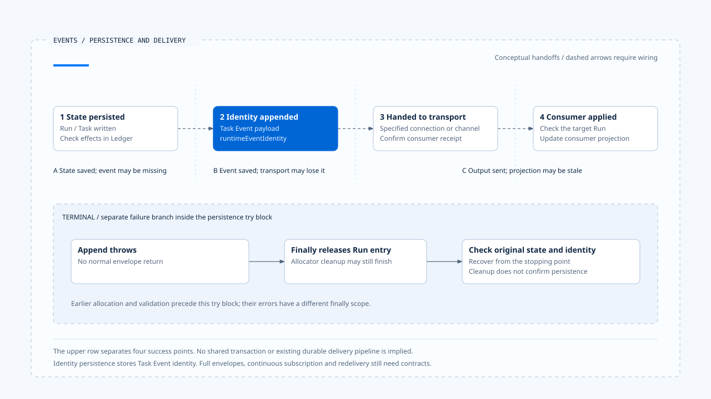
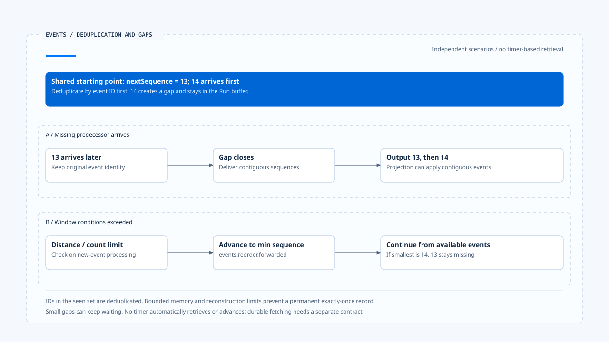

# Event persistence and result delivery

[English](./02-event-persistence-and-delivery.md) | [繁體中文](./02-event-persistence-and-delivery-zh-TW.md) | [简体中文](./02-event-persistence-and-delivery-zh-CN.md)

> In the following content:
> CCB is short for [claude-code-best](https://github.com/claude-code-best/claude-code).
> Chat Gun refers to [chat-gun](https://github.com/HsienW/chat-gun).

[Back to the guide](./README-zh-TW.md) · Previous: [Runtime events and ordering](./01-runtime-events-and-ordering.md) · Next: [Tracing, audit, and data boundaries](./03-tracing-audit-and-data-boundaries.md)

> A Task has completed and its Terminal identity is in the database, but the connection breaks before the frontend receives it. After reloading, the consumer has only an earlier state. The user clicks retry and triggers a second business operation.

**Event persistence, event delivery, and result application each need confirmation.**

Success at each layer has a defined scope. When a later gap appears, retrieve the existing state and result before deciding how to redeliver. Repeating the original work still requires execution and effect evidence.

## Four points of success

| Point | What it confirms | What remains unconfirmed |
|---|---|---|
| Authoritative state persistence | The specified Run/Task state has been written. | The corresponding event has been persisted or delivered. |
| Event append | The event record has entered the specified repository. | The transport and all consumers have received it. |
| Transport output | Data has been handed to the specified channel. | The screen has applied it to the correct Run. |
| Consumer application | That consumer's projection has been updated. | An external business effect has occurred or needs repeating. |

Stronger transaction and redelivery contracts can connect these points, but require actual wiring. A function return, HTTP 200, or an open socket alone cannot confirm the entire path.

## The persistence policy of `emitEnvelope()`

When the feature is disabled, Chat Gun returns the legacy event. When enabled, `emitEnvelope()` obtains an event ID, allocates a sequence, parses the payload, and validates the envelope.

The default policy requires identity persistence for run.terminal and uses none for other types; the caller can still supply an explicit policy.

### Prerequisites for required persistence

The required path needs an Event Repository and a Task Event supplied explicitly or convertible from legacy data.

Missing required data or a failed append causes the function to throw instead of returning the envelope normally. It persists a Task Event payload containing `runtimeEventIdentity`. That operation alone does not establish a durable, subscribable stream of complete new envelopes.

## Terminal cleanup and persistence windows

Within the persistence-and-return try/finally block, Terminal processing releases the allocator's Run entry. An append failure can also reach that release. Entry cleanup therefore does not confirm delivery of the final event.

Earlier allocation and validation steps sit before this try block. Errors there have a different finally scope. Recovery must follow the actual stopping point, retrieve the persisted identity and maximum sequence, and determine how to reconnect the remaining steps.

Separate calls for Terminal state persistence and event append can leave a window where state is complete but the event is missing. This article assumes no shared transaction with the external commit. The Ledger and lifecycle records from the preceding sections remain authoritative for their respective domains.

[Open the HTML diagram](../../assets/agent-runtime/events-and-operations/02-event-persistence-and-delivery/02-state-event-and-delivery-windows-en.html)

The upper row separates four success points. The lower row shows an append failure within the persistence try block. Even after allocator release, state and original event identity need checking; the dashed handoffs between the four points require concrete contracts.

## What does the repository stream do?

`PgEventRepository.append()` directly INSERTs a Task Event. The migration defines event_id as a primary key, and append does not use ON CONFLICT to turn duplicate writes into success. Persisting redeliveries therefore needs its own conflict handling.

`findByTaskId()` sorts by created_at and event_id. This is repository query order and must be distinguished from the original Run sequence.

`streamByTaskId()` enumerates one query result. It neither waits for the next event nor provides a continuous subscription or reconnect cursor. Durable delivery needs explicit producer, transport, replay-source, and consumer acknowledgment contracts.

## Bounded frontend deduplication and reordering

Chat Gun's `BoundedRuntimeEventBuffer` first deduplicates by event ID, then handles stale or same-sequence events using the Run's nextSequence. It delivers contiguous events downstream and holds events in the buffer when a gap appears.

When the sequence distance or buffered count exceeds the window conditions, the code advances to the smallest currently available sequence and records `events.reorder.forwarded`. This allows the projection to progress while the missing event remains missing.

[Open the HTML diagram](../../assets/agent-runtime/events-and-operations/02-event-persistence-and-delivery/02-sequence-gap-and-bounded-forwarding-en.html)

The two rows share a starting point but represent independent scenarios. A outputs contiguous events after 13 arrives. B exceeds a window condition and proceeds from an available sequence, leaving 13 missing. Durable fetching and reconnect acknowledgment positions require separate design.

### Capacity and reconstruction limits

Seen IDs, Run state, and the buffer all have capacity limits and reside in memory. View reconstruction or eviction prevents them from serving as a permanent exactly-once record. Gaps below the threshold can continue waiting; this class provides no guarantee of automatic advancement after a timeout.

### Event processing order in App

This path in `App.tsx` runs these steps in order:

1. Parse the versioned event.
2. Check the current authoritative Run.
3. Push the event into the buffer to wait for an output-ready sequence.
4. Convert emitted events into product events.

This confirms one section of actual consumer wiring. Durable redelivery from the backend to that entry point still needs verification.

## Demo timelines and production data sources

In the version referenced here, `AgentTaskTimeline/useTaskEvents.ts` advances a reducer with mock events and a timer. It demonstrates Task/Step screen updates; continuous subscription from the Event Repository requires separate evidence.

A project can contain real event consumers, demo data, and shared types together. Investigation must follow actual sources and call sites. A UI component name cannot establish that it represents the complete production execution flow.

CCB's transcript provides a comparison for persistence and loading. Its message chain cannot be treated as a redelivery queue for Chat Gun Task Events. Each consumer has its own data contract.

## Reconnection needs an explicit contract

If a product must resume after disconnection, specify at least the durable replay source, how the last acknowledged position is identified, how event IDs are retained, and how versions, sequence gaps, and terminal states are handled.

An Outbox is one design option: establish a recoverable relationship between state commit and event delivery responsibility, then use an independent dispatcher for delivery. The review found no complete Outbox flow covering all entry points, so it remains a design option with implementation and verification work outstanding.

Redelivering an existing result also requires checking trusted scope and the target Run. Late events can add evidence without automatically restoring control to a superseded or Terminal execution.

## How to validate event delivery

- Fail state persistence, event append, transport, and consumer application separately, checking facts at all four layers.
- INSERT the same event ID twice to validate conflict handling and reuse of persisted identity.
- Create small gaps, gaps beyond the window, and duplicate sequences to compare waiting with forward skipping.
- Rebuild the frontend buffer and redeliver old events to validate projection and deduplication responsibilities.
- Retrieve Terminal state and the original result after interruption, checking that delivery repair does not repeat the external operation.

This review covered emit, repository, migration, and frontend integration points. It did not run database, real disconnection, or E2E reconnect tests.

## Engineering judgment

I would list the facts each layer of the delivery path can confirm before designing redelivery. Restoring a consistent screen usually requires reusing an existing result. Treating every missing delivery as unexecuted work can turn an event problem into a side-effect problem.

## Implementation references and scope

- Backend: `runtime/emit-envelope.ts`, `runtime/persistence/event-repository.ts`, and `runtime/persistence/migrations/003_create_task_events.sql`, relative to `backend/src/`.
- Frontend: `frontend/src/App.tsx`, `lib/runtime-event-envelope.ts`, and `components/AgentTaskTimeline/useTaskEvents.ts`; the latter two are relative to `frontend/src/`.
- [Sources and file fingerprints](./README-zh-TW.md#來源與查證狀態) retain the review scope. Production transport and redelivery still need validation along their entry points.

## Further reading

Next, [Tracing, audit, and data boundaries](./03-tracing-audit-and-data-boundaries.md) examines the diagnostic data available alongside events when investigating an execution.
