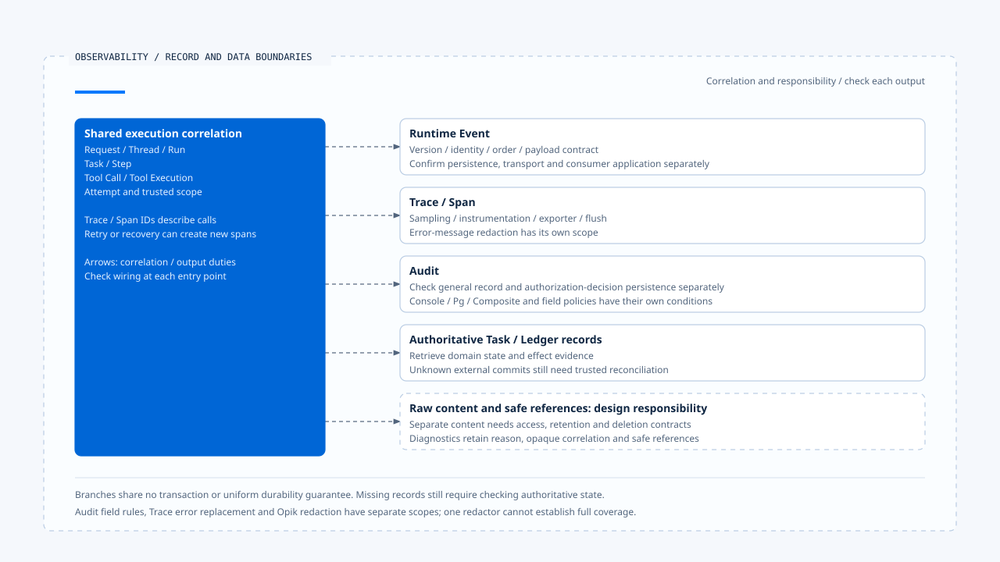

# 追踪、审计与数据边界

[English](./03-tracing-audit-and-data-boundaries.md) | [繁體中文](./03-tracing-audit-and-data-boundaries-zh-TW.md) | [简体中文](./03-tracing-audit-and-data-boundaries-zh-CN.md)

> 以下内容所提到的
> CCB 为 [claude-code-best](https://github.com/claude-code-best/claude-code) 的简称。
> Chat Gun 为 [chat-gun](https://github.com/HsienW/chat-gun)。

[回到导览](./README-zh-CN.md) · 前一篇：[事件保存与结果交付](./02-event-persistence-and-delivery-zh-CN.md) · 下一篇：[指标、成本与健康判读](./04-metrics-cost-and-runtime-health-zh-CN.md)

> 事故查询找不到工具 span，Log 却打印执行成功。另一份 Audit 方法也正常返回，但实际数据库写入曾失败。若运维者将这些返回值当成完整执行历史，就可能误判工具没有执行，或认为批准证据一定已保存。

**Trace、Audit 与执行记录各有保存目的与失败语义。**

查证时需要先辨认每份数据的来源，再核对它确认了哪一步；某份记录缺失或方法正常返回，都有各自的解读范围。

## 各类数据回答什么

| 数据 | 适合回答 | 需要另外查证 |
|---|---|---|
| Runtime Event | Consumer 收到哪项执行事实与状态变化？ | 是否完成权威写入与交付。 |
| Trace／Span | 已观察调用的父子关系、耗时及错误位置。 | 未取样或未导出的操作是否发生。 |
| Audit | 谁对什么资源作了哪个决策或行动？ | 记录是否确实持久化、访问是否受控。 |
| Task／Ledger | 指定工作与效果保存了什么权威状态？ | 外部回应遗失后的提交真相。 |

同一次 Tool Attempt 可以同时出现在这些数据中，但各层的成功时间未必相同。故障查证需要保留它们的原始关联及来源，不能只按显示文字拼成一份确定历史。

## 执行身份与 Trace 关联

Request、Thread、Run、Task、Step、Tool Call 与 Tool Execution 可以帮助找到业务执行；Trace／Span ID 则描述诊断调用。跨进程、重试及恢复可能形成不同 span，原业务效果仍需沿稳定身份追查。

Chat Gun `SpanManager` 可从 parent context 继承 attributes，再套用本次 attributes。`withSpan()` 建立 active context，在其中执行 operation；operation 抛错时记录例外并重新抛出，finally 结束 span。

这条程序路径能说明包覆范围，实际哪些入口使用它仍需续追。Attribute 有字段不代表值可信，也不代表每个 span 都已带齐执行身份；需要从 canonical Context 到 instrumentation 核对。

## 初始化、取样与缺少 span

Chat Gun `otel-setup.ts` 依 enabled、endpoint、protocol 与 sample rate 建立 provider。Exporter 可使用 OTLP HTTP、gRPC 或 Console，并透过 BatchSpanProcessor 处理输出。

Production 未指定 endpoint 时，初始化区段会抛错，但该例外被捕捉后可返回 disabled 结果。这条实现路径会留下告警并停用 tracing；程序是否继续启动，还要核对 caller 的处理。

| 查证现象 | 可能原因 | 不能直接推论 |
|---|---|---|
| 没有 span | 未启用、未取样、未经 instrumentation 或尚未导出。 | 操作没有执行。 |
| 有父 span、没有子 span | Context 未传递、子操作未包覆或输出缺失。 | 子操作一定被拒绝。 |
| Span 已结束 | 本地 end 被调用。 | Exporter 已持久保存。 |
| 有 error span | 包覆区段观察到错误。 | 外部效果未提交。 |

`shutdownTracing()` 尝试 forceFlush 与 shutdown，仍要核对程序退出路径是否调用，以及 exporter 能否送达。单一 span API 返回不能取代后端接收验证。

## Audit backend 的实际返回语义

`observability.ts` 可选 Console、Pg 或 Composite。默认可使用 Console；选择 Pg／Composite 但没有 Pool 时，会告警并退回 Console。因此部署宣告某个 backend，不代表每笔 Audit 都进入 PostgreSQL。

Composite 逐 backend 调用并捕捉错误，会让其他 backend 继续工作。`PgAuditLogger.record()` 也在自己的 try／catch 中处理保存错误并输出诊断，正常返回不表示数据库一定新增了记录。

当某项决策必须先持久化才能派送时，应使用有明确失败契约的权威保存接点。一般诊断 Audit 方法的尽力保存，不能自动充当这个关卡。

## 一般活动与授权决策

Pg Logger 的一般 `record()` 可从 event name／payload 推导 resource，使用 system actor 与 neutral decision。这适合记录一般活动，没有自动证明用户批准了操作。

`recordAuthorizationDecision()` 是另一个方法，会核对 Execution Context 与 request 的身份、scope 关系，记录决策、理由及指定资源；查读方法也对 principal 产生哈希表示。它的保存例外路径与一般 record 不同，不能因共用同一类别就套用相同成功保证。

这些字段仍需对回授权来源及正式 observer 接线。哈希 principal 有助于降低直接识别数据外露；数据是否仍可关联、能否窜改，以及如何从各存储删除，需要另外设计及验证。

## 脱敏规则有适用边界

Audit redaction 会依 blocked fields 省略数据，部分允许字段保留原值，未分类字符串则有截断限制。这是字段及长度政策，没有辨认任意短字符串中所有秘密或个人信息。

### Error message 与其他输出

Trace 的 `sanitizeErrorMessage()` 另有 Bearer 及特定 credential pattern 的替换与长度限制。它处理的是 error message，不能推论任意 span attribute 或所有原始工具内容都经相同规则处理。

Opik redaction 也有自己的 secret、PII、prompt、raw payload 与 correlation 字段处理，以及深度／集合大小限制。各自的规则要沿真正输出接点验证，不能只因项目有 redactor 就宣称全部 exporter 已涵盖。

脱敏后应保留足以查证的 reason、opaque correlation 与安全 reference；原始内容若另存，需要自己的访问与保留期限。这些是数据设计责任，本轮没有执行完整的敏感数据外送或删除验收。

[开启 HTML 图解](../../assets/agent-runtime/events-and-operations/03-tracing-audit-and-data-boundaries/03-records-and-data-output-boundaries-en.html)

各分支表示不同的记录用途及输出责任，保存、脱敏与失败语义需要分别核对。最下列虚线框保留原始内容另存时的设计责任，没有假设现有项目已提供一套通用内容存储及删除流程。

## CCB 的 Session tracing 对照

CCB `sessionTracing.ts` 提供 interaction、LLM request、tool、blocked-on-user、tool execution 与 hook 等 span。它用进程内 context 保存活动关联，另有孤立 span 的清理机制。

实际 tracing 由 enhanced／beta 等条件决定；Perfetto 有自己的路径，不能只由 OTel 未启用就推论所有诊断都关闭。Instrumentation、exporter 设置及内容策略仍需按部署核对。

`ClaudeCodeDiagLogger` 会把部分 OTel 诊断转入既有 error／debug Log，其他层级可不输出。这是诊断消息处理，不能将它当成每个用户行动都已持久审计的证据。

## 如何验证诊断与数据边界

- 关闭 tracing、降低取样或让 exporter 不可用，确认主流程与缺失诊断的判读。
- 在异步工具与恢复入口核对 parent context 及 Run／Attempt 关联。
- 分别让 Pg Audit、Composite 的一个 backend 与授权决策保存失败，核对不同返回语义。
- 以字段变形、短字符串秘密、深层对象与错误消息测试各 redactor 的范围。
- 检查原始内容、脱敏诊断与 reference 各自的访问、保留及外送位置。

本轮只查读程序，没有验证真实 Collector、Audit 数据库、exporter 或敏感数据删除流程。

## 本篇的工程判断

我会先说清楚哪份记录必须保存、失败是否阻止操作，再配置尽力而为的诊断。这能让系统在 tracing 降级时维持明确行为，也让事故查询知道缺少的是观察数据，还是必要的执行证据。

## 实现参照与适用范围

- Chat Gun：`platform/observability.ts`、`platform/tracing/otel-setup.ts`、`span-manager.ts`、`opik/opik-redaction.ts`、`runtime/audit/pg-audit-logger.ts` 与 `redaction.ts`，路径依各目录相对 `backend/src/`。
- CCB：`src/utils/telemetry/sessionTracing.ts`、`src/utils/telemetry/logger.ts`。
- [来源与文件指纹](./README-zh-CN.md#来源与查证状态)保留各实现；本文未宣称所有诊断具备相同持久性或数据治理保证。

## 接续阅读

下一篇[指标、成本与健康判读](./04-metrics-cost-and-runtime-health-zh-CN.md)从单次查证转向保留窗口与部署信号的判读。
