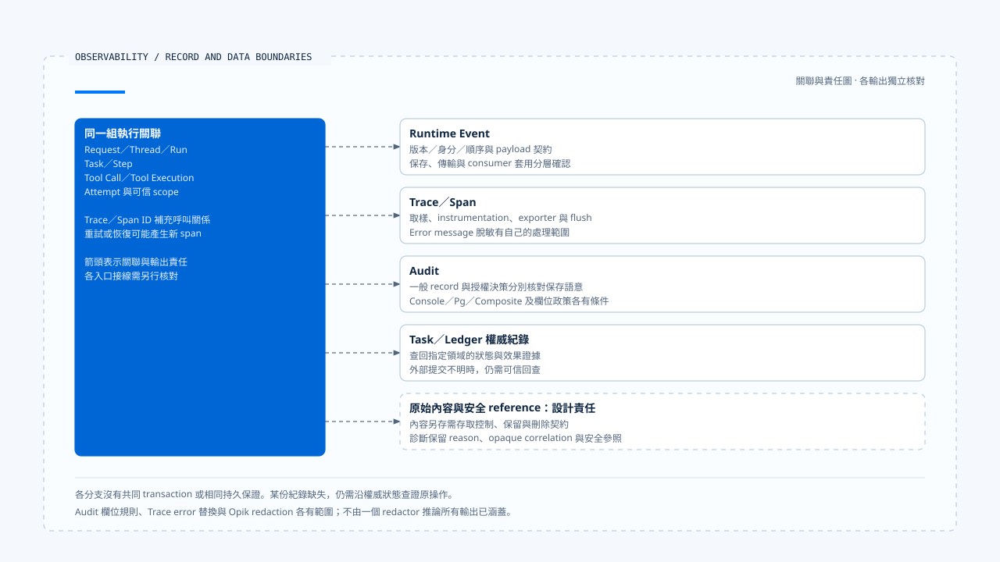

# 追蹤、稽核與資料邊界

[English](./03-tracing-audit-and-data-boundaries.md) | [繁體中文](./03-tracing-audit-and-data-boundaries-zh-TW.md) | [简体中文](./03-tracing-audit-and-data-boundaries-zh-CN.md)

> 以下內容所提到的
> CCB 為 [claude-code-best](https://github.com/claude-code-best/claude-code) 的簡稱。
> Chat Gun 為 [chat-gun](https://github.com/HsienW/chat-gun)。

[回到導覽](./README-zh-TW.md) · 前一篇：[事件保存與結果交付](./02-event-persistence-and-delivery-zh-TW.md) · 下一篇：[指標、成本與健康判讀](./04-metrics-cost-and-runtime-health-zh-TW.md)

> 事故查詢找不到工具 span，Log 卻印出執行成功。另一份 Audit 方法也正常返回，但實際資料庫寫入曾失敗。若維運者將這些回傳值當成完整執行歷史，就可能誤判工具沒有執行，或認為批准證據一定已保存。

**Trace、Audit 與執行紀錄各有保存目的與失敗語意。**

查證時需要先辨認每份資料的來源，再核對它確認了哪一步；某份紀錄缺失或方法正常返回，都有各自的解讀範圍。

## 各類資料回答什麼

| 資料 | 適合回答 | 需要另外查證 |
|---|---|---|
| Runtime Event | Consumer 收到哪項執行事實與狀態變化？ | 是否完成權威寫入與交付。 |
| Trace／Span | 已觀察呼叫的父子關係、耗時及錯誤位置。 | 未取樣或未匯出的操作是否發生。 |
| Audit | 誰對什麼資源作了哪個決策或行動？ | 紀錄是否確實持久化、存取是否受控。 |
| Task／Ledger | 指定工作與效果保存了什麼權威狀態？ | 外部回應遺失後的提交真相。 |

同一次 Tool Attempt 可以同時出現在這些資料中，但各層的成功時間未必相同。故障查證需要保留它們的原始關聯及來源，不能只按顯示文字拼成一份確定歷史。

## 執行身分與 Trace 關聯

Request、Thread、Run、Task、Step、Tool Call 與 Tool Execution 可以幫助找到業務執行；Trace／Span ID 則描述診斷呼叫。跨程序、重試及恢復可能形成不同 span，原業務效果仍需沿穩定身分追查。

Chat Gun `SpanManager` 可從 parent context 繼承 attributes，再套用本次 attributes。`withSpan()` 建立 active context，在其中執行 operation；operation 拋錯時記錄例外並重新拋出，finally 結束 span。

這條程式路徑能說明包覆範圍，實際哪些入口使用它仍需續追。Attribute 有欄位不代表值可信，也不代表每個 span 都已帶齊執行身分；需要從 canonical Context 到 instrumentation 核對。

## 初始化、取樣與缺少 span

Chat Gun `otel-setup.ts` 依 enabled、endpoint、protocol 與 sample rate 建立 provider。Exporter 可使用 OTLP HTTP、gRPC 或 Console，並透過 BatchSpanProcessor 處理輸出。

Production 未指定 endpoint 時，初始化區段會拋錯，但該例外被捕捉後可返回 disabled 結果。這條實作路徑會留下告警並停用 tracing；程序是否繼續啟動，還要核對 caller 的處理。

| 查證現象 | 可能原因 | 不能直接推論 |
|---|---|---|
| 沒有 span | 未啟用、未取樣、未經 instrumentation 或尚未匯出。 | 操作沒有執行。 |
| 有父 span、沒有子 span | Context 未傳遞、子操作未包覆或輸出缺失。 | 子操作一定被拒絕。 |
| Span 已結束 | 本地 end 被呼叫。 | Exporter 已持久保存。 |
| 有 error span | 包覆區段觀察到錯誤。 | 外部效果未提交。 |

`shutdownTracing()` 嘗試 forceFlush 與 shutdown，仍要核對程序退出路徑是否呼叫，以及 exporter 能否送達。單一 span API 返回不能取代後端接收驗證。

## Audit backend 的實際回傳語意

`observability.ts` 可選 Console、Pg 或 Composite。預設可使用 Console；選擇 Pg／Composite 但沒有 Pool 時，會告警並退回 Console。因此部署宣告某個 backend，不代表每筆 Audit 都進入 PostgreSQL。

Composite 逐 backend 呼叫並捕捉錯誤，會讓其他 backend 繼續工作。`PgAuditLogger.record()` 也在自己的 try／catch 中處理保存錯誤並輸出診斷，正常返回不表示資料庫一定新增了紀錄。

當某項決策必須先持久化才能派送時，應使用有明確失敗契約的權威保存接點。一般診斷 Audit 方法的盡力保存，不能自動充當這個關卡。

## 一般活動與授權決策

Pg Logger 的一般 `record()` 可從 event name／payload 推導 resource，使用 system actor 與 neutral decision。這適合記錄一般活動，沒有自動證明使用者批准了操作。

`recordAuthorizationDecision()` 是另一個方法，會核對 Execution Context 與 request 的身分、scope 關係，記錄決策、理由及指定資源；查讀方法也對 principal 產生雜湊表示。它的保存例外路徑與一般 record 不同，不能因共用同一類別就套用相同成功保證。

這些欄位仍需對回授權來源及正式 observer 接線。雜湊 principal 有助於降低直接識別資料外露；資料是否仍可關聯、能否竄改，以及如何從各儲存刪除，需要另外設計及驗證。

## 脫敏規則有適用邊界

Audit redaction 會依 blocked fields 省略資料，部分允許欄位保留原值，未分類字串則有截斷限制。這是欄位及長度政策，沒有辨認任意短字串中所有祕密或個資。

### Error message 與其他輸出

Trace 的 `sanitizeErrorMessage()` 另有 Bearer 及特定 credential pattern 的替換與長度限制。它處理的是 error message，不能推論任意 span attribute 或所有原始工具內容都經相同規則處理。

Opik redaction 也有自己的 secret、PII、prompt、raw payload 與 correlation 欄位處理，以及深度／集合大小限制。各自的規則要沿真正輸出接點驗證，不能只因專案有 redactor 就宣稱全部 exporter 已涵蓋。

脫敏後應保留足以查證的 reason、opaque correlation 與安全 reference；原始內容若另存，需要自己的存取與保留期限。這些是資料設計責任，未執行完整的敏感資料外送或刪除驗收。

[開啟 HTML 圖解](../../assets/agent-runtime/events-and-operations/03-tracing-audit-and-data-boundaries/03-records-and-data-output-boundaries.html)

各分支表示不同的紀錄用途及輸出責任，保存、脫敏與失敗語意需要分別核對。最下列虛線框保留原始內容另存時的設計責任，沒有假設現有專案已提供一套通用內容儲存及刪除流程。

## CCB 的 Session tracing 對照

CCB `sessionTracing.ts` 提供 interaction、LLM request、tool、blocked-on-user、tool execution 與 hook 等 span。它用程序內 context 保存活動關聯，另有孤立 span 的清理機制。

實際 tracing 由 enhanced／beta 等條件決定；Perfetto 有自己的路徑，不能只由 OTel 未啟用就推論所有診斷都關閉。Instrumentation、exporter 設定及內容策略仍需按部署核對。

`ClaudeCodeDiagLogger` 會把部分 OTel 診斷轉入既有 error／debug Log，其他層級可不輸出。這是診斷訊息處理，不能將它當成每個使用者行動都已持久稽核的證據。

## 如何驗證診斷與資料邊界

- 關閉 tracing、降低取樣或讓 exporter 不可用，確認主流程與缺失診斷的判讀。
- 在非同步工具與恢復入口核對 parent context 及 Run／Attempt 關聯。
- 分別讓 Pg Audit、Composite 的一個 backend 與授權決策保存失敗，核對不同回傳語意。
- 以欄位變形、短字串祕密、深層物件與錯誤訊息測試各 redactor 的範圍。
- 檢查原始內容、脫敏診斷與 reference 各自的存取、保留及外送位置。

僅查讀程式，沒有驗證真實 Collector、Audit 資料庫、exporter 或敏感資料刪除流程。

## 本篇的工程判斷

我會先說清楚哪份紀錄必須保存、失敗是否阻止操作，再配置盡力而為的診斷。這能讓系統在 tracing 降級時維持明確行為，也讓事故查詢知道缺少的是觀察資料，還是必要的執行證據。

## 實作參照與適用範圍

- Chat Gun：`platform/observability.ts`、`platform/tracing/otel-setup.ts`、`span-manager.ts`、`opik/opik-redaction.ts`、`runtime/audit/pg-audit-logger.ts` 與 `redaction.ts`，路徑依各目錄相對 `backend/src/`。
- CCB：`src/utils/telemetry/sessionTracing.ts`、`src/utils/telemetry/logger.ts`。
- [來源與檔案指紋](./README-zh-TW.md#來源與查證狀態)保留各實作；本文未宣稱所有診斷具備相同持久性或資料治理保證。

## 接續閱讀

下一篇[指標、成本與健康判讀](./04-metrics-cost-and-runtime-health-zh-TW.md)從單次查證轉向保留窗口與部署訊號的判讀。
