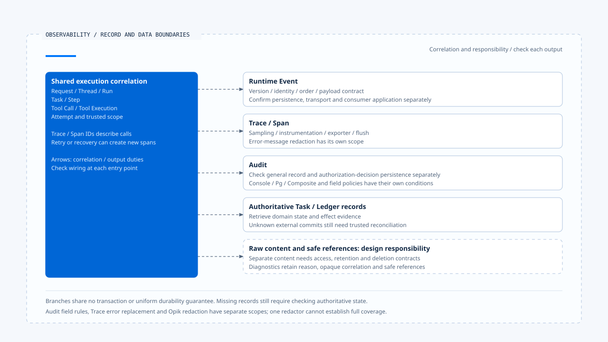

# Tracing, audit, and data boundaries

[English](./03-tracing-audit-and-data-boundaries.md) | [繁體中文](./03-tracing-audit-and-data-boundaries-zh-TW.md)

> In the following content:
> CCB is short for [claude-code-best](https://github.com/claude-code-best/claude-code).
> Chat Gun refers to [chat-gun](https://github.com/HsienW/chat-gun).

[Back to the guide](./README-zh-TW.md) · Previous: [Event persistence and result delivery](./02-event-persistence-and-delivery.md) · Next: [Metrics, cost, and runtime health](./04-metrics-cost-and-runtime-health.md)

> An incident query finds no tool span, yet the log reports successful execution. An Audit method also returned normally even though its database write failed. Treating these returns as a complete execution history can lead an operator to conclude that the tool never ran or that approval evidence must have been persisted.

**Traces, audit data, and execution records have different persistence purposes and failure semantics.**

Investigation starts by identifying each record's source and the step it confirms. A missing record or a normal method return has a specific interpretation scope.

## What each kind of data answers

| Data | Suitable questions | Requires separate investigation |
|---|---|---|
| Runtime Event | Which execution fact or state change did a consumer receive? | Whether authoritative persistence and delivery completed. |
| Trace/Span | Parent-child relationships, duration, and error locations in observed calls. | Whether unsampled or unexported operations occurred. |
| Audit | Who made which decision or took which action on which resource? | Whether records were durably persisted and access is controlled. |
| Task/Ledger | Which authoritative states were persisted for the work and its effects? | The actual commit outcome after an external response is lost. |

The same Tool Attempt can appear in all these records, but success at each layer may occur at different times. Fault investigation needs their original correlations and sources. Display text alone is insufficient to assemble a definitive history.

## Execution identity and trace correlation

Request, Thread, Run, Task, Step, Tool Call, and Tool Execution help locate a business execution; Trace/Span IDs describe diagnostic calls. Cross-process execution, retries, and recovery can create different spans. The original business effect still needs investigation through stable identity.

Chat Gun's `SpanManager` can inherit attributes from a parent context and then apply the current attributes. `withSpan()` creates an active context and runs the operation inside it. If the operation throws, it records the exception and rethrows; finally ends the span.

This code path describes the wrapper's scope. Which entry points use it still needs tracing. An attribute field's existence establishes neither a trusted value nor complete execution identity on every span. Check the path from canonical Context to instrumentation.

## Initialization, sampling, and missing spans

Chat Gun's `otel-setup.ts` creates a provider based on enabled, endpoint, protocol, and sample rate. Exporters can use OTLP HTTP, gRPC, or Console, with BatchSpanProcessor handling output.

In production, a missing endpoint causes an error inside initialization, but catching that exception can yield a disabled result. This path logs a warning and disables tracing. Whether the process continues starting still depends on caller handling.

| Observation | Possible causes | Insufficient grounds to conclude |
|---|---|---|
| No span | Disabled, unsampled, uninstrumented, or not yet exported. | The operation never executed. |
| Parent span exists, child span missing | Context was not propagated, the child was not wrapped, or output is missing. | The child operation was necessarily denied. |
| Span ended | Local end was called. | The exporter durably persisted it. |
| Error span exists | The wrapped section observed an error. | The external effect did not commit. |

`shutdownTracing()` attempts forceFlush and shutdown. Check whether the process exit path calls it and whether the exporter can deliver. A span API return cannot replace verification that the receiving backend accepted the data.

## What an Audit backend return means

`observability.ts` supports Console, Pg, and Composite. Console can be the default. Selecting Pg/Composite without a Pool logs a warning and falls back to Console. A declared backend therefore does not establish that every Audit record enters PostgreSQL.

Composite calls each backend and catches errors so the other backends can continue. `PgAuditLogger.record()` also handles persistence errors and emits diagnostics within its own try/catch. A normal return does not confirm that the database gained a record.

When dispatch requires a decision to be durably persisted first, use an authoritative persistence point with an explicit failure contract. Best-effort diagnostic Audit methods cannot automatically enforce that requirement.

## General activity and authorization decisions

The Pg logger's general `record()` can derive a resource from an event name/payload and use a system actor with a neutral decision. This records general activity without establishing that a user approved the operation.

`recordAuthorizationDecision()` is a separate method. It checks identity and scope relationships between the Execution Context and request, records the decision, reason, and specified resource, and hashes the principal in the reviewed implementation. Its persistence exception path differs from general record. Sharing a class does not imply a shared success guarantee.

These fields still need to be traced to the authorization source and production observer wiring. Hashing the principal helps reduce exposure of directly identifying data. Linkability, tamper resistance, and deletion across stores need separate design and validation.

## Redaction rules have defined scopes

Audit redaction omits data according to blocked fields, retains original values for some allowed fields, and truncates unclassified strings. These field and length policies do not identify every secret or piece of personal data in arbitrary short strings.

### Error messages and other outputs

Trace's `sanitizeErrorMessage()` separately replaces Bearer and specific credential patterns and imposes a length limit. It processes error messages. Its scope does not establish equivalent treatment for arbitrary span attributes or all raw tool content.

Opik redaction has its own handling for secret, PII, prompt, raw payload, and correlation fields, along with depth and collection-size limits. Validate each rule along the actual output path. A redactor's presence in the project cannot establish coverage for every exporter.

Redacted data should retain enough reason, opaque correlation, and safe references for investigation. Separately stored raw content needs its own access controls and retention period. These are data design responsibilities; this review did not perform full acceptance testing for sensitive data export or deletion.

[Open the HTML diagram](../../assets/agent-runtime/events-and-operations/03-tracing-audit-and-data-boundaries/03-records-and-data-output-boundaries-en.html)

The branches represent distinct record purposes and output responsibilities. Persistence, redaction, and failure semantics need separate checks. The bottom dashed box identifies design responsibilities for separately stored raw content; it assumes no existing general-purpose content storage and deletion flow.

## CCB Session tracing as a comparison

CCB's `sessionTracing.ts` provides spans for interaction, LLM request, tool, blocked-on-user, tool execution, and hook activity. It keeps active correlations in an in-process context and includes cleanup for orphan spans.

Actual tracing depends on conditions such as enhanced/beta settings. Perfetto has its own path, so disabled OTel alone does not imply that all diagnostics are off. Instrumentation, exporter settings, and content policies still need deployment-specific checks.

`ClaudeCodeDiagLogger` routes some OTel diagnostics into existing error/debug logs and may omit other levels. This diagnostic message handling provides no evidence that every user action has been durably audited.

## How to validate diagnostics and data boundaries

- Disable tracing, reduce sampling, or make the exporter unavailable, checking main-flow behavior and interpretation of missing diagnostics.
- Check parent context and Run/Attempt correlation at asynchronous tool and recovery entry points.
- Fail Pg Audit, one Composite backend, and authorization-decision persistence separately to check their different return semantics.
- Test each redactor's scope with field variations, secrets in short strings, deep objects, and error messages.
- Check access, retention, and export destinations for raw content, redacted diagnostics, and references separately.

This review inspected code only. It did not validate a real Collector, Audit database, exporter, or sensitive data deletion flow.

## Engineering judgment

I would define which records must be persisted and whether failure blocks an operation before configuring best-effort diagnostics. This gives the system explicit behavior when tracing degrades and lets incident investigation distinguish missing observation data from missing required execution evidence.

## Implementation references and scope

- Chat Gun: `platform/observability.ts`, `platform/tracing/otel-setup.ts`, `span-manager.ts`, `opik/opik-redaction.ts`, `runtime/audit/pg-audit-logger.ts`, and `redaction.ts`, under their respective directories relative to `backend/src/`.
- CCB: `src/utils/telemetry/sessionTracing.ts` and `src/utils/telemetry/logger.ts`.
- [Sources and file fingerprints](./README-zh-TW.md#來源與查證狀態) retain the implementations reviewed. This article claims no uniform persistence or data governance guarantee across all diagnostics.

## Further reading

Next, [Metrics, cost, and runtime health](./04-metrics-cost-and-runtime-health.md) moves from individual investigations to interpreting retention windows and deployment signals.
