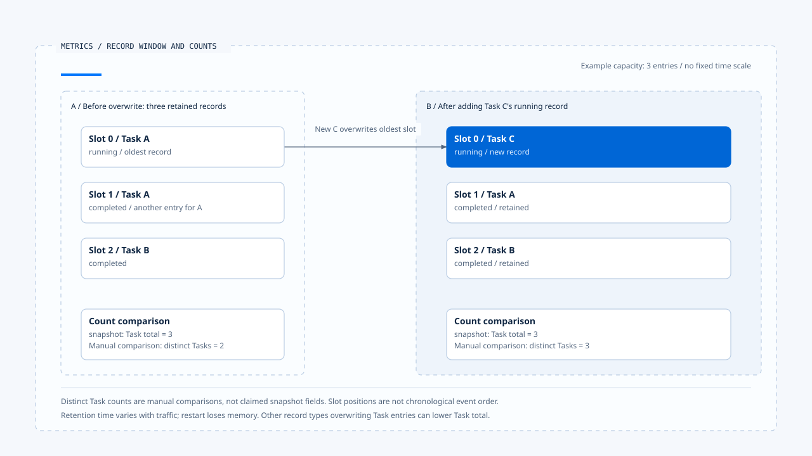
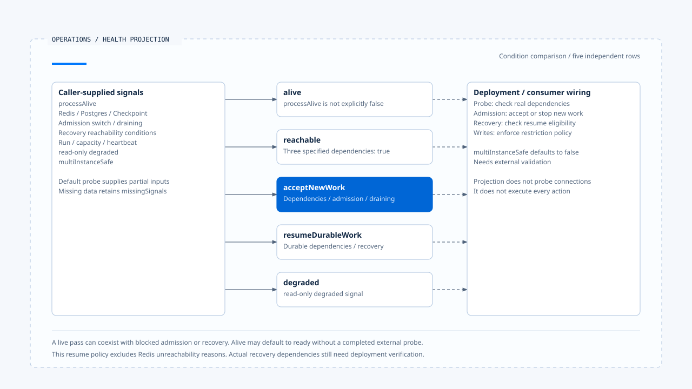

# 指标、成本与健康判读

[English](./04-metrics-cost-and-runtime-health.md) | [繁體中文](./04-metrics-cost-and-runtime-health-zh-TW.md) | [简体中文](./04-metrics-cost-and-runtime-health-zh-CN.md)

> 以下内容所提到的
> CCB 为 [claude-code-best](https://github.com/claude-code-best/claude-code) 的简称。
> Chat Gun 为 [chat-gun](https://github.com/HsienW/chat-gun)。

[回到导览](./README-zh-CN.md) · 前一篇：[追踪、审计与数据边界](./03-tracing-audit-and-data-boundaries-zh-CN.md) · 下一篇：[故障验证与上线门槛](./05-fault-validation-and-release-gates-zh-CN.md)

> Metrics endpoint 返回成功，面板显示延迟为零，服务的 live 检查也通过。但实际原因可能是没有任何耗时记录，而 Checkpointer 根本无法连接。这些信号不足以判断服务能接受新工作或恢复旧 Run。

**指标要交代量测范围，健康要保留缺失信号。**

运维者需要知道数值如何产生、依赖由谁探测，才能决定是否接纳、降级或停止工作。

## 先辨认量测单位

Chat Gun 收集 Task、Step、Tool、Token、Cost 与一般 Event metric，各类数据的意义不同。

| 类别 | 可观察内容 | 要核对的范围 |
|---|---|---|
| Task／Step | 状态、耗时、步骤及尝试。 | 一笔记录是否代表一份工作或一次状态变化。 |
| Tool | success、error、timeout、permission denied 与耗时。 | 一个逻辑调用是否包含多个 Attempt。 |
| Token／Cost | 供应商用量、模型及工具成本。 | 是否完整回报、使用何种估价与币别。 |
| Event | fallback、repair、reconciliation 等指定活动。 | 事件名称与实际 instrumentation 是否一致。 |
| Health signal | 依赖、容量、heartbeat 与执行进度。 | 信号来源、更新时间与缺失状态。 |

数值字段名称不能取代计算公式。正式建立 SLI 前，应先确认分子、分母、窗口与缺失数据，再决定门槛。

## 进程内 ring buffer 的窗口

`InMemoryMetricsCollector` 使用有限容量的 ring buffer。新增记录会覆写旧位置，`snapshot()` 只根据目前保留的 entries 计算；程序重启也不会自动读回完整历史。

这是容量窗口，不等于固定的最近几分钟。高流量时保留的时间较短，低流量时则可能保留更久。若要比较跨时段或跨实例指标，需要另有采样、聚合及保存策略。

Task total 在本文参照的实现中，计算的是 task entries 笔数；各状态也依 entries 计数，并未先按 taskId 合并成最新状态。一次 Task 若回报 running 与 completed，两笔可能同时留在窗口里，因此不能直接把 total 说成独立工作总数。

[开启 HTML 图解](../../assets/agent-runtime/events-and-operations/04-metrics-cost-and-runtime-health/04-ring-buffer-record-window-en.html)

两侧都是容量三笔的示意快照。覆写前 Task A 占两笔记录，覆写后 A、B、C 各占一笔；Task total 都是三，独立 Task 数却不同。独立 Task 数为手动对照，正式 snapshot 是否提供该指标仍要依实现确认。

## 零值、缺失与比例

Snapshot 在没有 Task duration 时，平均耗时可为零，而 p95 字段则只在有 duration 时加入。这让 consumer 必须区分「观测值为零」与「没有可计算数据」。

模型 fallback 比例另会优先依可用 call ID 集合计算，缺少这些集合时才可能退到 event counts；两条路径的分母来源需要保留，不能一律解读成独立用户请求的失败率。

Retry recovery、工具成功与 Task 成功也可能使用不同数据集合。建立告警前要先决定是在量测 Attempt、逻辑工作，还是用户可见失败，避免一次可恢复错误同时被算成多个最终失败。

## Endpoint 与输出格式

`/metrics` 在本文参照的实现中返回 JSON snapshot。Operations HTTP 另外提供 `/operations/metrics`，以 OpenMetrics content type 输出汇整值。

后者使用已保留记录计算名称带 total 的量测，可能随 ring buffer 覆写而变化，不能仅因后缀就当成从程序启动累积、永不下降的 Counter。Scraper 与面板应依实际语义配置。

### 单次查证与汇整维度

Run、Task、Step 等 correlation 适合查单次执行，若不加限制地成为 metric label，则会增加 cardinality。查读的 correlated index 另有允许字段及每 Run 记录上限；这种查证投影也不等于部署的低 cardinality 时序汇整。

## 成本与延迟分开计算

模型调用、Provider fallback、工具排队、人工确认与结果保存，都可能增加用户等待。只量测工具 executor 的耗时，无法回答整个 Run 为何很慢。

Chat Gun 的 Cost tracker 接收模型及工具成本，记录合计；它没有单靠这个调用取得供应商最终账单。实际价格来源、用量回报缺失与重试是否计入，需要逐 instrumentation 核对。

CCB `cost-tracker.ts` 保存 Session 及模型用量，并有含／不含重试的 API duration、cache token 与 unknown model cost 接点。`addToTotalSessionCost()` 累加 caller 提供的 cost 与 usage，仍须沿上游计价与回应解析确认完整性。

若额度控制要求阻止下一个操作，就需要在派送位置消费可信预算；显示成本的 metric 不会自动成为限制器。

## 健康要分层看

`projectRuntimeHealth()` 根据输入建立投影，主要层次如下：

| 层次 | 查读的判断方向 | 解读限制 |
|---|---|---|
| alive | processAlive 未明确为 false 时可为 ready。 | 未提供值不等于已完成外部探测。 |
| reachable | 指定 Redis、Postgres、Checkpoint 信号均为 true。 | 投影函数没有自己连接检查。 |
| acceptNewWork | 依赖条件、接纳开关与 draining。 | 返回状态仍需接入接纳 consumer。 |
| resumeDurableWork | 相关持久依赖与 recovery 可达条件。 | 不能推论已成功恢复所有工作。 |
| degraded | 由 read-only degraded 信号表达。 | 标记本身不会阻止所有写入。 |

查读的 resume 条件会将 Redis 不可达从该层的依赖原因中排除，与 acceptNewWork 的条件不同。这是此投影的政策，不代表任意部署都能在没有 Redis 时恢复；需核对实际恢复路径。

`multiInstanceSafe` 由输入提供，默认为 false；多 Worker 是否安全，仍需由外部验证支持。Run、容量及 heartbeat 数据缺失时，投影会保留 missingSignals，让 consumer 区分缺少数据与实际量测到零。

[开启 HTML 图解](../../assets/agent-runtime/events-and-operations/04-metrics-cost-and-runtime-health/04-layered-runtime-health-en.html)

中间五列各自判读条件，没有逐层通过的先后关系。左侧是 caller 提供的信号集合，各列只使用适用项目；右侧虚线提醒部署仍须接上真正的探测与处置。

## 默认 probe 与部署接线

`createOperationsHttpApp()` 的默认 health probe 只提供 processAlive、观察时间及部分门槛，没有替所有依赖执行探测。Live 可以通过，而 readiness、resume-ready 仍可能不通过。

HTTP app 对不同健康层提供不同 endpoint。是否被 orchestrator 采用、是否真的接上数据库与 Checkpointer probe，需由部署及 dependencies 查证。模块存在与 ingress 可达都不足以证明探测完整。

Reaper 的卡住 Run 判断也需要实际 Run projection，不能从一次 health snapshot 直接认定可以重新派送。效果 unknown 时，仍需走回查与治理条件。

## 如何验证指标与健康

- 让同一 Task 送出多笔状态，核对 snapshot 的 entry 计数与工作数差异。
- 超过 buffer 容量并重启程序，确认面板没有把窗口值当成完整历史。
- 不提供耗时、容量与 heartbeat，核对零值、缺字段及 missingSignals 的呈现。
- 分别切断 Redis、Postgres、Checkpoint 与 recovery probe，确认各健康层的条件。
- 开启 draining 或 read-only 标记，沿真正接纳及派送入口验证行为。

本轮查读收集、输出、health projection 与 HTTP 接点，未执行真实依赖探测、负载测试或成本对账。

## 本篇的工程判断

我会先让每个数值附带窗口与来源，再建立告警。缺少数据时保留缺失，能避免用一组看似正常的零值支持错误接纳；分开新工作与恢复条件，也能让运维处置更具体。

## 实现参照与适用范围

- Chat Gun：`platform/metrics/metrics-collector.ts`、`metrics-endpoint.ts`、`cost-tracker.ts`、`operations/metrics/health.ts`、`export.ts` 与 `operations/http-app.ts`，路径依目录相对 `backend/src/`。
- CCB：`src/cost-tracker.ts`。
- [来源与文件指纹](./README-zh-CN.md#来源与查证状态)记录本地版本；SLI、告警与部署 probe 的正式接线仍需验证。

## 接续阅读

下一篇[故障验证与上线门槛](./05-fault-validation-and-release-gates-zh-CN.md)将观察与故障结果整理成可核对的验收依据。
