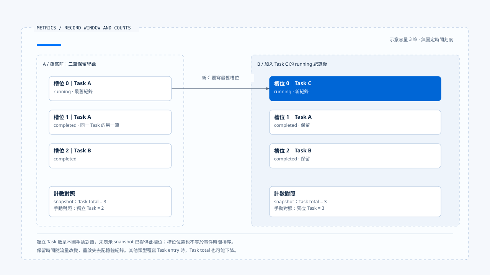
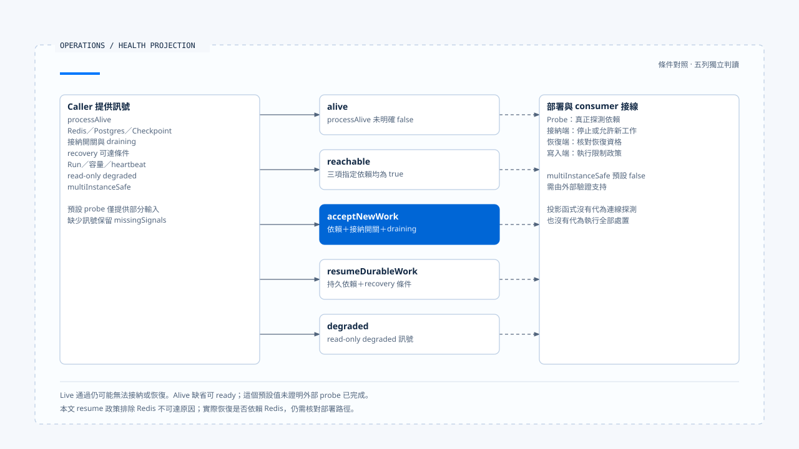

# 指標、成本與健康判讀

[English](./04-metrics-cost-and-runtime-health.md) | [繁體中文](./04-metrics-cost-and-runtime-health-zh-TW.md)

> 以下內容所提到的
> CCB 為 [claude-code-best](https://github.com/claude-code-best/claude-code) 的簡稱。
> Chat Gun 為 [chat-gun](https://github.com/HsienW/chat-gun)。

[回到導覽](./README-zh-TW.md) · 前一篇：[追蹤、稽核與資料邊界](./03-tracing-audit-and-data-boundaries-zh-TW.md) · 下一篇：[故障驗證與上線門檻](./05-fault-validation-and-release-gates-zh-TW.md)

> Metrics endpoint 回傳成功，面板顯示延遲為零，服務的 live 檢查也通過。但實際原因可能是沒有任何耗時紀錄，而 Checkpointer 根本無法連線。這些訊號不足以判斷服務能接受新工作或恢復舊 Run。

**指標要交代量測範圍，健康要保留缺失訊號。**

維運者需要知道數值如何產生、依賴由誰探測，才能決定是否接納、降級或停止工作。

## 先辨認量測單位

Chat Gun 收集 Task、Step、Tool、Token、Cost 與一般 Event metric，各類資料的意義不同。

| 類別 | 可觀察內容 | 要核對的範圍 |
|---|---|---|
| Task／Step | 狀態、耗時、步驟及嘗試。 | 一筆紀錄是否代表一份工作或一次狀態變化。 |
| Tool | success、error、timeout、permission denied 與耗時。 | 一個邏輯呼叫是否包含多個 Attempt。 |
| Token／Cost | 供應商用量、模型及工具成本。 | 是否完整回報、使用何種估價與幣別。 |
| Event | fallback、repair、reconciliation 等指定活動。 | 事件名稱與實際 instrumentation 是否一致。 |
| Health signal | 依賴、容量、heartbeat 與執行進度。 | 訊號來源、更新時間與缺失狀態。 |

數值欄位名稱不能取代計算公式。正式建立 SLI 前，應先確認分子、分母、窗口與缺失資料，再決定門檻。

## 程序內 ring buffer 的窗口

`InMemoryMetricsCollector` 使用有限容量的 ring buffer。新增紀錄會覆寫舊位置，`snapshot()` 只根據目前保留的 entries 計算；程序重啟也不會自動讀回完整歷史。

這是容量窗口，不等於固定的最近幾分鐘。高流量時保留的時間較短，低流量時則可能保留更久。若要比較跨時段或跨實例指標，需要另有採樣、聚合及保存策略。

Task total 在本文參照的實作中，計算的是 task entries 筆數；各狀態也依 entries 計數，並未先按 taskId 合併成最新狀態。一次 Task 若回報 running 與 completed，兩筆可能同時留在窗口裡，因此不能直接把 total 說成獨立工作總數。

[開啟 HTML 圖解](../../assets/agent-runtime/events-and-operations/04-metrics-cost-and-runtime-health/04-ring-buffer-record-window.html)

兩側都是容量三筆的示意快照。覆寫前 Task A 佔兩筆紀錄，覆寫後 A、B、C 各佔一筆；Task total 都是三，獨立 Task 數卻不同。獨立 Task 數為手動對照，正式 snapshot 是否提供該指標仍要依實作確認。

## 零值、缺失與比例

Snapshot 在沒有 Task duration 時，平均耗時可為零，而 p95 欄位則只在有 duration 時加入。這讓 consumer 必須區分「觀測值為零」與「沒有可計算資料」。

模型 fallback 比例另會優先依可用 call ID 集合計算，缺少這些集合時才可能退到 event counts；兩條路徑的分母來源需要保留，不能一律解讀成獨立使用者請求的失敗率。

Retry recovery、工具成功與 Task 成功也可能使用不同資料集合。建立告警前要先決定是在量測 Attempt、邏輯工作，還是使用者可見失敗，避免一次可恢復錯誤同時被算成多個最終失敗。

## Endpoint 與輸出格式

`/metrics` 在本文參照的實作中回傳 JSON snapshot。Operations HTTP 另外提供 `/operations/metrics`，以 OpenMetrics content type 輸出彙整值。

後者使用已保留紀錄計算名稱帶 total 的量測，可能隨 ring buffer 覆寫而變化，不能僅因後綴就當成從程序啟動累積、永不下降的 Counter。Scraper 與面板應依實際語意配置。

### 單次查證與彙整維度

Run、Task、Step 等 correlation 適合查單次執行，若不加限制地成為 metric label，則會增加 cardinality。查讀的 correlated index 另有允許欄位及每 Run 紀錄上限；這種查證投影也不等於部署的低 cardinality 時序彙整。

## 成本與延遲分開計算

模型呼叫、Provider fallback、工具排隊、人工確認與結果保存，都可能增加使用者等待。只量測工具 executor 的耗時，無法回答整個 Run 為何很慢。

Chat Gun 的 Cost tracker 接收模型及工具成本，記錄合計；它沒有單靠這個呼叫取得供應商最終帳單。實際價格來源、用量回報缺失與重試是否計入，需要逐 instrumentation 核對。

CCB `cost-tracker.ts` 保存 Session 及模型用量，並有含／不含重試的 API duration、cache token 與 unknown model cost 接點。`addToTotalSessionCost()` 累加 caller 提供的 cost 與 usage，仍須沿上游計價與回應解析確認完整性。

若額度控制要求阻止下一個操作，就需要在派送位置消費可信預算；顯示成本的 metric 不會自動成為限制器。

## 健康要分層看

`projectRuntimeHealth()` 根據輸入建立投影，主要層次如下：

| 層次 | 查讀的判斷方向 | 解讀限制 |
|---|---|---|
| alive | processAlive 未明確為 false 時可為 ready。 | 未提供值不等於已完成外部探測。 |
| reachable | 指定 Redis、Postgres、Checkpoint 訊號均為 true。 | 投影函式沒有自己連線檢查。 |
| acceptNewWork | 依賴條件、接納開關與 draining。 | 回傳狀態仍需接入接納 consumer。 |
| resumeDurableWork | 相關持久依賴與 recovery 可達條件。 | 不能推論已成功恢復所有工作。 |
| degraded | 由 read-only degraded 訊號表達。 | 標記本身不會阻止所有寫入。 |

查讀的 resume 條件會將 Redis 不可達從該層的依賴原因中排除，與 acceptNewWork 的條件不同。這是此投影的政策，不代表任意部署都能在沒有 Redis 時恢復；需核對實際恢復路徑。

`multiInstanceSafe` 由輸入提供，預設為 false；多 Worker 是否安全，仍需由外部驗證支持。Run、容量及 heartbeat 資料缺失時，投影會保留 missingSignals，讓 consumer 區分缺少資料與實際量測到零。

[開啟 HTML 圖解](../../assets/agent-runtime/events-and-operations/04-metrics-cost-and-runtime-health/04-layered-runtime-health.html)

中間五列各自判讀條件，沒有逐層通過的先後關係。左側是 caller 提供的訊號集合，各列只使用適用項目；右側虛線提醒部署仍須接上真正的探測與處置。

## 預設 probe 與部署接線

`createOperationsHttpApp()` 的預設 health probe 只提供 processAlive、觀察時間及部分門檻，沒有替所有依賴執行探測。Live 可以通過，而 readiness、resume-ready 仍可能不通過。

HTTP app 對不同健康層提供不同 endpoint。是否被 orchestrator 採用、是否真的接上資料庫與 Checkpointer probe，需由部署及 dependencies 查證。模組存在與 ingress 可達都不足以證明探測完整。

Reaper 的卡住 Run 判斷也需要實際 Run projection，不能從一次 health snapshot 直接認定可以重新派送。效果 unknown 時，仍需走回查與治理條件。

## 如何驗證指標與健康

- 讓同一 Task 送出多筆狀態，核對 snapshot 的 entry 計數與工作數差異。
- 超過 buffer 容量並重啟程序，確認面板沒有把窗口值當成完整歷史。
- 不提供耗時、容量與 heartbeat，核對零值、缺欄位及 missingSignals 的呈現。
- 分別切斷 Redis、Postgres、Checkpoint 與 recovery probe，確認各健康層的條件。
- 開啟 draining 或 read-only 標記，沿真正接納及派送入口驗證行為。

本輪查讀收集、輸出、health projection 與 HTTP 接點，未執行真實依賴探測、負載測試或成本對帳。

## 本篇的工程判斷

我會先讓每個數值附帶窗口與來源，再建立告警。缺少資料時保留缺失，能避免用一組看似正常的零值支持錯誤接納；分開新工作與恢復條件，也能讓維運處置更具體。

## 實作參照與適用範圍

- Chat Gun：`platform/metrics/metrics-collector.ts`、`metrics-endpoint.ts`、`cost-tracker.ts`、`operations/metrics/health.ts`、`export.ts` 與 `operations/http-app.ts`，路徑依目錄相對 `backend/src/`。
- CCB：`src/cost-tracker.ts`。
- [來源與檔案指紋](./README-zh-TW.md#來源與查證狀態)記錄本地版本；SLI、告警與部署 probe 的正式接線仍需驗證。

## 接續閱讀

下一篇[故障驗證與上線門檻](./05-fault-validation-and-release-gates-zh-TW.md)將觀察與故障結果整理成可核對的驗收依據。
