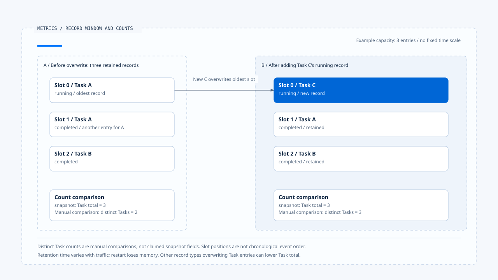
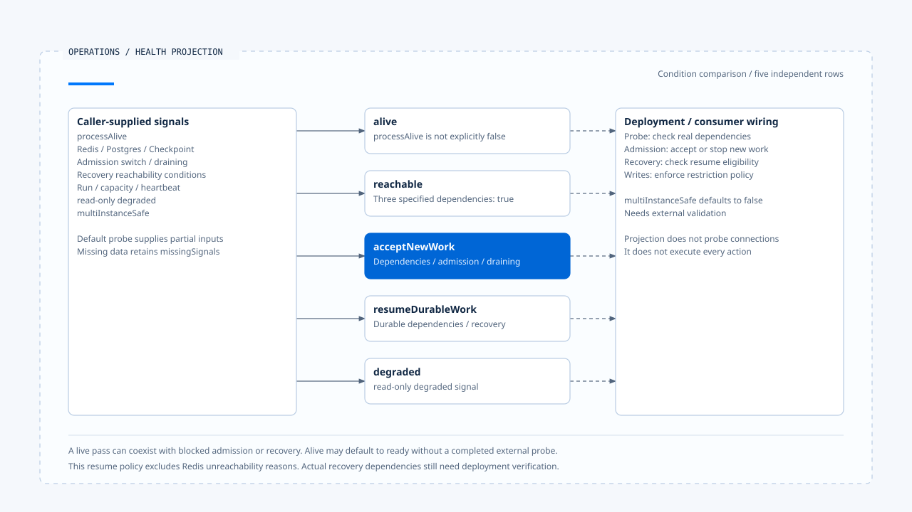

# Metrics, cost, and runtime health

[English](./04-metrics-cost-and-runtime-health.md) | [繁體中文](./04-metrics-cost-and-runtime-health-zh-TW.md) | [简体中文](./04-metrics-cost-and-runtime-health-zh-CN.md)

> In the following content:
> CCB is short for [claude-code-best](https://github.com/claude-code-best/claude-code).
> Chat Gun refers to [chat-gun](https://github.com/HsienW/chat-gun).

[Back to the guide](./README-zh-TW.md) · Previous: [Tracing, audit, and data boundaries](./03-tracing-audit-and-data-boundaries.md) · Next: [Fault validation and release gates](./05-fault-validation-and-release-gates.md)

> The metrics endpoint returns successfully, the dashboard shows zero latency, and the service passes its live check. Yet there may be no duration records at all, and the Checkpointer may be unreachable. These signals are insufficient to determine whether the service can accept new work or resume an old Run.

**Metrics need a measurement scope, and health needs to retain missing signals.**

Operators need to know how values are produced and who probes dependencies before deciding to admit, degrade, or stop work.

## Identify the unit of measurement

Chat Gun collects Task, Step, Tool, Token, Cost, and general Event metrics. Each category has different semantics.

| Category | Observable data | Scope to check |
|---|---|---|
| Task/Step | Status, duration, steps, and attempts. | Whether a record represents a unit of work or a state change. |
| Tool | success, error, timeout, permission denied, and duration. | Whether one logical call includes multiple Attempts. |
| Token/Cost | Provider usage, model cost, and tool cost. | Reporting completeness, estimates, and currency. |
| Event | Named activity such as fallback, repair, and reconciliation. | Whether event names match actual instrumentation. |
| Health signal | Dependencies, capacity, heartbeat, and execution progress. | Signal source, update time, and missing state. |

A numeric field name cannot replace its formula. Before defining an SLI, establish the numerator, denominator, window, and missing-data handling, then choose thresholds.

## The in-process ring buffer window

`InMemoryMetricsCollector` uses a finite-capacity ring buffer. New records overwrite old slots, and `snapshot()` calculates from currently retained entries only. A process restart does not automatically reload the complete history.

This is a capacity window with no fixed duration in minutes. High traffic shortens the retained time span; low traffic can extend it. Comparing metrics across periods or instances requires separate sampling, aggregation, and persistence strategies.

In the referenced implementation, Task total counts task entries. Status counts also use entries without first consolidating the latest state by taskId. If one Task reports running and completed, both records may remain in the window. Total therefore cannot be interpreted directly as the number of distinct jobs.

[Open the HTML diagram](../../assets/agent-runtime/events-and-operations/04-metrics-cost-and-runtime-health/04-ring-buffer-record-window-en.html)

Both sides are illustrative snapshots with a capacity of three entries. Task A occupies two records before the overwrite; afterward, A, B, and C each occupy one. Task total remains three while distinct Task counts differ. The distinct count is a manual comparison; check the implementation to determine whether the production snapshot provides that metric.

## Zero values, missing data, and ratios

When no Task duration is available, the snapshot's average duration can be zero, while the p95 field is included only when duration data exists. Consumers must distinguish an observed zero from an absence of calculable data.

The model fallback ratio preferentially uses available call ID sets and may fall back to event counts when those sets are absent. Retain the denominator source for each path. Neither path can be interpreted unconditionally as a failure rate for distinct user requests.

Retry recovery, tool success, and Task success may also use different datasets. Before creating alerts, decide whether the measurement concerns Attempts, logical work, or user-visible failures, so one recoverable error is not counted as several final failures.

## Endpoints and output formats

In the referenced implementation, `/metrics` returns a JSON snapshot. Operations HTTP separately provides `/operations/metrics`, emitting aggregates with an OpenMetrics content type.

The latter calculates measurements named with total from retained records, so values can change as the ring buffer overwrites entries. A suffix alone does not establish a Counter that accumulates from process startup and never decreases. Configure scrapers and dashboards according to the actual semantics.

### Individual investigation and aggregation dimensions

Correlations such as Run, Task, and Step help investigate a single execution, but unrestricted use as metric labels increases cardinality. The reviewed correlated index has allowed fields and per-Run record limits. This investigation projection does not itself provide deployment-wide, low-cardinality time-series aggregation.

## Calculate cost and latency separately

Model calls, Provider fallback, tool queues, human confirmation, and result persistence can all increase user waiting time. Measuring only the tool executor's duration cannot explain why an entire Run is slow.

Chat Gun's cost tracker receives model and tool costs and records totals. That call alone does not retrieve the provider's final bill. Check each instrumentation point for price sources, missing usage reports, and whether retries are included.

CCB's `cost-tracker.ts` retains Session and model usage, with integration points for API duration including/excluding retries, cache tokens, and unknown model cost. `addToTotalSessionCost()` accumulates caller-supplied cost and usage. Completeness still needs verification through upstream pricing and response parsing.

If quota control must block the next operation, dispatch must consume a trusted budget. A metric displaying cost does not automatically enforce that limit.

## Read health in layers

`projectRuntimeHealth()` builds a projection from its inputs. Its main layers are:

| Layer | Reviewed condition | Interpretation limit |
|---|---|---|
| alive | Can be ready when processAlive is not explicitly false. | An omitted value does not establish a completed external probe. |
| reachable | Specified Redis, Postgres, and Checkpoint signals are all true. | The projection function performs no connection checks itself. |
| acceptNewWork | Dependency conditions, admission switch, and draining. | The returned state still needs an admission consumer. |
| resumeDurableWork | Relevant durable dependencies and recovery reachability conditions. | Does not establish successful recovery of all work. |
| degraded | Expresses a read-only degraded signal. | The flag alone does not block all writes. |

The reviewed resume condition excludes Redis unreachability from that layer's dependency reasons, unlike acceptNewWork. This is a policy of this projection. Whether a deployment can actually resume without Redis must be checked against its recovery path.

`multiInstanceSafe` is supplied as input and defaults to false. Safety with multiple Workers needs external validation. When Run, capacity, or heartbeat data is missing, the projection retains missingSignals so consumers can distinguish missing data from a measured zero.

[Open the HTML diagram](../../assets/agent-runtime/events-and-operations/04-metrics-cost-and-runtime-health/04-layered-runtime-health-en.html)

The five middle rows evaluate their own conditions independently, with no sequential pass-through relationship. The left side collects caller-supplied signals, and each row uses only its applicable inputs. Dashed lines on the right indicate that deployment must still connect real probes and actions.

## Default probes and deployment wiring

The default health probe in `createOperationsHttpApp()` provides only processAlive, observation time, and some thresholds. It does not probe every dependency. Live can pass while readiness and resume-ready still fail.

The HTTP app exposes separate endpoints for different health layers. Whether the orchestrator uses them and whether database and Checkpointer probes are connected must be verified in deployment and dependencies. Module existence and reachable ingress do not establish complete probing.

The Reaper also needs a real Run projection to judge stuck Runs. A single health snapshot cannot establish eligibility for redispatch. An unknown effect still requires reconciliation and governance checks.

## How to validate metrics and health

- Send several states for the same Task and compare snapshot entry counts with work counts.
- Exceed buffer capacity and restart the process, checking that the dashboard does not present window values as complete history.
- Omit duration, capacity, and heartbeat, checking the presentation of zero values, absent fields, and missingSignals.
- Disconnect Redis, Postgres, Checkpoint, and the recovery probe separately to check each health layer's conditions.
- Enable draining or read-only flags and validate behavior through the actual admission and dispatch entry points.

This review covered collection, output, health projection, and HTTP integration points. It did not run real dependency probes, load tests, or cost reconciliation.

## Engineering judgment

I would attach a window and source to every value before building alerts. Retaining missing data as missing prevents apparently normal zeros from supporting incorrect admission decisions. Separate conditions for new work and recovery also make operational actions more specific.

## Implementation references and scope

- Chat Gun: `platform/metrics/metrics-collector.ts`, `metrics-endpoint.ts`, `cost-tracker.ts`, `operations/metrics/health.ts`, `export.ts`, and `operations/http-app.ts`, under their respective directories relative to `backend/src/`.
- CCB: `src/cost-tracker.ts`.
- [Sources and file fingerprints](./README-zh-TW.md#來源與查證狀態) record the local version. Production wiring for SLIs, alerts, and deployment probes still needs validation.

## Further reading

Next, [Fault validation and release gates](./05-fault-validation-and-release-gates.md) organizes observations and fault outcomes into verifiable acceptance evidence.
