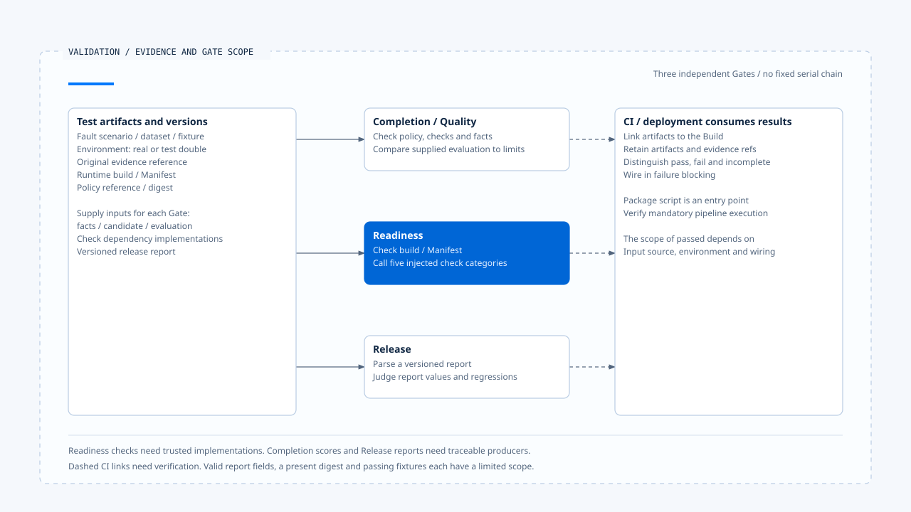

# 故障验证与上线门槛

[English](./05-fault-validation-and-release-gates.md) | [繁體中文](./05-fault-validation-and-release-gates-zh-TW.md) | [简体中文](./05-fault-validation-and-release-gates-zh-CN.md)

> 以下内容所提到的
> CCB 为 [claude-code-best](https://github.com/claude-code-best/claude-code) 的简称。
> Chat Gun 为 [chat-gun](https://github.com/HsienW/chat-gun)。

[回到导览](./README-zh-CN.md) · 前一篇：[指标、成本与健康判读](./04-metrics-cost-and-runtime-health-zh-CN.md) · 下一篇：[一次漏接终止事件的查证](./06-case-terminal-event-incident-zh-CN.md)

> 一份报告宣告没有重复副作用，Readiness 也返回 passed。但报告来自固定 fixture，Canary dependency 只是测试替身，实际部署从未送出外部请求。若只保存 passed 字样，上线时便失去判断验证范围的依据。

**Gate 必须连回具体测试、输入版本与原始证据。**

检查器依收到的数据作判断。测试是否真的执行、涵盖哪个环境，仍需从执行记录与实际接线确认。

## 三种 Gate 分别处理什么

| Gate | 查读的输入与责任 | 不能直接推论 |
|---|---|---|
| Completion／Quality | 依 policy 与 checks 判断指定候选及 facts。 | 已完成部署健康与外部副作用验收。 |
| Readiness | 验证 build／Manifest 关联，调用指定检查 dependencies。 | 每个 dependency 都是真实环境探测。 |
| Release | 读取版本化报告并判断回归条件。 | 报告值由该函数亲自量测。 |

Chat Gun 将这些接点放在不同模块。任务完成、部署接纳与版本发行各有判断条件，即使共用部分证据，也要分别保存结果与适用范围。

## 先定义故障与可观察结果

测试需要指出故障发生在哪个交接点，以及应观察什么。以 Terminal identity 保存失败为例，至少检查原状态、事件记录、allocator 清理、返回例外与 consumer 结果，不能只验证 Log 出现一个 code。

| 故障 | 应核对的结果 | 避免误判 |
|---|---|---|
| Event append 失败 | 权威状态与事件保存是否分离，producer 如何返回。 | 保存失败等于业务操作未发生。 |
| 重送／乱序／缺口 | ID 去重、重排及缺口处理。 | 有界 buffer 等于持久补送。 |
| Exporter／Audit 故障 | 诊断降级与必要证据的不同契约。 | 主流程成功等于每份诊断都送达。 |
| Probe 信号缺失 | 分层健康与 missingSignals。 | 没有数据等于没有故障。 |
| 外部回应遗失 | Operation、Ledger、实体 Attempt 次数。 | 画面重试可以直接重做。 |

每列应独立演练。将所有故障放进同一次流程，容易失去判断哪个条件导致哪个出口的能力。

## Completion Gate 的确定性检查

`evaluateCompletionGate()` 解析 input 与 policy，核对 policy reference，再检查输入 check 集合没有重复、与 policy 集合一致，且每个 kind、config reference 符合。

查读类型包含 Schema、expected value、required evidence、state invariant、side-effect invariant 与 recovery bound。各类型依自己的 facts／candidate 规则判断，不能只因名称含 invariant 就推论它已向真实外部系统查证。

### Evaluation 数据与调用限制

Deterministic checks 不通过时直接返回 failed。Policy 要求 evaluation 时，还需提供符合 dataset、evaluator、threshold 等设置的数据，再比较 normalized score 与门槛。

这个函数接收已提供的 score，没有在查读分支亲自执行 LLM judge。设置中的 timeout 或 maxJudgeCalls 也需要由产生 evaluation 的 consumer 执行限制；字段被验证不等于外部调用已受限。

## Readiness 的实际执行范围

`createReadinessGate()` 要求 architectureChecks、canary、deterministicGate、faultInjection 与 correlatedSli dependencies 存在。Evaluate 先验证输入，再确认 runtimeBuildId 与 Execution Manifest 的对应字段相同。

接着依序调用这些 checks，成功时收集可选 evidence reference，失败时收集 reason。Passed 的适用范围取决于 dependencies 的实现：测试替身可返回成功，正式环境则要提供可信探测与验证。

查读循环没有将每个 dependency 例外都改成 failed report。若检查器抛错，caller 也要保存未完成的验收状态，不能把没有报告当成通过。

Health endpoint 的 readiness 与这个验收 Gate 也有不同接口及用途。前者回报投影条件，后者执行指定检查，不能只因同名就认定部署采用了两者。

## Release Report 验证什么

`evaluateReleaseGate()` 先解析报告 Schema，再汇整 failure reason codes。查读条件包含：

- Deterministic regression 是否通过。
- Business constraint 与 duplicate side effect regression count 是否为零。
- Recovery 是否 within bounds，成本／延迟是否 within tolerance。
- Manifest 是否 incompatible。
- Hard negative cases 是否有失败。

Manifest 的拒绝条件是 incompatible，不能自行改写成 migratable 一律拒绝。若部署要求 migration 必须先完成，还需要对应 policy 与执行证据。

Policy ID、version 与 digest 在报告中提供关联，但这个函数没有单靠字符串存在就验证报告来源或签名。布尔值、count 与 tolerance 结果也由报告供应者提供，没有自动完成所有底层测试。

## CLI 与 CI 的接线

`release-gate.cli.ts` 读取工作目录内指定 JSON 文件，检查文件类型与大小，再返回结构化结果及 exit code。Package 的 `operations:release-gate` 提供执行入口。

这能用来串接 CI，但 script 存在不表示每次合并或部署都必须执行。还要确认实际 pipeline 的 trigger、报告产生步骤、失败阻挡与 artifact 保存。

刻意制造回归的 fixture 适合检查判断器会不会拒绝已知负例，无法单独证明某个 Build 对真实服务没有回归。测试替身、整合环境、Canary 与生产量测应各自保留范围。

## 一份可查证的验收记录

实务上可以让每次验收关联下列数据。这是一份建议设计，字段名称不要求与两个来源完全相同。

| 数据 | 查证用途 |
|---|---|
| Runtime build／Execution Manifest | 哪份程序与执行契约接受验证。 |
| Policy reference／digest | 依哪个版本的门槛判断。 |
| Dataset／fixture／fault spec | 使用哪些正例、负例及故障位置。 |
| 原始 evidence reference | 能否查回状态、事件、Ledger 与物理派送结果。 |
| 环境与 dependencies | 哪些是真实服务、哪些是替身或模拟。 |
| Gate result 与未完成检查 | 哪些通过、失败、缺失或抛错。 |

成本与延迟比较也要使用兼容窗口及样本条件；Metrics ring buffer 的片段，不应直接变成无条件的全部署基准。

[开启 HTML 图解](../../assets/agent-runtime/events-and-operations/05-fault-validation-and-release-gates/05-validation-evidence-and-gates-en.html)

三种 Gate 分别处理对应输入，图中没有要求固定串行。Readiness 会调用注入的 checks；Completion 与 Release 的 evaluation 或报告需要追溯产生端。右侧虚线表示仍须核对 CI 是否执行、保存证据并阻挡失败部署。

## 如何验证 Gate 本身

- 对 invalid Schema、重复 checks、policy reference 不符与缺少 evidence 各自建立负例。
- 让 dependency 返回 failed 或直接抛错，检查 caller 是否保留不同结果。
- 以刻意重复副作用、恢复超界与成本回归报告，确认 Release Gate 拒绝。
- 将 fixture 替换成真实测试产物，核对 build、dataset 与 evidence reference。
- 从 CI／部署入口验证失败确实阻挡，而不只是在本地打印 failed。

本轮查读 Gate 与 CLI，没有执行报告、LLM judge、Canary、故障注入或正式 CI／部署流程。

## 本篇的工程判断

我会让 Gate 保存「依什么数据作出判断」，也保存缺少的检查。可重现负例能验证判断器，真实环境证据则界定部署范围；两者接起来，passed 才能成为有依据的发版决策。

## 实现参照与适用范围

- Chat Gun：`backend/src/operations/quality-gate.ts`、`readiness-gate.ts`、`release-gate.ts`、`release-gate.cli.ts` 与 `backend/package.json`。
- [来源与文件指纹](./README-zh-CN.md#来源与查证状态)记录查读内容，未将 fixture 或报告判断描述成生产验收。

## 接续阅读

下一篇[一次漏接终止事件的查证](./06-case-terminal-event-incident-zh-CN.md)将这些证据与检查条件放进一个具体事故情境。
