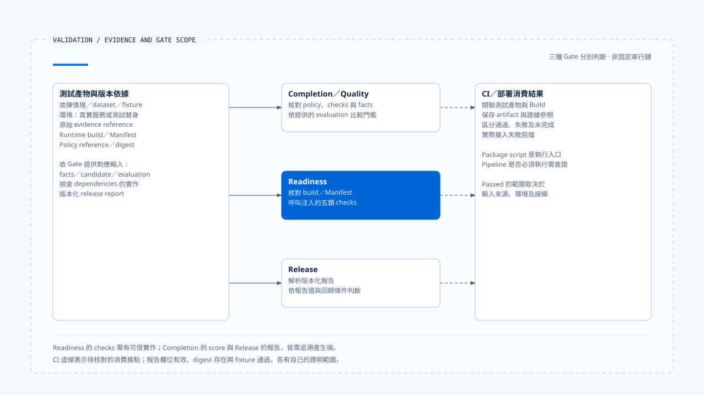

# 故障驗證與上線門檻

[English](./05-fault-validation-and-release-gates.md) | [繁體中文](./05-fault-validation-and-release-gates-zh-TW.md)

> 以下內容所提到的
> CCB 為 [claude-code-best](https://github.com/claude-code-best/claude-code) 的簡稱。
> Chat Gun 為 [chat-gun](https://github.com/HsienW/chat-gun)。

[回到導覽](./README-zh-TW.md) · 前一篇：[指標、成本與健康判讀](./04-metrics-cost-and-runtime-health-zh-TW.md) · 下一篇：[一次漏接終止事件的查證](./06-case-terminal-event-incident-zh-TW.md)

> 一份報告宣告沒有重複副作用，Readiness 也返回 passed。但報告來自固定 fixture，Canary dependency 只是測試替身，實際部署從未送出外部請求。若只保存 passed 字樣，上線時便失去判斷驗證範圍的依據。

**Gate 必須連回具體測試、輸入版本與原始證據。**

檢查器依收到的資料作判斷。測試是否真的執行、涵蓋哪個環境，仍需從執行紀錄與實際接線確認。

## 三種 Gate 分別處理什麼

| Gate | 查讀的輸入與責任 | 不能直接推論 |
|---|---|---|
| Completion／Quality | 依 policy 與 checks 判斷指定候選及 facts。 | 已完成部署健康與外部副作用驗收。 |
| Readiness | 驗證 build／Manifest 關聯，呼叫指定檢查 dependencies。 | 每個 dependency 都是真實環境探測。 |
| Release | 讀取版本化報告並判斷回歸條件。 | 報告值由該函式親自量測。 |

Chat Gun 將這些接點放在不同模組。任務完成、部署接納與版本發行各有判斷條件，即使共用部分證據，也要分別保存結果與適用範圍。

## 先定義故障與可觀察結果

測試需要指出故障發生在哪個交接點，以及應觀察什麼。以 Terminal identity 保存失敗為例，至少檢查原狀態、事件紀錄、allocator 清理、回傳例外與 consumer 結果，不能只驗證 Log 出現一個 code。

| 故障 | 應核對的結果 | 避免誤判 |
|---|---|---|
| Event append 失敗 | 權威狀態與事件保存是否分離，producer 如何返回。 | 保存失敗等於業務操作未發生。 |
| 重送／亂序／缺口 | ID 去重、重排及缺口處理。 | 有界 buffer 等於持久補送。 |
| Exporter／Audit 故障 | 診斷降級與必要證據的不同契約。 | 主流程成功等於每份診斷都送達。 |
| Probe 訊號缺失 | 分層健康與 missingSignals。 | 沒有資料等於沒有故障。 |
| 外部回應遺失 | Operation、Ledger、實體 Attempt 次數。 | 畫面重試可以直接重做。 |

每列應獨立演練。將所有故障放進同一次流程，容易失去判斷哪個條件導致哪個出口的能力。

## Completion Gate 的確定性檢查

`evaluateCompletionGate()` 解析 input 與 policy，核對 policy reference，再檢查輸入 check 集合沒有重複、與 policy 集合一致，且每個 kind、config reference 符合。

查讀類型包含 Schema、expected value、required evidence、state invariant、side-effect invariant 與 recovery bound。各類型依自己的 facts／candidate 規則判斷，不能只因名稱含 invariant 就推論它已向真實外部系統查證。

### Evaluation 資料與呼叫限制

Deterministic checks 不通過時直接回傳 failed。Policy 要求 evaluation 時，還需提供符合 dataset、evaluator、threshold 等設定的資料，再比較 normalized score 與門檻。

這個函式接收已提供的 score，沒有在查讀分支親自執行 LLM judge。設定中的 timeout 或 maxJudgeCalls 也需要由產生 evaluation 的 consumer 執行限制；欄位被驗證不等於外部呼叫已受限。

## Readiness 的實際執行範圍

`createReadinessGate()` 要求 architectureChecks、canary、deterministicGate、faultInjection 與 correlatedSli dependencies 存在。Evaluate 先驗證輸入，再確認 runtimeBuildId 與 Execution Manifest 的對應欄位相同。

接著依序呼叫這些 checks，成功時收集可選 evidence reference，失敗時收集 reason。Passed 的適用範圍取決於 dependencies 的實作：測試替身可回傳成功，正式環境則要提供可信探測與驗證。

查讀迴圈沒有將每個 dependency 例外都改成 failed report。若檢查器拋錯，caller 也要保存未完成的驗收狀態，不能把沒有報告當成通過。

Health endpoint 的 readiness 與這個驗收 Gate 也有不同介面及用途。前者回報投影條件，後者執行指定檢查，不能只因同名就認定部署採用了兩者。

## Release Report 驗證什麼

`evaluateReleaseGate()` 先解析報告 Schema，再彙整 failure reason codes。查讀條件包含：

- Deterministic regression 是否通過。
- Business constraint 與 duplicate side effect regression count 是否為零。
- Recovery 是否 within bounds，成本／延遲是否 within tolerance。
- Manifest 是否 incompatible。
- Hard negative cases 是否有失敗。

Manifest 的拒絕條件是 incompatible，不能自行改寫成 migratable 一律拒絕。若部署要求 migration 必須先完成，還需要對應 policy 與執行證據。

Policy ID、version 與 digest 在報告中提供關聯，但這個函式沒有單靠字串存在就驗證報告來源或簽章。布林值、count 與 tolerance 結果也由報告供應者提供，沒有自動完成所有底層測試。

## CLI 與 CI 的接線

`release-gate.cli.ts` 讀取工作目錄內指定 JSON 檔案，檢查檔案型別與大小，再回傳結構化結果及 exit code。Package 的 `operations:release-gate` 提供執行入口。

這能用來串接 CI，但 script 存在不表示每次合併或部署都必須執行。還要確認實際 pipeline 的 trigger、報告產生步驟、失敗阻擋與 artifact 保存。

刻意製造回歸的 fixture 適合檢查判斷器會不會拒絕已知負例，無法單獨證明某個 Build 對真實服務沒有回歸。測試替身、整合環境、Canary 與生產量測應各自保留範圍。

## 一份可查證的驗收紀錄

實務上可以讓每次驗收關聯下列資料。這是一份建議設計，欄位名稱不要求與兩個來源完全相同。

| 資料 | 查證用途 |
|---|---|
| Runtime build／Execution Manifest | 哪份程式與執行契約接受驗證。 |
| Policy reference／digest | 依哪個版本的門檻判斷。 |
| Dataset／fixture／fault spec | 使用哪些正例、負例及故障位置。 |
| 原始 evidence reference | 能否查回狀態、事件、Ledger 與物理派送結果。 |
| 環境與 dependencies | 哪些是真實服務、哪些是替身或模擬。 |
| Gate result 與未完成檢查 | 哪些通過、失敗、缺失或拋錯。 |

成本與延遲比較也要使用相容窗口及樣本條件；Metrics ring buffer 的片段，不應直接變成無條件的全部署基準。

[開啟 HTML 圖解](../../assets/agent-runtime/events-and-operations/05-fault-validation-and-release-gates/05-validation-evidence-and-gates.html)

三種 Gate 分別處理對應輸入，圖中沒有要求固定串行。Readiness 會呼叫注入的 checks；Completion 與 Release 的 evaluation 或報告需要追溯產生端。右側虛線表示仍須核對 CI 是否執行、保存證據並阻擋失敗部署。

## 如何驗證 Gate 本身

- 對 invalid Schema、重複 checks、policy reference 不符與缺少 evidence 各自建立負例。
- 讓 dependency 返回 failed 或直接拋錯，檢查 caller 是否保留不同結果。
- 以刻意重複副作用、恢復超界與成本回歸報告，確認 Release Gate 拒絕。
- 將 fixture 替換成真實測試產物，核對 build、dataset 與 evidence reference。
- 從 CI／部署入口驗證失敗確實阻擋，而不只是在本地印出 failed。

本輪查讀 Gate 與 CLI，沒有執行報告、LLM judge、Canary、故障注入或正式 CI／部署流程。

## 本篇的工程判斷

我會讓 Gate 保存「依什麼資料作出判斷」，也保存缺少的檢查。可重現負例能驗證判斷器，真實環境證據則界定部署範圍；兩者接起來，passed 才能成為有依據的發版決策。

## 實作參照與適用範圍

- Chat Gun：`backend/src/operations/quality-gate.ts`、`readiness-gate.ts`、`release-gate.ts`、`release-gate.cli.ts` 與 `backend/package.json`。
- [來源與檔案指紋](./README-zh-TW.md#來源與查證狀態)記錄查讀內容，未將 fixture 或報告判斷描述成生產驗收。

## 接續閱讀

下一篇[一次漏接終止事件的查證](./06-case-terminal-event-incident-zh-TW.md)將這些證據與檢查條件放進一個具體事故情境。
