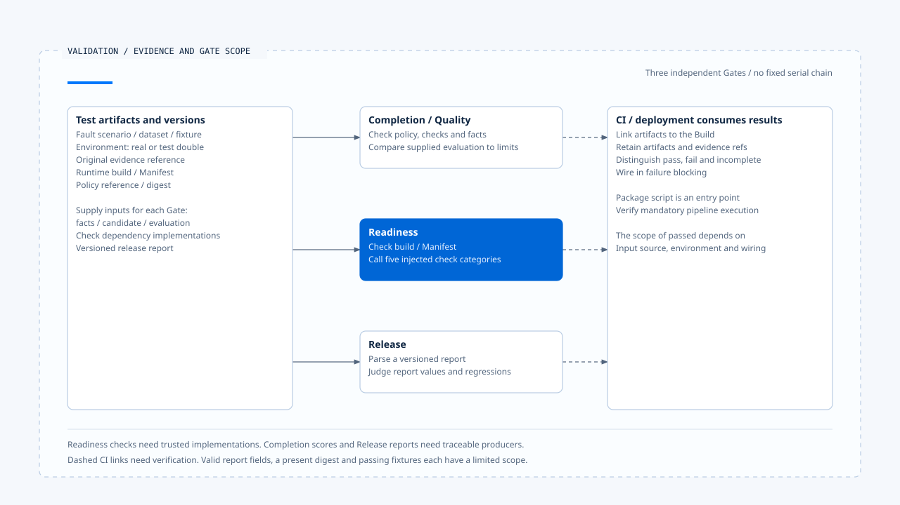

# Fault validation and release gates

[English](./05-fault-validation-and-release-gates.md) | [繁體中文](./05-fault-validation-and-release-gates-zh-TW.md) | [简体中文](./05-fault-validation-and-release-gates-zh-CN.md)

> In the following content:
> CCB is short for [claude-code-best](https://github.com/claude-code-best/claude-code).
> Chat Gun refers to [chat-gun](https://github.com/HsienW/chat-gun).

[Back to the guide](./README.md) · Previous: [Metrics, cost, and runtime health](./04-metrics-cost-and-runtime-health.md) · Next: [Investigating a missed terminal event](./06-case-terminal-event-incident.md)

> A report declares zero duplicate side effects, and Readiness returns passed. Yet the report came from a fixed fixture, the Canary dependency was a test double, and the actual deployment never made an external request. Retaining only the word passed removes the basis for judging validation scope at release time.

**Gates must link back to concrete tests, input versions, and original evidence.**

An evaluator judges the data it receives. Execution records and actual wiring must still confirm whether tests ran and which environment they covered.

## What the three Gates handle

| Gate | Reviewed input and responsibility | Insufficient grounds to conclude |
|---|---|---|
| Completion/Quality | Judge the specified candidate and facts according to policy and checks. | Deployment health and external side-effect acceptance testing are complete. |
| Readiness | Validate build/Manifest relationships and call specified check dependencies. | Every dependency probes a real environment. |
| Release | Read a versioned report and evaluate regression conditions. | The function measured the report values itself. |

Chat Gun places these integration points in different modules. Task completion, deployment admission, and version release have separate decision conditions. Even when they share evidence, retain their results and applicable scopes separately.

## Define faults and observable outcomes first

A test needs to identify the failing handoff and what should be observed. For a Terminal identity persistence failure, check at least the original state, event records, allocator cleanup, returned exception, and consumer outcome. A log code alone is insufficient.

| Fault | Outcomes to check | Misinterpretation to avoid |
|---|---|---|
| Event append failure | Whether authoritative state and event persistence diverge, and how the producer returns. | Persistence failure means the business operation never occurred. |
| Redelivery/reordering/gaps | ID deduplication, reordering, and gap handling. | A bounded buffer provides durable redelivery. |
| Exporter/Audit failure | Separate contracts for diagnostic degradation and required evidence. | Main-flow success means every diagnostic record arrived. |
| Missing probe signals | Layered health and missingSignals. | Missing data means no fault. |
| Lost external response | Operation, Ledger, and physical Attempt counts. | A UI retry can immediately repeat the operation. |

Exercise each row independently. Combining all faults in one flow makes it harder to determine which condition caused which outcome.

## Deterministic checks in the Completion Gate

`evaluateCompletionGate()` parses input and policy, checks the policy reference, then verifies that the input check set has no duplicates, matches the policy set, and has matching kind and config references.

The reviewed types include Schema, expected value, required evidence, state invariant, side-effect invariant, and recovery bound. Each type evaluates its own facts/candidate rules. An invariant name alone does not establish that a real external system was queried.

### Evaluation data and call limits

Failed deterministic checks return failed directly. When policy requires evaluation, the caller must also supply data matching settings such as dataset, evaluator, and threshold, after which the normalized score is compared with the threshold.

This function receives an existing score. The reviewed branch does not run an LLM judge itself. The consumer producing the evaluation must enforce configured timeout or maxJudgeCalls limits; validating fields alone does not limit external calls.

## The actual execution scope of Readiness

`createReadinessGate()` requires architectureChecks, canary, deterministicGate, faultInjection, and correlatedSli dependencies. Evaluate first validates input, then confirms that runtimeBuildId matches the corresponding Execution Manifest field.

It calls these checks in sequence, collecting optional evidence references on success and reasons on failure. The scope of passed depends on the dependency implementations: test doubles can return success, while production needs trustworthy probing and validation.

The reviewed loop does not convert every dependency exception into a failed report. If a checker throws, the caller must retain an incomplete acceptance state. An absent report cannot count as a pass.

The health endpoint's readiness and this acceptance Gate also have different interfaces and purposes. The former reports projected conditions; the latter runs specified checks. Deployment use of both requires separate verification despite the shared name.

## What the Release Report validates

`evaluateReleaseGate()` first parses the report schema, then aggregates failure reason codes. The reviewed conditions include:

- Whether deterministic regression passed.
- Whether business constraint and duplicate side effect regression counts are zero.
- Whether recovery is within bounds and cost/latency are within tolerance.
- Whether the Manifest is incompatible.
- Whether any hard negative cases failed.

The Manifest rejection condition is incompatible. It cannot be restated as unconditional rejection of migratable. Requiring migration to complete before deployment needs a corresponding policy and execution evidence.

Policy ID, version, and digest provide correlation in the report, but string presence alone does not make this function validate the report's origin or signature. Booleans, counts, and tolerance results also come from the report provider. Underlying tests need their own execution evidence.

## Wiring the CLI into CI

`release-gate.cli.ts` reads a specified JSON file within the working directory, checks file type and size, then returns structured results and an exit code. The package's `operations:release-gate` provides an execution entry point.

This can connect to CI, but a script's existence does not make execution mandatory for every merge or deployment. Check the actual pipeline triggers, report-generation steps, failure blocking, and artifact retention.

A deliberately regressing fixture helps check whether the evaluator rejects known negative cases. Alone, it cannot establish that a Build has no regression against real services. Test doubles, integration environments, Canary checks, and production measurements each need a retained scope.

## A verifiable acceptance record

In practice, each acceptance run can correlate the following data. This is a proposed design; field names need not match both source implementations exactly.

| Data | Investigation purpose |
|---|---|
| Runtime build/Execution Manifest | Identify the code and execution contract under validation. |
| Policy reference/digest | Identify the threshold version used for judgment. |
| Dataset/fixture/fault spec | Identify positive cases, negative cases, and fault locations. |
| Original evidence reference | Retrieve state, events, Ledger, and physical dispatch outcomes. |
| Environment and dependencies | Distinguish real services from test doubles or simulation. |
| Gate result and incomplete checks | Identify passes, failures, missing checks, and exceptions. |

Cost and latency comparisons also need compatible windows and sample conditions. A metrics ring buffer fragment cannot unconditionally serve as a deployment-wide baseline.

[Open the HTML diagram](../../assets/agent-runtime/events-and-operations/05-fault-validation-and-release-gates/05-validation-evidence-and-gates-en.html)

Each Gate handles its corresponding inputs, with no required serial chain. Readiness calls injected checks; Completion and Release evaluations or reports need traceable producers. Dashed lines on the right indicate the need to verify that CI runs, retains evidence, and blocks failed deployments.

## How to validate the Gates themselves

- Create separate negative cases for invalid schemas, duplicate checks, mismatched policy references, and missing evidence.
- Have a dependency return failed or throw, checking that the caller retains different outcomes.
- Supply reports with deliberate duplicate side effects, out-of-bounds recovery, and cost regression, checking Release Gate rejection.
- Replace fixtures with real test artifacts and check build, dataset, and evidence references.
- Validate actual failure blocking through CI/deployment entry points beyond printing failed locally.

This review covered Gates and the CLI. It did not run reports, an LLM judge, Canary checks, fault injection, or production CI/deployment flows.

## Engineering judgment

I would have Gates retain the basis for each judgment along with missing checks. Reproducible negative cases validate the evaluator; real environment evidence defines the deployment scope. Connecting both makes passed a supported release decision.

## Implementation references and scope

- Chat Gun: `backend/src/operations/quality-gate.ts`, `readiness-gate.ts`, `release-gate.ts`, `release-gate.cli.ts`, and `backend/package.json`.
- [Sources and file fingerprints](./README.md#sources-and-verification-status) record the reviewed material without presenting fixture or report evaluation as production acceptance testing.

## Further reading

Next, [Investigating a missed terminal event](./06-case-terminal-event-incident.md) places these evidence sources and checks into a concrete incident scenario.
