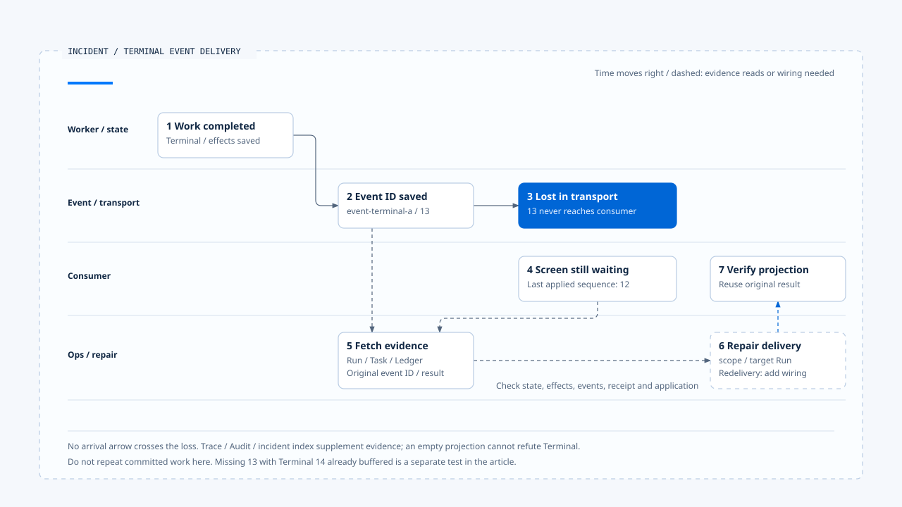

# 一次漏接终止事件的查证

[English](./06-case-terminal-event-incident.md) | [繁體中文](./06-case-terminal-event-incident-zh-TW.md) | [简体中文](./06-case-terminal-event-incident-zh-CN.md)

> 以下内容所提到的
> CCB 为 [claude-code-best](https://github.com/claude-code-best/claude-code) 的简称。
> Chat Gun 为 [chat-gun](https://github.com/HsienW/chat-gun)。

[回到导览](./README-zh-CN.md) · 前一篇：[故障验证与上线门槛](./05-fault-validation-and-release-gates-zh-CN.md)

> 用户看见 Agent 一直执行中，服务的 live 检查仍为绿灯。数据库却已保存 Terminal 结果，工具效果也有 committed 记录；前端只是没有收到最后的完成事件。此时若重新建立工作，原本的交付问题可能变成第二次业务操作。

**先找回原 Run 的权威结果，再判读交付与观察缺口。**

画面尚未完成时，先核对原 Run 的状态、效果及事件。Trace 缺失或事件未套用，应作为待查线索，重做工作则需要另外的依据。

## 案例前提

以下 ID 与时序是教学数据，以 Chat Gun 的 envelope、repository、Frontend buffer、诊断及 health 接点说明责任。案例主线采用以下前提：

- 原 Run 的权威 Terminal 与效果结果已保存。
- 最后事件已按启用的必要政策保存。
- 事件在 consumer 接收前遗失。

这个前提没有宣称 `emitEnvelope()` 已与所有正式 producer／传输形成同一条端到端管线。它提供的是事件建立及指定保存能力，传输与恢复交付仍需要具体 consumer 契约。

CCB 的 Trace、Session 与成本数据用作对照，不插入这条 Chat Gun 流程。案例也没有假设所有故障在同一次执行全部发生。

## 查证关联

| 身份／数据 | 教学值 | 用途 |
|---|---|---|
| Request／Run | `request-a`／`run-a` | 指定用户要求与原执行。 |
| Task | `task-a` | 查找工作记录及相关事件。 |
| 最后已套用 sequence | `12` | 描述本例 consumer 已知位置。 |
| Terminal event | `event-terminal-a`，sequence `13` | 查回已保存的原事件身份。 |
| Ledger／结果参照 | 原工具执行与结果 reference | 查证效果及是否能重用结果。 |
| Trace／Audit reference | 若有则关联原执行 | 补充诊断，不取代权威结果。 |

这份表格没有要求所有存储都具备同名字段。查证时需沿现有关联找到数据，不能只靠目前画面的 Thread 名称猜测 Run。

[开启 HTML 图解](../../assets/agent-runtime/events-and-operations/06-case-terminal-event-incident/06-terminal-event-incident-swimlane-en.html)

数字标示阅读顺序，时间大致向右推进，最后回到 consumer 核对投影。传输遗失处没有抵达箭头；查回原证据后，第 6 步仍需提供受控补送或投影重建能力，并重用原结果。

## 1. 先区分画面与执行状态

运维者先读取原 Run／Task 的可信状态及必要结果。Terminal 已保存时，接下来应追事件保存、传输与投影，不把用户看见的 loading 直接当成执行仍在进行。

如果权威状态尚未保存，则是另一个分支，需要确认原 Worker、finalizer 与外部效果；不能沿主线假设已完成。原 Run 已被替换时，也要核对 generation 与目前 owner，避免补送旧结果改写新工作。

## 2. 查回最后事件与保存窗口

在案例主线，repository 能查到 `event-terminal-a`，payload 内有相应 runtime event identity。这可支持查证原 event ID、sequence 与 context，仍要重建及验证 consumer 使用的完整内容。

若事件查不到，先区分状态已保存但 append 失败、查错 Task、数据被删除与 repository 读取问题。查读的 append 和状态更新没有自动建立全流程共同 transaction。

Terminal 的 allocator 条目也可能已释放。重新产生事件不能只依新 Map 从 1 开始；应核对已保存身份、序号与补送契约，避免 consumer 把新序号当成 stale，或把新 ID 当成另一个事件。

## 3. 核对 consumer 是否接收及套用

Chat Gun `App.tsx` 的 versioned 路径先解析事件，核对目前 authoritative Run，再交给 `BoundedRuntimeEventBuffer`，最后转成产品事件。排查时可沿这条路径分别确认：

1. 数据有没有抵达。
2. Parser 是否接受。
3. Run 是否匹配。
4. Buffer 是否输出。

主线选择 sequence 13 根本未抵达的情况。只重建画面并不能补回这笔事件，还需从持久来源取得原结果，经受控的 consumer 更新投影。

### 另一个分支：Terminal 已抵达但仍在 buffer

可以另设一个独立测试：consumer 预期 13，13 遗失，Terminal 改为 14 并已抵达。小缺口可能留在 buffer，尚未超过 window 的向前条件；这个类别没有时间到期就自动补回 13 的机制。

因此「没有套用 Terminal」也可能是重排等待。向前跳过只处理有界投影的进度，不代表遗失事件已重新送达；应保留 gap observation，决定补取、重建投影或其他明确处置。

Task Timeline 的 `useTaskEvents()` 查读版本使用 mock events，不能拿它的计时完成当成这条真实 stream 已正常交付。

## 4. 用诊断缩小范围

Trace 有数据时，可以查最后执行、保存及传输接点；没有数据时则保留未取样、未启用、未包覆或未导出的可能。单一 error span 也不能代替外部未提交证据。

Audit 的一般 record 可能在保存失败后告警并返回。若查不到记录，应确认 backend、Pool、redaction 与保存错误，不由空结果推论动作没有发生。授权决策则沿自己的权威数据与 observer 查证。

Metrics 只能描述保留窗口内已收集数据。Restart 或 ring buffer 覆写后，零失败记录不代表该 Run 没出错；还要查回 Task、Ledger 与原事件。

## 5. Incident endpoint 能提供什么

Chat Gun `/operations/incidents/:runId` 查询 `IncidentProjectionIndex`。查读的 index 是有界进程内 Map，保存 events、Audit／Trace reference、tool outcomes 与可空的 terminalResult，没有自行向所有持久数据库即时查询。

`createAuthoritativeIncidentProjection()` 提供先写 Fact Store、再更新 index 的接口。Index 更新失败可返回 projected 为 false，另有 rebuild；提供的 InMemory Fact Store 本身也不具跨进程持久保证。

### 投影缺失时回查什么

Endpoint 查不到数据或 terminalResult 为 null 时，应核对 Fact Store 的供应者、原始事实的写入端，以及查询与写入是否使用同一份 index。Terminal 是否已保存，仍以对应的权威记录为准；类别或方法名称中的 authoritative 无法取代这项查证。

## 6. 分开健康与处置资格

本例 live 通过，只表示对应 probe 的 alive 层条件成立。Readiness 与 resume-ready 另看依赖及设置，missingSignals 应明确保留。

若新的工作应暂停、旧工作仍可恢复，系统可以依政策分开处理。实际停止接纳、draining 或限制写入，必须由正式 consumer 执行；健康投影本身没有替所有路径完成治理。

这次事故若只是交付缺口，Reaper 重新排队也未必适用。效果 unknown 时则交回 Effects and Recovery 的回查，核对物理派送与外部提交证据后，再决定后续处置。

## 7. 修复交付并留下验证案例

当原结果、scope 与目标 Run 都已确认，可以设计重用原事件／结果的补送或投影重建。这是需要明确接线的修复契约，本文没有宣称现有 endpoint 已提供通用的一键补送。

修复应保留原事件身份、缺口原因与 consumer 结果，避免为了让画面变成完成而伪造新的外部成功。原工具已提交时，也不重新派送同一业务操作。

最后将本例变成可重现的故障测试，再关联 policy、dataset、build 与 evidence reference。Gate 验证的是这份产物与条件，仍需确认 CI 或部署实际消费该结果。

## 故障验证矩阵

| 独立情境 | 应查证的数据 | 处置方向 |
|---|---|---|
| Terminal 状态未存 | Worker、Run／Task、效果及 finalizer。 | 依生命周期与恢复契约处理。 |
| 状态成功、事件 append 失败 | 状态、原事件身份与保存错误。 | 修复交付责任，不重做原效果。 |
| 事件已存、传输遗失 | 原 event ID、sequence、consumer 位置。 | 依契约补取及去重。 |
| 前置 sequence 缺失 | Buffer、gap 与重排 observation。 | 明确选择补取或投影重建。 |
| Exporter／Audit backend 故障 | 设置、取样、降级及权威记录。 | 保留诊断缺失。 |
| Incident index 无数据 | Fact Store、填入／重建接线及原始状态。 | 不将空投影当成无执行。 |
| 旧 Run 晚到 | Run、generation、当前 owner。 | 不让旧结果接管新工作。 |

源代码查读了各层接点，未执行跨数据库、真实传输、Frontend、Collector 与 CI 的完整 E2E。案例中持久补送及投影修复属明列的设计责任。

## 本篇的工程判断

我会让事故处理先回答「原工作已知到哪里」，再问「哪个 consumer 缺少什么」。这能把修复交付与重做操作分开，也让观察数据缺失时仍保有查证路径。

## 实现参照与适用范围

- Chat Gun Backend：`runtime/emit-envelope.ts`、`runtime/persistence/event-repository.ts`、`operations/incident-query.ts`、`operations/http-app.ts` 及前篇诊断／健康接点，路径相对 `backend/src/`。
- Frontend：`frontend/src/App.tsx`、`frontend/src/lib/runtime-event-envelope.ts`、`frontend/src/components/AgentTaskTimeline/useTaskEvents.ts`。
- [来源与文件指纹](./README-zh-CN.md#来源与查证状态)记录本地查读范围，没有将各模块拼成已验收的全部署管线。

## 接续阅读

回到[Events and Operations 导览](./README-zh-CN.md)核对事件契约与交付条件，或参照[一次提交不明的恢复](../effects-and-recovery/06-case-ambiguous-commit-recovery-zh-CN.md)，分辨交付缺口与外部效果未知的不同后续。
