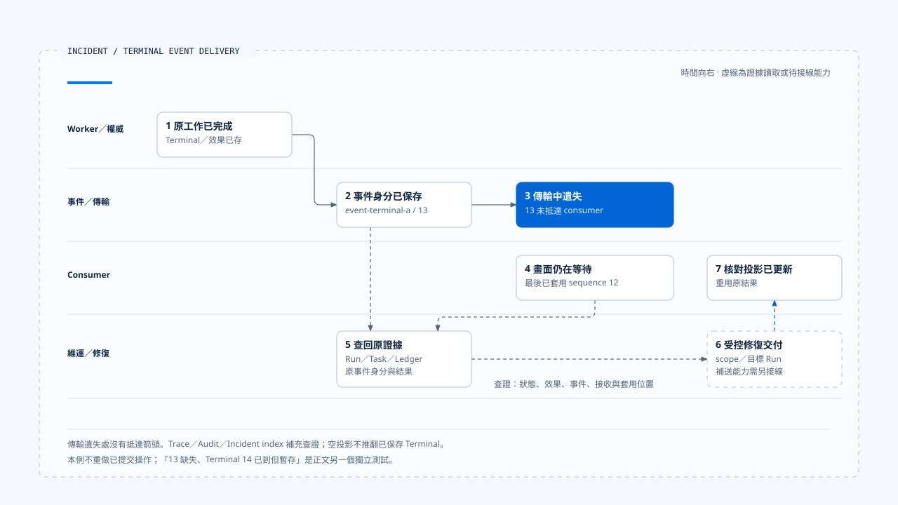

# 一次漏接終止事件的查證

[English](./06-case-terminal-event-incident.md) | [繁體中文](./06-case-terminal-event-incident-zh-TW.md) | [简体中文](./06-case-terminal-event-incident-zh-CN.md)

> 以下內容所提到的
> CCB 為 [claude-code-best](https://github.com/claude-code-best/claude-code) 的簡稱。
> Chat Gun 為 [chat-gun](https://github.com/HsienW/chat-gun)。

[回到導覽](./README-zh-TW.md) · 前一篇：[故障驗證與上線門檻](./05-fault-validation-and-release-gates-zh-TW.md)

> 使用者看見 Agent 一直執行中，服務的 live 檢查仍為綠燈。資料庫卻已保存 Terminal 結果，工具效果也有 committed 紀錄；前端只是沒有收到最後的完成事件。此時若重新建立工作，原本的交付問題可能變成第二次業務操作。

**先找回原 Run 的權威結果，再判讀交付與觀察缺口。**

畫面尚未完成時，先核對原 Run 的狀態、效果及事件。Trace 缺失或事件未套用，應作為待查線索，重做工作則需要另外的依據。

## 案例前提

以下 ID 與時序是教學資料，以 Chat Gun 的 envelope、repository、Frontend buffer、診斷及 health 接點說明責任。案例主線採用以下前提：

- 原 Run 的權威 Terminal 與效果結果已保存。
- 最後事件已按啟用的必要政策保存。
- 事件在 consumer 接收前遺失。

這個前提沒有宣稱 `emitEnvelope()` 已與所有正式 producer／傳輸形成同一條端到端管線。它提供的是事件建立及指定保存能力，傳輸與恢復交付仍需要具體 consumer 契約。

CCB 的 Trace、Session 與成本資料用作對照，不插入這條 Chat Gun 流程。案例也沒有假設所有故障在同一次執行全部發生。

## 查證關聯

| 身分／資料 | 教學值 | 用途 |
|---|---|---|
| Request／Run | `request-a`／`run-a` | 指定使用者要求與原執行。 |
| Task | `task-a` | 查找工作紀錄及相關事件。 |
| 最後已套用 sequence | `12` | 描述本例 consumer 已知位置。 |
| Terminal event | `event-terminal-a`，sequence `13` | 查回已保存的原事件身分。 |
| Ledger／結果參照 | 原工具執行與結果 reference | 查證效果及是否能重用結果。 |
| Trace／Audit reference | 若有則關聯原執行 | 補充診斷，不取代權威結果。 |

這份表格沒有要求所有儲存都具備同名欄位。查證時需沿現有關聯找到資料，不能只靠目前畫面的 Thread 名稱猜測 Run。

[開啟 HTML 圖解](../../assets/agent-runtime/events-and-operations/06-case-terminal-event-incident/06-terminal-event-incident-swimlane.html)

數字標示閱讀順序，時間大致向右推進，最後回到 consumer 核對投影。傳輸遺失處沒有抵達箭頭；查回原證據後，第 6 步仍需提供受控補送或投影重建能力，並重用原結果。

## 1. 先區分畫面與執行狀態

維運者先讀取原 Run／Task 的可信狀態及必要結果。Terminal 已保存時，接下來應追事件保存、傳輸與投影，不把使用者看見的 loading 直接當成執行仍在進行。

如果權威狀態尚未保存，則是另一個分支，需要確認原 Worker、finalizer 與外部效果；不能沿主線假設已完成。原 Run 已被替換時，也要核對 generation 與目前 owner，避免補送舊結果改寫新工作。

## 2. 查回最後事件與保存窗口

在案例主線，repository 能查到 `event-terminal-a`，payload 內有相應 runtime event identity。這可支援查證原 event ID、sequence 與 context，仍要重建及驗證 consumer 使用的完整內容。

若事件查不到，先區分狀態已保存但 append 失敗、查錯 Task、資料被刪除與 repository 讀取問題。查讀的 append 和狀態更新沒有自動建立全流程共同 transaction。

Terminal 的 allocator 條目也可能已釋放。重新產生事件不能只依新 Map 從 1 開始；應核對已保存身分、序號與補送契約，避免 consumer 把新序號當成 stale，或把新 ID 當成另一個事件。

## 3. 核對 consumer 是否接收及套用

Chat Gun `App.tsx` 的 versioned 路徑先解析事件，核對目前 authoritative Run，再交給 `BoundedRuntimeEventBuffer`，最後轉成產品事件。排查時可沿這條路徑分別確認：

1. 資料有沒有抵達。
2. Parser 是否接受。
3. Run 是否匹配。
4. Buffer 是否輸出。

主線選擇 sequence 13 根本未抵達的情況。只重建畫面並不能補回這筆事件，還需從持久來源取得原結果，經受控的 consumer 更新投影。

### 另一個分支：Terminal 已抵達但仍在 buffer

可以另設一個獨立測試：consumer 預期 13，13 遺失，Terminal 改為 14 並已抵達。小缺口可能留在 buffer，尚未超過 window 的向前條件；這個類別沒有時間到期就自動補回 13 的機制。

因此「沒有套用 Terminal」也可能是重排等待。向前跳過只處理有界投影的進度，不代表遺失事件已重新送達；應保留 gap observation，決定補取、重建投影或其他明確處置。

Task Timeline 的 `useTaskEvents()` 查讀版本使用 mock events，不能拿它的計時完成當成這條真實 stream 已正常交付。

## 4. 用診斷縮小範圍

Trace 有資料時，可以查最後執行、保存及傳輸接點；沒有資料時則保留未取樣、未啟用、未包覆或未匯出的可能。單一 error span 也不能代替外部未提交證據。

Audit 的一般 record 可能在保存失敗後告警並返回。若查不到紀錄，應確認 backend、Pool、redaction 與保存錯誤，不由空結果推論動作沒有發生。授權決策則沿自己的權威資料與 observer 查證。

Metrics 只能描述保留窗口內已收集資料。Restart 或 ring buffer 覆寫後，零失敗紀錄不代表該 Run 沒出錯；還要查回 Task、Ledger 與原事件。

## 5. Incident endpoint 能提供什麼

Chat Gun `/operations/incidents/:runId` 查詢 `IncidentProjectionIndex`。查讀的 index 是有界程序內 Map，保存 events、Audit／Trace reference、tool outcomes 與可空的 terminalResult，沒有自行向所有持久資料庫即時查詢。

`createAuthoritativeIncidentProjection()` 提供先寫 Fact Store、再更新 index 的介面。Index 更新失敗可返回 projected 為 false，另有 rebuild；提供的 InMemory Fact Store 本身也不具跨程序持久保證。

### 投影缺失時回查什麼

Endpoint 查不到資料或 terminalResult 為 null 時，應核對 Fact Store 的供應者、原始事實的寫入端，以及查詢與寫入是否使用同一份 index。Terminal 是否已保存，仍以對應的權威紀錄為準；類別或方法名稱中的 authoritative 無法取代這項查證。

## 6. 分開健康與處置資格

本例 live 通過，只表示對應 probe 的 alive 層條件成立。Readiness 與 resume-ready 另看依賴及設定，missingSignals 應明確保留。

若新的工作應暫停、舊工作仍可恢復，系統可以依政策分開處理。實際停止接納、draining 或限制寫入，必須由正式 consumer 執行；健康投影本身沒有替所有路徑完成治理。

這次事故若只是交付缺口，Reaper 重新排隊也未必適用。效果 unknown 時則交回 Effects and Recovery 的回查，核對物理派送與外部提交證據後，再決定後續處置。

## 7. 修復交付並留下驗證案例

當原結果、scope 與目標 Run 都已確認，可以設計重用原事件／結果的補送或投影重建。這是需要明確接線的修復契約，本文沒有宣稱現有 endpoint 已提供通用的一鍵補送。

修復應保留原事件身分、缺口原因與 consumer 結果，避免為了讓畫面變成完成而偽造新的外部成功。原工具已提交時，也不重新派送同一業務操作。

最後將本例變成可重現的故障測試，再關聯 policy、dataset、build 與 evidence reference。Gate 驗證的是這份產物與條件，仍需確認 CI 或部署實際消費該結果。

## 故障驗證矩陣

| 獨立情境 | 應查證的資料 | 處置方向 |
|---|---|---|
| Terminal 狀態未存 | Worker、Run／Task、效果及 finalizer。 | 依生命週期與恢復契約處理。 |
| 狀態成功、事件 append 失敗 | 狀態、原事件身分與保存錯誤。 | 修復交付責任，不重做原效果。 |
| 事件已存、傳輸遺失 | 原 event ID、sequence、consumer 位置。 | 依契約補取及去重。 |
| 前置 sequence 缺失 | Buffer、gap 與重排 observation。 | 明確選擇補取或投影重建。 |
| Exporter／Audit backend 故障 | 設定、取樣、降級及權威紀錄。 | 保留診斷缺失。 |
| Incident index 無資料 | Fact Store、填入／重建接線及原始狀態。 | 不將空投影當成無執行。 |
| 舊 Run 晚到 | Run、generation、當前 owner。 | 不讓舊結果接管新工作。 |

本輪查讀了各層接點，未執行跨資料庫、真實傳輸、Frontend、Collector 與 CI 的完整 E2E。案例中持久補送及投影修復屬明列的設計責任。

## 本篇的工程判斷

我會讓事故處理先回答「原工作已知到哪裡」，再問「哪個 consumer 缺少什麼」。這能把修復交付與重做操作分開，也讓觀察資料缺失時仍保有查證路徑。

## 實作參照與適用範圍

- Chat Gun Backend：`runtime/emit-envelope.ts`、`runtime/persistence/event-repository.ts`、`operations/incident-query.ts`、`operations/http-app.ts` 及前篇診斷／健康接點，路徑相對 `backend/src/`。
- Frontend：`frontend/src/App.tsx`、`frontend/src/lib/runtime-event-envelope.ts`、`frontend/src/components/AgentTaskTimeline/useTaskEvents.ts`。
- [來源與檔案指紋](./README-zh-TW.md#來源與查證狀態)記錄本地查讀範圍，沒有將各模組拼成已驗收的全部署管線。

## 接續閱讀

回到[Events and Operations 導覽](./README-zh-TW.md)核對各篇與圖解候選，或參照[一次提交不明的恢復](../effects-and-recovery/06-case-ambiguous-commit-recovery-zh-TW.md)，分辨交付缺口與外部效果未知的不同後續。
