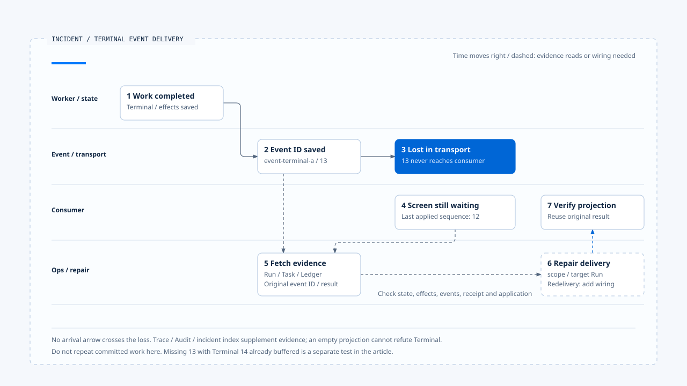

# Investigating a missed terminal event

[English](./06-case-terminal-event-incident.md) | [繁體中文](./06-case-terminal-event-incident-zh-TW.md) | [简体中文](./06-case-terminal-event-incident-zh-CN.md)

> In the following content:
> CCB is short for [claude-code-best](https://github.com/claude-code-best/claude-code).
> Chat Gun refers to [chat-gun](https://github.com/HsienW/chat-gun).

[Back to the guide](./README.md) · Previous: [Fault validation and release gates](./05-fault-validation-and-release-gates.md)

> The user sees an Agent that keeps running, and the service's live check remains green. Yet the database already holds a Terminal result and the tool effect has a committed record. The frontend simply missed the final completion event. Creating the work again could turn a delivery problem into a second business operation.

**Retrieve the original Run's authoritative result before interpreting delivery and observation gaps.**

When the screen remains incomplete, first check the original Run's state, effects, and events. A missing trace or unapplied event is an investigation lead. Repeating work requires additional grounds.

## Case assumptions

The following IDs and sequence are teaching data. They use Chat Gun's envelope, repository, frontend buffer, diagnostic, and health integration points to explain responsibilities. The main scenario assumes:

- The original Run's authoritative Terminal and effect result have been persisted.
- The final event has been persisted under the enabled required policy.
- The event is lost before consumer receipt.

These assumptions do not claim that `emitEnvelope()` already forms one end-to-end pipeline with all production producers/transports. It provides event construction and specified persistence capabilities. Transport and recovery delivery still need concrete consumer contracts.

CCB trace, Session, and cost data serve as comparisons without being inserted into this Chat Gun flow. The case treats the faults as separate scenarios; it does not assume they all occur in one execution.

## Investigation correlations

| Identity/data | Teaching value | Purpose |
|---|---|---|
| Request/Run | `request-a`/`run-a` | Identify the user request and original execution. |
| Task | `task-a` | Find work records and related events. |
| Last applied sequence | `12` | Describe the consumer's known position in this case. |
| Terminal event | `event-terminal-a`, sequence `13` | Retrieve the original persisted event identity. |
| Ledger/result reference | Original tool execution and result reference | Check effects and whether the result can be reused. |
| Trace/Audit reference | Correlate the original execution when available | Supplement diagnostics while authoritative results remain the basis for judgment. |

This table does not require identically named fields in every store. Follow existing correlations to locate data. The Thread name on the current screen alone cannot identify the Run reliably.

[Open the HTML diagram](../../assets/agent-runtime/events-and-operations/06-case-terminal-event-incident/06-terminal-event-incident-swimlane-en.html)

Numbers mark reading order. Time progresses roughly to the right, ending with a return to the consumer to verify its projection. No arrival arrow crosses the transport loss. After original evidence is retrieved, step 6 still needs controlled redelivery or projection reconstruction and must reuse the original result.

## 1. Separate screen state from execution state

The operator first reads trusted state and required results for the original Run/Task. Once Terminal persistence is confirmed, investigation moves to event persistence, transport, and projection. A loading indicator alone cannot establish ongoing execution.

An unpersisted authoritative state is a separate branch requiring checks of the original Worker, finalizer, and external effects. The main scenario's completion assumption cannot be applied there. If the original Run was replaced, also check generation and current owner so redelivered old results do not overwrite new work.

## 2. Retrieve the final event and inspect persistence windows

In the main scenario, the repository contains `event-terminal-a`, whose payload holds the corresponding runtime event identity. This supports investigation of the original event ID, sequence, and context. The complete content used by the consumer still needs reconstruction and validation.

If the event is absent, distinguish persisted state with failed append from a wrong Task lookup, deleted data, or repository read failure. The reviewed append and state update do not automatically create a shared transaction across the entire flow.

The Terminal allocator entry may already have been released. Recreating an event cannot rely on a new Map starting at 1 alone. Check persisted identity, sequence, and the redelivery contract so the consumer neither treats a new sequence as stale nor mistakes a new ID for another event.

## 3. Check consumer receipt and application

Chat Gun's versioned path in `App.tsx` parses the event, checks the current authoritative Run, passes it to `BoundedRuntimeEventBuffer`, and finally converts it into a product event. Investigate each point along this path:

1. Did the data arrive?
2. Did the parser accept it?
3. Did the Run match?
4. Did the buffer emit it?

The main scenario selects the case where sequence 13 never arrived. Rebuilding the screen alone cannot retrieve it. The original result must be fetched from a durable source and applied through a controlled consumer to update the projection.

### Another branch: Terminal arrived but remains buffered

A separate test can use a consumer expecting 13, a missing 13, and a Terminal event at 14 that has arrived. A small gap may remain buffered without exceeding the window's forward conditions. This class has no mechanism that automatically retrieves 13 when time expires.

An unapplied Terminal can therefore reflect reorder waiting. Forward skipping only advances a bounded projection; it does not establish redelivery of the missing event. Retain the gap observation and explicitly choose fetching, projection reconstruction, or another defined action.

The reviewed Task Timeline `useTaskEvents()` uses mock events. Its timer-driven completion cannot establish that this real stream has delivered successfully.

## 4. Use diagnostics to narrow the scope

When trace data exists, inspect the last execution, persistence, and transport integration points. When it is absent, retain possibilities such as unsampled, disabled, unwrapped, or unexported activity. A single error span also cannot establish that an external effect did not commit.

A general Audit record method may warn and return after persistence failure. If records are absent, check the backend, Pool, redaction, and persistence errors. An empty result cannot establish that the action never occurred. Investigate authorization decisions through their own authoritative data and observers.

Metrics describe only collected data within the retention window. After restart or ring buffer overwrite, zero failure records cannot establish that the Run had no errors. Retrieve Task, Ledger, and original event data as well.

## 5. What can the incident endpoint provide?

Chat Gun's `/operations/incidents/:runId` queries `IncidentProjectionIndex`. The reviewed index is a bounded in-process Map retaining events, Audit/Trace references, tool outcomes, and a nullable terminalResult. It does not query all durable databases live by itself.

`createAuthoritativeIncidentProjection()` provides an interface that writes the Fact Store before updating the index. An index update failure can return projected as false, and rebuild is available. The supplied InMemory Fact Store itself has no cross-process durability guarantee.

### What to check when the projection is missing

When the endpoint returns no data or terminalResult is null, check the Fact Store provider, the original fact writer, and whether queries and writes use the same index. The corresponding authoritative record determines whether Terminal was persisted. The word authoritative in a class or method name cannot replace that check.

## 6. Separate health from eligibility to act

A live pass in this case means only that the relevant probe's alive conditions hold. Readiness and resume-ready separately evaluate dependencies and settings; missingSignals should remain explicit.

If new work should pause while old work remains resumable, policy can handle them separately. Actual admission stops, draining, and write restrictions require production consumers to enforce them. The health projection alone does not govern every path.

Reaper requeueing may be inappropriate when the incident is only a delivery gap. Unknown effects return to Effects and Recovery reconciliation. Check physical dispatch and external commit evidence before choosing the next action.

## 7. Repair delivery and retain a validation case

Once the original result, scope, and target Run are confirmed, design redelivery or projection reconstruction that reuses the original event/result. This repair contract needs explicit wiring. This article claims no existing endpoint for general-purpose one-click redelivery.

Repair should retain original event identity, the gap reason, and consumer outcomes. Making the screen complete must not fabricate a new external success. If the original tool committed, do not dispatch the same business operation again.

Finally, turn the case into a reproducible fault test and correlate policy, dataset, build, and evidence references. The Gate validates that artifact and its conditions; confirm that CI or deployment actually consumes the result.

## Fault validation matrix

| Independent scenario | Data to investigate | Action direction |
|---|---|---|
| Terminal state not persisted | Worker, Run/Task, effects, and finalizer. | Follow lifecycle and recovery contracts. |
| State succeeds, event append fails | State, original event identity, and persistence error. | Repair delivery responsibility without repeating the original effect. |
| Event persisted, transport loses it | Original event ID, sequence, and consumer position. | Fetch and deduplicate according to contract. |
| Preceding sequence missing | Buffer, gap, and reordering observation. | Explicitly choose fetching or projection reconstruction. |
| Exporter/Audit backend fails | Settings, sampling, degradation, and authoritative records. | Retain diagnostic absence. |
| Incident index has no data | Fact Store, population/rebuild wiring, and original state. | An empty projection cannot establish absent execution. |
| Old Run arrives late | Run, generation, and current owner. | Prevent old results from taking over new work. |

This review inspected integration points at each layer. It did not run a full E2E across databases, real transport, frontend, Collector, and CI. Durable redelivery and projection repair remain explicit design responsibilities in the case.

## Engineering judgment

I would have incident handling first answer how far the original work is known to have progressed, then identify which consumer lacks which data. This separates delivery repair from repeating an operation and preserves an investigation path when observation data is missing.

## Implementation references and scope

- Chat Gun backend: `runtime/emit-envelope.ts`, `runtime/persistence/event-repository.ts`, `operations/incident-query.ts`, `operations/http-app.ts`, and diagnostic/health integration points from earlier articles, relative to `backend/src/`.
- Frontend: `frontend/src/App.tsx`, `frontend/src/lib/runtime-event-envelope.ts`, and `frontend/src/components/AgentTaskTimeline/useTaskEvents.ts`.
- [Sources and file fingerprints](./README.md#sources-and-verification-status) record the local review scope without presenting the modules as an acceptance-tested, deployment-wide pipeline.

## Further reading

Return to the [Events and Operations guide](./README.md) for the event contracts and delivery conditions, or see [Recovering an ambiguous commit](../effects-and-recovery/06-case-ambiguous-commit-recovery.md) to distinguish the next steps for delivery gaps and unknown external effects.
