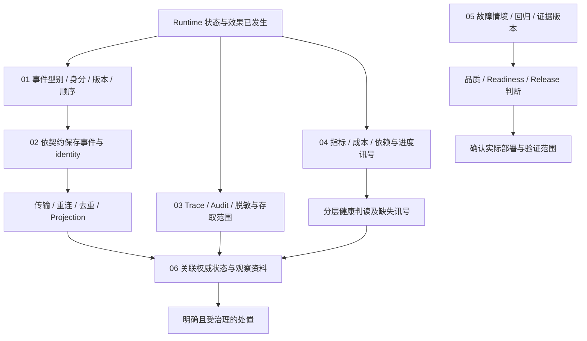

# Events and Operations

[English](./README.md) | [繁體中文](./README-zh-TW.md) | [简体中文](./README-zh-CN.md)

[回到 Runtime 总览](../README-zh-CN.md) · [Foundations 导览](../foundations/README-zh-CN.md) · [Effects and Recovery](../effects-and-recovery/README-zh-CN.md)

> 以下内容所提到的
> CCB 为 [claude-code-best](https://github.com/claude-code-best/claude-code) 的简称。
> Chat Gun 为 [chat-gun](https://github.com/HsienW/chat-gun)。

Run 已保存终止结果，前端却没收到最后一个事件；Trace 刚好没有取样，Metrics endpoint 仍回应成功。运维者需要查明哪笔工作已结束、哪个 consumer 漏接，以及现在能否继续接新工作。这些问题各有证据，不能用单一绿灯或一笔 Log 代替。

本区说明事件契约、保存交付、诊断关联、健康讯号、验证门槛与故障判读，将执行事实交给 consumer，并保留足以查证及操作的数据。

## 阅读顺序

| 篇次 | 文章 | 要回答的问题 | 文件名 | English |
|---|---|---|---|---|
| 01 | [Runtime 事件与顺序](./01-runtime-events-and-ordering-zh-CN.md) | 事件如何表达可信执行事实，识别、版本与 Run 内顺序各自提供什么？ | `01-runtime-events-and-ordering-zh-CN.md` | [Runtime events and ordering](./01-runtime-events-and-ordering.md) |
| 02 | [事件保存与结果交付](./02-event-persistence-and-delivery-zh-CN.md) | 事件从建立到 consumer 使用，哪些地方可能遗失、重复或晚到？ | `02-event-persistence-and-delivery-zh-CN.md` | [Event persistence and result delivery](./02-event-persistence-and-delivery.md) |
| 03 | [追踪、审计与数据边界](./03-tracing-audit-and-data-boundaries-zh-CN.md) | 如何关联一次执行，并分清 Trace、Audit 与内容数据的用途及保存限制？ | `03-tracing-audit-and-data-boundaries-zh-CN.md` | [Tracing, audit, and data boundaries](./03-tracing-audit-and-data-boundaries.md) |
| 04 | [指标、成本与健康判读](./04-metrics-cost-and-runtime-health-zh-CN.md) | 有哪些可用信号，如何分清活着、可接新工作、可恢复与缺少数据？ | `04-metrics-cost-and-runtime-health-zh-CN.md` | [Metrics, cost, and runtime health](./04-metrics-cost-and-runtime-health.md) |
| 05 | [故障验证与上线门槛](./05-fault-validation-and-release-gates-zh-CN.md) | 如何用可重现故障与版本化证据，支持品质、readiness 及 release 判断？ | `05-fault-validation-and-release-gates-zh-CN.md` | [Fault validation and release gates](./05-fault-validation-and-release-gates.md) |
| 06 | [一次漏接终止事件的查证](./06-case-terminal-event-incident-zh-CN.md) | 画面未完成、服务仍活着时，如何沿事件、状态与诊断证据决定处置？ | `06-case-terminal-event-incident-zh-CN.md` | [Investigating a missed terminal event](./06-case-terminal-event-incident.md) |

## 架构与责任范围

下图是责任与证据的阅读模型，没有宣称两个来源具备同一套管线，也没有把各存储与 exporter 画成共同 transaction。

### 与其他分类的分工

| 分类 | 本区承接的内容 | 既有分类保留的内容 |
|---|---|---|
| Foundations | 将执行证据展开成事件、诊断与操作接口。 | Runtime 定义、基本状态与责任交接。 |
| Execution Lifecycle | 读取 Terminal、ownership 与等待事实，说明如何保存及交付相应事件。 | 合法状态转移、替换、取消与 finalizer 的权威判断。 |
| Model and Tool Execution | 关联模型及工具 Attempt、延迟与结果分类。 | Provider 调用、流式传输组装、调度与容量演算法。 |
| Effects and Recovery | 显示 unknown、回查、补偿及接手证据，安排故障验证。 | Ledger、外部提交真相与恢复／补偿演算法。 |
| Harness Interaction and Feedback | 为产品提供有身份及顺序的结果与诊断数据。 | UI 呈现、用户反馈语义与互动政策。 |

### 各类数据的判断权

| 数据 | 主要用途 | 不能单独证明的事 |
|---|---|---|
| Runtime Event | 对 consumer 描述一项执行事实与关联。 | 该事实已由所有 consumer 收到。 |
| Task／Run／Ledger 记录 | 查回指定领域已保存的权威状态。 | 其他存储与外部系统同时完成。 |
| Trace | 检查已观察调用的父子关系与耗时。 | 未取样或尚未导出的工作没有发生。 |
| Audit | 保存行动、对象与决策的查证线索。 | 任意 Logger 都提供持久、不可窜改的审计。 |
| Metrics／Health | 汇整已取得的量测与探测结果。 | 缺少信号等于零故障，或健康投影就是部署验收。 |
| Gate Report | 依指定格式与条件汇整验证结果。 | 报告内每个值都来自可信、真实且完整的测试。 |

## 01. Runtime 事件与顺序

### 文章范围

从可信 Execution Context 到 Event Envelope，说明事件身份、语义类型与 Run 内顺序。事件、模型文字与 UI delta 分别处理，让 consumer 能知道自己读到的是哪种数据。

重点如下：

1. `schemaVersion`、`eventId`、`sequence`、`type`、`emittedAt`、context 与 payload 的责任。
2. Request、Thread、Run、Task、Step、Tool Call、Attempt 及可信 scope 的投影与关联。
3. Envelope Schema 与依事件类型的 payload Schema 分开验证；格式合法不自动代表语义兼容。
4. 同一事件重送与新事件的身份差异，以及 timestamp、sequence 与业务因果的限制。
5. 进程内序号配置、TTL／容量淘汰、重启 seed 与多实例协调要求。
6. Legacy Adapter 的启用条件、类型映射、既有 envelope 与未知类型出口。

### 已定位的来源与查证要求

Chat Gun `event-envelope.ts` 与 `event-sequence.ts` 已转接 contracts／kernel。已读取安装包中的事件 Schema 与 `RunSequenceAllocator`：sequence 保存在进程内 Map，有 TTL 与容量限制；`seed()` 可接受已保存最大序号，这些方法没有自行提供跨 Worker 的共享配置器。

Contracts 的 envelope Schema 会检查版本格式、ID、正整数 sequence 与 context 结构，payload 仍需依 type 另行解析。需要逐入口确认验证链，不能由版本字串符合 semver 就推论已完成版本协商。

`LegacyRuntimeEventAdapter` 受设置影响，未启用时返回原事件；已带 schemaVersion 的数据与一般 legacy 事件走不同处理。`platform/agent-runtime-events.ts` 另有旧事件联集及可选 correlation，应与 Task Event、标准 envelope 分开描述。CCB 的 stream event 与 Session 消息可作语义层次对照，不能直接当成相同持久事件协议。

## 02. 事件保存与结果交付

### 文章范围

沿事件建立、保存、传输与 consumer 套用，标出每个成功返回究竟确认了哪一步。跨进程投递的保证必须对回具体 consumer，不从方法名称补造持续订阅或自动补送。

重点如下：

1. `emitEnvelope()` 建立与返回 envelope，及事件持久化的可选／必要政策。
2. Terminal 状态写入、event identity 保存与结果送达的不同交易边界。
3. Append 失败、重复 event ID、重送与排序，保留原身份的前提。
4. 断线重连、读取缺口、晚到事件、去重与 Projection 的处理契约。
5. Task Event repository 的查询与 stream 接口实际做什么。
6. Outbox、持续订阅与 replay cursor 若作为建议设计，明列待实现与验证范围。

### 已定位的来源与查证要求

`emitEnvelope()` 在功能未启用时返回 legacy event。启用时建立 identity、sequence 与 payload；Terminal 默认要求 identity persistence，调用者仍可提供明确政策。必要保存缺少 repository／Task Event，或 append 失败时，不能沿该路径视为 envelope 已正常返回。

Terminal 的 allocator release 放在 finally，保存失败也可能释放程序内序号。需要将此窗口与重新读取、seed、身份重用分开核对。`stableEventId()` 只有在 caller 提供既有 ID 时才直接重用；新建 ID 的 helper 不会自行查找上次投递纪录。

`PgEventRepository.append()` 写入 Task Event；`findByTaskId()` 依 created_at、event_id 排序。`streamByTaskId()` 目前只列举一次该查询结果，不能称为持续追踪新事件。本文已续查 Frontend App 的 versioned event 接线、有界重排 buffer 与 mock Task Timeline，并分开描述。Backend 到 consumer 的全程传输、durable Outbox 与跨重连补送仍需逐入口验证，不默认 exactly-once 套用。

## 03. 追踪、审计与数据边界

### 文章范围

分开说明 Trace 与 Audit 的用途，沿同一组执行关联追查模型、工具、授权与恢复事件。内容进入 exporter 或持久存储前，要保留可用的识别及诊断信息，也需核对敏感数据处理范围。

重点如下：

1. Trace／Span 与 Run／Step／Attempt 的关联；parent context 与异步传递。
2. 取样、exporter 设置、初始化失败、flush／shutdown 与缺失 span 的判读。
3. Audit 的 actor、resource、decision、reason 与前后状态参照。
4. Console、Pg 与 Composite logger 的成功／失败语义及正式接线。
5. Audit、Opik、Trace error 与内容截断各自的规则，避免宣称存在一套通用 PII 遮罩。
6. 脱敏后仍需保留的关联，以及访问、保留期限、删除与数据外送的验证责任。

### 已定位的来源与查证要求

Chat Gun `otel-setup.ts` 依 enabled、exporter endpoint、protocol 与 sample rate 初始化。Production 缺少 endpoint 可在初始化时抛错，再被处理为 disabled；不能把「要求 endpoint」写成程序一定拒绝启动。`span-manager.ts` 提供异步 context 与 span 结束接点，实际入口、exporter 可用性与 flush 仍要核对。

`observability.ts` 默认可使用 Console Audit。选 Pg／Composite 但未取得 Pool 时，会告警并退回 Console；Composite 逐 backend 捕捉错误，不以整体调用完成证明每份审计都已保存。`PgAuditLogger` 的持久字段与决策 observer 要另对照，不能把推导 resource 或一般诊断 Log 当成可信批准记录。

Audit redaction 依字段规则省略数据，未分类字符串可被截断；这不能证明所有字符串中的秘密或 PII 都已识别。Opik 有自己的 redaction 接点。CCB `sessionTracing.ts` 有 interaction／LLM／tool 等 span 与进程内 context 管理；功能、exporter 与 beta 路径需续查实际 gate，不能由文件注解推论全部署启用。

## 04. 指标、成本与健康判读

### 文章范围

从已实际取得的信号建立判读，分清单次执行、保留窗口内汇整与部署健康。指标缺失需要保留缺失状态，成本与延迟也需交代计算及观测范围。

重点如下：

1. Task、Step、Tool、Token、Cost 与 Event 指标的维度及来源。
2. 进程内 ring buffer、覆写与 snapshot 的窗口，与部署全量历史的差别。
3. 模型用量、重试、工具耗时、排队、等待确认与结果保存延迟如何分开量测。
4. Cardinality、label 内容、缺失数据与 exporter 格式；避免把 Run ID 当成无限制聚合 label。
5. alive、reachable、acceptNewWork、resumeDurableWork 与 degraded 的分层判断。
6. Heartbeat、无进度、容量、draining 与依赖信号；健康投影如何交付运维 consumer。

### 已定位的来源与查证要求

Chat Gun `MetricsCollector` 使用有限容量的程序内 ring buffer。`/metrics` 提供 JSON snapshot，Operations HTTP 另有 OpenMetrics 输出入口；不能把路径名称直接写成 Prometheus 格式，也不能由单程序 snapshot 推论全部署统计。需要续查汇整公式、timestamp 范围与 consumer 的采样方式。

`projectRuntimeHealth()` 分开计算活着、依赖可达、接新工作及恢复工作条件，并保留 missingSignals。这份投影依 caller 提供的 boolean／Run 信号判断；它本身没有连接探测每个依赖。`multiInstanceSafe` 亦为输入，不是自动完成多实例验收。

`createOperationsHttpApp()` 的默认 probe 只提供部分信号，不能因 live 通过就认定 readiness 或 resume-ready 通过。CCB `cost-tracker.ts` 可对照 Session 用量、含／不含重试的 API duration 与 unknown model cost 接点；数值仍需追到具体更新位置，不能当成供应商最终账单。

## 05. 故障验证与上线门槛

### 文章范围

从故障情境与可核对证据建立验收条件，区分单元测试、注入故障、环境探测与 release report。每个 passed 都需说明数据来源、版本及适用部署范围。

重点如下：

1. 事件保存失败、断线重送、Trace exporter 故障、指标遗失与外部结果不明的测试设计。
2. Deterministic checks、Schema／state invariant、side-effect invariant 与 recovery bound。
3. Dataset、policy digest、runtime build、Execution Manifest 与 evidence reference 的关联。
4. Quality、Readiness 与 Release Gate 的不同输入、检查范围及失败出口。
5. Canary、负例与刻意回归案例；量测成本、延迟及恢复范围的前提。
6. 报告来源可信度、实际 CI／部署接线与人工处置；未接线条件不得描述为已阻止上线。

### 已定位的来源与查证要求

`evaluateReleaseGate()` 验证报告 Schema，再依 deterministic regression、business constraint、duplicate side effect、recovery、cost／latency、Manifest 与 hard negative 结果判断。它读取已提供的数值及 boolean，没有自行执行外部测试或验证 policy digest 的来源。查读条件只对 incompatible Manifest 拒绝，不能自行改述为 migratable 一律拒绝。

`release-gate.cli.ts` 读取工作目录内指定 JSON 报告、限制文件大小并回传 exit code。Package script 证明有执行入口，是否成为 CI 或部署的必要步骤仍要查证；未执行该 CLI。

`createReadinessGate()` 另检查 build／Manifest 关联，依序调用注入的 architecture、canary、deterministic、fault injection 与 correlated SLI checks。各 dependency 如何取得真实证据、抛错如何处理需另追。`quality-gate.ts` 有版本化检查配置与 invariant 类型，它与 Release Report 具有不同用途，不把型别或 fixture 当成已执行的验收。

## 06. 一次漏接终止事件的查证

### 文章范围

使用 Run 的 Terminal 结果已保存、consumer 未收到最后事件的教学情境，串起事件、数据库、Trace、Audit、Metrics 与 Health。案例以查证及受治理的后续操作为主，不将观察到的状态直接当成重新执行资格。

重点如下：

1. 列出 Request、Run、Task、event ID、sequence、Trace 与 Ledger 的查证关联。
2. 区分 Terminal 未保存、identity 保存失败、传输遗失及 consumer 未套用。
3. 查回权威状态与既有结果，核对晚到、重复及缺口，避免只依画面重启工作。
4. Trace 没取样、Audit fallback 与 Metrics 保留窗口不足时，如何保留缺失而不补造历史。
5. Live 通过但依赖、接纳或恢复条件未通过时的分层处置。
6. 将事件身份、保存窗口与 consumer 缺陷转成可重现负例及版本化 gate 证据。

### 已定位的来源与查证要求

案例组合本区 envelope、repository、observability、health 与 gate 接点。本文以明列前提的 Terminal 漏接案例，对照 Frontend 实际 buffer 接点；持久补送与投影修复仍列为待补契约，没有画成现成完整管线。

故障验证矩阵至少包含：Terminal 状态写入前停止、状态成功但事件保存失败、事件已存但连接中断、相同 ID 重送、allocator 重建后未 seed、exporter 不可用、健康信号缺失，以及旧 Run 的晚到事件。每种情境分开安排，并分别验证数据与实际物理派送次数。

Reaper 的 finding、decision 与 ownership 接手可作为操作交接对照，但其演算法沿用 Effects and Recovery。图中不以 requeued／resumed 字样表示工具已重送，也不以事件补送取代外部效果回查。

## 实现条件与限制

- Frontend App 在 Run 核对后使用有界 event buffer，容量与缺口处理不代表持久补送；Task Timeline 的查读版本仍使用 mock events。
- Pg Audit 的一般 record、授权决策保存与 Composite backend 具有不同失败路径；追踪及 Audit 缺失不反推操作未执行。
- Metrics snapshot 的状态计数以保留记录为基础，与独立工作数及全部署历史分开；Health 的 probe 输入也需实际接线。
- Completion、Readiness、Release Gate 各自处理不同输入，不将预先提供的 score 或 report 当成函数已执行外部验证。
- Incident endpoint 使用进程内投影，Fact Store 与 rebuild 接口不自动提供持久性；空投影不证明原执行不存在。

## 来源与查证状态

所列版本读取实现及部分配置／测试入口，未执行来源库测试、数据库故障、collector／exporter、真实 Canary、CI 部署或多 Worker 演练。套件源代码、wrapper、既有测试、正式入口接线与环境验收分别提供不同证据，后续本文须保留这些范围。

两轮图档均放在 `assets/agent-runtime/events-and-operations/`，沿用 Foundations 的浅底、蓝色焦点、虚线分区及圆角节点，保留 SVG／HTML。图为来源能力与设计责任的说明，未执行图中所述环境验收。

### 查读文件指纹

下表路径分别相对于两个来源库。包文件指纹记录本机安装内容，不能单靠包版本号推定远端或其他部署具有完全相同内容。

所列版本安装套件版本：`@gun-ai/harness-kernel@0.1.0-alpha.1`、`@gun-ai/harness-contracts@0.1.0-alpha.1`。

| 来源 | 相对路径 | SHA256 |
|---|---|---|
| Chat Gun | `backend/src/runtime/event-envelope.ts` | `bbfbc77484be155651db1ca8a4c6fb55a8a9107f34780d3e28cdac13ce88e213` |
| Chat Gun | `backend/src/runtime/event-sequence.ts` | `733e5dedef3e66a233c4bf621b4e73903bb41bd3a59956370595dc72f08550e8` |
| Chat Gun | `backend/src/runtime/emit-envelope.ts` | `a46a53b1f1975abcaa7efd92a9b85c69435caa39b27a0e9e7857ed754c561de1` |
| Chat Gun | `backend/src/runtime/legacy-event-adapter.ts` | `2fe857d435d33bd735c3043870b63e2d2b004a5f4376e1e98c16cb6663a481a9` |
| Chat Gun | `backend/src/runtime/persistence/event-repository.ts` | `57c8b1b2e6900123d1ccc86c12779f20c76dae570cdf0edc68e2a72f03d3a518` |
| Chat Gun | `backend/src/platform/agent-runtime-events.ts` | `3c12e27e88197c58e81f438613ef5918ae939466cf45029e630a51975c10f22c` |
| Chat Gun | `backend/src/platform/observability.ts` | `c1ea996d9a131784e62debd7566445d005b8dc49374eb5904b1e07495262455c` |
| Chat Gun | `backend/src/runtime/audit/pg-audit-logger.ts` | `d7d750055ba8bc8aa7d72cd85a9a7115c694e0a0c4d3bed08bbb682803e4b16a` |
| Chat Gun | `backend/src/runtime/audit/redaction.ts` | `fc0ecd6096511c4956f4ea2c6c940c2ed6fb7ab4b2c965633179bd3c2017f783` |
| Chat Gun | `backend/src/platform/tracing/otel-setup.ts` | `b1b3ea732f51a17fe091d3e1ed7cba91c4c086ba20a3186706b2af960146be29` |
| Chat Gun | `backend/src/platform/tracing/span-manager.ts` | `d1d8734bc83370a1d44d1f5ce052de11137bbb92270830df74e189e3e0b3ab50` |
| Chat Gun | `backend/src/platform/tracing/opik/opik-redaction.ts` | `d6d19aeef74cc53f2afe99ddfe0bb7d58147f1e5694ca0afb2bcacfd10ce7c8e` |
| Chat Gun | `backend/src/platform/tracing/opik/opik-setup.ts` | `9d888cbe210bf79c4e69e584e29881c07ce30e07c61ab77d4816ee214678129b` |
| Chat Gun | `backend/src/platform/metrics/metrics-collector.ts` | `fc7887d189771d05915c0f0da0e5a736d832cfd40347eeb5a1493c86c45186bc` |
| Chat Gun | `backend/src/platform/metrics/metrics-endpoint.ts` | `09b14c6a66a8b1eebdd887baabb1f74876e245703fe4d6bea03a26eeb4ece20d` |
| Chat Gun | `backend/src/platform/metrics/cost-tracker.ts` | `01bcdcbe7cd47a49bfffe78bcbb5af8ee5df7d14d2bd2f53fd362162a5cac1e6` |
| Chat Gun | `backend/src/operations/http-app.ts` | `b740a061d7ef5a66fcb63bbe2f89957c1bf3b0329ea5e77be5a1ad3e44299935` |
| Chat Gun | `backend/src/operations/metrics/health.ts` | `b298bb1795c0ef381913fd365aa577dae32f8f9cccb6870cda06ff452b91e9af` |
| Chat Gun | `backend/src/operations/release-gate.ts` | `ab47bc29bb519467198324cc2ae48a2c27b9e09badc8d9f73915059863c4d5f1` |
| Chat Gun | `backend/src/operations/release-gate.cli.ts` | `703a21539f587223f5e3e8bed506b36979bf39abf7c3409af9dd39154b6b8a0e` |
| Chat Gun | `backend/src/operations/readiness-gate.ts` | `91c9a7ac5688dab1ffcd42cd4409b8087512befb46bb911c8faa33e3a28f1f2c` |
| Chat Gun | `backend/src/operations/quality-gate.ts` | `a7cd2c9ef2f6c0263525d8980db244bba9f7734e6df56d0fcd1f60fe76961287` |
| Chat Gun | `backend/node_modules/@gun-ai/harness-kernel/src/events.ts` | `e55f5d991f3dd0a9f5e78c5e4dafa60fa33f285dc8506515f08d0a154082666d` |
| Chat Gun | `backend/node_modules/@gun-ai/harness-contracts/src/events.ts` | `52cfb6b0b4080421991567c7e4dc53e9d3ac5f87bf2ce48f268426ce6381bb04` |
| CCB | `src/utils/telemetry/sessionTracing.ts` | `803ff980b0f52f8cbaddda9d4dc3c9b09d15f19c83865edbe2732d4192e34f95` |
| CCB | `src/utils/telemetry/logger.ts` | `1551def23bd42b37d283a0cb279137d163e1554fa6c282b8082b9686be110a34` |
| CCB | `src/cost-tracker.ts` | `f202eef3702a02e0909f6a038a9ffa8e5736219dcdab60c489d00359d39ceee2` |
| Chat Gun | `backend/src/runtime/interaction/events.ts` | `89a8e24220e55053bd7d5742ba64068ff48560860f0d361390ce3333adaad7d8` |
| Chat Gun | `backend/src/operations/incident-query.ts` | `2b44a6d9e3a62437ab76ade5093cd127d4e4985111d6b0154c0d1b268d516b72` |
| Chat Gun | `backend/src/operations/metrics/export.ts` | `f600162808b389fa7be57920ceb24d13da540f84a823e4b3cb0396f5450d4860` |
| Chat Gun | `backend/src/runtime/persistence/migrations/003_create_task_events.sql` | `87a695a6e4fe864460391bcbe021ab6a28b616adcd5bd2b99fa79ebeb2cc714f` |
| Chat Gun | `backend/package.json` | `20aabbac6e2f5c33a7c46e11babb75cac5aab544a87eeab1ceb2fee338b50665` |
| Chat Gun | `frontend/src/App.tsx` | `a5d98d39ae2c74d274b41aca66831996388c50a3430e77117154e404717826ed` |
| Chat Gun | `frontend/src/lib/runtime-event-envelope.ts` | `31c7eb06fcf6de70888242c7a17dd98aa362675f9ec4a78837765f174085caff` |
| Chat Gun | `frontend/src/lib/agent-runtime-events.ts` | `7d1e10327be84766625a287cd74ed7e598766614233e93095dfbc56a4500b385` |
| Chat Gun | `frontend/src/components/AgentTaskTimeline/useTaskEvents.ts` | `7fc1773b60e9f42e2cca3cebb69a1248b61591d7df177a738274cccd7d08f0cf` |
