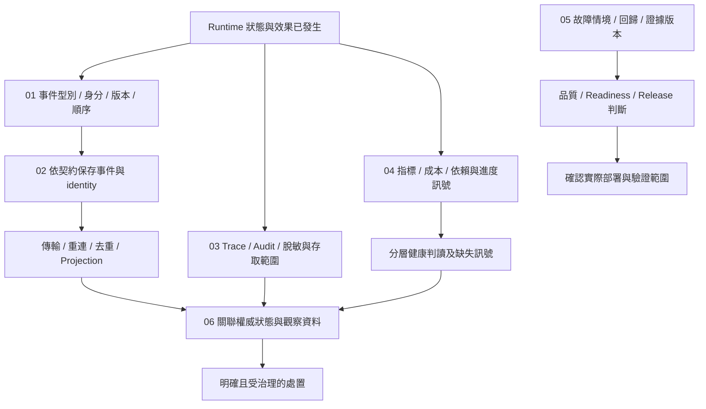

# Events and Operations

[English](./README.md) | [繁體中文](./README-zh-TW.md) | [简体中文](./README-zh-CN.md)

[回到 Runtime 總覽](../README-zh-TW.md) · [Foundations 導覽](../foundations/README-zh-TW.md) · [Effects and Recovery](../effects-and-recovery/README-zh-TW.md)

> 以下內容所提到的
> CCB 為 [claude-code-best](https://github.com/claude-code-best/claude-code) 的簡稱。
> Chat Gun 為 [chat-gun](https://github.com/HsienW/chat-gun)。

Run 已保存終止結果，前端卻沒收到最後一個事件；Trace 剛好沒有取樣，Metrics endpoint 仍回應成功。維運者需要查明哪筆工作已結束、哪個 consumer 漏接，以及現在能否繼續接新工作。這些問題各有證據，不能用單一綠燈或一筆 Log 代替。

本區說明事件契約、保存交付、診斷關聯、健康訊號、驗證門檻與故障判讀，將執行事實交給 consumer，並保留足以查證及操作的資料。

## 閱讀順序

| 篇次 | 文章 | 要回答的問題 | 檔名 | English |
|---|---|---|---|---|
| 01 | [Runtime 事件與順序](./01-runtime-events-and-ordering-zh-TW.md) | 事件如何表達可信執行事實，識別、版本與 Run 內順序各自提供什麼？ | `01-runtime-events-and-ordering-zh-TW.md` | [Runtime events and ordering](./01-runtime-events-and-ordering.md) |
| 02 | [事件保存與結果交付](./02-event-persistence-and-delivery-zh-TW.md) | 事件從建立到 consumer 使用，哪些地方可能遺失、重複或晚到？ | `02-event-persistence-and-delivery-zh-TW.md` | [Event persistence and result delivery](./02-event-persistence-and-delivery.md) |
| 03 | [追蹤、稽核與資料邊界](./03-tracing-audit-and-data-boundaries-zh-TW.md) | 如何關聯一次執行，並分清 Trace、Audit 與內容資料的用途及保存限制？ | `03-tracing-audit-and-data-boundaries-zh-TW.md` | [Tracing, audit, and data boundaries](./03-tracing-audit-and-data-boundaries.md) |
| 04 | [指標、成本與健康判讀](./04-metrics-cost-and-runtime-health-zh-TW.md) | 有哪些可用訊號，如何分清活著、可接新工作、可恢復與缺少資料？ | `04-metrics-cost-and-runtime-health-zh-TW.md` | [Metrics, cost, and runtime health](./04-metrics-cost-and-runtime-health.md) |
| 05 | [故障驗證與上線門檻](./05-fault-validation-and-release-gates-zh-TW.md) | 如何用可重現故障與版本化證據，支持品質、readiness 及 release 判斷？ | `05-fault-validation-and-release-gates-zh-TW.md` | [Fault validation and release gates](./05-fault-validation-and-release-gates.md) |
| 06 | [一次漏接終止事件的查證](./06-case-terminal-event-incident-zh-TW.md) | 畫面未完成、服務仍活著時，如何沿事件、狀態與診斷證據決定處置？ | `06-case-terminal-event-incident-zh-TW.md` | [Investigating a missed terminal event](./06-case-terminal-event-incident.md) |

## 架構與責任範圍

下圖是責任與證據的閱讀模型，沒有宣稱兩個來源具備同一套管線，也沒有把各儲存與 exporter 畫成共同 transaction。

### 與其他分類的分工

| 分類 | 本區承接的內容 | 既有分類保留的內容 |
|---|---|---|
| Foundations | 將執行證據展開成事件、診斷與操作介面。 | Runtime 定義、基本狀態與責任交接。 |
| Execution Lifecycle | 讀取 Terminal、ownership 與等待事實，說明如何保存及交付相應事件。 | 合法狀態轉移、替換、取消與 finalizer 的權威判斷。 |
| Model and Tool Execution | 關聯模型及工具 Attempt、延遲與結果分類。 | Provider 呼叫、串流組裝、排程與容量演算法。 |
| Effects and Recovery | 顯示 unknown、回查、補償及接手證據，安排故障驗證。 | Ledger、外部提交真相與恢復／補償演算法。 |
| Harness Interaction and Feedback | 為產品提供有身分及順序的結果與診斷資料。 | UI 呈現、使用者回饋語意與互動政策。 |

### 各類資料的判斷權

| 資料 | 主要用途 | 不能單獨證明的事 |
|---|---|---|
| Runtime Event | 對 consumer 描述一項執行事實與關聯。 | 該事實已由所有 consumer 收到。 |
| Task／Run／Ledger 紀錄 | 查回指定領域已保存的權威狀態。 | 其他儲存與外部系統同時完成。 |
| Trace | 檢查已觀察呼叫的父子關係與耗時。 | 未取樣或尚未匯出的工作沒有發生。 |
| Audit | 保存行動、對象與決策的查證線索。 | 任意 Logger 都提供持久、不可竄改的稽核。 |
| Metrics／Health | 彙整已取得的量測與探測結果。 | 缺少訊號等於零故障，或健康投影就是部署驗收。 |
| Gate Report | 依指定格式與條件彙整驗證結果。 | 報告內每個值都來自可信、真實且完整的測試。 |

## 01. Runtime 事件與順序

### 文章範圍

從可信 Execution Context 到 Event Envelope，說明事件身分、語意型別與 Run 內順序。事件、模型文字與 UI delta 分別處理，讓 consumer 能知道自己讀到的是哪種資料。

重點如下：

1. `schemaVersion`、`eventId`、`sequence`、`type`、`emittedAt`、context 與 payload 的責任。
2. Request、Thread、Run、Task、Step、Tool Call、Attempt 及可信 scope 的投影與關聯。
3. Envelope Schema 與依事件型別的 payload Schema 分開驗證；格式合法不自動代表語意相容。
4. 同一事件重送與新事件的身分差異，以及 timestamp、sequence 與業務因果的限制。
5. 程序內序號配置、TTL／容量淘汰、重啟 seed 與多實例協調要求。
6. Legacy Adapter 的啟用條件、型別映射、既有 envelope 與未知型別出口。

### 已定位的來源與查證要求

Chat Gun `event-envelope.ts` 與 `event-sequence.ts` 已轉接 contracts／kernel。已讀取安裝套件中的事件 Schema 與 `RunSequenceAllocator`：sequence 保存在程序內 Map，有 TTL 與容量限制；`seed()` 可接受已保存最大序號，這些方法沒有自行提供跨 Worker 的共享配置器。

Contracts 的 envelope Schema 會檢查版本格式、ID、正整數 sequence 與 context 結構，payload 仍需依 type 另行解析。需要逐入口確認驗證鏈，不能由版本字串符合 semver 就推論已完成版本協商。

`LegacyRuntimeEventAdapter` 受設定影響，未啟用時回傳原事件；已帶 schemaVersion 的資料與一般 legacy 事件走不同處理。`platform/agent-runtime-events.ts` 另有舊事件聯集及可選 correlation，應與 Task Event、標準 envelope 分開描述。CCB 的 stream event 與 Session 訊息可作語意層次對照，不能直接當成相同持久事件協定。

## 02. 事件保存與結果交付

### 文章範圍

沿事件建立、保存、傳輸與 consumer 套用，標出每個成功回傳究竟確認了哪一步。跨程序投遞的保證必須對回具體 consumer，不從方法名稱補造持續訂閱或自動補送。

重點如下：

1. `emitEnvelope()` 建立與回傳 envelope，及事件持久化的可選／必要政策。
2. Terminal 狀態寫入、event identity 保存與結果送達的不同交易邊界。
3. Append 失敗、重複 event ID、重送與排序，保留原身分的前提。
4. 斷線重連、讀取缺口、晚到事件、去重與 Projection 的處理契約。
5. Task Event repository 的查詢與 stream 介面實際做什麼。
6. Outbox、持續訂閱與 replay cursor 若作為建議設計，明列待實作與驗證範圍。

### 已定位的來源與查證要求

`emitEnvelope()` 在功能未啟用時返回 legacy event。啟用時建立 identity、sequence 與 payload；Terminal 預設要求 identity persistence，呼叫者仍可提供明確政策。必要保存缺少 repository／Task Event，或 append 失敗時，不能沿該路徑視為 envelope 已正常返回。

Terminal 的 allocator release 放在 finally，保存失敗也可能釋放程序內序號。需要將此窗口與重新讀取、seed、身分重用分開核對。`stableEventId()` 只有在 caller 提供既有 ID 時才直接重用；新建 ID 的 helper 不會自行查找上次投遞紀錄。

`PgEventRepository.append()` 寫入 Task Event；`findByTaskId()` 依 created_at、event_id 排序。`streamByTaskId()` 目前只列舉一次該查詢結果，不能稱為持續追蹤新事件。本文已續查 Frontend App 的 versioned event 接線、有界重排 buffer 與 mock Task Timeline，並分開描述。Backend 到 consumer 的全程傳輸、durable Outbox 與跨重連補送仍需逐入口驗證，不預設 exactly-once 套用。

## 03. 追蹤、稽核與資料邊界

### 文章範圍

分開說明 Trace 與 Audit 的用途，沿同一組執行關聯追查模型、工具、授權與恢復事件。內容進入 exporter 或持久儲存前，要保留可用的識別及診斷資訊，也需核對敏感資料處理範圍。

重點如下：

1. Trace／Span 與 Run／Step／Attempt 的關聯；parent context 與非同步傳遞。
2. 取樣、exporter 設定、初始化失敗、flush／shutdown 與缺失 span 的判讀。
3. Audit 的 actor、resource、decision、reason 與前後狀態參照。
4. Console、Pg 與 Composite logger 的成功／失敗語意及正式接線。
5. Audit、Opik、Trace error 與內容截斷各自的規則，避免宣稱存在一套通用 PII 遮罩。
6. 脫敏後仍需保留的關聯，以及存取、保留期限、刪除與資料外送的驗證責任。

### 已定位的來源與查證要求

Chat Gun `otel-setup.ts` 依 enabled、exporter endpoint、protocol 與 sample rate 初始化。Production 缺少 endpoint 可在初始化時拋錯，再被處理為 disabled；不能把「要求 endpoint」寫成程序一定拒絕啟動。`span-manager.ts` 提供非同步 context 與 span 結束接點，實際入口、exporter 可用性與 flush 仍要核對。

`observability.ts` 預設可使用 Console Audit。選 Pg／Composite 但未取得 Pool 時，會告警並退回 Console；Composite 逐 backend 捕捉錯誤，不以整體呼叫完成證明每份稽核都已保存。`PgAuditLogger` 的持久欄位與決策 observer 要另對照，不能把推導 resource 或一般診斷 Log 當成可信批准紀錄。

Audit redaction 依欄位規則省略資料，未分類字串可被截斷；這不能證明所有字串中的祕密或 PII 都已識別。Opik 有自己的 redaction 接點。CCB `sessionTracing.ts` 有 interaction／LLM／tool 等 span 與程序內 context 管理；功能、exporter 與 beta 路徑需續查實際 gate，不能由檔案註解推論全部署啟用。

## 04. 指標、成本與健康判讀

### 文章範圍

從已實際取得的訊號建立判讀，分清單次執行、保留窗口內彙整與部署健康。指標缺失需要保留缺失狀態，成本與延遲也需交代計算及觀測範圍。

重點如下：

1. Task、Step、Tool、Token、Cost 與 Event 指標的維度及來源。
2. 程序內 ring buffer、覆寫與 snapshot 的窗口，與部署全量歷史的差別。
3. 模型用量、重試、工具耗時、排隊、等待確認與結果保存延遲如何分開量測。
4. Cardinality、label 內容、缺失資料與 exporter 格式；避免把 Run ID 當成無限制聚合 label。
5. alive、reachable、acceptNewWork、resumeDurableWork 與 degraded 的分層判斷。
6. Heartbeat、無進度、容量、draining 與依賴訊號；健康投影如何交付維運 consumer。

### 已定位的來源與查證要求

Chat Gun `MetricsCollector` 使用有限容量的程序內 ring buffer。`/metrics` 提供 JSON snapshot，Operations HTTP 另有 OpenMetrics 輸出入口；不能把路徑名稱直接寫成 Prometheus 格式，也不能由單程序 snapshot 推論全部署統計。需要續查彙整公式、timestamp 範圍與 consumer 的採樣方式。

`projectRuntimeHealth()` 分開計算活著、依賴可達、接新工作及恢復工作條件，並保留 missingSignals。這份投影依 caller 提供的 boolean／Run 訊號判斷；它本身沒有連線探測每個依賴。`multiInstanceSafe` 亦為輸入，不是自動完成多實例驗收。

`createOperationsHttpApp()` 的預設 probe 只提供部分訊號，不能因 live 通過就認定 readiness 或 resume-ready 通過。CCB `cost-tracker.ts` 可對照 Session 用量、含／不含重試的 API duration 與 unknown model cost 接點；數值仍需追到具體更新位置，不能當成供應商最終帳單。

## 05. 故障驗證與上線門檻

### 文章範圍

從故障情境與可核對證據建立驗收條件，區分單元測試、注入故障、環境探測與 release report。每個 passed 都需說明資料來源、版本及適用部署範圍。

重點如下：

1. 事件保存失敗、斷線重送、Trace exporter 故障、指標遺失與外部結果不明的測試設計。
2. Deterministic checks、Schema／state invariant、side-effect invariant 與 recovery bound。
3. Dataset、policy digest、runtime build、Execution Manifest 與 evidence reference 的關聯。
4. Quality、Readiness 與 Release Gate 的不同輸入、檢查範圍及失敗出口。
5. Canary、負例與刻意回歸案例；量測成本、延遲及恢復範圍的前提。
6. 報告來源可信度、實際 CI／部署接線與人工處置；未接線條件不得描述為已阻止上線。

### 已定位的來源與查證要求

`evaluateReleaseGate()` 驗證報告 Schema，再依 deterministic regression、business constraint、duplicate side effect、recovery、cost／latency、Manifest 與 hard negative 結果判斷。它讀取已提供的數值及 boolean，沒有自行執行外部測試或驗證 policy digest 的來源。查讀條件只對 incompatible Manifest 拒絕，不能自行改述為 migratable 一律拒絕。

`release-gate.cli.ts` 讀取工作目錄內指定 JSON 報告、限制檔案大小並回傳 exit code。Package script 證明有執行入口，是否成為 CI 或部署的必要步驟仍要查證；未執行該 CLI。

`createReadinessGate()` 另檢查 build／Manifest 關聯，依序呼叫注入的 architecture、canary、deterministic、fault injection 與 correlated SLI checks。各 dependency 如何取得真實證據、拋錯如何處理需另追。`quality-gate.ts` 有版本化檢查設定與 invariant 類型，它與 Release Report 具有不同用途，不把型別或 fixture 當成已執行的驗收。

## 06. 一次漏接終止事件的查證

### 文章範圍

使用 Run 的 Terminal 結果已保存、consumer 未收到最後事件的教學情境，串起事件、資料庫、Trace、Audit、Metrics 與 Health。案例以查證及受治理的後續操作為主，不將觀察到的狀態直接當成重新執行資格。

重點如下：

1. 列出 Request、Run、Task、event ID、sequence、Trace 與 Ledger 的查證關聯。
2. 區分 Terminal 未保存、identity 保存失敗、傳輸遺失及 consumer 未套用。
3. 查回權威狀態與既有結果，核對晚到、重複及缺口，避免只依畫面重啟工作。
4. Trace 沒取樣、Audit fallback 與 Metrics 保留窗口不足時，如何保留缺失而不補造歷史。
5. Live 通過但依賴、接納或恢復條件未通過時的分層處置。
6. 將事件身分、保存窗口與 consumer 缺陷轉成可重現負例及版本化 gate 證據。

### 已定位的來源與查證要求

案例組合本區 envelope、repository、observability、health 與 gate 接點。本文以明列前提的 Terminal 漏接案例，對照 Frontend 實際 buffer 接點；持久補送與投影修復仍列為待補契約，沒有畫成現成完整管線。

故障驗證矩陣至少包含：Terminal 狀態寫入前停止、狀態成功但事件保存失敗、事件已存但連線中斷、相同 ID 重送、allocator 重建後未 seed、exporter 不可用、健康訊號缺失，以及舊 Run 的晚到事件。每種情境分開安排，並分別驗證資料與實際物理派送次數。

Reaper 的 finding、decision 與 ownership 接手可作為操作交接對照，但其演算法沿用 Effects and Recovery。圖中不以 requeued／resumed 字樣表示工具已重送，也不以事件補送取代外部效果回查。

## 實作條件與限制

- Frontend App 在 Run 核對後使用有界 event buffer，容量與缺口處理不代表持久補送；Task Timeline 的查讀版本仍使用 mock events。
- Pg Audit 的一般 record、授權決策保存與 Composite backend 具有不同失敗路徑；追蹤及 Audit 缺失不反推操作未執行。
- Metrics snapshot 的狀態計數以保留紀錄為基礎，與獨立工作數及全部署歷史分開；Health 的 probe 輸入也需實際接線。
- Completion、Readiness、Release Gate 各自處理不同輸入，不將預先提供的 score 或 report 當成函式已執行外部驗證。
- Incident endpoint 使用程序內投影，Fact Store 與 rebuild 介面不自動提供持久性；空投影不證明原執行不存在。

## 來源與查證狀態

所列版本讀取實作及部分設定／測試入口，未執行來源庫測試、資料庫故障、collector／exporter、真實 Canary、CI 部署或多 Worker 演練。套件原始碼、wrapper、既有測試、正式入口接線與環境驗收分別提供不同證據，後續本文須保留這些範圍。

兩輪圖檔均放在 `assets/agent-runtime/events-and-operations/`，沿用 Foundations 的淺底、藍色焦點、虛線分區及圓角節點，保留 SVG／HTML。圖為來源能力與設計責任的說明，未執行圖中所述環境驗收。

### 查讀檔案指紋

下表路徑分別相對於兩個來源庫。套件檔案指紋記錄本機安裝內容，不能單靠套件版本號推定遠端或其他部署具有完全相同內容。

所列版本安裝套件版本：`@gun-ai/harness-kernel@0.1.0-alpha.1`、`@gun-ai/harness-contracts@0.1.0-alpha.1`。

| 來源 | 相對路徑 | SHA256 |
|---|---|---|
| Chat Gun | `backend/src/runtime/event-envelope.ts` | `bbfbc77484be155651db1ca8a4c6fb55a8a9107f34780d3e28cdac13ce88e213` |
| Chat Gun | `backend/src/runtime/event-sequence.ts` | `733e5dedef3e66a233c4bf621b4e73903bb41bd3a59956370595dc72f08550e8` |
| Chat Gun | `backend/src/runtime/emit-envelope.ts` | `a46a53b1f1975abcaa7efd92a9b85c69435caa39b27a0e9e7857ed754c561de1` |
| Chat Gun | `backend/src/runtime/legacy-event-adapter.ts` | `2fe857d435d33bd735c3043870b63e2d2b004a5f4376e1e98c16cb6663a481a9` |
| Chat Gun | `backend/src/runtime/persistence/event-repository.ts` | `57c8b1b2e6900123d1ccc86c12779f20c76dae570cdf0edc68e2a72f03d3a518` |
| Chat Gun | `backend/src/platform/agent-runtime-events.ts` | `3c12e27e88197c58e81f438613ef5918ae939466cf45029e630a51975c10f22c` |
| Chat Gun | `backend/src/platform/observability.ts` | `c1ea996d9a131784e62debd7566445d005b8dc49374eb5904b1e07495262455c` |
| Chat Gun | `backend/src/runtime/audit/pg-audit-logger.ts` | `d7d750055ba8bc8aa7d72cd85a9a7115c694e0a0c4d3bed08bbb682803e4b16a` |
| Chat Gun | `backend/src/runtime/audit/redaction.ts` | `fc0ecd6096511c4956f4ea2c6c940c2ed6fb7ab4b2c965633179bd3c2017f783` |
| Chat Gun | `backend/src/platform/tracing/otel-setup.ts` | `b1b3ea732f51a17fe091d3e1ed7cba91c4c086ba20a3186706b2af960146be29` |
| Chat Gun | `backend/src/platform/tracing/span-manager.ts` | `d1d8734bc83370a1d44d1f5ce052de11137bbb92270830df74e189e3e0b3ab50` |
| Chat Gun | `backend/src/platform/tracing/opik/opik-redaction.ts` | `d6d19aeef74cc53f2afe99ddfe0bb7d58147f1e5694ca0afb2bcacfd10ce7c8e` |
| Chat Gun | `backend/src/platform/tracing/opik/opik-setup.ts` | `9d888cbe210bf79c4e69e584e29881c07ce30e07c61ab77d4816ee214678129b` |
| Chat Gun | `backend/src/platform/metrics/metrics-collector.ts` | `fc7887d189771d05915c0f0da0e5a736d832cfd40347eeb5a1493c86c45186bc` |
| Chat Gun | `backend/src/platform/metrics/metrics-endpoint.ts` | `09b14c6a66a8b1eebdd887baabb1f74876e245703fe4d6bea03a26eeb4ece20d` |
| Chat Gun | `backend/src/platform/metrics/cost-tracker.ts` | `01bcdcbe7cd47a49bfffe78bcbb5af8ee5df7d14d2bd2f53fd362162a5cac1e6` |
| Chat Gun | `backend/src/operations/http-app.ts` | `b740a061d7ef5a66fcb63bbe2f89957c1bf3b0329ea5e77be5a1ad3e44299935` |
| Chat Gun | `backend/src/operations/metrics/health.ts` | `b298bb1795c0ef381913fd365aa577dae32f8f9cccb6870cda06ff452b91e9af` |
| Chat Gun | `backend/src/operations/release-gate.ts` | `ab47bc29bb519467198324cc2ae48a2c27b9e09badc8d9f73915059863c4d5f1` |
| Chat Gun | `backend/src/operations/release-gate.cli.ts` | `703a21539f587223f5e3e8bed506b36979bf39abf7c3409af9dd39154b6b8a0e` |
| Chat Gun | `backend/src/operations/readiness-gate.ts` | `91c9a7ac5688dab1ffcd42cd4409b8087512befb46bb911c8faa33e3a28f1f2c` |
| Chat Gun | `backend/src/operations/quality-gate.ts` | `a7cd2c9ef2f6c0263525d8980db244bba9f7734e6df56d0fcd1f60fe76961287` |
| Chat Gun | `backend/node_modules/@gun-ai/harness-kernel/src/events.ts` | `e55f5d991f3dd0a9f5e78c5e4dafa60fa33f285dc8506515f08d0a154082666d` |
| Chat Gun | `backend/node_modules/@gun-ai/harness-contracts/src/events.ts` | `52cfb6b0b4080421991567c7e4dc53e9d3ac5f87bf2ce48f268426ce6381bb04` |
| CCB | `src/utils/telemetry/sessionTracing.ts` | `803ff980b0f52f8cbaddda9d4dc3c9b09d15f19c83865edbe2732d4192e34f95` |
| CCB | `src/utils/telemetry/logger.ts` | `1551def23bd42b37d283a0cb279137d163e1554fa6c282b8082b9686be110a34` |
| CCB | `src/cost-tracker.ts` | `f202eef3702a02e0909f6a038a9ffa8e5736219dcdab60c489d00359d39ceee2` |
| Chat Gun | `backend/src/runtime/interaction/events.ts` | `89a8e24220e55053bd7d5742ba64068ff48560860f0d361390ce3333adaad7d8` |
| Chat Gun | `backend/src/operations/incident-query.ts` | `2b44a6d9e3a62437ab76ade5093cd127d4e4985111d6b0154c0d1b268d516b72` |
| Chat Gun | `backend/src/operations/metrics/export.ts` | `f600162808b389fa7be57920ceb24d13da540f84a823e4b3cb0396f5450d4860` |
| Chat Gun | `backend/src/runtime/persistence/migrations/003_create_task_events.sql` | `87a695a6e4fe864460391bcbe021ab6a28b616adcd5bd2b99fa79ebeb2cc714f` |
| Chat Gun | `backend/package.json` | `20aabbac6e2f5c33a7c46e11babb75cac5aab544a87eeab1ceb2fee338b50665` |
| Chat Gun | `frontend/src/App.tsx` | `a5d98d39ae2c74d274b41aca66831996388c50a3430e77117154e404717826ed` |
| Chat Gun | `frontend/src/lib/runtime-event-envelope.ts` | `31c7eb06fcf6de70888242c7a17dd98aa362675f9ec4a78837765f174085caff` |
| Chat Gun | `frontend/src/lib/agent-runtime-events.ts` | `7d1e10327be84766625a287cd74ed7e598766614233e93095dfbc56a4500b385` |
| Chat Gun | `frontend/src/components/AgentTaskTimeline/useTaskEvents.ts` | `7fc1773b60e9f42e2cca3cebb69a1248b61591d7df177a738274cccd7d08f0cf` |
