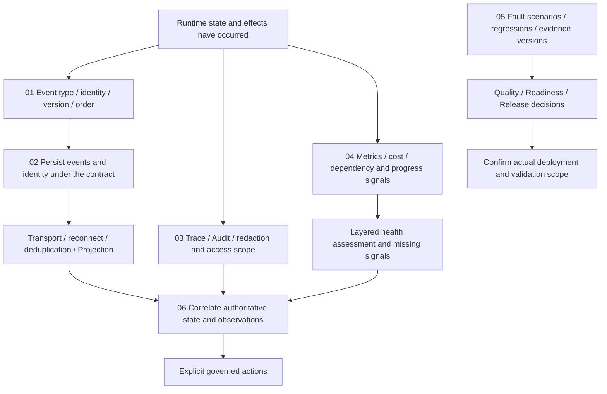

# Events and Operations

[English](./README.md) | [繁體中文](./README-zh-TW.md) | [简体中文](./README-zh-CN.md)

[Back to Runtime overview](../README.md) · [Foundations guide](../foundations/README.md) · [Effects and Recovery](../effects-and-recovery/README.md)

> In the following content:
> CCB is short for [claude-code-best](https://github.com/claude-code-best/claude-code).
> Chat Gun refers to [chat-gun](https://github.com/HsienW/chat-gun).

A Run has persisted its terminal result, but the frontend never receives the final event. The Trace was not sampled, while the Metrics endpoint still responds successfully. Operators need to establish which work ended, which consumer missed delivery, and whether new work can be accepted. Each question needs its own evidence; a single green light or Log entry cannot answer them all.

This section covers event contracts, persistence and delivery, diagnostic correlation, health signals, validation gates, and incident investigation. It explains how to deliver execution facts to consumers and retain data for verification and operations.

## Reading order

| Part | Article | Question to answer | Filename | Traditional Chinese |
|---|---|---|---|---|
| 01 | [Runtime events and ordering](./01-runtime-events-and-ordering.md) | How do events express trusted execution facts, and what do identity, version, and Run-local order each provide? | `01-runtime-events-and-ordering.md` | [繁體中文](./01-runtime-events-and-ordering-zh-TW.md) |
| 02 | [Event persistence and result delivery](./02-event-persistence-and-delivery.md) | Where can events be lost, duplicated, or delayed between creation and consumer use? | `02-event-persistence-and-delivery.md` | [繁體中文](./02-event-persistence-and-delivery-zh-TW.md) |
| 03 | [Tracing, audit, and data boundaries](./03-tracing-audit-and-data-boundaries.md) | How is execution correlated, and how do Trace, Audit, and content data differ in purpose and retention limits? | `03-tracing-audit-and-data-boundaries.md` | [繁體中文](./03-tracing-audit-and-data-boundaries-zh-TW.md) |
| 04 | [Metrics, cost, and runtime health](./04-metrics-cost-and-runtime-health.md) | Which signals distinguish being alive, accepting new work, recovery readiness, and missing data? | `04-metrics-cost-and-runtime-health.md` | [繁體中文](./04-metrics-cost-and-runtime-health-zh-TW.md) |
| 05 | [Fault validation and release gates](./05-fault-validation-and-release-gates.md) | How do reproducible failures and versioned evidence support quality, readiness, and release decisions? | `05-fault-validation-and-release-gates.md` | [繁體中文](./05-fault-validation-and-release-gates-zh-TW.md) |
| 06 | [Investigating a missed terminal event](./06-case-terminal-event-incident.md) | When the screen remains unfinished while the service is alive, how do events, state, and diagnostics guide action? | `06-case-terminal-event-incident.md` | [繁體中文](./06-case-terminal-event-incident-zh-TW.md) |

## Architecture and responsibilities

The diagram is a reading model for responsibilities and evidence. It claims no common pipeline across the sources and does not place separate Stores and exporters in one transaction.

### Division of work with other sections

| Section | What this section takes on | What existing sections retain |
|---|---|---|
| Foundations | Expand execution evidence into events, diagnostics, and operational interfaces. | Runtime definitions, basic states, and responsibility handoffs. |
| Execution Lifecycle | Read Terminal, ownership, and waiting facts to explain event persistence and delivery. | Authoritative decisions for legal transitions, supersede, cancellation, and finalizers. |
| Model and Tool Execution | Correlate model/tool Attempts, latency, and result classification. | Provider calls, stream assembly, scheduling, and capacity algorithms. |
| Effects and Recovery | Expose unknown, reconciliation, compensation, and takeover evidence; arrange fault validation. | Ledger, external commit truth, and recovery/compensation algorithms. |
| Harness Interaction and Feedback | Supply identified, ordered results and diagnostic data to the product. | UI presentation, user-feedback semantics, and interaction policy. |

### Authority of each data type

| Data | Main purpose | What it cannot establish alone |
|---|---|---|
| Runtime Event | Describe an execution fact and its correlation to consumers. | Every consumer received that fact. |
| Task/Run/Ledger records | Retrieve authoritative persisted state for a specific domain. | Other Stores and external systems completed simultaneously. |
| Trace | Inspect parent/child relationships and durations of observed calls. | Unsampled or unexported work did not occur. |
| Audit | Retain verification clues for actions, targets, and decisions. | Any Logger provides durable, tamper-resistant audit. |
| Metrics/Health | Aggregate acquired measurements and probe results. | Missing signals mean zero failures, or a health projection constitutes deployment acceptance. |
| Gate Report | Aggregate validation results under specified formats and conditions. | Every reported value comes from trusted, real, complete tests. |

## 01. Runtime events and ordering

### Article scope

Follow trusted Execution Context into Event Envelopes to explain event identity, semantic types, and Run-local order. Handle events, model text, and UI deltas separately so consumers can identify their data.

Key topics:

1. Responsibilities of `schemaVersion`, `eventId`, `sequence`, `type`, `emittedAt`, context, and payload.
2. Projection and correlation of Request, Thread, Run, Task, Step, Tool Call, Attempt, and trusted scope.
3. Validate Envelope Schema separately from event-type payload Schema; valid format does not establish semantic compatibility.
4. Identity differences between redelivery and new events, plus limits of timestamps, sequences, and business causality.
5. In-process sequence allocation, TTL/capacity eviction, restart seeds, and multi-instance coordination requirements.
6. Legacy Adapter enablement, type mappings, existing envelopes, and unknown-type exits.

### Located sources and verification requirements

Chat Gun `event-envelope.ts` and `event-sequence.ts` now delegate to contracts/kernel. Inspection of installed event Schemas and `RunSequenceAllocator` finds sequences in an in-process Map with TTL/capacity limits. `seed()` accepts a persisted maximum sequence; these methods do not themselves supply a shared cross-Worker allocator.

The contracts envelope Schema checks version format, IDs, positive-integer sequence, and context structure; payload still needs type-specific parsing. Check the validation chain at each entry. A semver-shaped string does not establish version negotiation.

Configuration controls `LegacyRuntimeEventAdapter`; when disabled it returns the original event. Data already carrying schemaVersion follows a different path from ordinary legacy events. `platform/agent-runtime-events.ts` has a separate old event union with optional correlation, which must remain distinct from Task Events and standard envelopes. CCB stream events and Session messages provide a semantic comparison, not an equivalent durable event protocol.

## 02. Event persistence and result delivery

### Article scope

Follow event creation, persistence, transport, and consumer application, stating what each successful return confirms. Cross-process delivery guarantees need concrete consumers; method names cannot establish continuous subscriptions or automatic replay.

Key topics:

1. `emitEnvelope()` creation/return and optional versus required event-persistence policies.
2. Separate transaction boundaries for Terminal-state writes, event-identity persistence, and result delivery.
3. Append failures, duplicate event IDs, redelivery, ordering, and conditions for preserving identity.
4. Contracts for reconnects, read gaps, late events, deduplication, and Projections.
5. Actual behavior of Task Event repository query and stream interfaces.
6. Label proposed Outbox, continuous-subscription, and replay-cursor designs with implementation and validation still required.

### Located sources and verification requirements

`emitEnvelope()` returns legacy events when disabled. When enabled, it creates identity, sequence, and payload. Terminal events require identity persistence by default, although callers may provide explicit policies. Missing repositories/Task Events or append failures under required persistence prevent treating that path as a normal envelope return.

Terminal allocator release occurs in finally, so failed persistence may still release in-process sequence state. Check this window separately from reload, seed, and identity reuse. `stableEventId()` directly reuses an ID only when the caller provides it; new-ID helpers do not look up prior delivery records.

`PgEventRepository.append()` writes Task Events; `findByTaskId()` orders them by created_at and event_id. `streamByTaskId()` enumerates that query result once, rather than continuously following new events. The article additionally inspects Frontend App versioned-event wiring, bounded reorder buffers, and the mock Task Timeline separately. End-to-end backend/consumer transport, durable Outbox, and reconnect replay still require entry-specific verification; exactly-once application is not assumed.

## 03. Tracing, audit, and data boundaries

### Article scope

Separate Trace and Audit purposes while following model, tool, authorization, and recovery events through shared execution correlation. Before content enters exporters or durable storage, retain useful identity/diagnostics and check sensitive-data handling scope.

Key topics:

1. Trace/Span correlation with Run/Step/Attempt; parent context and asynchronous propagation.
2. Sampling, exporter configuration, initialization failures, flush/shutdown, and missing spans.
3. Audit actor, resource, decision, reason, and before/after state references.
4. Console, Pg, and Composite logger success/failure semantics and production wiring.
5. Separate Audit, Opik, Trace-error, and content-truncation rules; do not claim a universal PII mask.
6. Correlation retained after redaction, plus verification responsibilities for access, retention, deletion, and data egress.

### Located sources and verification requirements

Chat Gun `otel-setup.ts` initializes from enabled, exporter endpoint, protocol, and sample rate. Missing production endpoints can throw during initialization and then be handled as disabled; requiring an endpoint does not establish that the process refuses startup. `span-manager.ts` offers asynchronous-context and span-end handoffs; verify actual entries, exporter availability, and flush separately.

`observability.ts` can default to Console Audit. Selecting Pg/Composite without a Pool warns and falls back to Console. Composite catches errors per backend, so overall completion does not prove every audit copy persisted. Compare `PgAuditLogger` persistent fields and decision observers separately; inferred resources or diagnostic Logs are not trusted approval records.

Audit redaction omits fields under field-specific rules and may truncate unclassified strings. This does not establish detection of every secret or PII value in all strings. Opik has its own redaction handoff. CCB `sessionTracing.ts` provides interaction/LLM/tool spans and in-process context management. Follow actual gates for features, exporters, and beta paths; comments cannot establish enablement in every deployment.

## 04. Metrics, cost, and runtime health

### Article scope

Build judgments from signals actually acquired, distinguishing individual execution, retained-window aggregates, and deployment health. Keep missing metrics explicitly missing and state measurement/observation scopes for cost and latency.

Key topics:

1. Dimensions and sources of Task, Step, Tool, Token, Cost, and Event metrics.
2. In-process ring-buffer, overwrite, and snapshot windows versus deployment-wide history.
3. Separate measurement of model usage, retries, tool duration, queueing, confirmation waits, and result-persistence latency.
4. Cardinality, label content, missing data, and exporter format; avoid unbounded Run ID aggregation labels.
5. Layered judgments for alive, reachable, acceptNewWork, resumeDurableWork, and degraded.
6. Heartbeat, no-progress, capacity, draining, and dependency signals; delivery of health projections to operational consumers.

### Located sources and verification requirements

Chat Gun `MetricsCollector` uses a bounded in-process ring buffer. `/metrics` provides JSON snapshots, while Operations HTTP has a separate OpenMetrics output. A path name does not establish Prometheus format, nor does one process snapshot establish deployment-wide statistics. Inspect aggregation formulas, timestamp ranges, and consumer sampling.

`projectRuntimeHealth()` separately computes liveness, dependency reachability, new-work acceptance, and recovery conditions, retaining missingSignals. It uses caller-supplied boolean/Run signals rather than probing dependencies itself. `multiInstanceSafe` is also an input, not automatic multi-instance acceptance testing.

Default probes in `createOperationsHttpApp()` provide only some signals. Passing live does not establish readiness or resume-ready. CCB `cost-tracker.ts` offers comparison points for Session usage, API durations with/without retries, and unknown model cost. Trace numeric updates to their consumers; they are not the Provider's final invoice.

## 05. Fault validation and release gates

### Article scope

Build acceptance conditions from fault scenarios and inspectable evidence, distinguishing unit tests, injected failures, environment probes, and release reports. Each passed result needs its source, version, and applicable deployment scope.

Key topics:

1. Test designs for event-persistence failures, reconnect redelivery, Trace-exporter failure, missing metrics, and ambiguous external results.
2. Deterministic checks, Schema/state invariants, side-effect invariants, and recovery bounds.
3. Correlation among dataset, policy digest, runtime build, Execution Manifest, and evidence references.
4. Distinct inputs, check scopes, and failure exits of Quality, Readiness, and Release Gates.
5. Canary, negative, and intentional-regression cases; preconditions for measuring cost, latency, and recovery scope.
6. Report-source trust, actual CI/deployment wiring, and manual handling; unwired conditions cannot be described as already blocking releases.

### Located sources and verification requirements

`evaluateReleaseGate()` validates report Schema, then evaluates deterministic regressions, business constraints, duplicate side effects, recovery, cost/latency, Manifest, and hard negatives. It reads supplied numbers and booleans without running external tests or verifying policy-digest provenance. The inspected condition rejects incompatible Manifests; it cannot be restated as rejecting all migratable ones.

`release-gate.cli.ts` reads a specified JSON report within the working directory, limits file size, and returns an exit code. The package script establishes an execution entry; mandatory CI/deployment integration needs separate verification. The CLI was not run.

`createReadinessGate()` separately checks build/Manifest correlation, then calls injected architecture, canary, deterministic, fault-injection, and correlated-SLI checks in order. Trace evidence acquisition and exception handling in each dependency. `quality-gate.ts` defines versioned check configuration and invariant types; explain these separately from Release Reports rather than treating types or fixtures as executed acceptance tests.

## 06. Investigating a missed terminal event

### Article scope

A teaching case connects events, databases, Trace, Audit, Metrics, and Health after a Run persists its Terminal result but a consumer misses the final event. Focus on verification and governed follow-up actions; observed state alone does not grant reexecution eligibility.

Key topics:

1. List verification correlations among Request, Run, Task, event ID, sequence, Trace, and Ledger.
2. Distinguish unpersisted Terminal state, identity-persistence failure, transport loss, and unapplied consumer events.
3. Retrieve authoritative state and existing results, checking late events, duplicates, and gaps instead of restarting from UI state alone.
4. Retain missing evidence when Trace is unsampled, Audit falls back, or Metrics windows are insufficient, without inventing history.
5. Layered actions when live passes but dependency, admission, or recovery conditions fail.
6. Turn event-identity, persistence-window, and consumer defects into reproducible negative cases and versioned Gate evidence.

### Located sources and verification requirements

The case combines envelope, repository, observability, health, and gate handoffs. Its Terminal-miss scenario states assumptions explicitly and compares actual Frontend buffer handoffs. Durable replay and projection repair remain contracts to add, not a ready-made complete pipeline.

The validation matrix includes stopping before Terminal writes, state success with failed event persistence, disconnect after event persistence, same-ID redelivery, allocator reconstruction without seed, unavailable exporters, missing health signals, and late old-Run events. Arrange each separately and validate both data and actual physical-dispatch counts.

Reaper findings, decisions, and ownership takeover provide operational-handoff comparisons, while their algorithms remain in Effects and Recovery. Requeued/resumed labels do not imply tool redispatch; event replay does not replace external-effect reconciliation.

## Implementation conditions and limits

- Frontend App uses a bounded event buffer after Run validation; capacity/gap handling does not establish durable replay. The inspected Task Timeline still uses mock events.
- General Pg Audit records, authorization-decision persistence, and Composite backends have different failure paths. Missing Trace or Audit does not establish that operations never ran.
- Metrics snapshot state counts reflect retained entries, separately from distinct work counts and deployment history. Health probe inputs also require actual wiring.
- Completion, Readiness, and Release Gates handle different inputs. Supplied scores/reports do not establish that evaluators executed external validation.
- The incident endpoint uses in-process projections. Fact Store and rebuild interfaces do not supply durability automatically; an empty projection does not prove original execution never existed.

## Sources and verification status

Implementation and configuration inspection did not include source tests, database failures, collectors/exporters, real Canary, CI deployment, or multi-Worker drills. Package sources, wrappers, existing tests, production-entry wiring, and environment acceptance supply different evidence; each has its own scope.

Both diagram rounds live under `assets/agent-runtime/events-and-operations/`, retaining Foundations' light background, blue focus, dashed regions, and rounded nodes with SVG/HTML. They explain source capabilities and design responsibilities; the depicted environment acceptance was not executed.

### Inspected file fingerprints

Paths below are relative to the respective source repositories. Package fingerprints identify local installed content; version numbers alone cannot establish identical remote or deployment content.

Installed package versions : `@gun-ai/harness-kernel@0.1.0-alpha.1`, `@gun-ai/harness-contracts@0.1.0-alpha.1`.

| Source | Relative path | SHA256 |
|---|---|---|
| Chat Gun | `backend/src/runtime/event-envelope.ts` | `bbfbc77484be155651db1ca8a4c6fb55a8a9107f34780d3e28cdac13ce88e213` |
| Chat Gun | `backend/src/runtime/event-sequence.ts` | `733e5dedef3e66a233c4bf621b4e73903bb41bd3a59956370595dc72f08550e8` |
| Chat Gun | `backend/src/runtime/emit-envelope.ts` | `a46a53b1f1975abcaa7efd92a9b85c69435caa39b27a0e9e7857ed754c561de1` |
| Chat Gun | `backend/src/runtime/legacy-event-adapter.ts` | `2fe857d435d33bd735c3043870b63e2d2b004a5f4376e1e98c16cb6663a481a9` |
| Chat Gun | `backend/src/runtime/persistence/event-repository.ts` | `57c8b1b2e6900123d1ccc86c12779f20c76dae570cdf0edc68e2a72f03d3a518` |
| Chat Gun | `backend/src/platform/agent-runtime-events.ts` | `3c12e27e88197c58e81f438613ef5918ae939466cf45029e630a51975c10f22c` |
| Chat Gun | `backend/src/platform/observability.ts` | `c1ea996d9a131784e62debd7566445d005b8dc49374eb5904b1e07495262455c` |
| Chat Gun | `backend/src/runtime/audit/pg-audit-logger.ts` | `d7d750055ba8bc8aa7d72cd85a9a7115c694e0a0c4d3bed08bbb682803e4b16a` |
| Chat Gun | `backend/src/runtime/audit/redaction.ts` | `fc0ecd6096511c4956f4ea2c6c940c2ed6fb7ab4b2c965633179bd3c2017f783` |
| Chat Gun | `backend/src/platform/tracing/otel-setup.ts` | `b1b3ea732f51a17fe091d3e1ed7cba91c4c086ba20a3186706b2af960146be29` |
| Chat Gun | `backend/src/platform/tracing/span-manager.ts` | `d1d8734bc83370a1d44d1f5ce052de11137bbb92270830df74e189e3e0b3ab50` |
| Chat Gun | `backend/src/platform/tracing/opik/opik-redaction.ts` | `d6d19aeef74cc53f2afe99ddfe0bb7d58147f1e5694ca0afb2bcacfd10ce7c8e` |
| Chat Gun | `backend/src/platform/tracing/opik/opik-setup.ts` | `9d888cbe210bf79c4e69e584e29881c07ce30e07c61ab77d4816ee214678129b` |
| Chat Gun | `backend/src/platform/metrics/metrics-collector.ts` | `fc7887d189771d05915c0f0da0e5a736d832cfd40347eeb5a1493c86c45186bc` |
| Chat Gun | `backend/src/platform/metrics/metrics-endpoint.ts` | `09b14c6a66a8b1eebdd887baabb1f74876e245703fe4d6bea03a26eeb4ece20d` |
| Chat Gun | `backend/src/platform/metrics/cost-tracker.ts` | `01bcdcbe7cd47a49bfffe78bcbb5af8ee5df7d14d2bd2f53fd362162a5cac1e6` |
| Chat Gun | `backend/src/operations/http-app.ts` | `b740a061d7ef5a66fcb63bbe2f89957c1bf3b0329ea5e77be5a1ad3e44299935` |
| Chat Gun | `backend/src/operations/metrics/health.ts` | `b298bb1795c0ef381913fd365aa577dae32f8f9cccb6870cda06ff452b91e9af` |
| Chat Gun | `backend/src/operations/release-gate.ts` | `ab47bc29bb519467198324cc2ae48a2c27b9e09badc8d9f73915059863c4d5f1` |
| Chat Gun | `backend/src/operations/release-gate.cli.ts` | `703a21539f587223f5e3e8bed506b36979bf39abf7c3409af9dd39154b6b8a0e` |
| Chat Gun | `backend/src/operations/readiness-gate.ts` | `91c9a7ac5688dab1ffcd42cd4409b8087512befb46bb911c8faa33e3a28f1f2c` |
| Chat Gun | `backend/src/operations/quality-gate.ts` | `a7cd2c9ef2f6c0263525d8980db244bba9f7734e6df56d0fcd1f60fe76961287` |
| Chat Gun | `backend/node_modules/@gun-ai/harness-kernel/src/events.ts` | `e55f5d991f3dd0a9f5e78c5e4dafa60fa33f285dc8506515f08d0a154082666d` |
| Chat Gun | `backend/node_modules/@gun-ai/harness-contracts/src/events.ts` | `52cfb6b0b4080421991567c7e4dc53e9d3ac5f87bf2ce48f268426ce6381bb04` |
| CCB | `src/utils/telemetry/sessionTracing.ts` | `803ff980b0f52f8cbaddda9d4dc3c9b09d15f19c83865edbe2732d4192e34f95` |
| CCB | `src/utils/telemetry/logger.ts` | `1551def23bd42b37d283a0cb279137d163e1554fa6c282b8082b9686be110a34` |
| CCB | `src/cost-tracker.ts` | `f202eef3702a02e0909f6a038a9ffa8e5736219dcdab60c489d00359d39ceee2` |
| Chat Gun | `backend/src/runtime/interaction/events.ts` | `89a8e24220e55053bd7d5742ba64068ff48560860f0d361390ce3333adaad7d8` |
| Chat Gun | `backend/src/operations/incident-query.ts` | `2b44a6d9e3a62437ab76ade5093cd127d4e4985111d6b0154c0d1b268d516b72` |
| Chat Gun | `backend/src/operations/metrics/export.ts` | `f600162808b389fa7be57920ceb24d13da540f84a823e4b3cb0396f5450d4860` |
| Chat Gun | `backend/src/runtime/persistence/migrations/003_create_task_events.sql` | `87a695a6e4fe864460391bcbe021ab6a28b616adcd5bd2b99fa79ebeb2cc714f` |
| Chat Gun | `backend/package.json` | `20aabbac6e2f5c33a7c46e11babb75cac5aab544a87eeab1ceb2fee338b50665` |
| Chat Gun | `frontend/src/App.tsx` | `a5d98d39ae2c74d274b41aca66831996388c50a3430e77117154e404717826ed` |
| Chat Gun | `frontend/src/lib/runtime-event-envelope.ts` | `31c7eb06fcf6de70888242c7a17dd98aa362675f9ec4a78837765f174085caff` |
| Chat Gun | `frontend/src/lib/agent-runtime-events.ts` | `7d1e10327be84766625a287cd74ed7e598766614233e93095dfbc56a4500b385` |
| Chat Gun | `frontend/src/components/AgentTaskTimeline/useTaskEvents.ts` | `7fc1773b60e9f42e2cca3cebb69a1248b61591d7df177a738274cccd7d08f0cf` |
