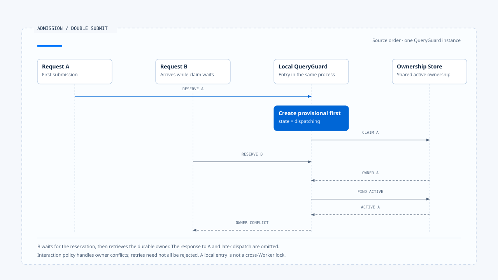

# Run 接纳与建立

[English](./01-run-admission-and-creation.md) | [繁體中文](./01-run-admission-and-creation-zh-TW.md) | [简体中文](./01-run-admission-and-creation-zh-CN.md)

> 以下内容所提到的
> CCB 为 [claude-code-best](https://github.com/claude-code-best/claude-code) 的简称。
> Chat Gun 为 [chat-gun](https://github.com/HsienW/chat-gun)。

[回到导览](./README-zh-CN.md) · 下一篇：[执行归属与替换](./02-run-ownership-and-supersede-zh-CN.md)

> 用户连按两次送出。第一个请求已经读到「目前没有 Run」，却还在等待数据库；第二个请求也读到相同结果。两边都调用模型，画面只显示其中一次，工具却可能执行两次。

**Runtime 接纳一次执行时，需要把「收到要求」「取得保留」「持有执行权」与「开始派送」分开记录。** 每一步都有可能失败，后续清理也要知道本次到底取得了什么。

本篇从 Harness 已整理好的要求开始。输入的语义与产品互动政策沿用 [Interaction and Feedback](../../agent-harness/interaction-and-feedback/README-zh-CN.md)；这里追到 Runtime 如何接手，以及接手失败时如何停止。

## 接纳在哪一刻成立

HTTP handler 收到请求、SDK 建立 Promise，或前端切成 loading，都只表示某个入口开始处理。Runtime 接纳需要更具体的结果：这次要求已通过必要检查，后续工作可以对回权威执行识别，且目前允许这个执行者继续。

| 阶段 | 已成立的事实 | 还不能据此宣称 |
|---|---|---|
| Received | 入口收到一份要求。 | 要求合法、owner 已取得。 |
| Reserved | 本地或持久层留下派送保留。 | 模型已调用、业务已开始。 |
| Admitted | 必要契约与执行权已确认。 | 任务一定能完成。 |
| Dispatched | 已调用指定执行入口。 | 外部效果已提交。 |

这些名称是本文的观察阶段。CCB 的进程内 QueryGuard 与 Chat Gun 的 ownership repository 使用各自的状态，不能直接把表格转成两者共用的 enum。

## 接手前要核对的数据

Harness 应提供可信的身份、Context、能力及政策条件。Runtime 接纳时，再核对执行这份契约所需的字段与依赖；模型之后提出哪个 Tool Call，仍要走该次行动的授权流程。

- **Identity**：Request、Thread、Scope、Task 与本次 Run 如何关联，哪些值由可信入口建立。
- **Manifest**：输入、Graph、Tool 与恢复版本是否能由目前 consumer 解读。
- **Limits**：有效的 Deadline、turn 与其他已支持额度；缺少必要限制时如何拒绝或降级。
- **Dependencies**：Store、Decision Port 或必要 adapter 是否可用。

概念上的接纳结果可以分成：

~~~ts
type AdmissionResult =
  | { kind: "accepted"; runId: string; ownershipRef: string }
  | { kind: "reused"; resultRef: string }
  | { kind: "rejected"; reasonCode: string };
~~~

这段类型用来整理责任，未表示来源库已有同名接口。若产品需要 queue，还要另外取得可查询的排队记录与接手契约；返回 accepted 本身无法证明工作已持久入列。

## 先保留，才能跨过 async gap

「检查没有执行中工作」与「开始执行」之间，常有数据库、附件处理或远端请求。若检查结果只存在区域变数，另一个请求可以在等待期间通过同一项检查。

### CCB 的进程内保留

本区查读的 CCB 副本中，`QueryGuard.reserve()` 同步把 idle 改成 dispatching。`isActive` 在 dispatching 与 running 都返回 true，让排队处理器与直接送出入口能看见已取得的保留。

后续 `tryStart()` 可从 idle 或 dispatching 进入 running，并增加 generation。若排队处理后发现没有工作，`cancelReservation()` 只在 dispatching 时释放；这些操作限制在同一个 QueryGuard 实例内。

> 这项保护适合进程内重入。多个 Worker、另一个程序或重新启动后的接手，需要共享权威与持久记录另外支持。

### Chat Gun 的本地与持久保留

本区 Chat Gun 版本的 `GenerationQueryGuard.reserve()` 先在 Map 建立 provisional dispatching，再查 `findActive()` 或执行 `claim()`。若已有 active owner，guard 采用该 owner 并返回 ownership conflict，交由上层决定后续处置。

数据库 claim 发生非冲突错误时，程序只在 Map 仍指向原 provisional entry 的情况下删除它。这个条件让旧操作的失败处理不会误删后来接手的 entry。

- 本地 entry 防止同一程序在 await 间隙重入。
- Repository 决定共享的 active ownership。
- 返回的 ownership 才是后续核对 generation 的依据，Client hint 只是输入线索。

两个层次各自留下状态，也因此有不同的失败与清理位置。

- 图中选取同一个 QueryGuard 实例、A 成功 claim 的路径。B 收到 ownership conflict 后仍交由互动政策处置，向 A 返回及后续派送省略。
- [开启双送出时序与实现注记](../../assets/agent-runtime/execution-lifecycle/01-run-admission-and-creation/01-double-submit-reservation-en.html)。

## 接纳检查可以分段，证据要对回顺序

Chat Gun 的 `beforeRun()` 先读取 Context 与 normalized input，对 invalid 输入直接拒绝，再进入 reservation。其后才有 `ensureTask`、已配置的 idempotency guard，以及互动分类与策略处理。

这条顺序表示部分要求可能在取得保留后才被拒绝。检查来源时，需同时追到 `rejectBeforeDispatch()`、`cleanupBeforeDispatch()` 与 catch 分支，确认已取得的本地 entry、ownership 或 idempotency record 如何收束。

工具 Pipeline 的 Schema 与 dependency 检查发生在另一个边界。即使工具 admission 完整，也仍需另查 Run 入口是否验证了自己需要的条件；同样地，Run 接纳成功后，具体工具仍可能被拒绝。

## Run 建立与 owner claim 的先后

原生 Agent Server 可能先产生 Run ID，产品 repository 再 claim owner；另一种组装则先取得产品保留，再调用原生 Run API。采用哪个顺序都需要处理两边只成功一半的情况。

| 失败位置 | 需要保留的数据 | 清理或恢复方向 |
|---|---|---|
| Reservation 前 | Request 与拒绝原因。 | 返回拒绝，不宣称已开始。 |
| 本地保留后、claim 失败 | 本次 entry 与错误。 | 条件式释放本地保留。 |
| Owner 已取得、Run 启动失败 | Owner、Run 关联与派送证据。 | 更新权威记录，避免留下永久 active。 |
| 原生 Run 已建立、回应遗失 | 可查询的 Request／Run 关联。 | 先查是否已存在，再决定重新建立。 |
| 派送成功、started event 失败 | 已存在的 Run 与投递状态。 | 重送或查询，避免重复启动。 |

表格是设计检查框架。本轮未证明来源库对所有原生 API timeout 都已有跨 Store 原子接纳，因此正文只依各接点的证据说明。

## 重复要求与结果重用

相同文字可能是用户真的要再做一次，也可能是网络重送。判断重复需要明确的 request identity、可信 key、作用范围及保存期限，不能只靠 Prompt 相似度。

本区 Chat Gun 的 idempotency 路径需要可信 key 与已配置 guard。`already_completed` 可以带回既有 result；`already_locked` 与 failed 状态则有各自拒绝原因。这是特定 consumer 的行为，不能据此推论所有入口都会重用结果。

重用前还要确认结果属于同一 Principal／Scope 与操作契约。Run 接纳的去重与工具外部效果的去重各有自己的 key，后者另见 [Foundations 的持久化与恢复](../foundations/04-persistence-interrupt-and-resume-zh-CN.md)。

## Queue 需要接手记录

本区 Chat Gun 的互动 consumer 遇到 `enqueue` 策略时，会以 `NATIVE_QUEUE_OWNERSHIP_REQUIRED` 拒绝本地派送。它指出原生排队能力的前置条件，未建立一条产品本地持久 queue。

若要将 queue 纳入 Runtime 契约，至少需要辨认入列结果、取出者、重送及取消排队项目的责任。这些能力须沿实际 Agent Server API 查证，不能把类型中的策略名称画成已存在的 Worker 流程。

## 如何验证接纳边界

### 重入与失败测试

- 在 reservation 到 dispatch 之间暂停第一个要求，再送入第二个要求，核对 owner 与底层执行次数。
- 让 claim 抛出错误，确认原 provisional entry 被释放，后来接手的 entry 仍保留。
- 让 Run 建立与事件投递分别失败，核对是否可以查回已取得的执行。

### 去重与必要依赖

- 重送相同可信 key 时，区分执行中、已完成与失败记录。
- 用不同 Scope 重送相似内容，确认不会取得另一项任务的结果。
- 移除必要 Store 或 Decision Port，确认拒绝发生在对应模型或工具派送前。

来源库的 QueryGuard 测试已有 dispatch gap、durable owner 与旧 finalizer 情境。本轮只查读测试安排，没有执行正式多 Worker 或数据库故障测试。

## 本篇的工程判断

Runtime 接纳之后，工程人员应能指出本次 Run 是谁、目前 owner 是谁，以及下一次派送依据什么。部分步骤失败时，系统仍要留下可查询的关联，让重送与清理有明确目标。

我会优先检查 await 前后的保留，以及「已取得 owner、尚未派送」的窗口。这些位置往往只占几进程序，却直接决定双送出会被拒绝、重用，还是启动两次工作。

## 实现参照与适用范围

- Chat Gun：`backend/src/platform/interaction-runtime.ts` 的 `beforeRun()`、拒绝与清理路径；`backend/src/runtime/input/query-guard.ts` 的 reservation；`backend/src/runtime/interaction/ownership.ts` 的 claim。
- CCB：`src/utils/QueryGuard.ts` 与 `src/utils/handlePromptSubmit.ts` 的入口协调。
- [Chat Gun QueryGuard 源代码][g-guard]、[互动 consumer][g-runtime]；本区版本与 CCB 副本指纹见[来源与适用范围](./README-zh-CN.md#正文来源与适用范围)。

本篇的接纳结果类型与跨 Store 失败表属概念设计。源代码观察依本区所列版本，未执行 Provider、数据库竞态或端到端验证。

## 接续阅读

- [执行归属与替换](./02-run-ownership-and-supersede-zh-CN.md)
- [执行中新输入与互动策略](../../agent-harness/interaction-and-feedback/01-in-flight-input-policy-zh-CN.md)

[g-guard]: https://github.com/HsienW/chat-gun/blob/f83a38fd67a021904e597c60543708ee0c206076/backend/src/runtime/input/query-guard.ts
[g-runtime]: https://github.com/HsienW/chat-gun/blob/f83a38fd67a021904e597c60543708ee0c206076/backend/src/platform/interaction-runtime.ts
