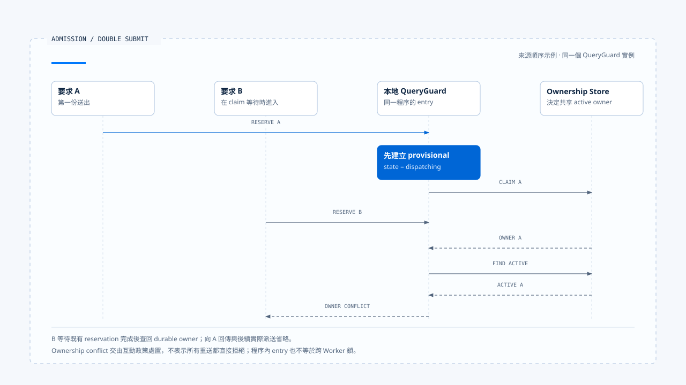

# Run 接納與建立

[English](./01-run-admission-and-creation.md) | [繁體中文](./01-run-admission-and-creation-zh-TW.md)

> 以下內容所提到的
> CCB 為 [claude-code-best](https://github.com/claude-code-best/claude-code) 的簡稱。
> Chat Gun 為 [chat-gun](https://github.com/HsienW/chat-gun)。

[回到導覽](./README-zh-TW.md) · 下一篇：[執行歸屬與替換](./02-run-ownership-and-supersede-zh-TW.md)

> 使用者連按兩次送出。第一個請求已經讀到「目前沒有 Run」，卻還在等待資料庫；第二個請求也讀到相同結果。兩邊都呼叫模型，畫面只顯示其中一次，工具卻可能執行兩次。

**Runtime 接納一次執行時，需要把「收到要求」「取得保留」「持有執行權」與「開始派送」分開記錄。** 每一步都有可能失敗，後續清理也要知道本次到底取得了什麼。

本篇從 Harness 已整理好的要求開始。輸入的語意與產品互動政策沿用 [Interaction and Feedback](../../agent-harness/interaction-and-feedback/README-zh-TW.md)；這裡追到 Runtime 如何接手，以及接手失敗時如何停止。

## 接納在哪一刻成立

HTTP handler 收到請求、SDK 建立 Promise，或前端切成 loading，都只表示某個入口開始處理。Runtime 接納需要更具體的結果：這次要求已通過必要檢查，後續工作可以對回權威執行識別，且目前允許這個執行者繼續。

| 階段 | 已成立的事實 | 還不能據此宣稱 |
|---|---|---|
| Received | 入口收到一份要求。 | 要求合法、owner 已取得。 |
| Reserved | 本地或持久層留下派送保留。 | 模型已呼叫、業務已開始。 |
| Admitted | 必要契約與執行權已確認。 | 任務一定能完成。 |
| Dispatched | 已呼叫指定執行入口。 | 外部效果已提交。 |

這些名稱是本文的觀察階段。CCB 的程序內 QueryGuard 與 Chat Gun 的 ownership repository 使用各自的狀態，不能直接把表格轉成兩者共用的 enum。

## 接手前要核對的資料

Harness 應提供可信的身分、Context、能力及政策條件。Runtime 接納時，再核對執行這份契約所需的欄位與依賴；模型之後提出哪個 Tool Call，仍要走該次行動的授權流程。

- **Identity**：Request、Thread、Scope、Task 與本次 Run 如何關聯，哪些值由可信入口建立。
- **Manifest**：輸入、Graph、Tool 與恢復版本是否能由目前 consumer 解讀。
- **Limits**：有效的 Deadline、turn 與其他已支援額度；缺少必要限制時如何拒絕或降級。
- **Dependencies**：Store、Decision Port 或必要 adapter 是否可用。

概念上的接納結果可以分成：

~~~ts
type AdmissionResult =
  | { kind: "accepted"; runId: string; ownershipRef: string }
  | { kind: "reused"; resultRef: string }
  | { kind: "rejected"; reasonCode: string };
~~~

這段型別用來整理責任，未表示來源庫已有同名介面。若產品需要 queue，還要另外取得可查詢的排隊紀錄與接手契約；回傳 accepted 本身無法證明工作已持久入列。

## 先保留，才能跨過 async gap

「檢查沒有執行中工作」與「開始執行」之間，常有資料庫、附件處理或遠端請求。若檢查結果只存在區域變數，另一個請求可以在等待期間通過同一項檢查。

### CCB 的程序內保留

本區查讀的 CCB 副本中，`QueryGuard.reserve()` 同步把 idle 改成 dispatching。`isActive` 在 dispatching 與 running 都回傳 true，讓排隊處理器與直接送出入口能看見已取得的保留。

後續 `tryStart()` 可從 idle 或 dispatching 進入 running，並增加 generation。若排隊處理後發現沒有工作，`cancelReservation()` 只在 dispatching 時釋放；這些操作限制在同一個 QueryGuard 實例內。

> 這項保護適合程序內重入。多個 Worker、另一個程序或重新啟動後的接手，需要共享權威與持久紀錄另外支持。

### Chat Gun 的本地與持久保留

本區 Chat Gun 版本的 `GenerationQueryGuard.reserve()` 先在 Map 建立 provisional dispatching，再查 `findActive()` 或執行 `claim()`。若已有 active owner，guard 採用該 owner 並回傳 ownership conflict，交由上層決定後續處置。

資料庫 claim 發生非衝突錯誤時，程式只在 Map 仍指向原 provisional entry 的情況下刪除它。這個條件讓舊操作的失敗處理不會誤刪後來接手的 entry。

- 本地 entry 防止同一程序在 await 間隙重入。
- Repository 決定共享的 active ownership。
- 回傳的 ownership 才是後續核對 generation 的依據，Client hint 只是輸入線索。

兩個層次各自留下狀態，也因此有不同的失敗與清理位置。

- 圖中選取同一個 QueryGuard 實例、A 成功 claim 的路徑。B 收到 ownership conflict 後仍交由互動政策處置，向 A 回傳及後續派送省略。
- [開啟雙送出時序與實作註記](../../assets/agent-runtime/execution-lifecycle/01-run-admission-and-creation/01-double-submit-reservation.html)。

## 接納檢查可以分段，證據要對回順序

Chat Gun 的 `beforeRun()` 先讀取 Context 與 normalized input，對 invalid 輸入直接拒絕，再進入 reservation。其後才有 `ensureTask`、已配置的 idempotency guard，以及互動分類與策略處理。

這條順序表示部分要求可能在取得保留後才被拒絕。檢查來源時，需同時追到 `rejectBeforeDispatch()`、`cleanupBeforeDispatch()` 與 catch 分支，確認已取得的本地 entry、ownership 或 idempotency record 如何收束。

工具 Pipeline 的 Schema 與 dependency 檢查發生在另一個邊界。即使工具 admission 完整，也仍需另查 Run 入口是否驗證了自己需要的條件；同樣地，Run 接納成功後，具體工具仍可能被拒絕。

## Run 建立與 owner claim 的先後

原生 Agent Server 可能先產生 Run ID，產品 repository 再 claim owner；另一種組裝則先取得產品保留，再呼叫原生 Run API。採用哪個順序都需要處理兩邊只成功一半的情況。

| 失敗位置 | 需要保留的資料 | 清理或恢復方向 |
|---|---|---|
| Reservation 前 | Request 與拒絕原因。 | 回傳拒絕，不宣稱已開始。 |
| 本地保留後、claim 失敗 | 本次 entry 與錯誤。 | 條件式釋放本地保留。 |
| Owner 已取得、Run 啟動失敗 | Owner、Run 關聯與派送證據。 | 更新權威紀錄，避免留下永久 active。 |
| 原生 Run 已建立、回應遺失 | 可查詢的 Request／Run 關聯。 | 先查是否已存在，再決定重新建立。 |
| 派送成功、started event 失敗 | 已存在的 Run 與投遞狀態。 | 重送或查詢，避免重複啟動。 |

表格是設計檢查框架。本輪未證明來源庫對所有原生 API timeout 都已有跨 Store 原子接納，因此正文只依各接點的證據說明。

## 重複要求與結果重用

相同文字可能是使用者真的要再做一次，也可能是網路重送。判斷重複需要明確的 request identity、可信 key、作用範圍及保存期限，不能只靠 Prompt 相似度。

本區 Chat Gun 的 idempotency 路徑需要可信 key 與已配置 guard。`already_completed` 可以帶回既有 result；`already_locked` 與 failed 狀態則有各自拒絕原因。這是特定 consumer 的行為，不能據此推論所有入口都會重用結果。

重用前還要確認結果屬於同一 Principal／Scope 與操作契約。Run 接納的去重與工具外部效果的去重各有自己的 key，後者另見 [Foundations 的持久化與恢復](../foundations/04-persistence-interrupt-and-resume-zh-TW.md)。

## Queue 需要接手紀錄

本區 Chat Gun 的互動 consumer 遇到 `enqueue` 策略時，會以 `NATIVE_QUEUE_OWNERSHIP_REQUIRED` 拒絕本地派送。它指出原生排隊能力的前置條件，未建立一條產品本地持久 queue。

若要將 queue 納入 Runtime 契約，至少需要辨認入列結果、取出者、重送及取消排隊項目的責任。這些能力須沿實際 Agent Server API 查證，不能把型別中的策略名稱畫成已存在的 Worker 流程。

## 如何驗證接納邊界

### 重入與失敗測試

- 在 reservation 到 dispatch 之間暫停第一個要求，再送入第二個要求，核對 owner 與底層執行次數。
- 讓 claim 拋出錯誤，確認原 provisional entry 被釋放，後來接手的 entry 仍保留。
- 讓 Run 建立與事件投遞分別失敗，核對是否可以查回已取得的執行。

### 去重與必要依賴

- 重送相同可信 key 時，區分執行中、已完成與失敗紀錄。
- 用不同 Scope 重送相似內容，確認不會取得另一項任務的結果。
- 移除必要 Store 或 Decision Port，確認拒絕發生在對應模型或工具派送前。

來源庫的 QueryGuard 測試已有 dispatch gap、durable owner 與舊 finalizer 情境。本輪只查讀測試安排，沒有執行正式多 Worker 或資料庫故障測試。

## 本篇的工程判斷

Runtime 接納之後，工程人員應能指出本次 Run 是誰、目前 owner 是誰，以及下一次派送依據什麼。部分步驟失敗時，系統仍要留下可查詢的關聯，讓重送與清理有明確目標。

我會優先檢查 await 前後的保留，以及「已取得 owner、尚未派送」的窗口。這些位置往往只占幾行程式，卻直接決定雙送出會被拒絕、重用，還是啟動兩次工作。

## 實作參照與適用範圍

- Chat Gun：`backend/src/platform/interaction-runtime.ts` 的 `beforeRun()`、拒絕與清理路徑；`backend/src/runtime/input/query-guard.ts` 的 reservation；`backend/src/runtime/interaction/ownership.ts` 的 claim。
- CCB：`src/utils/QueryGuard.ts` 與 `src/utils/handlePromptSubmit.ts` 的入口協調。
- [Chat Gun QueryGuard 原始碼][g-guard]、[互動 consumer][g-runtime]；本區版本與 CCB 副本指紋見[來源與適用範圍](./README-zh-TW.md#正文來源與適用範圍)。

本篇的接納結果型別與跨 Store 失敗表屬概念設計。原始碼觀察依本區所列版本，未執行 Provider、資料庫競態或端到端驗證。

## 接續閱讀

- [執行歸屬與替換](./02-run-ownership-and-supersede-zh-TW.md)
- [執行中新輸入與互動策略](../../agent-harness/interaction-and-feedback/01-in-flight-input-policy-zh-TW.md)

[g-guard]: https://github.com/HsienW/chat-gun/blob/f83a38fd67a021904e597c60543708ee0c206076/backend/src/runtime/input/query-guard.ts
[g-runtime]: https://github.com/HsienW/chat-gun/blob/f83a38fd67a021904e597c60543708ee0c206076/backend/src/platform/interaction-runtime.ts
