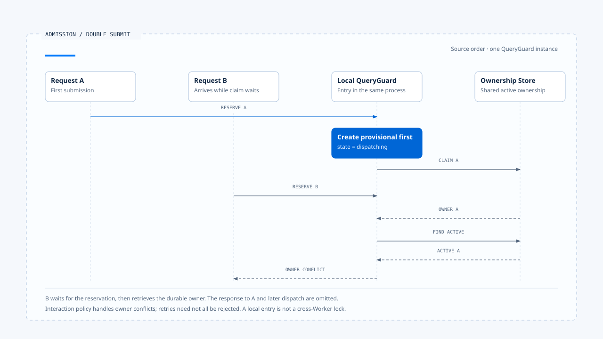

# Run admission and creation

[English](./01-run-admission-and-creation.md) | [繁體中文](./01-run-admission-and-creation-zh-TW.md)

> In the following content:
> CCB is short for [claude-code-best](https://github.com/claude-code-best/claude-code).
> Chat Gun refers to [chat-gun](https://github.com/HsienW/chat-gun).

[Back to guide](./README-zh-TW.md) · Next: [Run ownership and replacement](./02-run-ownership-and-supersede.md)

> A user clicks Submit twice. The first request has already read "no current Run" but is still waiting on the database; the second request reads the same result. Both call the model. The screen shows only one execution, while tools may run twice.

**When a Runtime admits an execution, it needs separate records for receiving the request, obtaining a reservation, holding execution ownership, and starting dispatch.** Any step can fail, and subsequent cleanup needs to know exactly what this execution acquired.

This article starts with a request already prepared by the Harness. Input semantics and product interaction policies follow [Interaction and Feedback](../../agent-harness/interaction-and-feedback/README.md); here, we trace how the Runtime takes responsibility and stops when that handoff fails.

## When admission takes effect

An HTTP handler receiving a request, an SDK creating a Promise, or a frontend entering a loading state only indicates that an entry point has begun processing. Runtime admission needs a more specific result: the request has passed the required checks, subsequent work can be traced to an authoritative execution identity, and this executor is currently allowed to continue.

| Stage | Established fact | What it does not yet establish |
|---|---|---|
| Received | An entry point received a request. | The request is valid or ownership has been acquired. |
| Reserved | A dispatch reservation exists locally or in persistent storage. | The model has been called or business work has started. |
| Admitted | Required contracts and execution ownership have been confirmed. | The task will complete successfully. |
| Dispatched | The designated execution entry point has been called. | External effects have committed. |

These names describe observation stages in this article. CCB's process-local QueryGuard and Chat Gun's ownership repository use their own states; the table cannot be converted directly into a shared enum for both.

## Data to check before taking responsibility

The Harness should provide trusted identity, Context, capabilities, and policy conditions. At admission, the Runtime checks the fields and dependencies needed to execute that contract. Any Tool Call the model later proposes must still pass authorization for that action.

- **Identity**: How Request, Thread, Scope, Task, and this Run relate, and which values come from a trusted entry point.
- **Manifest**: Whether the current consumer can interpret the input, Graph, Tool, and recovery versions.
- **Limits**: The effective Deadline, turn limit, and other supported budgets; how missing required limits cause rejection or degradation.
- **Dependencies**: Whether the Store, Decision Port, and required adapters are available.

A conceptual admission result can distinguish:

~~~ts
type AdmissionResult =
  | { kind: "accepted"; runId: string; ownershipRef: string }
  | { kind: "reused"; resultRef: string }
  | { kind: "rejected"; reasonCode: string };
~~~

This type organizes responsibilities; it does not mean the source repositories have an interface with the same name. A product that needs a queue must also obtain a queryable queue record and a handoff contract. Returning accepted alone does not prove that work has been durably queued.

## Reserve before crossing an async gap

Database access, attachment processing, or remote requests often sit between checking for active work and starting execution. If the check result exists only in a local variable, another request can pass the same check during the wait.

### CCB's process-local reservation

In the CCB copy examined for this section, `QueryGuard.reserve()` synchronously changes idle to dispatching. `isActive` returns true for both dispatching and running, so queue handlers and direct submission entry points can see the reservation.

The subsequent `tryStart()` can move from idle or dispatching to running and increment generation. If queue processing finds no work, `cancelReservation()` releases only a dispatching reservation. These operations are confined to one QueryGuard instance.

> This protection covers re-entry within a process. Multiple Workers, another process, or a handoff after restart require additional support from shared authority and durable records.

### Chat Gun's local and durable reservations

In the Chat Gun version examined here, `GenerationQueryGuard.reserve()` first creates a provisional dispatching entry in the Map, then calls `findActive()` or `claim()`. If an active owner already exists, the guard adopts that owner and returns an ownership conflict for the upper layer to handle.

If the database claim fails with a non-conflict error, the code deletes the Map entry only if it still points to the original provisional entry. That condition prevents an older operation's failure handling from deleting an entry adopted later.

- The local entry prevents re-entry during an await gap in the same process.
- The repository determines shared active ownership.
- The returned ownership is the basis for subsequent generation checks; a Client hint is only an input clue.

Each layer leaves its own state and therefore has separate failure and cleanup points.

- The diagram selects the path where A successfully claims within one QueryGuard instance. B's ownership conflict still goes to the interaction policy for disposition. The response to A and subsequent dispatch are omitted.
- [Open the double-submit sequence and implementation notes](../../assets/agent-runtime/execution-lifecycle/01-run-admission-and-creation/01-double-submit-reservation-en.html).

## Admission checks can occur in stages; evidence must preserve their order

Chat Gun's `beforeRun()` first reads Context and normalized input, rejects invalid input directly, and then enters reservation. Only afterward does it reach `ensureTask`, the configured idempotency guard, and interaction classification and policy handling.

This order means some requests can be rejected after acquiring a reservation. Reading the source requires following `rejectBeforeDispatch()`, `cleanupBeforeDispatch()`, and catch branches to determine how acquired local entries, ownership, and idempotency records are finalized.

The tool Pipeline's Schema and dependency checks occur at another boundary. Complete tool admission still requires a separate check of whether the Run entry point validates its own conditions. Likewise, a particular tool can still be rejected after Run admission succeeds.

## Ordering Run creation and owner claim

A native Agent Server may create the Run ID before the product repository claims ownership. Another composition may obtain a product reservation before calling the native Run API. Either order needs to handle one side succeeding while the other fails.

| Failure point | Data to retain | Cleanup or recovery direction |
|---|---|---|
| Before reservation | Request and rejection reason. | Return rejection without claiming execution started. |
| After local reservation, claim fails | This entry and the error. | Conditionally release the local reservation. |
| Owner acquired, Run start fails | Owner, Run correlation, and dispatch evidence. | Update the authoritative record to avoid a permanently active entry. |
| Native Run created, response lost | A queryable Request/Run correlation. | Check whether it already exists before deciding to create again. |
| Dispatch succeeds, started event fails | Existing Run and delivery status. | Redeliver or query without starting execution again. |

The table is a design review framework. The work behind this section did not establish atomic admission across Stores for every native API timeout in the source repositories, so the discussion follows the evidence at each boundary.

## Duplicate requests and result reuse

Identical text can mean that a user wants the work done again, or that the network retried a request. Detecting duplicates requires an explicit request identity, trusted key, scope, and retention period. Prompt similarity alone is insufficient.

Chat Gun's idempotency path examined here requires a trusted key and a configured guard. `already_completed` can return an existing result; `already_locked` and failed states have their own rejection reasons. This is the behavior of a particular consumer and does not establish result reuse at every entry point.

Before reuse, the result must also belong to the same Principal/Scope and operation contract. Run admission deduplication and deduplication of tool effects use separate keys. For the latter, see [persistence and recovery in Foundations](../foundations/04-persistence-interrupt-and-resume.md).

## A queue needs a handoff record

The Chat Gun interaction consumer examined here rejects local dispatch for the `enqueue` policy with `NATIVE_QUEUE_OWNERSHIP_REQUIRED`. It identifies a prerequisite for native queuing; it does not establish a product-local durable queue.

To include a queue in the Runtime contract, the design must at least identify the enqueue result and responsibility for dequeueing, redelivery, and cancelling queued items. These capabilities must be verified through the actual Agent Server API. A policy name in a type cannot be treated as an existing Worker workflow.

## How to verify the admission boundary

### Re-entry and failure tests

- Pause the first request between reservation and dispatch, submit a second request, and check the owner and underlying execution count.
- Make claim throw, and confirm that the original provisional entry is released while an entry adopted later remains.
- Fail Run creation and event delivery separately, and check whether the acquired execution can be retrieved.

### Deduplication and required dependencies

- Resubmit the same trusted key and distinguish active, completed, and failed records.
- Resubmit similar content under a different Scope and confirm that it cannot retrieve another task's result.
- Remove a required Store or Decision Port and confirm rejection before the corresponding model or tool dispatch.

The source repository's QueryGuard tests already cover dispatch gaps, durable owners, and stale finalizers. The work behind this section inspected the test arrangements without running production multi-Worker or database failure tests.

## Engineering judgment

After Runtime admission, an engineer should be able to identify this Run, its current owner, and the basis for the next dispatch. When some steps fail, the system still needs queryable correlations so retries and cleanup have a clear target.

I would first inspect reservations around await points and the window where ownership has been acquired but dispatch has not started. These locations often occupy only a few lines, yet directly determine whether a double submission is rejected, reused, or starts work twice.

## Implementation references and scope

- Chat Gun: `beforeRun()`, rejection, and cleanup paths in `backend/src/platform/interaction-runtime.ts`; reservation in `backend/src/runtime/input/query-guard.ts`; claim in `backend/src/runtime/interaction/ownership.ts`.
- CCB: entry coordination in `src/utils/QueryGuard.ts` and `src/utils/handlePromptSubmit.ts`.
- [Chat Gun QueryGuard source][g-guard] and [interaction consumer][g-runtime]; see [sources and scope](./README-zh-TW.md#正文來源與適用範圍) for this section's version and CCB copy fingerprints.

The admission result type and cross-Store failure table are conceptual designs. Source observations apply to the versions listed for this section. Provider, database race, and end-to-end verification were not performed.

## Further reading

- [Run ownership and replacement](./02-run-ownership-and-supersede.md)
- [In-flight input and interaction policy](../../agent-harness/interaction-and-feedback/01-in-flight-input-policy.md)

[g-guard]: https://github.com/HsienW/chat-gun/blob/f83a38fd67a021904e597c60543708ee0c206076/backend/src/runtime/input/query-guard.ts
[g-runtime]: https://github.com/HsienW/chat-gun/blob/f83a38fd67a021904e597c60543708ee0c206076/backend/src/platform/interaction-runtime.ts
