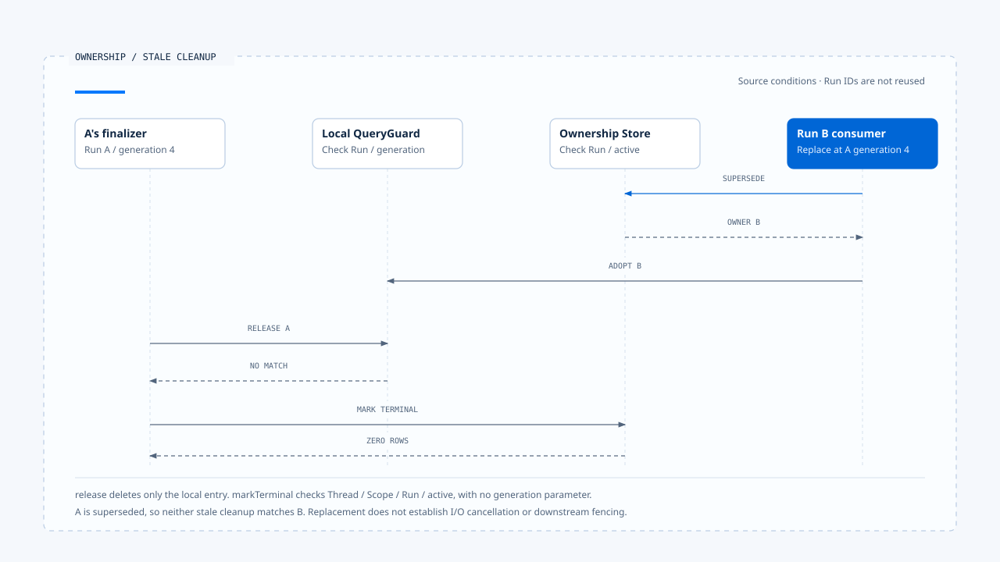

# 执行归属与替换

[English](./02-run-ownership-and-supersede.md) | [繁體中文](./02-run-ownership-and-supersede-zh-TW.md) | [简体中文](./02-run-ownership-and-supersede-zh-CN.md)

> 以下内容所提到的
> CCB 为 [claude-code-best](https://github.com/claude-code-best/claude-code) 的简称。
> Chat Gun 为 [chat-gun](https://github.com/HsienW/chat-gun)。

[回到导览](./README-zh-CN.md) · 前一篇：[Run 接纳与建立](./01-run-admission-and-creation-zh-CN.md) · 下一篇：[执行限制与取消](./03-deadlines-budgets-and-cancellation-zh-CN.md)

> Run A 被取消后，用户立刻送出 Run B。B 已经开始执行，A 的 Promise 才进入 `finally`。如果清理只写「目前已闲置」，B 的执行权就会被旧回调清掉。

**Ownership 需要让每个执行者知道自己可以改动哪份状态，以及何时已失去这项权力。** 取得、替换与释放都要带回可核对的身份；清理成功与否由目前权威记录决定。

## Thread、Task 与 Run 的归属

Thread 保存可延续的对话或 Graph 容器，Task 表达工作目标，Run 则是一次执行。同一个 Task 可以经过多次 Run，产品也可能在替换时建立新 Task。名称相同或沿用同一 Thread，都不足以确认目前 owner。

| 数据 | 用途 | 需要另外查明的事 |
|---|---|---|
| Thread／Scope | 定位共享的互动范围。 | 是否允许多个同时活动的 Task。 |
| Task | 关联业务目标。 | 替换或 Resume 是否延续此目标。 |
| Run | 定位本次执行。 | 是否仍有权派送与更新。 |
| Generation | 辨认 ownership 的版本。 | 哪个 repository 或 guard 建立它。 |

本区 Chat Gun repository 以 Thread 与 Scope 查询 active owner。这是该实现的作用范围，不能直接改写为所有产品都以 Task ID 作唯一锁。

## Claim 如何建立权威

`PgActiveRunOwnershipRepository.claim()` 插入 active ownership，并在同一 Thread／Scope 的历史数据中计算下一个 generation。SQL 使用 `ON CONFLICT DO NOTHING`，调用端要求插入返回一笔数据；没有取得数据时，转成 ownership conflict。

这条路径需要数据库约束与 repository 协同。`MAX(generation) + 1` 的计算式本身不提供多连接唯一性；要验证同时 claim 的行为，还需核对 migration、唯一索引、隔离级别与冲突处理。

- 查询没有 active owner，只是当时的读取结果。
- Claim 成功，才表示该次写入取得 repository 承认的 owner。
- Claim 失败后，调用端应查回或回报目前 owner，避免盲目再建立另一份执行。

进程内 guard 可以提前阻挡重入，数据库仍需处理其他实例送来的要求。

## Supersede 的更新条件

本区 Chat Gun 的 `supersede()` 在 `withTransaction()` 内先更新旧 active row，再插入 replacement。旧记录的更新条件包含：

~~~sql
WHERE thread_id = $1 AND scope_id = $2
  AND generation = $3 AND status = 'active'
~~~

只有符合 expected generation 的 active row 能被替换。Replacement 使用新的 Task／Run 关联，generation 则增加一；旧 row 保存 `supersededByRunId`，让后续查证能追到接手者。

### Transaction 的实际保证

这个方法把两次写入交给同一 transaction 接口。部署时仍需确认 adapter 确实使用同一数据库 transaction，第二次 insert 失败会 rollback，连接中断与重送也有明确结果。

若原生 Run 建立发生在另一个服务，repository transaction 无法直接涵盖它。可能出现 owner 已替换、原生 Run 尚未启动的窗口；[前篇](./01-run-admission-and-creation-zh-CN.md) 的接纳记录与恢复机制需要接住这项差异。

## 替换 owner 之后，旧 I/O 仍可能存在

更新 ownership 会改变后续命令的资格。原先送出的 Provider request、文件写入或外部 HTTP 调用，仍需要透过自己的取消机制停止，或等待结果后判读。

~~~text
A 持有 generation 4，外部 I/O 已送出
  → 條件式 supersede 成功
  → B 持有 generation 5
  → A 的 I/O 與 finally 可能晚到
~~~

因此，generation 的用途要对回每个 consumer：显示层用它拒绝旧活动；QueryGuard 用它限制清理；工具派送与下游写入若要拒绝过期执行者，还需要相应的检查。

> 一个 generation 字段只有在写入端实际核对时，才具备 fencing 的效果。不能从字段存在推论远端系统也会拒绝旧 Run。

本区没有证据支持所有外部服务都接受同一个 fencing token，因此对已派送 I/O 保留取消与效果回查的独立责任。

## 释放要对回自己的执行

### Chat Gun 的本地 release

`GenerationQueryGuard.release()` 只在 Map entry 的 runId 与 generation 都符合时删除 entry。A 带 generation 4 回来时，若 Map 已采用 B 的 generation 5，清理便不会命中。

这个方法只清理本地 Map。Durable ownership 的终止由 repository 的另一个方法负责，两者没有因为同一个 finalizer 调用便自动成为原子操作。

### Repository 的 terminal 更新

Chat Gun `markTerminal()` 的条件是 Thread、Scope、Run 与 active status：

~~~sql
WHERE thread_id = $1 AND scope_id = $2
  AND run_id = $3 AND status = 'active'
~~~

它没有 generation 参数。若 A 已 superseded，或目前 active row 属于 B，A 的更新不会命中。这项保护依赖 Run ID 的生命周期；程序若任意重用同一 Run ID，原本的关联假设便需重新检查。

把 repository 与 guard 的条件分开写，读者才能知道不同清理动作为何被拒绝，也能定位仍缺少保护的接点。

- 本地 release 与 repository terminal 更新使用不同条件，图中不把它们视为共同 transaction。此例假设 Run ID 不重用，A 的旧 I/O 仍需另外取消或回查。
- [开启旧执行清理时序与条件说明](../../assets/agent-runtime/execution-lifecycle/02-run-ownership-and-supersede/02-stale-run-cleanup-en.html)。

## CCB 的进程内对照

CCB `QueryGuard.tryStart()` 增加自己的 generation，`end(generation)` 只允许目前 generation 且仍为 running 的调用者结束查询。`forceEnd()` 则在非 idle 时切回 idle 并增加 generation，让旧查询稍后进入 `finally` 时失去清理资格。

这里的 generation 属于 QueryGuard 实例。它可以解决同一程序的旧回调，却没有建立跨进程 ownership，也未代表所有工具都会在派送前读取这个值。

| 接点 | 核对条件 | 保护范围 |
|---|---|---|
| CCB `end()` | 本地 generation 与 running。 | 单一 guard 的清理。 |
| Chat Gun `release()` | 本地 runId 与 generation。 | 同一 guard 的 entry。 |
| Chat Gun `markTerminal()` | Thread／Scope／Run／active。 | Repository 指定 Run 的终止更新。 |
| 外部资源写入 | 依下游契约而定。 | 本区未确认统一 fencing。 |

## Lease 与接管要另有契约

Owner 可以持久保存，也可能因 Worker 消失而永远停在 active。要处理这种情况，系统需要知道何时判定失联、谁有权接管，以及接管后如何查明旧外部效果。

本区查读的 ownership 接口没有通用 lease、心跳与到期接管契约。若原生 Agent Server 已提供 Worker lease，需沿其 API 与部署证据核对；在取得证据前，不能把持久 row 写成自动故障转移能力。

设计接管时，至少需要 expected owner／version、失联证据、重新派送限制，以及旧 I/O 的查证位置。这些条件也会影响 generation 的有效范围。

## 如何验证替换与清理

### 同时取得执行权

- 让两个连接对同一 Thread／Scope claim，核对成功数与冲突结果。
- 让两次 supersede 使用相同 expected generation，确认只有符合权威条件的更新成立。
- 在旧 row 更新后让 replacement insert 失败，确认 transaction adapter 的 rollback。

### 旧执行的晚到动作

- B 取得新 owner 后，再执行 A 的 `release()` 与 `markTerminal()`。
- 取消 A、启动 B，再让 A 的 Promise 进入 `finally`。
- 记录外部 I/O 在 supersede 后仍返回的结果，确认不会取得 B 的控制权。

现有 ownership 与 QueryGuard 测试安排包含 racing CAS、下一代 claim 与 stale finalizer。本轮未执行测试，也未将 mock database 的案例视为正式多连接压测。

## 本篇的工程判断

替换需要同时保留旧 Run 的历史与新 Run 的执行资格。每个更新端都带回自己取得的 identity，权威 Store 再决定它是否仍有效，便能把晚到动作收敛为明确拒绝。

我会逐一查明 claim、supersede、terminal 与 release 的条件。不同方法使用不同字段并不构成错误；没有说清楚条件的作用范围，才会让进程内保护被误用成整个系统的保证。

## 实现参照与适用范围

- [Chat Gun ownership repository][g-owner]：claim、transactional supersede 与条件式 terminal 更新。
- [Chat Gun QueryGuard][g-guard]：本地保留、adopt 与 runId／generation release。
- CCB `src/utils/QueryGuard.ts`：`reserve()`、`tryStart()`、`end()` 与 `forceEnd()`。
- 来源版本、CCB 副本指纹与测试限制见[本区导览](./README-zh-CN.md#正文来源与适用范围)。

## 接续阅读

- [执行限制与取消](./03-deadlines-budgets-and-cancellation-zh-CN.md)
- [Run 归属与可见状态](../../agent-harness/interaction-and-feedback/02-run-ownership-and-visible-state-zh-CN.md)

[g-owner]: https://github.com/HsienW/chat-gun/blob/f83a38fd67a021904e597c60543708ee0c206076/backend/src/runtime/interaction/ownership.ts
[g-guard]: https://github.com/HsienW/chat-gun/blob/f83a38fd67a021904e597c60543708ee0c206076/backend/src/runtime/input/query-guard.ts
