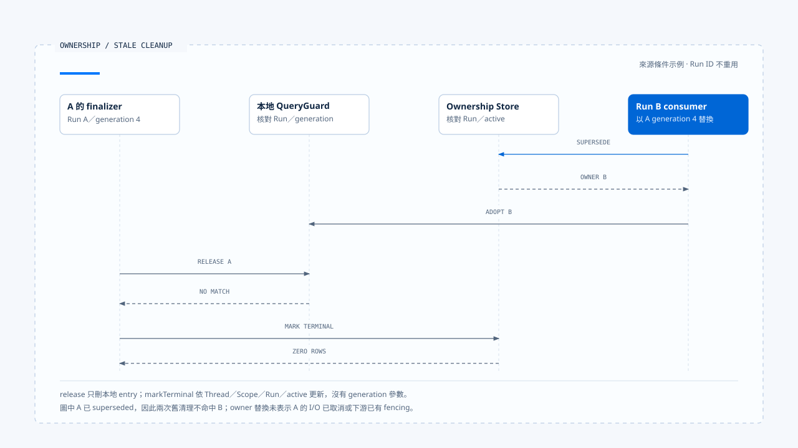

# 執行歸屬與替換

[English](./02-run-ownership-and-supersede.md) | [繁體中文](./02-run-ownership-and-supersede-zh-TW.md)

> 以下內容所提到的
> CCB 為 [claude-code-best](https://github.com/claude-code-best/claude-code) 的簡稱。
> Chat Gun 為 [chat-gun](https://github.com/HsienW/chat-gun)。

[回到導覽](./README-zh-TW.md) · 前一篇：[Run 接納與建立](./01-run-admission-and-creation-zh-TW.md) · 下一篇：[執行限制與取消](./03-deadlines-budgets-and-cancellation-zh-TW.md)

> Run A 被取消後，使用者立刻送出 Run B。B 已經開始執行，A 的 Promise 才進入 `finally`。如果清理只寫「目前已閒置」，B 的執行權就會被舊回呼清掉。

**Ownership 需要讓每個執行者知道自己可以改動哪份狀態，以及何時已失去這項權力。** 取得、替換與釋放都要帶回可核對的身分；清理成功與否由目前權威紀錄決定。

## Thread、Task 與 Run 的歸屬

Thread 保存可延續的對話或 Graph 容器，Task 表達工作目標，Run 則是一次執行。同一個 Task 可以經過多次 Run，產品也可能在替換時建立新 Task。名稱相同或沿用同一 Thread，都不足以確認目前 owner。

| 資料 | 用途 | 需要另外查明的事 |
|---|---|---|
| Thread／Scope | 定位共享的互動範圍。 | 是否允許多個同時活動的 Task。 |
| Task | 關聯業務目標。 | 替換或 Resume 是否延續此目標。 |
| Run | 定位本次執行。 | 是否仍有權派送與更新。 |
| Generation | 辨認 ownership 的版本。 | 哪個 repository 或 guard 建立它。 |

本區 Chat Gun repository 以 Thread 與 Scope 查詢 active owner。這是該實作的作用範圍，不能直接改寫為所有產品都以 Task ID 作唯一鎖。

## Claim 如何建立權威

`PgActiveRunOwnershipRepository.claim()` 插入 active ownership，並在同一 Thread／Scope 的歷史資料中計算下一個 generation。SQL 使用 `ON CONFLICT DO NOTHING`，呼叫端要求插入回傳一筆資料；沒有取得資料時，轉成 ownership conflict。

這條路徑需要資料庫約束與 repository 協同。`MAX(generation) + 1` 的計算式本身不提供多連線唯一性；要驗證同時 claim 的行為，還需核對 migration、唯一索引、隔離級別與衝突處理。

- 查詢沒有 active owner，只是當時的讀取結果。
- Claim 成功，才表示該次寫入取得 repository 承認的 owner。
- Claim 失敗後，呼叫端應查回或回報目前 owner，避免盲目再建立另一份執行。

程序內 guard 可以提前阻擋重入，資料庫仍需處理其他實例送來的要求。

## Supersede 的更新條件

本區 Chat Gun 的 `supersede()` 在 `withTransaction()` 內先更新舊 active row，再插入 replacement。舊紀錄的更新條件包含：

~~~sql
WHERE thread_id = $1 AND scope_id = $2
  AND generation = $3 AND status = 'active'
~~~

只有符合 expected generation 的 active row 能被替換。Replacement 使用新的 Task／Run 關聯，generation 則增加一；舊 row 保存 `supersededByRunId`，讓後續查證能追到接手者。

### Transaction 的實際保證

這個方法把兩次寫入交給同一 transaction 介面。部署時仍需確認 adapter 確實使用同一資料庫 transaction，第二次 insert 失敗會 rollback，連線中斷與重送也有明確結果。

若原生 Run 建立發生在另一個服務，repository transaction 無法直接涵蓋它。可能出現 owner 已替換、原生 Run 尚未啟動的窗口；[前篇](./01-run-admission-and-creation-zh-TW.md) 的接納紀錄與恢復機制需要接住這項差異。

## 替換 owner 之後，舊 I/O 仍可能存在

更新 ownership 會改變後續命令的資格。原先送出的 Provider request、檔案寫入或外部 HTTP 呼叫，仍需要透過自己的取消機制停止，或等待結果後判讀。

~~~text
A 持有 generation 4，外部 I/O 已送出
  → 條件式 supersede 成功
  → B 持有 generation 5
  → A 的 I/O 與 finally 可能晚到
~~~

因此，generation 的用途要對回每個 consumer：顯示層用它拒絕舊活動；QueryGuard 用它限制清理；工具派送與下游寫入若要拒絕過期執行者，還需要相應的檢查。

> 一個 generation 欄位只有在寫入端實際核對時，才具備 fencing 的效果。不能從欄位存在推論遠端系統也會拒絕舊 Run。

本區沒有證據支持所有外部服務都接受同一個 fencing token，因此對已派送 I/O 保留取消與效果回查的獨立責任。

## 釋放要對回自己的執行

### Chat Gun 的本地 release

`GenerationQueryGuard.release()` 只在 Map entry 的 runId 與 generation 都符合時刪除 entry。A 帶 generation 4 回來時，若 Map 已採用 B 的 generation 5，清理便不會命中。

這個方法只清理本地 Map。Durable ownership 的終止由 repository 的另一個方法負責，兩者沒有因為同一個 finalizer 呼叫便自動成為原子操作。

### Repository 的 terminal 更新

Chat Gun `markTerminal()` 的條件是 Thread、Scope、Run 與 active status：

~~~sql
WHERE thread_id = $1 AND scope_id = $2
  AND run_id = $3 AND status = 'active'
~~~

它沒有 generation 參數。若 A 已 superseded，或目前 active row 屬於 B，A 的更新不會命中。這項保護依賴 Run ID 的生命週期；程式若任意重用同一 Run ID，原本的關聯假設便需重新檢查。

把 repository 與 guard 的條件分開寫，讀者才能知道不同清理動作為何被拒絕，也能定位仍缺少保護的接點。

- 本地 release 與 repository terminal 更新使用不同條件，圖中不把它們視為共同 transaction。此例假設 Run ID 不重用，A 的舊 I/O 仍需另外取消或回查。
- [開啟舊執行清理時序與條件說明](../../assets/agent-runtime/execution-lifecycle/02-run-ownership-and-supersede/02-stale-run-cleanup.html)。

## CCB 的程序內對照

CCB `QueryGuard.tryStart()` 增加自己的 generation，`end(generation)` 只允許目前 generation 且仍為 running 的呼叫者結束查詢。`forceEnd()` 則在非 idle 時切回 idle 並增加 generation，讓舊查詢稍後進入 `finally` 時失去清理資格。

這裡的 generation 屬於 QueryGuard 實例。它可以解決同一程序的舊回呼，卻沒有建立跨程序 ownership，也未代表所有工具都會在派送前讀取這個值。

| 接點 | 核對條件 | 保護範圍 |
|---|---|---|
| CCB `end()` | 本地 generation 與 running。 | 單一 guard 的清理。 |
| Chat Gun `release()` | 本地 runId 與 generation。 | 同一 guard 的 entry。 |
| Chat Gun `markTerminal()` | Thread／Scope／Run／active。 | Repository 指定 Run 的終止更新。 |
| 外部資源寫入 | 依下游契約而定。 | 本區未確認統一 fencing。 |

## Lease 與接管要另有契約

Owner 可以持久保存，也可能因 Worker 消失而永遠停在 active。要處理這種情況，系統需要知道何時判定失聯、誰有權接管，以及接管後如何查明舊外部效果。

本區查讀的 ownership 介面沒有通用 lease、心跳與到期接管契約。若原生 Agent Server 已提供 Worker lease，需沿其 API 與部署證據核對；在取得證據前，不能把持久 row 寫成自動故障轉移能力。

設計接管時，至少需要 expected owner／version、失聯證據、重新派送限制，以及舊 I/O 的查證位置。這些條件也會影響 generation 的有效範圍。

## 如何驗證替換與清理

### 同時取得執行權

- 讓兩個連線對同一 Thread／Scope claim，核對成功數與衝突結果。
- 讓兩次 supersede 使用相同 expected generation，確認只有符合權威條件的更新成立。
- 在舊 row 更新後讓 replacement insert 失敗，確認 transaction adapter 的 rollback。

### 舊執行的晚到動作

- B 取得新 owner 後，再執行 A 的 `release()` 與 `markTerminal()`。
- 取消 A、啟動 B，再讓 A 的 Promise 進入 `finally`。
- 記錄外部 I/O 在 supersede 後仍回傳的結果，確認不會取得 B 的控制權。

現有 ownership 與 QueryGuard 測試安排包含 racing CAS、下一代 claim 與 stale finalizer。本輪未執行測試，也未將 mock database 的案例視為正式多連線壓測。

## 本篇的工程判斷

替換需要同時保留舊 Run 的歷史與新 Run 的執行資格。每個更新端都帶回自己取得的 identity，權威 Store 再決定它是否仍有效，便能把晚到動作收斂為明確拒絕。

我會逐一查明 claim、supersede、terminal 與 release 的條件。不同方法使用不同欄位並不構成錯誤；沒有說清楚條件的作用範圍，才會讓程序內保護被誤用成整個系統的保證。

## 實作參照與適用範圍

- [Chat Gun ownership repository][g-owner]：claim、transactional supersede 與條件式 terminal 更新。
- [Chat Gun QueryGuard][g-guard]：本地保留、adopt 與 runId／generation release。
- CCB `src/utils/QueryGuard.ts`：`reserve()`、`tryStart()`、`end()` 與 `forceEnd()`。
- 來源版本、CCB 副本指紋與測試限制見[本區導覽](./README-zh-TW.md#正文來源與適用範圍)。

## 接續閱讀

- [執行限制與取消](./03-deadlines-budgets-and-cancellation-zh-TW.md)
- [Run 歸屬與可見狀態](../../agent-harness/interaction-and-feedback/02-run-ownership-and-visible-state-zh-TW.md)

[g-owner]: https://github.com/HsienW/chat-gun/blob/f83a38fd67a021904e597c60543708ee0c206076/backend/src/runtime/interaction/ownership.ts
[g-guard]: https://github.com/HsienW/chat-gun/blob/f83a38fd67a021904e597c60543708ee0c206076/backend/src/runtime/input/query-guard.ts
