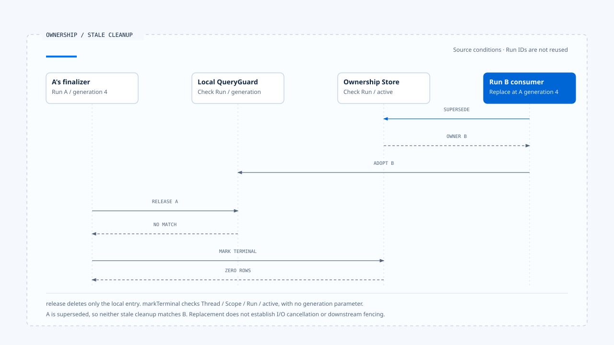

# Run ownership and replacement

[English](./02-run-ownership-and-supersede.md) | [繁體中文](./02-run-ownership-and-supersede-zh-TW.md)

> In the following content:
> CCB is short for [claude-code-best](https://github.com/claude-code-best/claude-code).
> Chat Gun refers to [chat-gun](https://github.com/HsienW/chat-gun).

[Back to guide](./README-zh-TW.md) · Previous: [Run admission and creation](./01-run-admission-and-creation.md) · Next: [Execution limits and cancellation](./03-deadlines-budgets-and-cancellation.md)

> After Run A is cancelled, the user immediately submits Run B. B has already started when A's Promise finally enters `finally`. If cleanup simply writes "now idle," the old callback can clear B's execution ownership.

**Ownership needs to tell each executor which state it may change and when it has lost that authority.** Acquisition, replacement, and release must carry an identity that can be checked. The current authoritative record determines whether cleanup succeeds.

## Ownership across Thread, Task, and Run

A Thread holds a continuing conversation or Graph container, a Task expresses the work objective, and a Run is one execution. The same Task can span multiple Runs, and a product may create a new Task during replacement. Sharing a name or Thread is insufficient to identify the current owner.

| Data | Purpose | What needs separate verification |
|---|---|---|
| Thread/Scope | Locate the shared interaction scope. | Whether multiple Tasks may be active at once. |
| Task | Associate the business objective. | Whether replacement or Resume continues that objective. |
| Run | Identify this execution. | Whether it still has authority to dispatch and update. |
| Generation | Identify the ownership version. | Which repository or guard creates it. |

The Chat Gun repository examined here queries the active owner by Thread and Scope. That is this implementation's scope; it cannot be generalized into a rule that every product uses Task ID as its unique lock.

## How claim establishes authority

`PgActiveRunOwnershipRepository.claim()` inserts active ownership and calculates the next generation from the history of the same Thread/Scope. Its SQL uses `ON CONFLICT DO NOTHING`, and the caller requires one returned row. No returned row becomes an ownership conflict.

This path requires coordination between database constraints and the repository. The expression `MAX(generation) + 1` alone does not provide uniqueness across connections. Verifying concurrent claims also requires checking migrations, unique indexes, isolation levels, and conflict handling.

- A query finding no active owner is only the read result at that moment.
- A successful claim establishes that the write acquired an owner recognized by the repository.
- After a failed claim, the caller should retrieve or report the current owner to avoid blindly creating another execution.

A process-local guard can block re-entry early. The database still needs to handle requests from other instances.

## Conditions for supersede

In the Chat Gun version examined here, `supersede()` first updates the old active row and then inserts the replacement inside `withTransaction()`. The old record's update conditions include:

~~~sql
WHERE thread_id = $1 AND scope_id = $2
  AND generation = $3 AND status = 'active'
~~~

Only an active row matching the expected generation can be replaced. The replacement uses the new Task/Run correlation and increments generation by one. The old row retains `supersededByRunId` so later investigation can trace the successor.

### What the transaction actually guarantees

This method passes both writes through one transaction interface. Deployment verification still needs to establish that the adapter uses the same database transaction, rolls back if the second insert fails, and provides defined outcomes for connection loss and retries.

If native Run creation happens in another service, the repository transaction cannot directly cover it. Ownership may have been replaced while the native Run has not started. The admission records and recovery mechanisms in the [previous article](./01-run-admission-and-creation.md) need to cover that gap.

## Old I/O can remain after ownership replacement

Updating ownership changes eligibility for subsequent commands. A Provider request, file write, or external HTTP call already sent still needs its own cancellation mechanism, or must be interpreted when its result returns.

~~~text
A 持有 generation 4，外部 I/O 已送出
  → 條件式 supersede 成功
  → B 持有 generation 5
  → A 的 I/O 與 finally 可能晚到
~~~

Generation therefore needs to be traced to each consumer: the display layer uses it to reject stale activity, and QueryGuard uses it to constrain cleanup. Tool dispatch and downstream writes need corresponding checks if they are to reject stale executors.

> A generation field provides fencing only when the writer actually checks it. Its presence does not establish that a remote system will reject an old Run.

The evidence examined here does not establish that every external service accepts the same fencing token. Cancellation and effect reconciliation remain separate responsibilities for I/O already dispatched.

## Release must identify its own execution

### Chat Gun's local release

`GenerationQueryGuard.release()` deletes a Map entry only when both runId and generation match. When A returns with generation 4, cleanup will not match if the Map has already adopted B's generation 5.

This method only clears the local Map. Another repository method terminates durable ownership; calling both from the same finalizer does not make them atomic.

### Repository terminal updates

Chat Gun's `markTerminal()` checks Thread, Scope, Run, and active status:

~~~sql
WHERE thread_id = $1 AND scope_id = $2
  AND run_id = $3 AND status = 'active'
~~~

It has no generation parameter. If A has been superseded, or the current active row belongs to B, A's update will not match. This protection depends on the Run ID lifecycle. Arbitrary reuse of a Run ID would require re-examining that correlation assumption.

Describing repository and guard conditions separately lets readers understand why each cleanup operation is rejected and locate boundaries that still lack protection.

- Local release and repository terminal updates use different conditions; the diagram does not treat them as one transaction. This example assumes Run IDs are not reused. A's old I/O still needs separate cancellation or reconciliation.
- [Open the stale-run cleanup sequence and conditions](../../assets/agent-runtime/execution-lifecycle/02-run-ownership-and-supersede/02-stale-run-cleanup-en.html).

## CCB's process-local comparison

CCB's `QueryGuard.tryStart()` increments its own generation. `end(generation)` allows only the current generation, while still running, to end the query. When not idle, `forceEnd()` switches back to idle and increments generation, removing the old query's cleanup authority when it later enters `finally`.

This generation belongs to a QueryGuard instance. It handles stale callbacks within the same process, but establishes no cross-process ownership and does not mean every tool reads this value before dispatch.

| Boundary | Conditions checked | Protection scope |
|---|---|---|
| CCB `end()` | Local generation and running. | Cleanup within one guard. |
| Chat Gun `release()` | Local runId and generation. | An entry in the same guard. |
| Chat Gun `markTerminal()` | Thread/Scope/Run/active. | Terminal update for the specified repository Run. |
| External resource writes | Defined by the downstream contract. | No uniform fencing was confirmed in this section. |

## Leases and takeover need their own contract

An owner can persist, yet remain active forever after its Worker disappears. Handling that situation requires knowing when to declare the Worker unreachable, who may take over, and how to investigate old external effects afterward.

The ownership interface examined here has no general contract for leases, heartbeats, or takeover after expiry. If the native Agent Server provides a Worker lease, its API and deployment evidence need to be checked. Until then, a durable row cannot be described as automatic failover.

A takeover design needs at least an expected owner/version, evidence of lost contact, redispatch limits, and a place to investigate old I/O. These conditions also affect the scope in which generation is effective.

## How to verify replacement and cleanup

### Concurrent acquisition

- Have two connections claim the same Thread/Scope, and check success counts and conflict results.
- Have two supersede operations use the same expected generation, and confirm that only an update meeting the authoritative conditions succeeds.
- Fail the replacement insert after updating the old row, and check rollback in the transaction adapter.

### Late actions from an old execution

- Run A's `release()` and `markTerminal()` after B acquires new ownership.
- Cancel A, start B, and then let A's Promise enter `finally`.
- Record results from external I/O that returns after supersede, and confirm that it cannot acquire B's control authority.

The existing ownership and QueryGuard test arrangements include racing CAS, next-generation claims, and stale finalizers. They were not executed for this section, and mock database cases were not treated as production load tests across connections.

## Engineering judgment

Replacement needs to preserve both the old Run's history and the new Run's execution eligibility. When every updater carries the identity it acquired, the authoritative Store can decide whether it remains valid and reject late actions explicitly.

I would inspect the conditions for claim, supersede, terminal, and release individually. Different methods using different fields is not inherently an error. Leaving each condition's scope unexplained is what allows process-local protection to be mistaken for a system-wide guarantee.

## Implementation references and scope

- [Chat Gun ownership repository][g-owner]: claim, transactional supersede, and conditional terminal updates.
- [Chat Gun QueryGuard][g-guard]: local reservation, adopt, and runId/generation release.
- CCB `src/utils/QueryGuard.ts`: `reserve()`, `tryStart()`, `end()`, and `forceEnd()`.
- See the [section guide](./README-zh-TW.md#正文來源與適用範圍) for source versions, CCB copy fingerprints, and test limitations.

## Further reading

- [Execution limits and cancellation](./03-deadlines-budgets-and-cancellation.md)
- [Run ownership and visible state](../../agent-harness/interaction-and-feedback/02-run-ownership-and-visible-state.md)

[g-owner]: https://github.com/HsienW/chat-gun/blob/f83a38fd67a021904e597c60543708ee0c206076/backend/src/runtime/interaction/ownership.ts
[g-guard]: https://github.com/HsienW/chat-gun/blob/f83a38fd67a021904e597c60543708ee0c206076/backend/src/runtime/input/query-guard.ts
