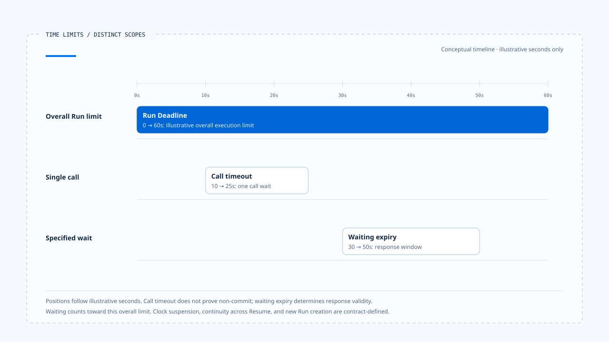
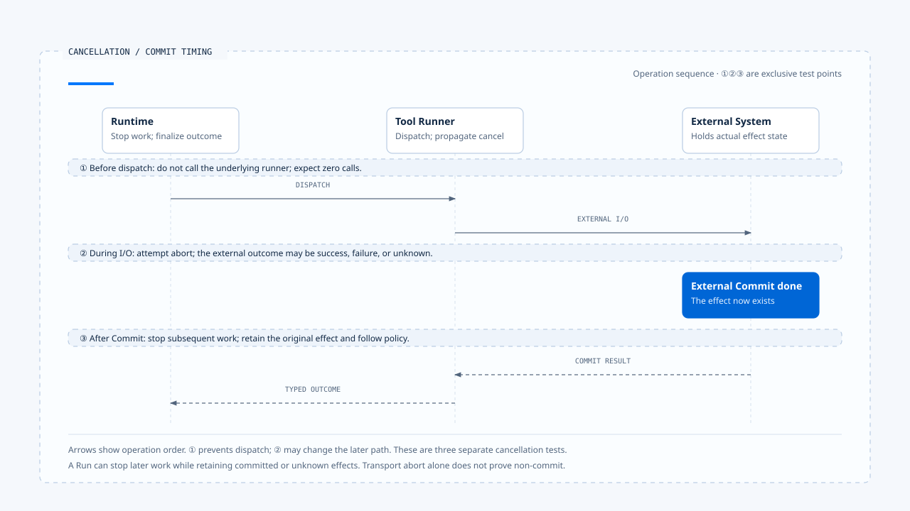

# 执行限制与取消

[English](./03-deadlines-budgets-and-cancellation.md) | [繁體中文](./03-deadlines-budgets-and-cancellation-zh-TW.md) | [简体中文](./03-deadlines-budgets-and-cancellation-zh-CN.md)

> 以下内容所提到的
> CCB 为 [claude-code-best](https://github.com/claude-code-best/claude-code) 的简称。
> Chat Gun 为 [chat-gun](https://github.com/HsienW/chat-gun)。

[回到导览](./README-zh-CN.md) · 前一篇：[执行归属与替换](./02-run-ownership-and-supersede-zh-CN.md) · 下一篇：[等待与恢复转移](./04-waiting-and-resume-transitions-zh-CN.md)

> 用户按下停止，画面的文字符流式传输立刻消失；另一端的退款请求却已送出。几秒后，下游完成退款，Runtime 才收到取消信号。若产品只回复「已取消」，用户会以为那笔操作没有发生。

**执行限制需要落到派送与状态转移的位置，取消结果则要说明停止了哪个范围。** Deadline、Budget 与 Abort 各自影响不同资源，最后仍须保留已经产生或尚无法判读的效果。

## 三种时间限制

Run 有整体时间限制，一次 Provider 或 Tool 调用也可能有 timeout；人工等待则有自己的 expiry。三者可以同时存在，处理端要知道哪个期限到达，以及它允许终止哪份工作。

| 限制 | 作用范围 | 到期后需要判断 |
|---|---|---|
| Run Deadline | 整次执行。 | 是否停止新派送、如何收束未完成工作。 |
| Call timeout | 一次模型、工具或网络等待。 | 是否已送出、外部效果是否可查。 |
| Waiting expiry | 指定 Interrupt 或批准。 | 回复是否仍可消费、如何结束等待。 |

工具在 timeout 后没有回应，不能直接推论整个 Run 已取消；等待批准过期，也不代表下游系统中的既有效果已撤销。结果契约要保留各自的原因。

- 秒数仅用来呈现比例，不是来源默认值或实测结果。本例将等待包含在整体期限内，实际暂停计时与 Resume 规则仍由契约决定。
- [开启三种期限时间轴与范围注记](../../assets/agent-runtime/execution-lifecycle/03-deadlines-budgets-and-cancellation/03-deadline-timeout-expiry-en.html)。

### Deadline 如何延续

若产品要求 Task 跨 Resume 仍受同一期限约束，应保存可验证的截止数据。每次启动都重新给完整时限，会让多次等待与重试不断延长原本承诺。

进程内经过时间可以使用单调时计；跨进程保存的截止时间则需要一致的时间解读与时钟偏差处理。这是 Deadline 契约的设计要求，本区未证明两个来源库已有统一实现。

## Budget 要先说明量测单位

一个 `remaining` 无法同时表达工具次数、模型 Token 与费用。限制若要影响下一步，Runtime 至少需要知道它的单位、作用范围，以及在哪里更新。

| Budget | 需要辨认的单位 | 不能直接推论的能力 |
|---|---|---|
| Max turns | 该实现如何计算一轮。 | 同一轮只会执行一个工具。 |
| Token budget | 输入、输出或 Context 用量。 | 已具备美元成本上限。 |
| Cost budget | 已计价或预留的费用。 | 不会出现单次请求超出剩余额度。 |
| Tool attempt budget | 同一操作的派送尝试。 | 模型不会提出新的 Tool Call。 |
| Task budget | 任务或子工作之间的总额。 | 已跨所有 Run 持久保存。 |

重新取样、fallback 与 retry 都可能消耗额度。若由多个 Worker 共用 Budget，读取剩余量与预留额度也需要并发控制，否则两边可能同时花掉同一份余额。

## CCB 中可追到的限制

本区 CCB 副本的 `query.ts` 接受 `maxTurns` 与 `taskBudget`。在循环准备下一轮时，它会核对 next turn count，超过 `maxTurns` 后产生对应附件并以 `max_turns` 原因返回；工具中止的分支也有 turn limit 处理。

`taskBudgetRemaining` 在 query 路径中计算并传递；另有受 `TOKEN_BUDGET` feature gate 控制的 tracker。这几项功能应各自追查，不能合称同一个默认启用的总额限制。

### Headless 费用检查

`QueryEngine.ts` 在消费 query 消息的流程中检查 `getTotalCost() >= maxBudgetUsd`，达到条件时返回费用上限结果。这提供累积费用的停止点，仍须区分已发生成本与派送前的保守预留。

> 成本检查若发生在某次使用量已入帐之后，可以阻止后续工作，却无法收回该次已花费的成本。

要承诺严格的派送前成本控制，还需预估或预留机制、Provider 用量回报与未知费用的处理。本篇将其列为设计需求，没有把既有费用比较式扩张成零超额保证。

## Cancel 的三个动作

收到 Cancel Command 后，Runtime 需要依序处理：

1. 改变权威状态或设置可核对的取消要求，阻止新增工作。
2. 将 AbortSignal 或下游 cancel 传给仍支持取消的操作。
3. 取得或保留 in-flight outcome，说明完成、未提交或效果不明。

各步可能由不同组件承担。UI 关闭 stream 只影响一条传输路径，business cancel 还需对到正确 Run；下游不支持撤销时，已送出的工作可能继续。

## 取消发生在哪里

| 时点 | Runtime 可以采取的动作 | 应保留的结果 |
|---|---|---|
| 模型请求前 | 不调用 Provider。 | 本次请求未送出。 |
| 模型流式传输中 | 中止 transport，保留必要消息状态。 | 已消耗用量与不完整输出。 |
| 工具派送前 | 拒绝进入 runner。 | Cancelled before dispatch。 |
| 外部 I/O 中 | 尝试 abort 或 cancel。 | 已取得或尚未知的效果。 |
| 外部 Commit 后 | 停止后续工作，依政策交付更正或补偿。 | 原效果与后续 action 分开。 |
| Waiting 中 | 结束或失效指定等待。 | 旧 Resume 不再取得执行资格。 |

多工具同时执行时，Run 可能同时包含以上数种时点。把整个 Run 标成 Cancelled 后，仍需逐项保存工具结果，避免遗失已提交证据。

- ①②③ 是互斥的测试插入点。派送前取消生效时不会继续调用工具，I/O 中取消则可能改变后续结果；底图只用来定位操作顺序。
- [开启取消时序与外部效果注记](../../assets/agent-runtime/execution-lifecycle/03-deadlines-budgets-and-cancellation/03-cancellation-and-commit-en.html)。

## Chat Gun 如何判读取消效果

本区 Chat Gun 的 `deriveCancellationPhase()` 从 Ledger entries 区分 read_only、reversible_committed、irreversible_committed 与 unknown。若有 executing、unknown，或工具记录与业务 Commit 状态不一致，会先进 unknown。

取消决策对 unknown 调用 reconciliation；若仍无法判读，返回人工处理路径。已知可补偿效果会交给 compensation dependency，不可逆的 committed 效果则另求 corrective authorization。

这些是判断与交接接点，实际效果仍依注入的 Ledger reader、reconciler、compensator 与正式入口组装而定。`read_only` 也是依当时可取得的 entries 判定，完整性需由 reader 与执行接线支持。

### 替换不一定可以立刻进行

互动 consumer 只在允许的 cancellation path 上继续 supersede。其他结果可能停在 corrective 或 manual handling，拒绝直接启动替换工作。

因此，用户要求「改做另一件事」之后，旧 owner、外部效果与新要求需要共同判读。产品选择替换策略，仍要由 Runtime 检查当时是否具备执行条件。

## 完成与取消同时抵达

模型最后一段回应、Cancel Command 与 Deadline 可能几乎同时到达。若不同处理端都直接写 status，结果便取决于最后一次覆写。

可检查的设计应让转移回到同一个权威，带 expected state 或 version；第一个合法提交之后，其他要求依目前状态返回明确结果。哪一种终止理由有优先权由契约定义，不能只比较 UI 事件的 timestamp。

本区来源提供局部 guard、Abort 与 repository 条件，未证明存在涵盖所有 Native Run、Deadline、取消及效果的共同 transaction。本文不为两者补造统一的竞态优先规则。

## 限制触发后留下什么

- 触发的是 Deadline、哪一类 Budget，或哪个可信 Cancel Command。
- 当时 Run、owner 与正在执行的 Step／Attempt。
- 哪些工作没有派送，哪些已传递取消。
- 已提交、未提交或仍不明的效果及证据位置。
- 后续是终止、回查、停放或人工处理。

这些信息让 Harness 能说明停止范围，也让恢复处理端不必从「timeout」一个字猜测是否可以重做操作。

## 如何验证执行限制

### 派送与额度

- 在下一次模型或工具调用前耗尽额度，核对实际调用次数。
- 在允许的 fallback 与 retry 之后检查 usage，确认未重设原有上限。
- 若宣称共享 Budget，使用多个 Worker 同时预留，验证扣除与冲突处理。

### 取消与竞态

- 在派送前、外部 I/O 中与 Commit 后送入取消，核对不同 outcome。
- 让完成、取消与 Deadline 使用可控制的交错时序，检查权威结果与晚到回应。
- 将传输停止与 business cancel 分开注入，确认产品不会混淆两者。

上述项目是验证方案。未执行真实 Provider、外部退款、费用试算或多 Worker 压测。

## 本篇的工程判断

限制能保护哪个范围，取决于它在何处被检查，以及触发时工作已经走多远。文件应把这个位置写出来，让读者知道是阻止下一步、终止等待，还是只中止一条连接。

我会把 Cancelled 与外部效果分开查。后续工作停止、退款已提交、结果尚不明，可以同时成为同一次执行的事实，回复需要容纳这些差异。

## 实现参照与适用范围

- [Chat Gun cancellation decision][g-cancel]：phase、reconciliation 与 corrective／compensation 交接。
- [Chat Gun interaction runtime][g-runtime]：允许 supersede 的取消路径与拒绝出口。
- CCB `src/query.ts`：turn、task budget、Abort 与返回原因；`src/QueryEngine.ts`：`maxBudgetUsd` consumer。
- 版本与副本指纹见[来源与适用范围](./README-zh-CN.md#来源与适用范围)。

## 接续阅读

- [等待与恢复转移](./04-waiting-and-resume-transitions-zh-CN.md)
- [取消、修正与已生效操作](../../agent-harness/interaction-and-feedback/04-cancellation-and-correction-zh-CN.md)

[g-cancel]: https://github.com/HsienW/chat-gun/blob/f83a38fd67a021904e597c60543708ee0c206076/backend/src/runtime/interaction/cancel-decision.ts
[g-runtime]: https://github.com/HsienW/chat-gun/blob/f83a38fd67a021904e597c60543708ee0c206076/backend/src/platform/interaction-runtime.ts
