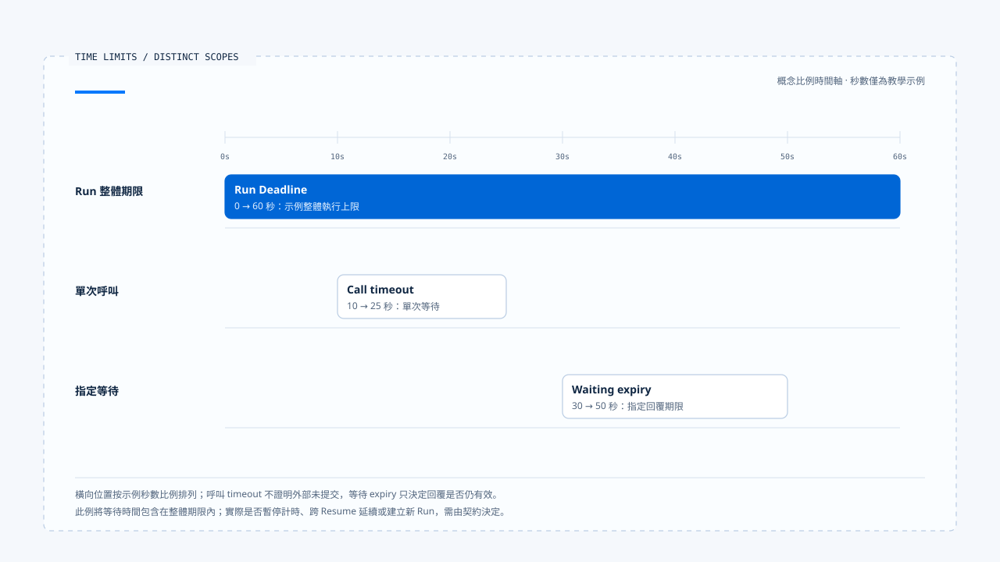
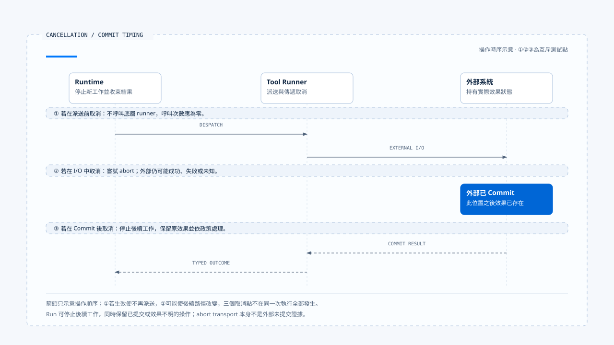

# 執行限制與取消

[English](./03-deadlines-budgets-and-cancellation.md) | [繁體中文](./03-deadlines-budgets-and-cancellation-zh-TW.md)

> 以下內容所提到的
> CCB 為 [claude-code-best](https://github.com/claude-code-best/claude-code) 的簡稱。
> Chat Gun 為 [chat-gun](https://github.com/HsienW/chat-gun)。

[回到導覽](./README-zh-TW.md) · 前一篇：[執行歸屬與替換](./02-run-ownership-and-supersede-zh-TW.md) · 下一篇：[等待與恢復轉移](./04-waiting-and-resume-transitions-zh-TW.md)

> 使用者按下停止，畫面的文字串流立刻消失；另一端的退款請求卻已送出。幾秒後，下游完成退款，Runtime 才收到取消訊號。若產品只回覆「已取消」，使用者會以為那筆操作沒有發生。

**執行限制需要落到派送與狀態轉移的位置，取消結果則要說明停止了哪個範圍。** Deadline、Budget 與 Abort 各自影響不同資源，最後仍須保留已經產生或尚無法判讀的效果。

## 三種時間限制

Run 有整體時間限制，一次 Provider 或 Tool 呼叫也可能有 timeout；人工等待則有自己的 expiry。三者可以同時存在，處理端要知道哪個期限到達，以及它允許終止哪份工作。

| 限制 | 作用範圍 | 到期後需要判斷 |
|---|---|---|
| Run Deadline | 整次執行。 | 是否停止新派送、如何收束未完成工作。 |
| Call timeout | 一次模型、工具或網路等待。 | 是否已送出、外部效果是否可查。 |
| Waiting expiry | 指定 Interrupt 或批准。 | 回覆是否仍可消費、如何結束等待。 |

工具在 timeout 後沒有回應，不能直接推論整個 Run 已取消；等待批准過期，也不代表下游系統中的既有效果已撤銷。結果契約要保留各自的原因。

- 秒數僅用來呈現比例，不是來源預設值或實測結果。本例將等待包含在整體期限內，實際暫停計時與 Resume 規則仍由契約決定。
- [開啟三種期限時間軸與範圍註記](../../assets/agent-runtime/execution-lifecycle/03-deadlines-budgets-and-cancellation/03-deadline-timeout-expiry.html)。

### Deadline 如何延續

若產品要求 Task 跨 Resume 仍受同一期限約束，應保存可驗證的截止資料。每次啟動都重新給完整時限，會讓多次等待與重試不斷延長原本承諾。

程序內經過時間可以使用單調時計；跨程序保存的截止時間則需要一致的時間解讀與時鐘偏差處理。這是 Deadline 契約的設計要求，本區未證明兩個來源庫已有統一實作。

## Budget 要先說明量測單位

一個 `remaining` 無法同時表達工具次數、模型 Token 與費用。限制若要影響下一步，Runtime 至少需要知道它的單位、作用範圍，以及在哪裡更新。

| Budget | 需要辨認的單位 | 不能直接推論的能力 |
|---|---|---|
| Max turns | 該實作如何計算一輪。 | 同一輪只會執行一個工具。 |
| Token budget | 輸入、輸出或 Context 用量。 | 已具備美元成本上限。 |
| Cost budget | 已計價或預留的費用。 | 不會出現單次請求超出剩餘額度。 |
| Tool attempt budget | 同一操作的派送嘗試。 | 模型不會提出新的 Tool Call。 |
| Task budget | 任務或子工作之間的總額。 | 已跨所有 Run 持久保存。 |

重新取樣、fallback 與 retry 都可能消耗額度。若由多個 Worker 共用 Budget，讀取剩餘量與預留額度也需要併發控制，否則兩邊可能同時花掉同一份餘額。

## CCB 中可追到的限制

本區 CCB 副本的 `query.ts` 接受 `maxTurns` 與 `taskBudget`。在循環準備下一輪時，它會核對 next turn count，超過 `maxTurns` 後產生對應附件並以 `max_turns` 原因返回；工具中止的分支也有 turn limit 處理。

`taskBudgetRemaining` 在 query 路徑中計算並傳遞；另有受 `TOKEN_BUDGET` feature gate 控制的 tracker。這幾項功能應各自追查，不能合稱同一個預設啟用的總額限制。

### Headless 費用檢查

`QueryEngine.ts` 在消費 query 訊息的流程中檢查 `getTotalCost() >= maxBudgetUsd`，達到條件時回傳費用上限結果。這提供累積費用的停止點，仍須區分已發生成本與派送前的保守預留。

> 成本檢查若發生在某次使用量已入帳之後，可以阻止後續工作，卻無法收回該次已花費的成本。

要承諾嚴格的派送前成本控制，還需預估或預留機制、Provider 用量回報與未知費用的處理。本篇將其列為設計需求，沒有把既有費用比較式擴張成零超額保證。

## Cancel 的三個動作

收到 Cancel Command 後，Runtime 需要依序處理：

1. 改變權威狀態或設定可核對的取消要求，阻止新增工作。
2. 將 AbortSignal 或下游 cancel 傳給仍支援取消的操作。
3. 取得或保留 in-flight outcome，說明完成、未提交或效果不明。

各步可能由不同元件承擔。UI 關閉 stream 只影響一條傳輸路徑，business cancel 還需對到正確 Run；下游不支援撤銷時，已送出的工作可能繼續。

## 取消發生在哪裡

| 時點 | Runtime 可以採取的動作 | 應保留的結果 |
|---|---|---|
| 模型請求前 | 不呼叫 Provider。 | 本次請求未送出。 |
| 模型串流中 | 中止 transport，保留必要訊息狀態。 | 已消耗用量與不完整輸出。 |
| 工具派送前 | 拒絕進入 runner。 | Cancelled before dispatch。 |
| 外部 I/O 中 | 嘗試 abort 或 cancel。 | 已取得或尚未知的效果。 |
| 外部 Commit 後 | 停止後續工作，依政策交付更正或補償。 | 原效果與後續 action 分開。 |
| Waiting 中 | 結束或失效指定等待。 | 舊 Resume 不再取得執行資格。 |

多工具同時執行時，Run 可能同時包含以上數種時點。把整個 Run 標成 Cancelled 後，仍需逐項保存工具結果，避免遺失已提交證據。

- ①②③ 是互斥的測試插入點。派送前取消生效時不會繼續呼叫工具，I/O 中取消則可能改變後續結果；底圖只用來定位操作順序。
- [開啟取消時序與外部效果註記](../../assets/agent-runtime/execution-lifecycle/03-deadlines-budgets-and-cancellation/03-cancellation-and-commit.html)。

## Chat Gun 如何判讀取消效果

本區 Chat Gun 的 `deriveCancellationPhase()` 從 Ledger entries 區分 read_only、reversible_committed、irreversible_committed 與 unknown。若有 executing、unknown，或工具紀錄與業務 Commit 狀態不一致，會先進 unknown。

取消決策對 unknown 呼叫 reconciliation；若仍無法判讀，回傳人工處理路徑。已知可補償效果會交給 compensation dependency，不可逆的 committed 效果則另求 corrective authorization。

這些是判斷與交接接點，實際效果仍依注入的 Ledger reader、reconciler、compensator 與正式入口組裝而定。`read_only` 也是依當時可取得的 entries 判定，完整性需由 reader 與執行接線支持。

### 替換不一定可以立刻進行

互動 consumer 只在允許的 cancellation path 上繼續 supersede。其他結果可能停在 corrective 或 manual handling，拒絕直接啟動替換工作。

因此，使用者要求「改做另一件事」之後，舊 owner、外部效果與新要求需要共同判讀。產品選擇替換策略，仍要由 Runtime 檢查當時是否具備執行條件。

## 完成與取消同時抵達

模型最後一段回應、Cancel Command 與 Deadline 可能幾乎同時到達。若不同處理端都直接寫 status，結果便取決於最後一次覆寫。

可檢查的設計應讓轉移回到同一個權威，帶 expected state 或 version；第一個合法提交之後，其他要求依目前狀態回傳明確結果。哪一種終止理由有優先權由契約定義，不能只比較 UI 事件的 timestamp。

本區來源提供局部 guard、Abort 與 repository 條件，未證明存在涵蓋所有 Native Run、Deadline、取消及效果的共同 transaction。正文不為兩者補造統一的競態優先規則。

## 限制觸發後留下什麼

- 觸發的是 Deadline、哪一類 Budget，或哪個可信 Cancel Command。
- 當時 Run、owner 與正在執行的 Step／Attempt。
- 哪些工作沒有派送，哪些已傳遞取消。
- 已提交、未提交或仍不明的效果及證據位置。
- 後續是終止、回查、停放或人工處理。

這些資訊讓 Harness 能說明停止範圍，也讓恢復處理端不必從「timeout」一個字猜測是否可以重做操作。

## 如何驗證執行限制

### 派送與額度

- 在下一次模型或工具呼叫前耗盡額度，核對實際呼叫次數。
- 在允許的 fallback 與 retry 之後檢查 usage，確認未重設原有上限。
- 若宣稱共享 Budget，使用多個 Worker 同時預留，驗證扣除與衝突處理。

### 取消與競態

- 在派送前、外部 I/O 中與 Commit 後送入取消，核對不同 outcome。
- 讓完成、取消與 Deadline 使用可控制的交錯時序，檢查權威結果與晚到回應。
- 將傳輸停止與 business cancel 分開注入，確認產品不會混淆兩者。

上述項目是驗證方案。本輪沒有執行真實 Provider、外部退款、費用試算或多 Worker 壓測。

## 本篇的工程判斷

限制能保護哪個範圍，取決於它在何處被檢查，以及觸發時工作已經走多遠。文件應把這個位置寫出來，讓讀者知道是阻止下一步、終止等待，還是只中止一條連線。

我會把 Cancelled 與外部效果分開查。後續工作停止、退款已提交、結果尚不明，可以同時成為同一次執行的事實，回覆需要容納這些差異。

## 實作參照與適用範圍

- [Chat Gun cancellation decision][g-cancel]：phase、reconciliation 與 corrective／compensation 交接。
- [Chat Gun interaction runtime][g-runtime]：允許 supersede 的取消路徑與拒絕出口。
- CCB `src/query.ts`：turn、task budget、Abort 與返回原因；`src/QueryEngine.ts`：`maxBudgetUsd` consumer。
- 版本與副本指紋見[來源與適用範圍](./README-zh-TW.md#正文來源與適用範圍)。

## 接續閱讀

- [等待與恢復轉移](./04-waiting-and-resume-transitions-zh-TW.md)
- [取消、修正與已生效操作](../../agent-harness/interaction-and-feedback/04-cancellation-and-correction-zh-TW.md)

[g-cancel]: https://github.com/HsienW/chat-gun/blob/f83a38fd67a021904e597c60543708ee0c206076/backend/src/runtime/interaction/cancel-decision.ts
[g-runtime]: https://github.com/HsienW/chat-gun/blob/f83a38fd67a021904e597c60543708ee0c206076/backend/src/platform/interaction-runtime.ts
