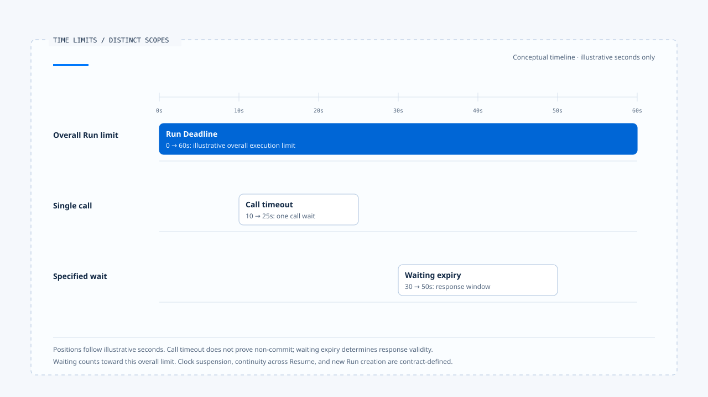
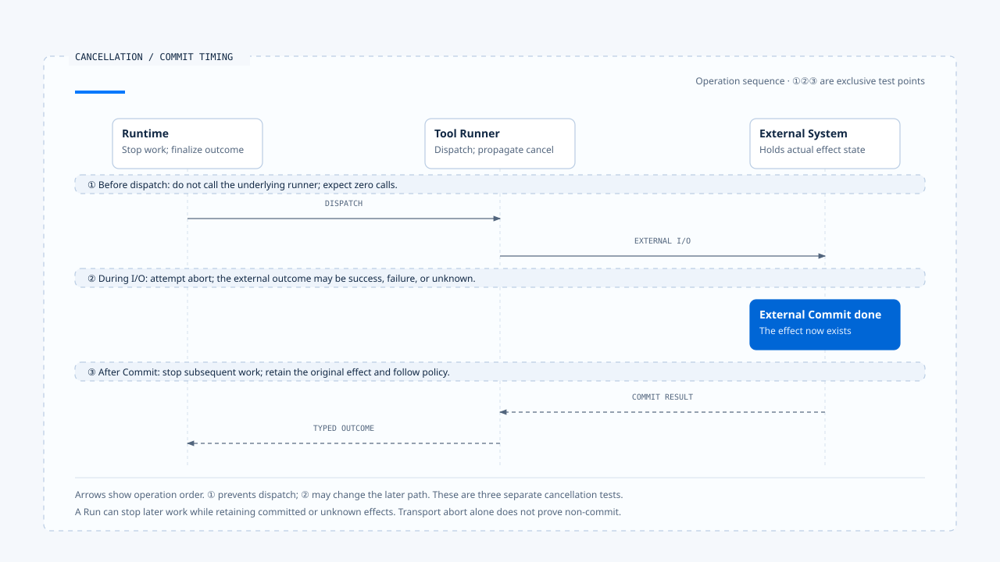

# Execution limits and cancellation

[English](./03-deadlines-budgets-and-cancellation.md) | [繁體中文](./03-deadlines-budgets-and-cancellation-zh-TW.md)

> In the following content:
> CCB is short for [claude-code-best](https://github.com/claude-code-best/claude-code).
> Chat Gun refers to [chat-gun](https://github.com/HsienW/chat-gun).

[Back to guide](./README-zh-TW.md) · Previous: [Run ownership and replacement](./02-run-ownership-and-supersede.md) · Next: [Waiting and resume transitions](./04-waiting-and-resume-transitions.md)

> A user clicks Stop, and the text stream immediately disappears from the screen. A refund request has already been sent at the other end. A few seconds later, the downstream system completes the refund before the Runtime receives the cancellation signal. If the product only says "cancelled," the user may believe the operation never happened.

**Execution limits need enforcement at dispatch and state transition points, while cancellation results need to state what was stopped.** Deadline, Budget, and Abort affect different resources. Effects already produced, or still unresolved, must remain recorded.

## Three kinds of time limits

A Run can have an overall time limit, a Provider or Tool call can have its own timeout, and a human wait can have its own expiry. All three can coexist. The handler needs to know which limit was reached and which work it may terminate.

| Limit | Scope | What to determine on expiry |
|---|---|---|
| Run Deadline | The entire execution. | Whether to stop new dispatches and how to finalize unfinished work. |
| Call timeout | One wait for a model, tool, or network call. | Whether the request was sent and whether external effects can be queried. |
| Waiting expiry | A specified Interrupt or approval. | Whether a response can still be consumed and how to end the wait. |

A tool failing to respond after timeout does not establish that the entire Run was cancelled. An approval expiring does not mean existing effects in a downstream system were reversed. The result contract needs to retain each reason separately.

- The seconds illustrate proportions; they are neither source defaults nor measurements. This example counts waiting within the overall deadline. Actual clock suspension and Resume rules remain contract-defined.
- [Open the three-limit timeline and scope notes](../../assets/agent-runtime/execution-lifecycle/03-deadlines-budgets-and-cancellation/03-deadline-timeout-expiry-en.html).

### Carrying a Deadline forward

If a product requires a Task to retain the same deadline across Resume, it should persist verifiable deadline data. Granting the full time allowance at each start lets repeated waits and retries continually extend the original commitment.

Elapsed time within a process can use a monotonic clock. A deadline persisted across processes needs consistent time interpretation and clock-skew handling. These are design requirements for a Deadline contract; this section did not establish a uniform implementation in either source repository.

## A Budget needs a unit

A single `remaining` value cannot express tool counts, model Tokens, and cost at once. To constrain the next step, the Runtime needs at least the budget's unit, scope, and update location.

| Budget | Unit to identify | What it does not establish |
|---|---|---|
| Max turns | How the implementation counts a turn. | Only one tool runs per turn. |
| Token budget | Input, output, or Context usage. | A dollar cost cap is in place. |
| Cost budget | Cost already priced or reserved. | A single request cannot exceed the remaining allowance. |
| Tool attempt budget | Dispatch attempts for the same operation. | The model cannot propose new Tool Calls. |
| Task budget | A total across a task or subtasks. | The total is persisted across all Runs. |

Resampling, fallback, and retry can all consume budget. A Budget shared by multiple Workers also needs concurrency control when reading the remaining amount and reserving capacity. Otherwise, both may spend the same balance.

## Limits traceable in CCB

The CCB copy examined here accepts `maxTurns` and `taskBudget` in `query.ts`. When preparing the next loop iteration, it checks the next turn count. Exceeding `maxTurns` produces the corresponding attachment and returns with reason `max_turns`. The tool-abort branch also handles the turn limit.

`taskBudgetRemaining` is calculated and passed through the query path. A separate tracker is controlled by the `TOKEN_BUDGET` feature gate. These features need individual investigation; they cannot be grouped into one overall limit enabled by default.

### Headless cost checks

While consuming query messages, `QueryEngine.ts` checks `getTotalCost() >= maxBudgetUsd` and returns a cost-limit result when the condition holds. This provides a stopping point based on accumulated cost, but incurred cost still needs to be distinguished from a conservative reservation before dispatch.

> A cost check performed after usage has been accounted for can stop subsequent work, but cannot recover the cost already incurred by that request.

A strict commitment to cost control before dispatch also needs estimation or reservation, Provider usage reporting, and handling for unknown costs. This article lists those as design requirements without extending the existing comparison into a guarantee of zero overspend.

## Three actions in cancellation

After receiving a Cancel Command, the Runtime needs to:

1. Change authoritative state or record a verifiable cancellation request to prevent new work.
2. Pass an AbortSignal or downstream cancel to operations that still support cancellation.
3. Obtain or retain the in-flight outcome, stating whether it completed, did not commit, or has an unknown effect.

Different components may perform these steps. Closing a UI stream affects one transport path. Business cancellation still needs to target the correct Run; work already sent may continue when the downstream system cannot reverse it.

## Where cancellation occurs

| Point | Action available to the Runtime | Result to retain |
|---|---|---|
| Before the model request | Do not call the Provider. | This request was not sent. |
| During the model stream | Abort transport and retain required message state. | Usage already consumed and incomplete output. |
| Before tool dispatch | Reject entry into the runner. | Cancelled before dispatch. |
| During external I/O | Attempt abort or cancel. | Effects known so far or still unknown. |
| After external Commit | Stop subsequent work and hand off correction or compensation according to policy. | Original effects and subsequent actions kept separate. |
| While Waiting | End or invalidate the specified wait. | An old Resume cannot regain execution eligibility. |

When multiple tools run concurrently, one Run can contain several of these points at once. Marking the Run Cancelled still requires saving each tool result so evidence of committed effects is retained.

- Points ①, ②, and ③ are mutually exclusive test insertion points. Effective cancellation before dispatch prevents the tool call; cancellation during I/O may alter the later outcome. The underlying sequence only locates the operations.
- [Open the cancellation sequence and external-effect notes](../../assets/agent-runtime/execution-lifecycle/03-deadlines-budgets-and-cancellation/03-cancellation-and-commit-en.html).

## How Chat Gun interprets cancellation effects

Chat Gun's `deriveCancellationPhase()` examined here distinguishes read_only, reversible_committed, irreversible_committed, and unknown from Ledger entries. An executing or unknown entry, or a mismatch between tool records and business Commit state, first leads to unknown.

For unknown, the cancellation decision calls reconciliation. If the result remains unresolved, it returns a manual-handling path. Known compensable effects go to the compensation dependency; irreversible committed effects require separate corrective authorization.

These are decision and handoff points. Their actual effects depend on the injected Ledger reader, reconciler, compensator, and production entry-point composition. `read_only` is also determined from the entries available at that time. Completeness depends on the reader and execution wiring.

### Replacement may need to wait

The interaction consumer continues to supersede only on permitted cancellation paths. Other outcomes may stop at corrective or manual handling and reject an immediate replacement execution.

After a user asks to do something else, the old owner, external effects, and new request therefore need to be interpreted together. The product selects a replacement policy, and the Runtime still checks whether execution conditions hold at that moment.

## Completion and cancellation arriving together

The model's final response, a Cancel Command, and a Deadline can arrive almost simultaneously. If separate handlers directly write status, the final result depends on the last overwrite.

A design that can be inspected routes transitions back to the same authority with an expected state or version. After the first valid commit, other requests return explicit results based on current state. The contract defines precedence among terminal reasons; UI event timestamps alone cannot decide it.

The sources examined here provide local guards, Abort handling, and repository conditions. They do not establish a shared transaction covering every Native Run, Deadline, cancellation, and effect. This discussion does not invent a uniform race-precedence rule for either repository.

## What to retain after a limit triggers

- Whether the trigger was a Deadline, a particular Budget, or a trusted Cancel Command.
- The Run, owner, and active Step/Attempt at that moment.
- Which work was never dispatched and which work received cancellation.
- Committed, uncommitted, or unresolved effects and their evidence locations.
- Whether the next action is termination, reconciliation, parking, or manual handling.

This information lets the Harness explain the stopping scope and keeps recovery handlers from guessing whether an operation may be repeated from the word "timeout" alone.

## How to verify execution limits

### Dispatch and budget

- Exhaust the budget before the next model or tool call, and check actual call counts.
- Check usage after permitted fallback and retry, confirming that the original cap was not reset.
- If a shared Budget is claimed, reserve concurrently from multiple Workers and verify deductions and conflict handling.

### Cancellation and races

- Inject cancellation before dispatch, during external I/O, and after Commit, and check the different outcomes.
- Use controlled interleavings for completion, cancellation, and Deadline, and inspect authoritative results and late responses.
- Inject transport closure separately from business cancellation, and confirm that the product distinguishes them.

These are verification plans. No real Provider calls, external refunds, cost simulations, or multi-Worker load tests were executed for this section.

## Engineering judgment

The scope a limit can protect depends on where it is checked and how far work has progressed when it triggers. Documentation should name that location so readers know whether it prevents the next step, ends a wait, or only closes a connection.

I would inspect Cancelled separately from external effects. Subsequent work stopping, a refund having committed, and an outcome remaining unresolved can all be facts about the same execution. The response needs to accommodate those differences.

## Implementation references and scope

- [Chat Gun cancellation decision][g-cancel]: phase, reconciliation, and corrective/compensation handoffs.
- [Chat Gun interaction runtime][g-runtime]: cancellation paths permitting supersede and rejection exits.
- CCB `src/query.ts`: turns, task budget, Abort, and return reasons; `src/QueryEngine.ts`: the `maxBudgetUsd` consumer.
- See [sources and scope](./README-zh-TW.md#正文來源與適用範圍) for versions and copy fingerprints.

## Further reading

- [Waiting and resume transitions](./04-waiting-and-resume-transitions.md)
- [Cancellation, correction, and committed actions](../../agent-harness/interaction-and-feedback/04-cancellation-and-correction.md)

[g-cancel]: https://github.com/HsienW/chat-gun/blob/f83a38fd67a021904e597c60543708ee0c206076/backend/src/runtime/interaction/cancel-decision.ts
[g-runtime]: https://github.com/HsienW/chat-gun/blob/f83a38fd67a021904e597c60543708ee0c206076/backend/src/platform/interaction-runtime.ts
