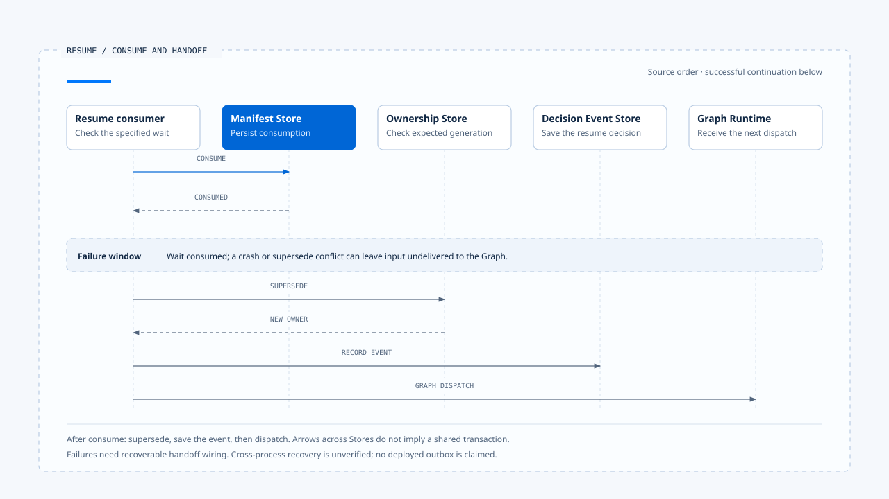

# 等待与恢复转移

[English](./04-waiting-and-resume-transitions.md) | [繁體中文](./04-waiting-and-resume-transitions-zh-TW.md) | [简体中文](./04-waiting-and-resume-transitions-zh-CN.md)

> 以下内容所提到的
> CCB 为 [claude-code-best](https://github.com/claude-code-best/claude-code) 的简称。
> Chat Gun 为 [chat-gun](https://github.com/HsienW/chat-gun)。

[回到导览](./README-zh-CN.md) · 前一篇：[执行限制与取消](./03-deadlines-budgets-and-cancellation-zh-CN.md) · 下一篇：[终止判定与清理](./05-terminal-results-and-finalization-zh-CN.md)

> 用户在手机上批准一次操作，浏览器重试又送出相同回复。第一个请求已把等待标成 consumed，却在重新派送前崩溃；第二个请求因为「已消费」被拒绝，任务从此停住。

**等待的生命周期要同时处理回复资格、单次消费与消费后的接手。** 阻止重复批准之后，系统仍需知道合法输入是否已交给 Runtime；这两份事实各有自己的提交位置。

## Waiting 保存的是可继续的条件

一个等待至少要说明目前缺少什么、谁可以提供、回复对到哪个执行，以及通过验证后从哪个位置继续。只保存问题文字，无法辨认稍后收到的回答是否还有效。

| 数据 | 用途 |
|---|---|
| Waiting reason／kind | 区分厘清、批准或其他外部决策。 |
| Correlation | 关联 Interrupt、Thread、Task、Run 与 Scope。 |
| Response contract | 定义 Schema 与可接受的 payload。 |
| Expiry／version | 限定何时可回复，以及哪些程序能解读。 |
| Recovery position | 指出 Graph／Runtime 后续执行位置。 |
| Consumption state | 辨认等待中、已消费、过期或失效。 |

不同等待种类可以省略或增加字段，但要说明相应责任由谁承担。人工批准还可能绑定 Resource、Tool Call、参数摘要与授权结果，不能直接沿用一般厘清的检查集合。

## 先保存，再向用户显示

Runtime 决定暂停后，应先留下必要 Manifest 与恢复数据，再发出等待通知。若画面先出现问题，存储却失败，用户回复时就没有对应的权威等待。

概念顺序可以表示为：

~~~text
建立指定等待与回覆契约
  → 保存必要 Manifest／恢复位置
  → 确认等待已可恢复
  → 通知 Harness 显示
  → 接受对到该等待的 Resume
~~~

这个顺序未指定跨 Store transaction。Manifest 与 Graph Checkpoint 若分开保存，需要处理只完成其中一项的窗口；数据库与部署方式另见 [Foundations 的持久化说明](../foundations/04-persistence-interrupt-and-resume-zh-CN.md)。

### 暂停的作用范围

等待时可以停止该分支的模型与工具派送，但不能只从画面看见等待便推论整个系统没有 in-flight 工作。平行分支、远端工具或另一个 Run 可能仍在进行。

Runtime 应在契约中说明等待的是一个 Tool Call、Graph 分支或整个 Task。这也决定取消与恢复需要检查哪些未完成工作。

## Resume 要指向指定等待

Resume handler 需要读取权威等待，再判断这份回复是否可接受。Client 提供的 Interrupt ID 可以用来定位，身份与权限仍需来自可信 Context。

一般设计至少要检查：

1. 等待仍存在，kind 符合指定 consumer。
2. Correlation 对回正确 Thread、Task、Run 与 Scope。
3. Responder 的可信身份与资源权限符合该等待种类。
4. 回复通过指定 Schema，期限与版本仍有效。
5. 等待没有被取消、替换或其他回复消费。

这份清单是完整路径的责任框架。单一 helper 可能只执行其中几项，其他条件要继续追到上游，不能以函数名称代替查证。

## Chat Gun 的 Clarification consumer

本区版本的 `createClarificationResumeAuthorizer()` 先依 Interrupt ID 读 Manifest，核对 kind，再比较 manifest 的 Thread／Scope 与传入要求，以及 Run／Task 与 `activeOwnership` 的关联。

后续处理包括：

- 要求 manifest status 为 waiting。
- 期限已到时，尝试把 waiting 转为 expired，返回过期原因。
- 用目前 execution manifest 判断兼容性。
- 将 response 交给指定的 response Schema registry。
- 最后调用 manifest repository 的 `consume()`，依结果返回成功或拒绝。

### 信任数据从哪里进入

这个 authorizer 的参数包含 Scope 与 active ownership，没有直接接收完整 Principal。它能证明自己比较了哪些关联；回复者身份如何建立、Tenant 或 Resource 如何授权，仍要沿输入与互动 consumer 查读。

若产品需要每次恢复都核对最新资源状态，也应找到实际检查点。Clarification 的 Schema 验证无法代替工具行动的授权。

## 消费成功之后，可能取得新的 Run

本区 Chat Gun 的 `resume_same_task` 分支，先对 clarification response 调用 authorizer。成功后，consumer 再执行 ownership `supersede()`，保留 disposition 指定的 Task，改用本次 Context 的 Run，并取得新的 generation。

接着 guard 采用 replacement 为 dispatching，记录 `clarification_resumed` 决策事件，再切换本地 guard 到 running，交回原生 Graph 执行路径。

> 这里的「同一 Task」不要求相同 Run ID。产品 ownership 的新 Run、原生 Thread 的恢复位置与输入 payload，需要依各自契约串起来。

不能把这段产品流程套成所有 LangGraph Resume 的规则。其他 Graph 或直接使用原生 Agent Server 的入口，可能采用不同 Run 生命周期。

## Consume 与接手之间的窗口

目前查读的 consumer 是先 consume，再 supersede、记录事件与准备派送。这些操作没有在该段程序中呈现为一个共同 transaction。

- 图中的下半段表示成功续行；若风险窗口真的发生故障，不能沿箭头推论系统会自动恢复。下表分别列出各段可能留下的状态。
- [开启时序图与实现注记](../../assets/agent-runtime/execution-lifecycle/04-waiting-and-resume-transitions/04-consume-handoff-window-en.html)。

| 中断位置 | 可能留下的状态 | 恢复需要回答 |
|---|---|---|
| Consume 前 | 等待仍未消费。 | 是否仍可重送同一回复？ |
| Consume 后、supersede 前 | 输入已消费，owner 尚未替换。 | 谁负责继续接手或回报失败？ |
| Supersede 后、事件保存前 | 新 owner 已建立。 | 能否从 owner 与等待关联查回处置？ |
| 事件保存后、Graph 派送前 | 产品已记录恢复决策。 | Graph 是否真的开始或需要补派送？ |

另一个要求也可能在 authorizer 读取 active ownership 后改变 owner。后续 supersede 的 expected generation 可以拒绝过期更新，但合法回复可能已先消费；这是需要故障与并发验证的接线窗口。

要让消费与接手可恢复，可以设计持久的 Resume request、待派送记录或 outbox，再让重试查回既有处置。这些是设计选项，本轮没有证明来源已提供涵盖整条路径的实现。

## 单次消费需要权威条件

两个相同回复都可能先读到 waiting。真正决定谁能继续的是 consume 写入，而非之前那次读取；repository 应以目前状态、关联与期限等条件判定，避免第二次消费。

查读 authorizer 可以确认它调用 consume，原子性仍要追到 repository 实现与数据库。即使单次消费成立，后面的 Graph 派送是否只发生一次，仍是另一项需要证据的主张。

## Confirmation 与 CCB Permission 的边界

人工批准要绑定已具体化的行动。工具、Resource 或参数在等待期间改变时，需要依批准契约决定是否失效或重新确认；先前取得的批准不能任意套到另一个 Tool Call。

Chat Gun Confirmation 有自己的 descriptor 与 authorized dispatch consumer，与本篇的 Clarification authorizer 分开。关于沿用先前 authorization result 的行为，应以 [Run 完整走法](../foundations/06-one-run-walkthrough-zh-CN.md) 所列来源与版本范围查证。

CCB 的 Permission 往返可以作进程内等待对照，但它不会因为也显示确认界面，就取得 Chat Gun Manifest、Scope 或跨进程恢复的语义。这些能力需要各自的 Store 与处理路径支持。

## 过期、取消与终止

- **Expired**：该次等待不再接受新回答，产品可另建新问题或结束 Task。
- **Cancelled**：等待依取消策略失效；后到批准不能重新启动旧工作。
- **Superseded**：恢复资格需对回目前 owner，不能只比对旧 Interrupt ID。
- **Terminal**：保留原始结果；新需求要建立新的合法执行关联。

原生 Graph 停在 Interrupt、一次 stream 结束，以及产品 ownership 被标成 completed，可能来自不同层次。要判断整项 Task 是否仍在等待，需读取各自权威数据；wrapper 的结束值不能单独替代 Waiting 判定。

## 如何验证恢复转移

### 回复资格

- 使用错误 kind、Scope、Run、Schema 或过期 Manifest，核对拒绝原因。
- 验证错误回复者会在可信入口或指定授权 consumer 被拒绝。
- 让旧 waiting record 与新 owner 同时存在，确认不会绑到新 Run。

### 单次消费与接手

- 同时送入两份相同回复，核对 consume 成功数与后续实际派送次数。
- 在 consume 后、supersede 后与 Graph 启动前分别停止程序，查明残留数据。
- 在读取 owner 与 supersede 间插入另一个替换，检查已消费输入如何恢复。

现有 clarification authorizer 测试安排包含单次消费、replay、错误 correlation 与 payload。本轮未执行这些测试，亦未验证跨进程接手。

## 本篇的工程判断

一个可恢复等待，必须让用户的回答与 Runtime 的接手结果都能查回。保存了问题、拒绝了重送，仍需要回答那份已被合法消费的输入去了哪里。

我会优先检查 consume 之后的第一个 await。该处若会建立新 owner、保存事件或调用另一个服务，就需要明确的失败记录与恢复契约，让单次批准不会变成永久卡住的任务。

## 实现参照与适用范围

- [Chat Gun clarification authorizer][g-resume]：correlation、status、expiry、compatibility、Schema 与 consume 交接。
- [Chat Gun interaction consumer][g-runtime]：`resume_same_task`、supersede 与派送前事件。
- CCB Permission 仅作不同 Runtime 形状的比较；本篇没有宣称共同的 durable waiting 接口。
- 来源版本与查证范围见[本区导览](./README-zh-CN.md#正文来源与适用范围)。

## 接续阅读

- [终止判定与清理](./05-terminal-results-and-finalization-zh-CN.md)
- [厘清提问与任务恢复](../../agent-harness/interaction-and-feedback/03-clarification-and-resume-zh-CN.md)

[g-resume]: https://github.com/HsienW/chat-gun/blob/f83a38fd67a021904e597c60543708ee0c206076/backend/src/runtime/recovery/clarification-resume-authorization.ts
[g-runtime]: https://github.com/HsienW/chat-gun/blob/f83a38fd67a021904e597c60543708ee0c206076/backend/src/platform/interaction-runtime.ts
