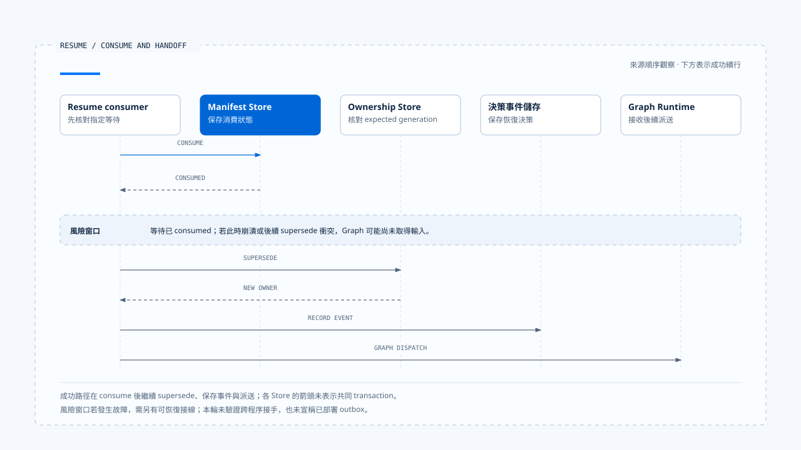

# 等待與恢復轉移

[English](./04-waiting-and-resume-transitions.md) | [繁體中文](./04-waiting-and-resume-transitions-zh-TW.md)

> 以下內容所提到的
> CCB 為 [claude-code-best](https://github.com/claude-code-best/claude-code) 的簡稱。
> Chat Gun 為 [chat-gun](https://github.com/HsienW/chat-gun)。

[回到導覽](./README-zh-TW.md) · 前一篇：[執行限制與取消](./03-deadlines-budgets-and-cancellation-zh-TW.md) · 下一篇：[終止判定與清理](./05-terminal-results-and-finalization-zh-TW.md)

> 使用者在手機上批准一次操作，瀏覽器重試又送出相同回覆。第一個請求已把等待標成 consumed，卻在重新派送前崩潰；第二個請求因為「已消費」被拒絕，任務從此停住。

**等待的生命週期要同時處理回覆資格、單次消費與消費後的接手。** 阻止重複批准之後，系統仍需知道合法輸入是否已交給 Runtime；這兩份事實各有自己的提交位置。

## Waiting 保存的是可繼續的條件

一個等待至少要說明目前缺少什麼、誰可以提供、回覆對到哪個執行，以及通過驗證後從哪個位置繼續。只保存問題文字，無法辨認稍後收到的回答是否還有效。

| 資料 | 用途 |
|---|---|
| Waiting reason／kind | 區分釐清、批准或其他外部決策。 |
| Correlation | 關聯 Interrupt、Thread、Task、Run 與 Scope。 |
| Response contract | 定義 Schema 與可接受的 payload。 |
| Expiry／version | 限定何時可回覆，以及哪些程式能解讀。 |
| Recovery position | 指出 Graph／Runtime 後續執行位置。 |
| Consumption state | 辨認等待中、已消費、過期或失效。 |

不同等待種類可以省略或增加欄位，但要說明相應責任由誰承擔。人工批准還可能綁定 Resource、Tool Call、參數摘要與授權結果，不能直接沿用一般釐清的檢查集合。

## 先保存，再向使用者顯示

Runtime 決定暫停後，應先留下必要 Manifest 與恢復資料，再發出等待通知。若畫面先出現問題，儲存卻失敗，使用者回覆時就沒有對應的權威等待。

概念順序可以表示為：

~~~text
建立指定等待與回覆契約
  → 保存必要 Manifest／恢復位置
  → 確認等待已可恢復
  → 通知 Harness 顯示
  → 接受對到該等待的 Resume
~~~

這個順序未指定跨 Store transaction。Manifest 與 Graph Checkpoint 若分開保存，需要處理只完成其中一項的窗口；資料庫與部署方式另見 [Foundations 的持久化說明](../foundations/04-persistence-interrupt-and-resume-zh-TW.md)。

### 暫停的作用範圍

等待時可以停止該分支的模型與工具派送，但不能只從畫面看見等待便推論整個系統沒有 in-flight 工作。平行分支、遠端工具或另一個 Run 可能仍在進行。

Runtime 應在契約中說明等待的是一個 Tool Call、Graph 分支或整個 Task。這也決定取消與恢復需要檢查哪些未完成工作。

## Resume 要指向指定等待

Resume handler 需要讀取權威等待，再判斷這份回覆是否可接受。Client 提供的 Interrupt ID 可以用來定位，身分與權限仍需來自可信 Context。

一般設計至少要檢查：

1. 等待仍存在，kind 符合指定 consumer。
2. Correlation 對回正確 Thread、Task、Run 與 Scope。
3. Responder 的可信身分與資源權限符合該等待種類。
4. 回覆通過指定 Schema，期限與版本仍有效。
5. 等待沒有被取消、替換或其他回覆消費。

這份清單是完整路徑的責任框架。單一 helper 可能只執行其中幾項，其他條件要繼續追到上游，不能以函式名稱代替查證。

## Chat Gun 的 Clarification consumer

本區版本的 `createClarificationResumeAuthorizer()` 先依 Interrupt ID 讀 Manifest，核對 kind，再比較 manifest 的 Thread／Scope 與傳入要求，以及 Run／Task 與 `activeOwnership` 的關聯。

後續處理包括：

- 要求 manifest status 為 waiting。
- 期限已到時，嘗試把 waiting 轉為 expired，回傳過期原因。
- 用目前 execution manifest 判斷相容性。
- 將 response 交給指定的 response Schema registry。
- 最後呼叫 manifest repository 的 `consume()`，依結果回傳成功或拒絕。

### 信任資料從哪裡進入

這個 authorizer 的參數包含 Scope 與 active ownership，沒有直接接收完整 Principal。它能證明自己比較了哪些關聯；回覆者身分如何建立、Tenant 或 Resource 如何授權，仍要沿輸入與互動 consumer 查讀。

若產品需要每次恢復都核對最新資源狀態，也應找到實際檢查點。Clarification 的 Schema 驗證無法代替工具行動的授權。

## 消費成功之後，可能取得新的 Run

本區 Chat Gun 的 `resume_same_task` 分支，先對 clarification response 呼叫 authorizer。成功後，consumer 再執行 ownership `supersede()`，保留 disposition 指定的 Task，改用本次 Context 的 Run，並取得新的 generation。

接著 guard 採用 replacement 為 dispatching，記錄 `clarification_resumed` 決策事件，再切換本地 guard 到 running，交回原生 Graph 執行路徑。

> 這裡的「同一 Task」不要求相同 Run ID。產品 ownership 的新 Run、原生 Thread 的恢復位置與輸入 payload，需要依各自契約串起來。

不能把這段產品流程套成所有 LangGraph Resume 的規則。其他 Graph 或直接使用原生 Agent Server 的入口，可能採用不同 Run 生命週期。

## Consume 與接手之間的窗口

目前查讀的 consumer 是先 consume，再 supersede、記錄事件與準備派送。這些操作沒有在該段程式中呈現為一個共同 transaction。

- 圖中的下半段表示成功續行；若風險窗口真的發生故障，不能沿箭頭推論系統會自動恢復。下表分別列出各段可能留下的狀態。
- [開啟時序圖與實作註記](../../assets/agent-runtime/execution-lifecycle/04-waiting-and-resume-transitions/04-consume-handoff-window.html)。

| 中斷位置 | 可能留下的狀態 | 恢復需要回答 |
|---|---|---|
| Consume 前 | 等待仍未消費。 | 是否仍可重送同一回覆？ |
| Consume 後、supersede 前 | 輸入已消費，owner 尚未替換。 | 誰負責繼續接手或回報失敗？ |
| Supersede 後、事件保存前 | 新 owner 已建立。 | 能否從 owner 與等待關聯查回處置？ |
| 事件保存後、Graph 派送前 | 產品已記錄恢復決策。 | Graph 是否真的開始或需要補派送？ |

另一個要求也可能在 authorizer 讀取 active ownership 後改變 owner。後續 supersede 的 expected generation 可以拒絕過期更新，但合法回覆可能已先消費；這是需要故障與併發驗證的接線窗口。

要讓消費與接手可恢復，可以設計持久的 Resume request、待派送紀錄或 outbox，再讓重試查回既有處置。這些是設計選項，本輪沒有證明來源已提供涵蓋整條路徑的實作。

## 單次消費需要權威條件

兩個相同回覆都可能先讀到 waiting。真正決定誰能繼續的是 consume 寫入，而非之前那次讀取；repository 應以目前狀態、關聯與期限等條件判定，避免第二次消費。

查讀 authorizer 可以確認它呼叫 consume，原子性仍要追到 repository 實作與資料庫。即使單次消費成立，後面的 Graph 派送是否只發生一次，仍是另一項需要證據的主張。

## Confirmation 與 CCB Permission 的邊界

人工批准要綁定已具體化的行動。工具、Resource 或參數在等待期間改變時，需要依批准契約決定是否失效或重新確認；先前取得的批准不能任意套到另一個 Tool Call。

Chat Gun Confirmation 有自己的 descriptor 與 authorized dispatch consumer，與本篇的 Clarification authorizer 分開。關於沿用先前 authorization result 的行為，應以 [Run 完整走法](../foundations/06-one-run-walkthrough-zh-TW.md) 所列來源與版本範圍查證。

CCB 的 Permission 往返可以作程序內等待對照，但它不會因為也顯示確認介面，就取得 Chat Gun Manifest、Scope 或跨程序恢復的語意。這些能力需要各自的 Store 與處理路徑支持。

## 過期、取消與終止

- **Expired**：該次等待不再接受新回答，產品可另建新問題或結束 Task。
- **Cancelled**：等待依取消策略失效；後到批准不能重新啟動舊工作。
- **Superseded**：恢復資格需對回目前 owner，不能只比對舊 Interrupt ID。
- **Terminal**：保留原始結果；新需求要建立新的合法執行關聯。

原生 Graph 停在 Interrupt、一次 stream 結束，以及產品 ownership 被標成 completed，可能來自不同層次。要判斷整項 Task 是否仍在等待，需讀取各自權威資料；wrapper 的結束值不能單獨替代 Waiting 判定。

## 如何驗證恢復轉移

### 回覆資格

- 使用錯誤 kind、Scope、Run、Schema 或過期 Manifest，核對拒絕原因。
- 驗證錯誤回覆者會在可信入口或指定授權 consumer 被拒絕。
- 讓舊 waiting record 與新 owner 同時存在，確認不會綁到新 Run。

### 單次消費與接手

- 同時送入兩份相同回覆，核對 consume 成功數與後續實際派送次數。
- 在 consume 後、supersede 後與 Graph 啟動前分別停止程序，查明殘留資料。
- 在讀取 owner 與 supersede 間插入另一個替換，檢查已消費輸入如何恢復。

現有 clarification authorizer 測試安排包含單次消費、replay、錯誤 correlation 與 payload。本輪未執行這些測試，亦未驗證跨程序接手。

## 本篇的工程判斷

一個可恢復等待，必須讓使用者的回答與 Runtime 的接手結果都能查回。保存了問題、拒絕了重送，仍需要回答那份已被合法消費的輸入去了哪裡。

我會優先檢查 consume 之後的第一個 await。該處若會建立新 owner、保存事件或呼叫另一個服務，就需要明確的失敗紀錄與恢復契約，讓單次批准不會變成永久卡住的任務。

## 實作參照與適用範圍

- [Chat Gun clarification authorizer][g-resume]：correlation、status、expiry、compatibility、Schema 與 consume 交接。
- [Chat Gun interaction consumer][g-runtime]：`resume_same_task`、supersede 與派送前事件。
- CCB Permission 僅作不同 Runtime 形狀的比較；本篇沒有宣稱共同的 durable waiting 介面。
- 來源版本與查證範圍見[本區導覽](./README-zh-TW.md#正文來源與適用範圍)。

## 接續閱讀

- [終止判定與清理](./05-terminal-results-and-finalization-zh-TW.md)
- [釐清提問與任務恢復](../../agent-harness/interaction-and-feedback/03-clarification-and-resume-zh-TW.md)

[g-resume]: https://github.com/HsienW/chat-gun/blob/f83a38fd67a021904e597c60543708ee0c206076/backend/src/runtime/recovery/clarification-resume-authorization.ts
[g-runtime]: https://github.com/HsienW/chat-gun/blob/f83a38fd67a021904e597c60543708ee0c206076/backend/src/platform/interaction-runtime.ts
