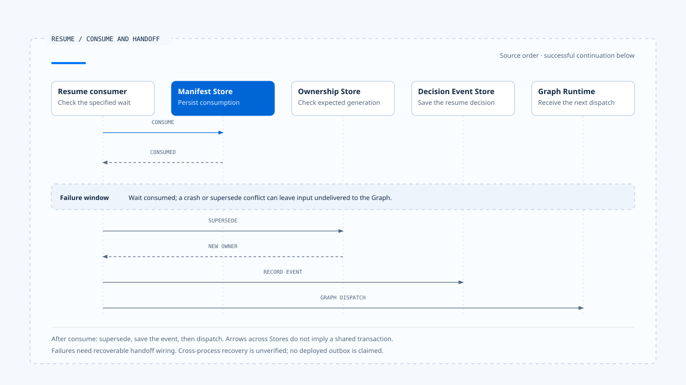

# Waiting and resume transitions

[English](./04-waiting-and-resume-transitions.md) | [繁體中文](./04-waiting-and-resume-transitions-zh-TW.md)

> In the following content:
> CCB is short for [claude-code-best](https://github.com/claude-code-best/claude-code).
> Chat Gun refers to [chat-gun](https://github.com/HsienW/chat-gun).

[Back to guide](./README-zh-TW.md) · Previous: [Execution limits and cancellation](./03-deadlines-budgets-and-cancellation.md) · Next: [Terminal decisions and cleanup](./05-terminal-results-and-finalization.md)

> A user approves an operation on a phone, and a browser retry sends the same response again. The first request has marked the wait consumed but crashes before redispatch. The second request is rejected because it was "already consumed," leaving the task stuck.

**A wait lifecycle needs to handle response eligibility, single consumption, and the handoff after consumption.** After preventing duplicate approval, the system still needs to know whether the valid input reached the Runtime. Those facts have separate commit points.

## Waiting preserves the conditions for continuation

A wait needs to state at least what is missing, who may provide it, which execution the response belongs to, and where execution continues after validation. Saving only the question text cannot determine whether a later answer is still valid.

| Data | Purpose |
|---|---|
| Waiting reason/kind | Distinguish clarification, approval, and other external decisions. |
| Correlation | Relate Interrupt, Thread, Task, Run, and Scope. |
| Response contract | Define the Schema and acceptable payload. |
| Expiry/version | Limit when responses are accepted and which code can interpret them. |
| Recovery position | Identify the subsequent Graph/Runtime execution position. |
| Consumption state | Distinguish waiting, consumed, expired, and invalidated. |

Different wait kinds may omit or add fields, but must explain who carries the corresponding responsibilities. Human approval may also bind a Resource, Tool Call, argument summary, and authorization result. It cannot simply reuse the checks for ordinary clarification.

## Persist before displaying the wait

After deciding to pause, the Runtime should retain the required Manifest and recovery data before issuing the waiting notification. If the question appears first and storage fails, no corresponding authoritative wait exists when the user replies.

The conceptual order is:

~~~text
建立指定等待與回覆契約
  → 保存必要 Manifest／恢復位置
  → 確認等待已可恢復
  → 通知 Harness 顯示
  → 接受對到該等待的 Resume
~~~

This order does not specify a cross-Store transaction. If the Manifest and Graph Checkpoint are saved separately, the design needs to handle the window where only one succeeds. For storage and deployment, see [persistence in Foundations](../foundations/04-persistence-interrupt-and-resume.md).

### The scope of a pause

Waiting can stop model and tool dispatch for that branch, but a wait displayed on screen does not establish that the whole system has no in-flight work. Parallel branches, remote tools, or another Run may still be active.

The Runtime contract should state whether a Tool Call, Graph branch, or entire Task is waiting. This also determines which unfinished work cancellation and resume need to check.

## Resume must target a specified wait

A Resume handler needs to read the authoritative wait before deciding whether to accept a response. A Client-supplied Interrupt ID can locate it; identity and permissions must still come from trusted Context.

A general design needs at least these checks:

1. The wait still exists, with a kind matching the designated consumer.
2. Correlation matches the correct Thread, Task, Run, and Scope.
3. The responder's trusted identity and resource permissions satisfy that wait kind.
4. The response passes the designated Schema, and expiry and version remain valid.
5. The wait has not been cancelled, replaced, or consumed by another response.

This list is a responsibility framework for the full path. An individual helper may perform only some checks; the others must be traced upstream. A function name cannot substitute for verification.

## Chat Gun's Clarification consumer

In the version examined here, `createClarificationResumeAuthorizer()` first reads the Manifest by Interrupt ID and checks kind. It then compares the manifest's Thread/Scope with the request and its Run/Task with `activeOwnership`.

Subsequent handling includes:

- Requiring manifest status to be waiting.
- Attempting to transition waiting to expired and returning an expiry reason when the deadline has passed.
- Checking compatibility against the current execution manifest.
- Passing the response to the designated response Schema registry.
- Finally calling `consume()` on the manifest repository and returning success or rejection from its result.

### Where trusted data enters

This authorizer receives Scope and active ownership as parameters, without directly receiving a complete Principal. It establishes which correlations it compares. How responder identity is established and how Tenant or Resource authorization works still need to be traced through input and interaction consumers.

If a product requires every resume to check the latest resource state, that enforcement point must also be located. Clarification Schema validation cannot replace authorization for a tool action.

## Successful consumption may lead to a new Run

In the Chat Gun `resume_same_task` branch examined here, the consumer first calls the authorizer for the clarification response. After success, it performs ownership `supersede()`, retaining the Task specified by the disposition, using the current Context's Run, and obtaining a new generation.

The guard then adopts the replacement as dispatching, records a `clarification_resumed` decision event, changes the local guard to running, and returns to the native Graph execution path.

> Here, "same Task" does not require the same Run ID. The new product-ownership Run, the native Thread's resume position, and the input payload need to be connected under their respective contracts.

This product flow cannot be generalized to every LangGraph Resume. Other Graphs or entry points using the native Agent Server directly may use a different Run lifecycle.

## The window between consumption and handoff

The consumer examined here consumes first, then supersedes, records an event, and prepares dispatch. That code does not present these operations as one shared transaction.

- The lower half shows successful continuation. A failure in the risk window does not imply automatic recovery along the arrows. The table below lists the state each interruption can leave behind.
- [Open the sequence diagram and implementation notes](../../assets/agent-runtime/execution-lifecycle/04-waiting-and-resume-transitions/04-consume-handoff-window-en.html).

| Interruption point | Possible remaining state | Question recovery must answer |
|---|---|---|
| Before consume | The wait is still unconsumed. | Can the same response still be retried? |
| After consume, before supersede | Input is consumed; ownership has not been replaced. | Who continues the handoff or reports failure? |
| After supersede, before event persistence | The new owner exists. | Can the disposition be retrieved from the owner and wait correlation? |
| After event persistence, before Graph dispatch | The product has recorded the resume decision. | Did the Graph actually start, or does dispatch need recovery? |

Another request may also change ownership after the authorizer reads active ownership. The expected generation in the later supersede can reject a stale update, but a valid response may already have been consumed. This wiring window needs failure and concurrency verification.

A durable Resume request, pending dispatch record, or outbox can make consumption and handoff recoverable, with retries retrieving the existing disposition. These are design options. The work behind this section did not establish an implementation covering the entire path in the source.

## Single consumption needs authoritative conditions

Two identical responses can both initially read waiting. The consume write determines which may continue; the earlier read does not. The repository should evaluate current state, correlation, expiry, and other conditions to prevent a second consumption.

Reading the authorizer confirms that it calls consume. Atomicity still needs to be traced to the repository implementation and database. Even if single consumption holds, exactly one subsequent Graph dispatch is a separate claim requiring evidence.

## Boundaries of Confirmation and CCB Permission

Human approval needs to bind a concrete action. If the tool, Resource, or arguments change during the wait, the approval contract must determine whether approval expires or requires renewed confirmation. A previous approval cannot be applied arbitrarily to another Tool Call.

Chat Gun Confirmation has its own descriptor and authorized dispatch consumer, separate from this article's Clarification authorizer. Behavior that reuses an earlier authorization result should be checked within the sources and versions listed in the [one-Run walkthrough](../foundations/06-one-run-walkthrough.md).

CCB's Permission round trip offers a process-local comparison. Showing a confirmation interface does not give it Chat Gun's Manifest, Scope, or cross-process recovery semantics. Those capabilities require their own Stores and handling paths.

## Expiry, cancellation, and termination

- **Expired**: This wait no longer accepts new answers. The product may create a new question or end the Task.
- **Cancelled**: The wait is invalidated according to cancellation policy; a late approval cannot restart old work.
- **Superseded**: Resume eligibility must match the current owner, beyond matching an old Interrupt ID.
- **Terminal**: Retain the original result; new requirements need a new valid execution correlation.

A native Graph stopping at an Interrupt, a stream ending, and product ownership being marked completed can belong to different layers. Determining whether the whole Task is still waiting requires reading their respective authorities. A wrapper's end value alone cannot replace Waiting evaluation.

## How to verify resume transitions

### Response eligibility

- Use the wrong kind, Scope, Run, Schema, or an expired Manifest, and check rejection reasons.
- Verify that an unauthorized responder is rejected at a trusted entry point or designated authorization consumer.
- Keep an old waiting record alongside a new owner, and confirm that it cannot bind to the new Run.

### Single consumption and handoff

- Submit two identical responses concurrently, and check successful consumes and actual subsequent dispatch counts.
- Stop the process after consume, after supersede, and before Graph startup, and inspect remaining data.
- Insert another replacement between reading the owner and supersede, and check how consumed input is recovered.

Existing clarification authorizer test arrangements include single consumption, replay, incorrect correlation, and payload cases. They were not executed for this section, and cross-process handoff was not verified.

## Engineering judgment

A recoverable wait must make both the user's answer and the Runtime handoff result retrievable. Saving the question and rejecting retries still leaves the question of where the validly consumed input went.

I would inspect the first await after consume. If it creates a new owner, saves an event, or calls another service, it needs an explicit failure record and recovery contract so a single approval does not leave a task permanently stuck.

## Implementation references and scope

- [Chat Gun clarification authorizer][g-resume]: correlation, status, expiry, compatibility, Schema, and consume handoff.
- [Chat Gun interaction consumer][g-runtime]: `resume_same_task`, supersede, and events before dispatch.
- CCB Permission is used only to compare different Runtime forms; this article does not claim a shared durable waiting interface.
- See the [section guide](./README-zh-TW.md#正文來源與適用範圍) for source versions and verification scope.

## Further reading

- [Terminal decisions and cleanup](./05-terminal-results-and-finalization.md)
- [Clarification and task resume](../../agent-harness/interaction-and-feedback/03-clarification-and-resume.md)

[g-resume]: https://github.com/HsienW/chat-gun/blob/f83a38fd67a021904e597c60543708ee0c206076/backend/src/runtime/recovery/clarification-resume-authorization.ts
[g-runtime]: https://github.com/HsienW/chat-gun/blob/f83a38fd67a021904e597c60543708ee0c206076/backend/src/platform/interaction-runtime.ts
