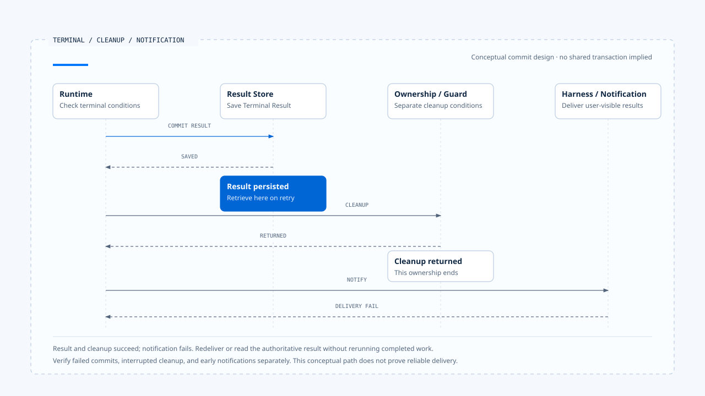
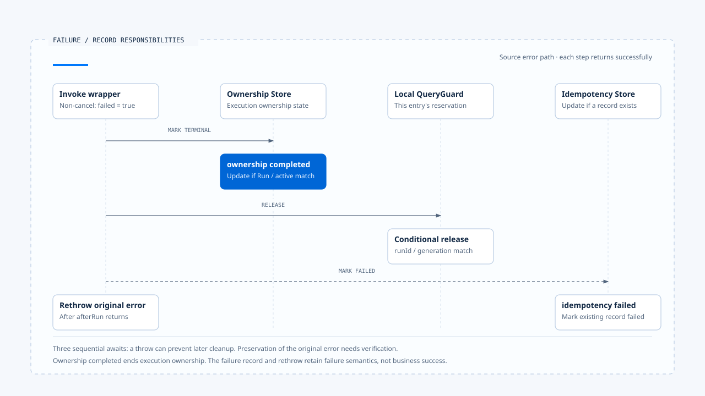

# 终止判定与清理

[English](./05-terminal-results-and-finalization.md) | [繁體中文](./05-terminal-results-and-finalization-zh-TW.md) | [简体中文](./05-terminal-results-and-finalization-zh-CN.md)

> 以下内容所提到的
> CCB 为 [claude-code-best](https://github.com/claude-code-best/claude-code) 的简称。
> Chat Gun 为 [chat-gun](https://github.com/HsienW/chat-gun)。

[回到导览](./README-zh-CN.md) · 前一篇：[等待与恢复转移](./04-waiting-and-resume-transitions-zh-CN.md) · 下一篇：[一次替换与晚到结果](./06-case-lifecycle-races-zh-CN.md)

> 最后一段模型文字已经送到画面，Run 的结果却还没写入；另一种情况是结果早已保存，terminal event 在途中遗失。两者都可能让用户一直看到 loading，恢复方式却完全不同。

**终止需要分开判断工作结果、提交权威状态与交付通知。** 清理则必须对回本次取得的资源，避免旧执行在结束时伤及新的 owner。

## 哪一种完成

Runtime 周边有多种「结束」信号：Provider stream 关闭、generator return、工具 Promise resolved、ownership 结束，以及业务目标完成。每项信号只能证明自己观察到的范围。

| 信号 | 可以确认的事 | 还需核对 |
|---|---|---|
| Provider stream 结束 | 该次传输结束。 | 消息是否完整、是否仍有 Tool Call。 |
| Tool Promise resolved | 调用返回了一份值。 | 内层 typed outcome 与外部效果。 |
| Graph／generator 返回 | 该次调用不再产生下一项内容。 | 是否因等待、限制或失败而结束。 |
| Ownership terminal | 指定 owner 已依 repository 契约结束。 | Native Run 与业务 Task 的结果。 |
| Terminal event 送达 | Consumer 收到一笔通知。 | 通知对应的权威结果与版本。 |

同一个 `completed` 字符串出现在不同 Store 时，需要分别说明含义。若产品要显示「任务完成」，还得核对必要工具、资源及业务条件。

## Terminal 判定的输入

概念上，Runtime 进入 Completed 前，需要确认目前没有仍待处理的 Tool Call、Interrupt、取消或未知效果，并保存契约要求的结果。Failed、Cancelled、Rejected 与 Parked 则留下不同的停止原因与后续责任。

- **Completed**：本次执行符合完成条件，必要结果可查。
- **Failed**：失败阻止本次继续，保留原因与已知效果。
- **Cancelled**：停止后续工作的要求已按契约收束，外部效果另行记录。
- **Rejected**：接纳或政策条件不允许继续；单一工具拒绝是否终止整个 Run 由产品决定。
- **Parked**：自动处理停止，保留待回查或人工接手的位置。

这些是概念结果，不能直接假设来源库已有全部状态。Waiting 若仍可 Resume，通常要在 Task 层保留等待事实，即使本次 API 已经回应结束。

## Terminal、清理与通知的提交

一个可检查的设计会把三件事拆开：

1. **结果提交**：以合法转移保存本次权威结果。
2. **资源清理**：释放属于自己的 reservation、owner 或连接。
3. **结果交付**：发出通知，让 Harness 或其他 consumer 取得结果。

这份顺序需要依 Store 与部署调整，但任何一步失败，都不应让系统重新执行已完成的外部操作。若跨 Store 没有共同 transaction，恢复必须能辨认哪些事实已成立。

| 失败窗口 | 已成立的事实 | 合理的后续方向 |
|---|---|---|
| 结果提交前中断 | 尚未确认 Terminal 写入。 | 查回 Run 与效果，再决定收束。 |
| Terminal 成功、清理失败 | 结果已存在。 | 重试条件式清理，避免重做业务。 |
| 清理成功、通知失败 | 本次已不再持有执行权。 | 重送通知或读取权威结果。 |
| 通知先送达、结果保存失败 | 画面与权威数据可能不一致。 | 回报失败并修正，不能假装已持久提交。 |

- 图中选取结果与清理成功、通知失败的情境。这是提交责任的概念设计，不表示两个来源库已使用相同 Store 或具有共同 transaction。
- [开启提交、清理与通知时序](../../assets/agent-runtime/execution-lifecycle/05-terminal-results-and-finalization/05-terminal-cleanup-notification-en.html)。

可靠投递可采持久事件记录或 outbox 等设计，但需找到实际 consumer 才能主张保证。本区没有把这些选项写成来源已部署的能力。

## Chat Gun ownership 的实际含义

本区 `markTerminal()` 接受 completed 或 cancelled，并以 Thread、Scope、Run 与 active status 条件更新 ownership row。它没有 Failed、Waiting 或 Parked 这几种值。

这个 repository 管理目前执行权。若要完整表达业务结果，需连同其他字段、原生 Run 状态与 outcome 读取；单从它的状态集合无法建立完整的 Runtime state machine。

### Wrapper 的错误路径

本区 `applyInteractionGovernance()` 的 invoke wrapper 在非取消例外时，会调用 `afterRun()`，传入 ownership terminal status `completed`，同时将 failed 设为 true，之后重新抛出例外。

`afterRun()` 先尝试更新 ownership，再释放本地 guard；若有 idempotency record，failed 分支会调用 `markFailed()`。因此同一次调用可能留下 ownership completed 与失败记录，两者描述不同责任。

> 这条程序路径提醒 consumer：ownership completed 不能直接显示成「工具成功」或「业务完成」。错误仍由调用端接收，产品需要保留它的结果语义。

- 图中分开呈现各份记录的责任。向下时序假设前一步成功返回；若中途 await 抛错，后续清理与原例外的保留需另行验证。
- [开启失败记录图与条件说明](../../assets/agent-runtime/execution-lifecycle/05-terminal-results-and-finalization/05-failure-record-separation-en.html)。

### Stream 提前结束

`createGovernedStream()` 追踪 completed、failed 与 terminalStatus。正常耗尽来源会把状态设为 completed；例外依取消判定选择状态，而 `finally` 仍会尝试调用 `afterRun()`。

若来源因 Graph Interrupt 正常结束，本段 wrapper 没有单独将它辨认为业务 Waiting。产品仍需读取原生 Graph／Manifest 的等待事实，避免用正常耗尽 stream 代替整项任务完成。

这项观察限于该 wrapper，尚未证明每个正式入口都使用相同组装或已有同一种显示问题。

## CCB generator 的三种退出

本区 CCB 的 `query()` 使用 `yield* queryLoop()` 接收 terminal。只有内层正常返回，才继续通知已消费 command 的 lifecycle completed；若内层 throw，或外层以 `.return()` 提前关闭，这段正常返回后的通知不会执行。

| 退出方式 | 控制流程 | 调用端需处理 |
|---|---|---|
| 正常 return | 可取得 queryLoop 的返回原因。 | 分辨正常结束、限制或中止理由。 |
| Throw | 错误向外传播。 | 保存失败，清理本次资源。 |
| 提前 `.return()` | Generator 被外部关闭。 | 核对 finally 与未完成工作，避免误报成功。 |

例如工具 abort 分支可以返回 `aborted_tools`，turn 上限则有 `max_turns`。它们都是正常的程序返回路径，业务解读仍需读取 reason。

## Finally 里可以做哪些事

`finally` 适合安排必要清理，但其中的 await 也会失败。若 terminal 更新先抛错，后面的 guard release 或 idempotency 更新可能未执行，还可能遮住原先的执行例外。

设计清理时，需要分别考虑：

- 哪些清理有顺序依赖，哪些可以各自尝试。
- 第一个清理失败后，如何保留原本的工作错误。
- 重试时如何确认资源仍属于本次 Run。
- 哪个 consumer 会接手尚未完成的清理。

本区 Chat Gun 的 `afterRun()` 依序 await repository、guard 与 idempotency 更新。这能说明顺序，却不证明第一项失败时其余清理仍会完成；相应 Store failure 情境需另行验证。

## 终止后的晚到结果

Terminal 结果一旦成立，旧 progress 不应恢复 Running。工具在取消后回报 committed 时，系统则保存新取得的效果证据，必要时建立 reconciliation 或 corrective action。

追加证据与改写执行历史需要分开。Run 可以维持 Cancelled，同时告知用户先前派送的操作已提交；后续 compensation 也应有自己的 action 与结果。

目前 owner 已是新 Run 时，旧 finalizer 的 release 要回到 [第二篇](./02-run-ownership-and-supersede-zh-CN.md) 的 runId／generation 检查。显示层另外核对事件归属，不能只因收到最后一笔消息就覆盖目前活动。

## Terminal Result 应让 consumer 查回什么

一份概念结果可保存 Run、status、reason、usage、evidence refs 与未完成的后续处理位置。字段名称依实现而定，重点是 consumer 可以直接取得结果，不必从显示文字反推。

若没有结果内容却已释放 owner，查询端也需得到明确的失败或待回查状态。单纯返回「现在没有 active Run」，无法说明先前那次执行的下落。

## 如何验证终止与清理

### 结果与通知

- 在 Terminal write 前后中断，核对结果可见性与重试方向。
- 让 event delivery 失败，确认不会重新调用底层工具。
- 让 Graph 因等待结束本次 stream，核对产品仍能辨认 pending Interrupt。

### Finalizer 与错误

- 正常 return、throw 与 generator `.return()` 分别执行，记录清理次数。
- 在 repository terminal 更新时注入错误，确认 guard、idempotency 及原始错误的可观察结果。
- 新 Run 开始后才执行旧 finalizer，确认不会释放新 owner。

这些检查需要正式 consumer 与可控制的 Store。查读源代码可以找出窗口，未执行相应故障注入。

## 本篇的工程判断

一项执行何时结束，要由它的权威契约回答。模型、wrapper、ownership 与产品结果可以在不同时间收束，文件应保留这些时间差，让故障处理有具体数据可查。

我会沿着错误分支读到最后一个 await，再回头看用户取得哪份结果。只有成功路径的 finalizer 看起来完整，仍不足以说明失败、等待与提前关闭之后的状态。

## 实现参照与适用范围

- [Chat Gun interaction wrapper 与 afterRun][g-runtime]：invoke、stream、failed flag 与清理顺序。
- [Chat Gun ownership][g-owner]：terminal 栏位与条件式更新。
- CCB `src/query.ts`：query generator、command lifecycle 与返回原因；`src/utils/QueryGuard.ts`：条件式结束。
- 版本与查读范围见[本区导览](./README-zh-CN.md#来源与适用范围)。

## 接续阅读

- [一次替换与晚到结果](./06-case-lifecycle-races-zh-CN.md)
- [Agent Runtime 设计原则](../foundations/05-runtime-design-principles-zh-CN.md)

[g-runtime]: https://github.com/HsienW/chat-gun/blob/f83a38fd67a021904e597c60543708ee0c206076/backend/src/platform/interaction-runtime.ts
[g-owner]: https://github.com/HsienW/chat-gun/blob/f83a38fd67a021904e597c60543708ee0c206076/backend/src/runtime/interaction/ownership.ts
