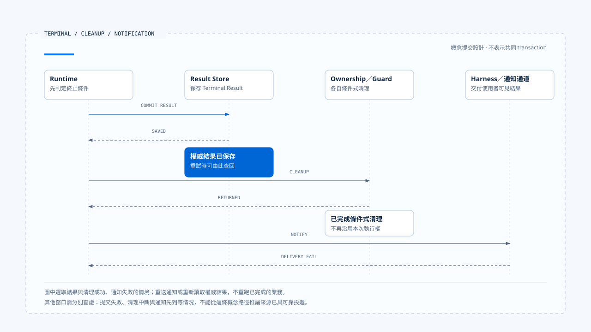
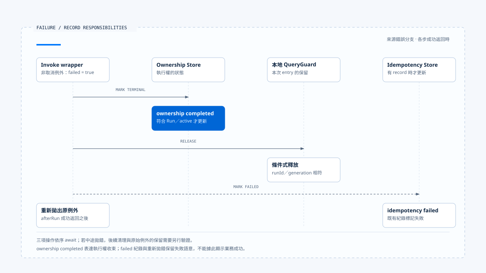

# 終止判定與清理

[English](./05-terminal-results-and-finalization.md) | [繁體中文](./05-terminal-results-and-finalization-zh-TW.md)

> 以下內容所提到的
> CCB 為 [claude-code-best](https://github.com/claude-code-best/claude-code) 的簡稱。
> Chat Gun 為 [chat-gun](https://github.com/HsienW/chat-gun)。

[回到導覽](./README-zh-TW.md) · 前一篇：[等待與恢復轉移](./04-waiting-and-resume-transitions-zh-TW.md) · 下一篇：[一次替換與晚到結果](./06-case-lifecycle-races-zh-TW.md)

> 最後一段模型文字已經送到畫面，Run 的結果卻還沒寫入；另一種情況是結果早已保存，terminal event 在途中遺失。兩者都可能讓使用者一直看到 loading，恢復方式卻完全不同。

**終止需要分開判斷工作結果、提交權威狀態與交付通知。** 清理則必須對回本次取得的資源，避免舊執行在結束時傷及新的 owner。

## 哪一種完成

Runtime 周邊有多種「結束」訊號：Provider stream 關閉、generator return、工具 Promise resolved、ownership 結束，以及業務目標完成。每項訊號只能證明自己觀察到的範圍。

| 訊號 | 可以確認的事 | 還需核對 |
|---|---|---|
| Provider stream 結束 | 該次傳輸結束。 | 訊息是否完整、是否仍有 Tool Call。 |
| Tool Promise resolved | 呼叫回傳了一份值。 | 內層 typed outcome 與外部效果。 |
| Graph／generator 返回 | 該次呼叫不再產生下一項內容。 | 是否因等待、限制或失敗而結束。 |
| Ownership terminal | 指定 owner 已依 repository 契約結束。 | Native Run 與業務 Task 的結果。 |
| Terminal event 送達 | Consumer 收到一筆通知。 | 通知對應的權威結果與版本。 |

同一個 `completed` 字串出現在不同 Store 時，需要分別說明含義。若產品要顯示「任務完成」，還得核對必要工具、資源及業務條件。

## Terminal 判定的輸入

概念上，Runtime 進入 Completed 前，需要確認目前沒有仍待處理的 Tool Call、Interrupt、取消或未知效果，並保存契約要求的結果。Failed、Cancelled、Rejected 與 Parked 則留下不同的停止原因與後續責任。

- **Completed**：本次執行符合完成條件，必要結果可查。
- **Failed**：失敗阻止本次繼續，保留原因與已知效果。
- **Cancelled**：停止後續工作的要求已按契約收束，外部效果另行記錄。
- **Rejected**：接納或政策條件不允許繼續；單一工具拒絕是否終止整個 Run 由產品決定。
- **Parked**：自動處理停止，保留待回查或人工接手的位置。

這些是概念結果，不能直接假設來源庫已有全部狀態。Waiting 若仍可 Resume，通常要在 Task 層保留等待事實，即使本次 API 已經回應結束。

## Terminal、清理與通知的提交

一個可檢查的設計會把三件事拆開：

1. **結果提交**：以合法轉移保存本次權威結果。
2. **資源清理**：釋放屬於自己的 reservation、owner 或連線。
3. **結果交付**：發出通知，讓 Harness 或其他 consumer 取得結果。

這份順序需要依 Store 與部署調整，但任何一步失敗，都不應讓系統重新執行已完成的外部操作。若跨 Store 沒有共同 transaction，恢復必須能辨認哪些事實已成立。

| 失敗窗口 | 已成立的事實 | 合理的後續方向 |
|---|---|---|
| 結果提交前中斷 | 尚未確認 Terminal 寫入。 | 查回 Run 與效果，再決定收束。 |
| Terminal 成功、清理失敗 | 結果已存在。 | 重試條件式清理，避免重做業務。 |
| 清理成功、通知失敗 | 本次已不再持有執行權。 | 重送通知或讀取權威結果。 |
| 通知先送達、結果保存失敗 | 畫面與權威資料可能不一致。 | 回報失敗並修正，不能假裝已持久提交。 |

- 圖中選取結果與清理成功、通知失敗的情境。這是提交責任的概念設計，不表示兩個來源庫已使用相同 Store 或具有共同 transaction。
- [開啟提交、清理與通知時序](../../assets/agent-runtime/execution-lifecycle/05-terminal-results-and-finalization/05-terminal-cleanup-notification.html)。

可靠投遞可採持久事件紀錄或 outbox 等設計，但需找到實際 consumer 才能主張保證。本區沒有把這些選項寫成來源已部署的能力。

## Chat Gun ownership 的實際含義

本區 `markTerminal()` 接受 completed 或 cancelled，並以 Thread、Scope、Run 與 active status 條件更新 ownership row。它沒有 Failed、Waiting 或 Parked 這幾種值。

這個 repository 管理目前執行權。若要完整表達業務結果，需連同其他欄位、原生 Run 狀態與 outcome 讀取；單從它的狀態集合無法建立完整的 Runtime state machine。

### Wrapper 的錯誤路徑

本區 `applyInteractionGovernance()` 的 invoke wrapper 在非取消例外時，會呼叫 `afterRun()`，傳入 ownership terminal status `completed`，同時將 failed 設為 true，之後重新拋出例外。

`afterRun()` 先嘗試更新 ownership，再釋放本地 guard；若有 idempotency record，failed 分支會呼叫 `markFailed()`。因此同一次呼叫可能留下 ownership completed 與失敗紀錄，兩者描述不同責任。

> 這條程式路徑提醒 consumer：ownership completed 不能直接顯示成「工具成功」或「業務完成」。錯誤仍由呼叫端接收，產品需要保留它的結果語意。

- 圖中分開呈現各份紀錄的責任。向下時序假設前一步成功返回；若中途 await 拋錯，後續清理與原例外的保留需另行驗證。
- [開啟失敗紀錄圖與條件說明](../../assets/agent-runtime/execution-lifecycle/05-terminal-results-and-finalization/05-failure-record-separation.html)。

### Stream 提前結束

`createGovernedStream()` 追蹤 completed、failed 與 terminalStatus。正常耗盡來源會把狀態設為 completed；例外依取消判定選擇狀態，而 `finally` 仍會嘗試呼叫 `afterRun()`。

若來源因 Graph Interrupt 正常結束，本段 wrapper 沒有單獨將它辨認為業務 Waiting。產品仍需讀取原生 Graph／Manifest 的等待事實，避免用正常耗盡 stream 代替整項任務完成。

這項觀察限於該 wrapper，尚未證明每個正式入口都使用相同組裝或已有同一種顯示問題。

## CCB generator 的三種退出

本區 CCB 的 `query()` 使用 `yield* queryLoop()` 接收 terminal。只有內層正常返回，才繼續通知已消費 command 的 lifecycle completed；若內層 throw，或外層以 `.return()` 提前關閉，這段正常返回後的通知不會執行。

| 退出方式 | 控制流程 | 呼叫端需處理 |
|---|---|---|
| 正常 return | 可取得 queryLoop 的返回原因。 | 分辨正常結束、限制或中止理由。 |
| Throw | 錯誤向外傳播。 | 保存失敗，清理本次資源。 |
| 提前 `.return()` | Generator 被外部關閉。 | 核對 finally 與未完成工作，避免誤報成功。 |

例如工具 abort 分支可以回傳 `aborted_tools`，turn 上限則有 `max_turns`。它們都是正常的程式返回路徑，業務解讀仍需讀取 reason。

## Finally 裡可以做哪些事

`finally` 適合安排必要清理，但其中的 await 也會失敗。若 terminal 更新先拋錯，後面的 guard release 或 idempotency 更新可能未執行，還可能遮住原先的執行例外。

設計清理時，需要分別考慮：

- 哪些清理有順序依賴，哪些可以各自嘗試。
- 第一個清理失敗後，如何保留原本的工作錯誤。
- 重試時如何確認資源仍屬於本次 Run。
- 哪個 consumer 會接手尚未完成的清理。

本區 Chat Gun 的 `afterRun()` 依序 await repository、guard 與 idempotency 更新。這能說明順序，卻不證明第一項失敗時其餘清理仍會完成；相應 Store failure 情境需另行驗證。

## 終止後的晚到結果

Terminal 結果一旦成立，舊 progress 不應恢復 Running。工具在取消後回報 committed 時，系統則保存新取得的效果證據，必要時建立 reconciliation 或 corrective action。

追加證據與改寫執行歷史需要分開。Run 可以維持 Cancelled，同時告知使用者先前派送的操作已提交；後續 compensation 也應有自己的 action 與結果。

目前 owner 已是新 Run 時，舊 finalizer 的 release 要回到 [第二篇](./02-run-ownership-and-supersede-zh-TW.md) 的 runId／generation 檢查。顯示層另外核對事件歸屬，不能只因收到最後一筆訊息就覆蓋目前活動。

## Terminal Result 應讓 consumer 查回什麼

一份概念結果可保存 Run、status、reason、usage、evidence refs 與未完成的後續處理位置。欄位名稱依實作而定，重點是 consumer 可以直接取得結果，不必從顯示文字反推。

若沒有結果內容卻已釋放 owner，查詢端也需得到明確的失敗或待回查狀態。單純回傳「現在沒有 active Run」，無法說明先前那次執行的下落。

## 如何驗證終止與清理

### 結果與通知

- 在 Terminal write 前後中斷，核對結果可見性與重試方向。
- 讓 event delivery 失敗，確認不會重新呼叫底層工具。
- 讓 Graph 因等待結束本次 stream，核對產品仍能辨認 pending Interrupt。

### Finalizer 與錯誤

- 正常 return、throw 與 generator `.return()` 分別執行，記錄清理次數。
- 在 repository terminal 更新時注入錯誤，確認 guard、idempotency 及原始錯誤的可觀察結果。
- 新 Run 開始後才執行舊 finalizer，確認不會釋放新 owner。

這些檢查需要正式 consumer 與可控制的 Store。查讀原始碼可以找出窗口，本輪未執行相應故障注入。

## 本篇的工程判斷

一項執行何時結束，要由它的權威契約回答。模型、wrapper、ownership 與產品結果可以在不同時間收束，文件應保留這些時間差，讓故障處理有具體資料可查。

我會沿著錯誤分支讀到最後一個 await，再回頭看使用者取得哪份結果。只有成功路徑的 finalizer 看起來完整，仍不足以說明失敗、等待與提前關閉之後的狀態。

## 實作參照與適用範圍

- [Chat Gun interaction wrapper 與 afterRun][g-runtime]：invoke、stream、failed flag 與清理順序。
- [Chat Gun ownership][g-owner]：terminal 欄位與條件式更新。
- CCB `src/query.ts`：query generator、command lifecycle 與返回原因；`src/utils/QueryGuard.ts`：條件式結束。
- 版本與查讀範圍見[本區導覽](./README-zh-TW.md#正文來源與適用範圍)。

## 接續閱讀

- [一次替換與晚到結果](./06-case-lifecycle-races-zh-TW.md)
- [Agent Runtime 設計原則](../foundations/05-runtime-design-principles-zh-TW.md)

[g-runtime]: https://github.com/HsienW/chat-gun/blob/f83a38fd67a021904e597c60543708ee0c206076/backend/src/platform/interaction-runtime.ts
[g-owner]: https://github.com/HsienW/chat-gun/blob/f83a38fd67a021904e597c60543708ee0c206076/backend/src/runtime/interaction/ownership.ts
