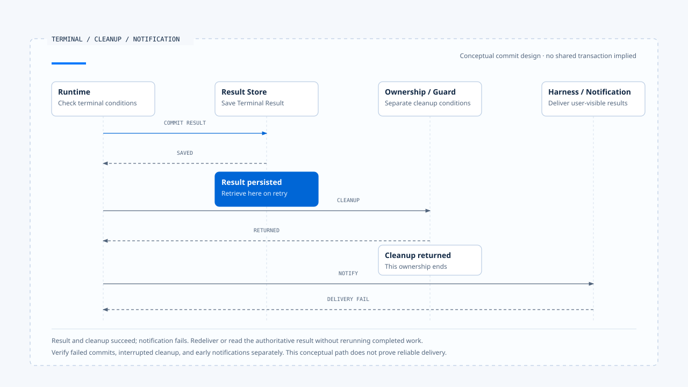
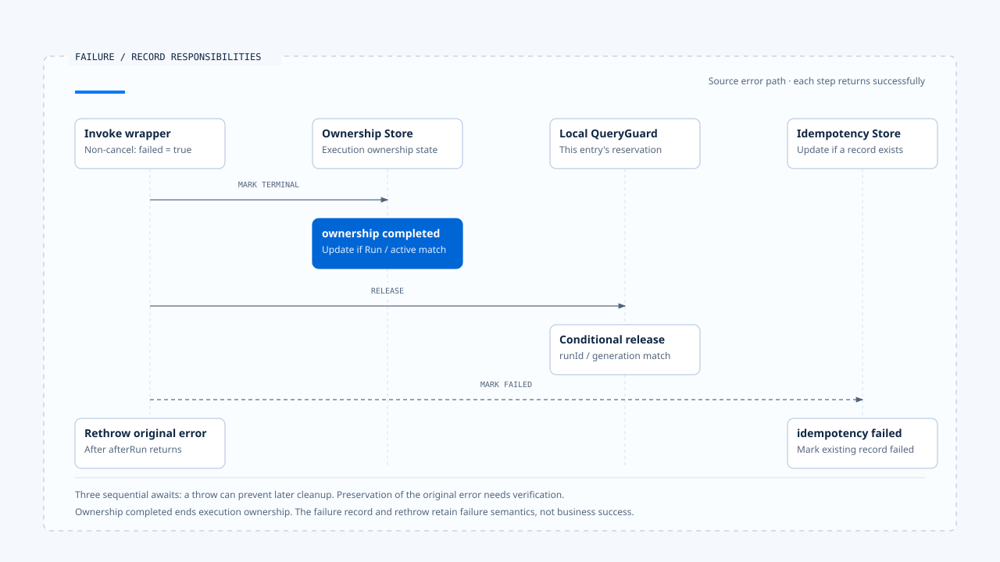

# Terminal decisions and cleanup

[English](./05-terminal-results-and-finalization.md) | [繁體中文](./05-terminal-results-and-finalization-zh-TW.md)

> In the following content:
> CCB is short for [claude-code-best](https://github.com/claude-code-best/claude-code).
> Chat Gun refers to [chat-gun](https://github.com/HsienW/chat-gun).

[Back to guide](./README-zh-TW.md) · Previous: [Waiting and resume transitions](./04-waiting-and-resume-transitions.md) · Next: [A replacement and late results](./06-case-lifecycle-races.md)

> The model's final text has reached the screen, but the Run result has not been written. In another case, the result was saved long ago, but the terminal event was lost in transit. Both can leave the user staring at a loading indicator, yet require entirely different recovery.

**Termination needs separate decisions about the work outcome, authoritative state commit, and notification delivery.** Cleanup must identify the resources this execution acquired so an old execution cannot harm the new owner as it ends.

## Which kind of completion?

Several signals around the Runtime indicate an ending: a Provider stream closes, a generator returns, a tool Promise resolves, ownership ends, or the business objective is met. Each signal establishes only the scope it observes.

| Signal | What it establishes | What still needs checking |
|---|---|---|
| Provider stream ends | That transport has ended. | Whether the message is complete and Tool Calls remain. |
| Tool Promise resolves | The call returned a value. | The inner typed outcome and external effects. |
| Graph/generator returns | This invocation produces no further items. | Whether it ended because of waiting, a limit, or failure. |
| Ownership terminal | The specified owner ended under the repository contract. | Native Run and business Task outcomes. |
| Terminal event arrives | A consumer received a notification. | The authoritative result and version it refers to. |

When the same `completed` string appears in different Stores, its meaning needs separate explanation. Displaying "task complete" also requires checking the necessary tools, resources, and business conditions.

## Inputs to a terminal decision

Conceptually, before entering Completed, the Runtime needs to confirm that no Tool Call, Interrupt, cancellation, or unknown effect remains pending, and save the result required by the contract. Failed, Cancelled, Rejected, and Parked retain different stopping reasons and follow-up responsibilities.

- **Completed**: This execution meets completion conditions, and required results are queryable.
- **Failed**: A failure prevents continuation; retain the reason and known effects.
- **Cancelled**: The request to stop subsequent work has been finalized under the contract, with external effects recorded separately.
- **Rejected**: Admission or policy conditions prohibit continuation. The product decides whether rejection of one tool ends the entire Run.
- **Parked**: Automatic handling stops, retaining a position for reconciliation or manual handoff.

These are conceptual outcomes; the source repositories cannot be assumed to implement every state. If Waiting still permits Resume, the Task layer generally needs to retain the waiting fact even after this API response has ended.

## Committing terminal state, cleanup, and notification

A design that can be inspected separates three responsibilities:

1. **Result commit**: Persist this execution's authoritative result through a valid transition.
2. **Resource cleanup**: Release reservations, ownership, or connections belonging to this execution.
3. **Result delivery**: Notify the Harness or other consumers so they can obtain the result.

The order needs adjustment for the Stores and deployment, but failure at any step should not re-execute a completed external operation. Without a shared transaction across Stores, recovery must identify which facts already hold.

| Failure window | Established fact | Reasonable next action |
|---|---|---|
| Interrupted before result commit | The Terminal write is unconfirmed. | Retrieve the Run and effects before deciding how to finalize. |
| Terminal succeeds, cleanup fails | The result exists. | Retry conditional cleanup without repeating business work. |
| Cleanup succeeds, notification fails | This execution no longer holds execution ownership. | Redeliver the notification or read the authoritative result. |
| Notification arrives first, result persistence fails | Display and authoritative data may disagree. | Report and correct the failure without claiming a durable commit. |

- The diagram selects successful result persistence and cleanup followed by failed notification. This is a conceptual division of commit responsibilities. It does not mean both source repositories use the same Stores or share a transaction.
- [Open the commit, cleanup, and notification sequence](../../assets/agent-runtime/execution-lifecycle/05-terminal-results-and-finalization/05-terminal-cleanup-notification-en.html).

Reliable delivery can use durable event records or an outbox, but a guarantee requires an actual consumer. This section does not describe those options as deployed source capabilities.

## What Chat Gun ownership actually means

The `markTerminal()` examined here accepts completed or cancelled and updates an ownership row under Thread, Scope, Run, and active-status conditions. It has no Failed, Waiting, or Parked values.

This repository manages current execution ownership. A complete business outcome requires reading other fields, native Run state, and outcome data together. Its state set alone cannot define a complete Runtime state machine.

### The wrapper's error path

For a non-cancellation exception, the invoke wrapper in `applyInteractionGovernance()` calls `afterRun()` with ownership terminal status `completed` and failed set to true, then rethrows the exception.

`afterRun()` first attempts the ownership update, then releases the local guard. If an idempotency record exists, the failed branch calls `markFailed()`. One invocation can therefore leave ownership completed alongside a failure record; they describe different responsibilities.

> This path warns consumers that ownership completed cannot directly be displayed as "tool succeeded" or "business work completed." The caller still receives an error, and the product needs to retain its outcome semantics.

- The diagram separates the records' responsibilities. The downward sequence assumes each prior step returns successfully. If an await throws midway, subsequent cleanup and preservation of the original exception need separate verification.
- [Open the failure-record diagram and conditions](../../assets/agent-runtime/execution-lifecycle/05-terminal-results-and-finalization/05-failure-record-separation-en.html).

### A stream ending early

`createGovernedStream()` tracks completed, failed, and terminalStatus. Normal source exhaustion sets the status to completed. Exceptions select a status based on cancellation detection, while `finally` still attempts `afterRun()`.

If the source ends normally because of a Graph Interrupt, this wrapper does not separately recognize business Waiting. The product still needs to read waiting facts from the native Graph/Manifest, rather than interpreting normal stream exhaustion as completion of the whole task.

This observation is limited to the wrapper. It does not establish that every production entry point uses the same composition or has the same display problem.

## Three exits from the CCB generator

In the CCB copy examined here, `query()` receives terminal through `yield* queryLoop()`. Only a normal inner return continues to the lifecycle completed notification for consumed commands. An inner throw or early external closure through `.return()` skips that post-return notification.

| Exit | Control flow | Caller responsibility |
|---|---|---|
| Normal return | The queryLoop return reason is available. | Distinguish normal ending, a limit, and an abort reason. |
| Throw | The error propagates outward. | Persist failure and clean up this execution's resources. |
| Early `.return()` | The generator is closed externally. | Check finally and unfinished work to avoid reporting success incorrectly. |

For example, a tool-abort branch can return `aborted_tools`, while the turn limit has `max_turns`. Both are normal program return paths. Their business interpretation still requires reading the reason.

## What belongs in finally

`finally` is useful for required cleanup, but an await inside it can also fail. If the terminal update throws first, guard release or idempotency updates may not run, and the cleanup error may obscure the original execution exception.

A cleanup design needs to consider:

- Which cleanup actions depend on order and which can be attempted independently.
- How to preserve the original work error after the first cleanup failure.
- How a retry confirms that resources still belong to this Run.
- Which consumer takes over unfinished cleanup.

Chat Gun's `afterRun()` examined here awaits repository, guard, and idempotency updates in sequence. This establishes order, but does not prove that the remaining cleanup completes if the first operation fails. Corresponding Store failure cases need separate verification.

## Late results after termination

Once a Terminal result is established, stale progress should not restore Running. If a tool reports committed after cancellation, the system saves the newly obtained effect evidence and creates reconciliation or corrective action where needed.

Appending evidence needs to remain distinct from rewriting execution history. A Run can remain Cancelled while informing the user that a previously dispatched operation committed. Subsequent compensation should also have its own action and result.

When a new Run is the current owner, an old finalizer's release must follow the runId/generation checks in the [second article](./02-run-ownership-and-supersede.md). The display layer separately checks event ownership; receiving the latest message alone does not justify overwriting current activity.

## What a Terminal Result should let consumers retrieve

A conceptual result can retain Run, status, reason, usage, evidence refs, and locations for unfinished follow-up. Field names depend on the implementation. The point is for consumers to obtain the result directly without inferring it from display text.

If ownership has been released without result content, the query path also needs an explicit failure or pending-reconciliation state. Simply returning "no active Run now" cannot explain what happened to the previous execution.

## How to verify termination and cleanup

### Results and notifications

- Interrupt before and after the Terminal write, and check result visibility and retry direction.
- Fail event delivery and confirm that the underlying tool is not called again.
- Let a Graph end the current stream because of waiting, and check that the product can still recognize the pending Interrupt.

### Finalizers and errors

- Exercise normal return, throw, and generator `.return()` separately, recording cleanup counts.
- Inject an error in the repository terminal update, and inspect observable guard, idempotency, and original-error outcomes.
- Run an old finalizer after the new Run starts, and confirm that it cannot release the new owner.

These checks require production consumers and controllable Stores. Source inspection can identify the windows; the corresponding fault injection was not performed for this section.

## Engineering judgment

An execution's authoritative contract needs to determine when it ends. The model, wrapper, ownership, and product result can finalize at different times. Documentation should preserve those gaps so failure handling has concrete data to inspect.

I would follow the error branch through its final await, then check which result the user receives. A finalizer that looks complete only on the success path is insufficient to explain state after failure, waiting, or early closure.

## Implementation references and scope

- [Chat Gun interaction wrapper and afterRun][g-runtime]: invoke, stream, failed flag, and cleanup order.
- [Chat Gun ownership][g-owner]: terminal fields and conditional updates.
- CCB `src/query.ts`: query generator, command lifecycle, and return reasons; `src/utils/QueryGuard.ts`: conditional ending.
- See the [section guide](./README-zh-TW.md#正文來源與適用範圍) for versions and inspection scope.

## Further reading

- [A replacement and late results](./06-case-lifecycle-races.md)
- [Agent Runtime design principles](../foundations/05-runtime-design-principles.md)

[g-runtime]: https://github.com/HsienW/chat-gun/blob/f83a38fd67a021904e597c60543708ee0c206076/backend/src/platform/interaction-runtime.ts
[g-owner]: https://github.com/HsienW/chat-gun/blob/f83a38fd67a021904e597c60543708ee0c206076/backend/src/runtime/interaction/ownership.ts
