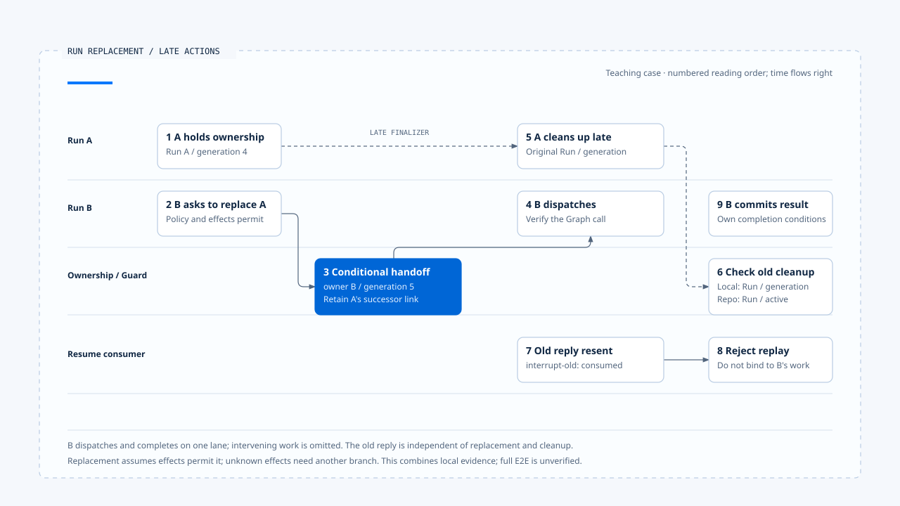

# 一次替换与晚到结果

[English](./06-case-lifecycle-races.md) | [繁體中文](./06-case-lifecycle-races-zh-TW.md) | [简体中文](./06-case-lifecycle-races-zh-CN.md)

> 以下内容所提到的
> CCB 为 [claude-code-best](https://github.com/claude-code-best/claude-code) 的简称。
> Chat Gun 为 [chat-gun](https://github.com/HsienW/chat-gun)。

[回到导览](./README-zh-CN.md) · 前一篇：[终止判定与清理](./05-terminal-results-and-finalization-zh-CN.md)

> Run A 还在流式传输，用户要求改成另一种报告格式。Run B 已接手，A 的错误与 finalizer 才抵达；此时浏览器又重送了一份旧厘清回答。画面可能只有一次更新，后端却需要分别判断三种不同的动作。

本篇用交错时序把前五篇串起来。主线选择旧工作尚未留下外部写入效果、政策允许替换的情境；需要回查、恢复或补偿的情况另外分支，避免把它们当成同一路径必经的步骤。

**这是一份教学推演与验证框架。** Chat Gun ownership、QueryGuard、Resume authorizer 与 CCB guard 是分开查读的证据，本轮没有执行一条串起全部步骤的正式 E2E。

## 场景与身份

假设 Harness 已建立可信的用户与工作区 Scope，Run A 正在整理公开数据。用户此时要求改成新的摘要格式，产品互动政策决定以新 Run 替换。

| Identity | A | B | 说明 |
|---|---|---|---|
| Thread | `thread-summary` | `thread-summary` | 共用对话容器。 |
| Scope | `scope-workspace` | `scope-workspace` | 本例相同的可信作用范围。 |
| Task | `task-summary` | `task-summary` | 本例选择延续同一目标。 |
| Run | `run-a` | `run-b` | 各自的执行实例。 |
| Generation | `4` | `5` | 教学设置的先后 owner 版本。 |

旧厘清回答带 `interrupt-old`，来自先前已消费的等待。它的内容可以保留为输入记录，但不能因此取得恢复权。

本例的 Task 沿用是产品选择。Chat Gun supersede 也接受 replacement Task；原生 Graph 是否沿用 Thread、如何接受新 input，仍须依正式入口核对。

## 1. A 已接纳，B 再次进入

A 已取得 active ownership，本地 guard 也处于 running。B 的要求进入时，不能只看前端是否 loading；可信 Context 与 ownership repository 才能告诉 consumer 目前执行者是谁。

本区 Chat Gun `reserve()` 查到既有 owner 时返回 ownership conflict 与该笔数据。上层可以用目前 owner 判断新要求，并不表示 B 已直接取得第二份 active ownership。

需要保留的证据包括：

- A 的 Run、Task、Scope 与 generation。
- B 的 Request／Run identity 与产品选定策略。
- Reservation 查到哪一笔 active owner。
- 新输入分类与策略决策的原因。

若输入被分类为 tentative，或策略要求原生 queue 而该能力未接妥，本次可以停在拒绝；替换主线只在相应条件成立后继续。

## 2. 先判读旧工作的效果

主线假设取消决策根据可取得的完整 Ledger 数据判定没有已提交的写入效果，允许 `interrupt_or_supersede`。consumer 才进入替换路径。

| A 的已知效果 | 本例如何分流 |
|---|---|
| 没有需处理的外部写入 | 在政策允许下继续替换。 |
| 可补偿且已提交 | 依补偿结果决定是否允许接手。 |
| 不可逆且已提交 | 进 corrective authorization 或人工处理。 |
| 仍在执行或结果不明 | 先回查，无法判读则停止直接替换。 |

本例没有把「A 的外部写入仍不明」放进正常替换主线。那种情况会改变取消决策，需要回到 [第三篇](./03-deadlines-budgets-and-cancellation-zh-CN.md) 的效果分流。

## 3. B 取得 replacement ownership

consumer 以 A 的 generation 4 作 expected generation，请 repository 执行 supersede。条件成立后，旧 row 转为 superseded，新 row 保存 B 与 generation 5。

~~~text
替换前：active owner = run-a / generation 4
  → 以 expected generation 4 提交 supersede
替换後：active owner = run-b / generation 5
  → 本地 guard 采用 B
~~~

若另一个要求先改变 owner，这次 supersede 应回报冲突。consumer 需要依最新权威状态重新判断，不能用旧读取结果强行覆写。

### 替换成功还没证明 B 已派送

本区 consumer 在 supersede 后采用 guard、保存决策事件，再准备 Graph 执行。若事件保存或原生派送在此时失败，B 可能只取得部分状态。

因此验证时要分开查 owner、决策记录与实际 Graph 调用。这些数据对不上时，恢复应接手该段失败，不能只因 owner 是 B 就宣称 B 已开始推理。

## 4. A 的流式传输与取消回应晚到

A 的模型请求可能尚未回应 abort，或有数据已在传输途中。替换 ownership 不会自动收回这些数据；要阻止更新，事件 consumer 还需核对 Run 与 generation。

执行侧则必须找到停止新派送与传递取消的实际 consumer。本区 cancellation decision 的路径名称只能说明决策，无法代替原生 Run cancel API 或 Provider abort 的执行证据。

若 A 的旧文字抵达产品端，可以依政策保留在历史或舍弃，但它不能成为 B 的目前进度。前端处理细节连回 [Run 归属与可见状态](../../agent-harness/interaction-and-feedback/02-run-ownership-and-visible-state-zh-CN.md)。

## 5. A 的 finalizer 开始清理

这时本地 guard 已采用 B。A 带自己的 Context 与 generation 4 执行 release，条件无法命中 B 的 entry；repository 若收到 A 的 terminal 更新，也因 A 已不是 active 而不更新该 row。

| 动作 | 带入数据 | 应核对的结果 |
|---|---|---|
| A 的本地 release | runId A、generation 4。 | B 的 entry 仍存在。 |
| A 的 repository terminal | Run A、active 条件。 | 已 superseded 的 A 不被改成目前 owner。 |
| B 的后续查询 | Run B、generation 5。 | 仍能对回原有执行资格。 |

CCB 可用进程内 guard 做较小范围的对照：A 开始后取得一个 generation，forceEnd 使其失效，B 再取得新 generation；此后 A 的 `end(oldGeneration)` 不得清理 B。

这个对照没有共享 Chat Gun 的数据库 row，也没有证明外部资源具备相同 fencing。它只支持本地旧回调的控制流判断。

## 6. 旧厘清回答被重送

`interrupt-old` 在本例已 consumed。handler 应查回该等待并拒绝再次消费，而不能把用户回答直接附到 B 的 Prompt 后当成合法 Resume。

如果把情境改成「等待仍为 waiting，但 owner 已从 A 换成 B」，则 correlation 必须对回正确的旧 Run／Task 与目前 ownership。这是另一个测试分支，与已消费重送分开执行。

### 合法回复也可能在接手时失败

第四篇指出，authorizer consume 成功后，后续 supersede 仍可能冲突或失败。验证不能只记录「第二次回复被拒绝」；还要确认第一次合法输入是否已交给 Graph，或留在可恢复的位置。

本区尚未取得这整段跨步骤接手的 E2E 证据，因此保留为明确的故障注入要求。

## 7. B 完成，或先碰到执行限制

若 B 正常完成，Runtime 仍需核对 pending work、typed outcome 与必要结果写入。终止后才失败的事件交付，不能让 `run-b` 再次调用工具。

另一个分支让 B 在下一次派送前到达 Deadline 或额度限制。Deadline 的 clock、Budget 的 consumer 与终止理由都需由实际组装提供；本例不假设 Chat Gun 已有一套统一的限制引擎。

完成、限制与取消交错时，测试需要控制各次权威写入的时点。不要只以最后一个抵达 UI 的事件决定 B 的结果。

## 用交错表整理验证

- 编号表示阅读顺序。B 的派送与完成同列呈现，中间执行省略；旧回复是独立输入，各段证据尚未串成一次已验证的完整 E2E。
- [开启竞态泳道图与证据注记](../../assets/agent-runtime/execution-lifecycle/06-case-lifecycle-races/06-run-replacement-race-swimlane-en.html)。

| 顺序 | 执行动作 | 核对的权威或结果 |
|---|---|---|
| 1 | A 取得 owner。 | active A、generation 4。 |
| 2 | B 查到 A，产品选择替换。 | B 尚未直接 claim 第二个 active owner。 |
| 3 | 取消决策允许，supersede 成功。 | active B、generation 5；A 保存替换关联。 |
| 4 | B 完成实际派送交接。 | Graph 调用与 B 的 owner 相符。 |
| 5 | A 回报 progress 并执行 finally。 | B 的显示与 owner 不被旧动作覆写。 |
| 6 | 旧 Resume 重送。 | 对回指定等待，拒绝重复消费。 |
| 7 | B 提交结果，通知送达失败。 | 权威结果保留，重送不重跑业务。 |

表格是应验证的主线。原生取消、跨 Store 接手、等待语义与显示 consumer 必须在各自来源补证，不能只靠 ownership 测试推论整条链成立。

## 故障要插在哪里

### Ownership 与派送

- 在读取 A 与 supersede 之间让另一个要求取得 owner。
- 在 supersede 的两次数据库写入间注入失败，核对 rollback。
- 在 B 取得 owner 后让事件保存或 Graph 启动失败，检查残留状态。

### Resume 与清理

- 同时送两份合法回复，分别记录 consume 与 Graph 调用次数。
- Consume 成功后让 supersede 冲突，确认已消费输入有查询与接手机制。
- 在 B 开始后才执行 A 的 finalizer，并让其中一次 Store 更新抛错。

### Terminal 与效果

- 让 B 的 terminal write 成功、事件投递失败，确认工具调用次数不增加。
- 在独立分支中加入 A 的外部效果不明，确认主线改走回查或人工处理。
- 取消后再取得 committed 证据，确认追加效果记录而不复活原 Run。

## 来源能支持哪一段

| 证据 | 支持的观察 | 本轮仍未验证 |
|---|---|---|
| Chat Gun ownership 源代码与测试安排 | Claim、expected generation supersede、指定 Run terminal。 | 正式 PostgreSQL 的多连接与连接中断。 |
| Chat Gun QueryGuard | 本地 provisional、durable owner lookup、条件式 release。 | 所有 Worker、工具与下游的共同 fencing。 |
| Clarification authorizer 与 consumer | 指定等待核对、consume 到 replacement 的程序顺序。 | 消费后跨进程接手与完整恢复。 |
| Interaction wrapper | invoke／stream 的 afterRun 与清理顺序。 | 所有 Graph Waiting 与业务成功的统一判定。 |
| CCB QueryGuard | 同一实例的新旧 generation 清理。 | 跨进程 ownership 或 durable Resume。 |

这些来源足以建立查读与测试框架，尚未构成一次正式执行结果。要升格为 E2E，需从产品入口经真实 Store、Graph、取消 consumer 与工具 adapter，再记录各个故障时点。

## 本篇的工程判断

一次替换最容易出错的地方，是旧工作仍在结束、新工作已开始，而回复又带着更早的等待关联。把每个动作对回 Run、owner、等待与效果记录，才有办法判断它还剩下哪些权力。

检查结果时，我会同时看权威 Store 与实际派送次数。画面正确、旧 finalizer 被拒绝、批准只消费一次，分别是有用的局部证据；完整接手还需要把这些观察对到同一段执行。

## 实现参照与适用范围

- [Chat Gun ownership][g-owner]、[QueryGuard][g-guard] 与其测试安排。
- [Clarification Resume authorizer][g-resume]、[interaction runtime][g-runtime] 的 consumer 与 wrapper。
- CCB `src/utils/QueryGuard.ts` 的进程内对照；来源副本与查读范围见[本区导览](./README-zh-CN.md#正文来源与适用范围)。

## 接续阅读

- [Execution Lifecycle 导览](./README-zh-CN.md)
- [一次 Run 的完整走法](../foundations/06-one-run-walkthrough-zh-CN.md)
- 后续分类：Model and Tool Execution、Effects and Recovery、Events and Operations。

[g-owner]: https://github.com/HsienW/chat-gun/blob/f83a38fd67a021904e597c60543708ee0c206076/backend/src/runtime/interaction/ownership.ts
[g-guard]: https://github.com/HsienW/chat-gun/blob/f83a38fd67a021904e597c60543708ee0c206076/backend/src/runtime/input/query-guard.ts
[g-resume]: https://github.com/HsienW/chat-gun/blob/f83a38fd67a021904e597c60543708ee0c206076/backend/src/runtime/recovery/clarification-resume-authorization.ts
[g-runtime]: https://github.com/HsienW/chat-gun/blob/f83a38fd67a021904e597c60543708ee0c206076/backend/src/platform/interaction-runtime.ts
