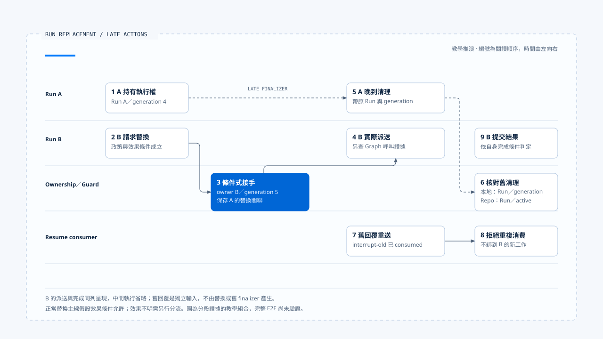

# 一次替換與晚到結果

[English](./06-case-lifecycle-races.md) | [繁體中文](./06-case-lifecycle-races-zh-TW.md)

> 以下內容所提到的
> CCB 為 [claude-code-best](https://github.com/claude-code-best/claude-code) 的簡稱。
> Chat Gun 為 [chat-gun](https://github.com/HsienW/chat-gun)。

[回到導覽](./README-zh-TW.md) · 前一篇：[終止判定與清理](./05-terminal-results-and-finalization-zh-TW.md)

> Run A 還在串流，使用者要求改成另一種報告格式。Run B 已接手，A 的錯誤與 finalizer 才抵達；此時瀏覽器又重送了一份舊釐清回答。畫面可能只有一次更新，後端卻需要分別判斷三種不同的動作。

本篇用交錯時序把前五篇串起來。主線選擇舊工作尚未留下外部寫入效果、政策允許替換的情境；需要回查、恢復或補償的情況另外分支，避免把它們當成同一路徑必經的步驟。

**這是一份教學推演與驗證框架。** Chat Gun ownership、QueryGuard、Resume authorizer 與 CCB guard 是分開查讀的證據，本輪沒有執行一條串起全部步驟的正式 E2E。

## 場景與身分

假設 Harness 已建立可信的使用者與工作區 Scope，Run A 正在整理公開資料。使用者此時要求改成新的摘要格式，產品互動政策決定以新 Run 替換。

| Identity | A | B | 說明 |
|---|---|---|---|
| Thread | `thread-summary` | `thread-summary` | 共用對話容器。 |
| Scope | `scope-workspace` | `scope-workspace` | 本例相同的可信作用範圍。 |
| Task | `task-summary` | `task-summary` | 本例選擇延續同一目標。 |
| Run | `run-a` | `run-b` | 各自的執行實例。 |
| Generation | `4` | `5` | 教學設定的先後 owner 版本。 |

舊釐清回答帶 `interrupt-old`，來自先前已消費的等待。它的內容可以保留為輸入紀錄，但不能因此取得恢復權。

本例的 Task 沿用是產品選擇。Chat Gun supersede 也接受 replacement Task；原生 Graph 是否沿用 Thread、如何接受新 input，仍須依正式入口核對。

## 1. A 已接納，B 再次進入

A 已取得 active ownership，本地 guard 也處於 running。B 的要求進入時，不能只看前端是否 loading；可信 Context 與 ownership repository 才能告訴 consumer 目前執行者是誰。

本區 Chat Gun `reserve()` 查到既有 owner 時回傳 ownership conflict 與該筆資料。上層可以用目前 owner 判斷新要求，並不表示 B 已直接取得第二份 active ownership。

需要保留的證據包括：

- A 的 Run、Task、Scope 與 generation。
- B 的 Request／Run identity 與產品選定策略。
- Reservation 查到哪一筆 active owner。
- 新輸入分類與策略決策的原因。

若輸入被分類為 tentative，或策略要求原生 queue 而該能力未接妥，本次可以停在拒絕；替換主線只在相應條件成立後繼續。

## 2. 先判讀舊工作的效果

主線假設取消決策根據可取得的完整 Ledger 資料判定沒有已提交的寫入效果，允許 `interrupt_or_supersede`。consumer 才進入替換路徑。

| A 的已知效果 | 本例如何分流 |
|---|---|
| 沒有需處理的外部寫入 | 在政策允許下繼續替換。 |
| 可補償且已提交 | 依補償結果決定是否允許接手。 |
| 不可逆且已提交 | 進 corrective authorization 或人工處理。 |
| 仍在執行或結果不明 | 先回查，無法判讀則停止直接替換。 |

本例沒有把「A 的外部寫入仍不明」放進正常替換主線。那種情況會改變取消決策，需要回到 [第三篇](./03-deadlines-budgets-and-cancellation-zh-TW.md) 的效果分流。

## 3. B 取得 replacement ownership

consumer 以 A 的 generation 4 作 expected generation，請 repository 執行 supersede。條件成立後，舊 row 轉為 superseded，新 row 保存 B 與 generation 5。

~~~text
替換前：active owner = run-a / generation 4
  → 以 expected generation 4 提交 supersede
替換後：active owner = run-b / generation 5
  → 本地 guard 採用 B
~~~

若另一個要求先改變 owner，這次 supersede 應回報衝突。consumer 需要依最新權威狀態重新判斷，不能用舊讀取結果強行覆寫。

### 替換成功還沒證明 B 已派送

本區 consumer 在 supersede 後採用 guard、保存決策事件，再準備 Graph 執行。若事件保存或原生派送在此時失敗，B 可能只取得部分狀態。

因此驗證時要分開查 owner、決策紀錄與實際 Graph 呼叫。這些資料對不上時，恢復應接手該段失敗，不能只因 owner 是 B 就宣稱 B 已開始推理。

## 4. A 的串流與取消回應晚到

A 的模型請求可能尚未回應 abort，或有資料已在傳輸途中。替換 ownership 不會自動收回這些資料；要阻止更新，事件 consumer 還需核對 Run 與 generation。

執行側則必須找到停止新派送與傳遞取消的實際 consumer。本區 cancellation decision 的路徑名稱只能說明決策，無法代替原生 Run cancel API 或 Provider abort 的執行證據。

若 A 的舊文字抵達產品端，可以依政策保留在歷史或捨棄，但它不能成為 B 的目前進度。前端處理細節連回 [Run 歸屬與可見狀態](../../agent-harness/interaction-and-feedback/02-run-ownership-and-visible-state-zh-TW.md)。

## 5. A 的 finalizer 開始清理

這時本地 guard 已採用 B。A 帶自己的 Context 與 generation 4 執行 release，條件無法命中 B 的 entry；repository 若收到 A 的 terminal 更新，也因 A 已不是 active 而不更新該 row。

| 動作 | 帶入資料 | 應核對的結果 |
|---|---|---|
| A 的本地 release | runId A、generation 4。 | B 的 entry 仍存在。 |
| A 的 repository terminal | Run A、active 條件。 | 已 superseded 的 A 不被改成目前 owner。 |
| B 的後續查詢 | Run B、generation 5。 | 仍能對回原有執行資格。 |

CCB 可用程序內 guard 做較小範圍的對照：A 開始後取得一個 generation，forceEnd 使其失效，B 再取得新 generation；此後 A 的 `end(oldGeneration)` 不得清理 B。

這個對照沒有共享 Chat Gun 的資料庫 row，也沒有證明外部資源具備相同 fencing。它只支持本地舊回呼的控制流判斷。

## 6. 舊釐清回答被重送

`interrupt-old` 在本例已 consumed。handler 應查回該等待並拒絕再次消費，而不能把使用者回答直接附到 B 的 Prompt 後當成合法 Resume。

如果把情境改成「等待仍為 waiting，但 owner 已從 A 換成 B」，則 correlation 必須對回正確的舊 Run／Task 與目前 ownership。這是另一個測試分支，與已消費重送分開執行。

### 合法回覆也可能在接手時失敗

第四篇指出，authorizer consume 成功後，後續 supersede 仍可能衝突或失敗。驗證不能只記錄「第二次回覆被拒絕」；還要確認第一次合法輸入是否已交給 Graph，或留在可恢復的位置。

本區尚未取得這整段跨步驟接手的 E2E 證據，因此保留為明確的故障注入要求。

## 7. B 完成，或先碰到執行限制

若 B 正常完成，Runtime 仍需核對 pending work、typed outcome 與必要結果寫入。終止後才失敗的事件交付，不能讓 `run-b` 再次呼叫工具。

另一個分支讓 B 在下一次派送前到達 Deadline 或額度限制。Deadline 的 clock、Budget 的 consumer 與終止理由都需由實際組裝提供；本例不假設 Chat Gun 已有一套統一的限制引擎。

完成、限制與取消交錯時，測試需要控制各次權威寫入的時點。不要只以最後一個抵達 UI 的事件決定 B 的結果。

## 用交錯表整理驗證

- 編號表示閱讀順序。B 的派送與完成同列呈現，中間執行省略；舊回覆是獨立輸入，各段證據尚未串成一次已驗證的完整 E2E。
- [開啟競態泳道圖與證據註記](../../assets/agent-runtime/execution-lifecycle/06-case-lifecycle-races/06-run-replacement-race-swimlane.html)。

| 順序 | 執行動作 | 核對的權威或結果 |
|---|---|---|
| 1 | A 取得 owner。 | active A、generation 4。 |
| 2 | B 查到 A，產品選擇替換。 | B 尚未直接 claim 第二個 active owner。 |
| 3 | 取消決策允許，supersede 成功。 | active B、generation 5；A 保存替換關聯。 |
| 4 | B 完成實際派送交接。 | Graph 呼叫與 B 的 owner 相符。 |
| 5 | A 回報 progress 並執行 finally。 | B 的顯示與 owner 不被舊動作覆寫。 |
| 6 | 舊 Resume 重送。 | 對回指定等待，拒絕重複消費。 |
| 7 | B 提交結果，通知送達失敗。 | 權威結果保留，重送不重跑業務。 |

表格是應驗證的主線。原生取消、跨 Store 接手、等待語意與顯示 consumer 必須在各自來源補證，不能只靠 ownership 測試推論整條鏈成立。

## 故障要插在哪裡

### Ownership 與派送

- 在讀取 A 與 supersede 之間讓另一個要求取得 owner。
- 在 supersede 的兩次資料庫寫入間注入失敗，核對 rollback。
- 在 B 取得 owner 後讓事件保存或 Graph 啟動失敗，檢查殘留狀態。

### Resume 與清理

- 同時送兩份合法回覆，分別記錄 consume 與 Graph 呼叫次數。
- Consume 成功後讓 supersede 衝突，確認已消費輸入有查詢與接手機制。
- 在 B 開始後才執行 A 的 finalizer，並讓其中一次 Store 更新拋錯。

### Terminal 與效果

- 讓 B 的 terminal write 成功、事件投遞失敗，確認工具呼叫次數不增加。
- 在獨立分支中加入 A 的外部效果不明，確認主線改走回查或人工處理。
- 取消後再取得 committed 證據，確認追加效果紀錄而不復活原 Run。

## 來源能支持哪一段

| 證據 | 支持的觀察 | 本輪仍未驗證 |
|---|---|---|
| Chat Gun ownership 原始碼與測試安排 | Claim、expected generation supersede、指定 Run terminal。 | 正式 PostgreSQL 的多連線與連線中斷。 |
| Chat Gun QueryGuard | 本地 provisional、durable owner lookup、條件式 release。 | 所有 Worker、工具與下游的共同 fencing。 |
| Clarification authorizer 與 consumer | 指定等待核對、consume 到 replacement 的程式順序。 | 消費後跨程序接手與完整恢復。 |
| Interaction wrapper | invoke／stream 的 afterRun 與清理順序。 | 所有 Graph Waiting 與業務成功的統一判定。 |
| CCB QueryGuard | 同一實例的新舊 generation 清理。 | 跨程序 ownership 或 durable Resume。 |

這些來源足以建立查讀與測試框架，尚未構成一次正式執行結果。要升格為 E2E，需從產品入口經真實 Store、Graph、取消 consumer 與工具 adapter，再記錄各個故障時點。

## 本篇的工程判斷

一次替換最容易出錯的地方，是舊工作仍在結束、新工作已開始，而回覆又帶著更早的等待關聯。把每個動作對回 Run、owner、等待與效果紀錄，才有辦法判斷它還剩下哪些權力。

檢查結果時，我會同時看權威 Store 與實際派送次數。畫面正確、舊 finalizer 被拒絕、批准只消費一次，分別是有用的局部證據；完整接手還需要把這些觀察對到同一段執行。

## 實作參照與適用範圍

- [Chat Gun ownership][g-owner]、[QueryGuard][g-guard] 與其測試安排。
- [Clarification Resume authorizer][g-resume]、[interaction runtime][g-runtime] 的 consumer 與 wrapper。
- CCB `src/utils/QueryGuard.ts` 的程序內對照；來源副本與查讀範圍見[本區導覽](./README-zh-TW.md#正文來源與適用範圍)。

## 接續閱讀

- [Execution Lifecycle 導覽](./README-zh-TW.md)
- [一次 Run 的完整走法](../foundations/06-one-run-walkthrough-zh-TW.md)
- 後續分類：Model and Tool Execution、Effects and Recovery、Events and Operations。

[g-owner]: https://github.com/HsienW/chat-gun/blob/f83a38fd67a021904e597c60543708ee0c206076/backend/src/runtime/interaction/ownership.ts
[g-guard]: https://github.com/HsienW/chat-gun/blob/f83a38fd67a021904e597c60543708ee0c206076/backend/src/runtime/input/query-guard.ts
[g-resume]: https://github.com/HsienW/chat-gun/blob/f83a38fd67a021904e597c60543708ee0c206076/backend/src/runtime/recovery/clarification-resume-authorization.ts
[g-runtime]: https://github.com/HsienW/chat-gun/blob/f83a38fd67a021904e597c60543708ee0c206076/backend/src/platform/interaction-runtime.ts
