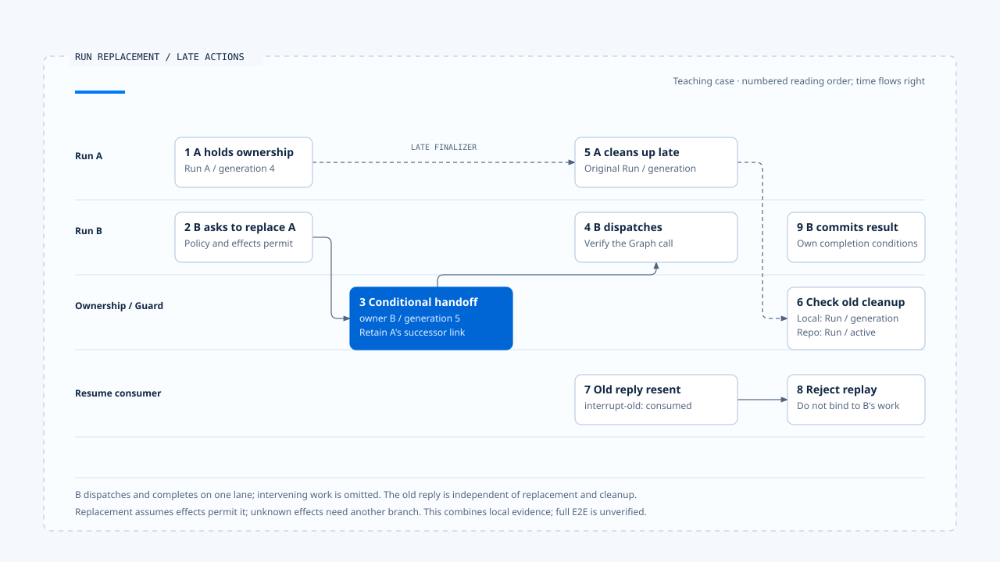

# A replacement and late results

[English](./06-case-lifecycle-races.md) | [繁體中文](./06-case-lifecycle-races-zh-TW.md)

> In the following content:
> CCB is short for [claude-code-best](https://github.com/claude-code-best/claude-code).
> Chat Gun refers to [chat-gun](https://github.com/HsienW/chat-gun).

[Back to guide](./README-zh-TW.md) · Previous: [Terminal decisions and cleanup](./05-terminal-results-and-finalization.md)

> Run A is still streaming when the user requests a different report format. Run B takes over before A's error and finalizer arrive. Meanwhile, the browser resends an old clarification response. The screen may show only one update, while the backend needs separate decisions for three different actions.

This article connects the first five through an interleaved sequence. The main path assumes old work has produced no external write effects and policy permits replacement. Cases requiring reconciliation, recovery, or compensation use separate branches so they are not mistaken for mandatory steps along one path.

**This is a teaching walkthrough and verification framework.** Chat Gun ownership, QueryGuard, the Resume authorizer, and the CCB guard were inspected separately. No production E2E linking every step was executed for this section.

## Scenario and identities

Assume the Harness has established a trusted user and workspace Scope, and Run A is organizing public information. The user asks for a new summary format, and product interaction policy selects replacement with a new Run.

| Identity | A | B | Explanation |
|---|---|---|---|
| Thread | `thread-summary` | `thread-summary` | Shared conversation container. |
| Scope | `scope-workspace` | `scope-workspace` | The same trusted scope in this example. |
| Task | `task-summary` | `task-summary` | This example continues the same objective. |
| Run | `run-a` | `run-b` | Separate execution instances. |
| Generation | `4` | `5` | Successive owner versions chosen for illustration. |

The old clarification response carries `interrupt-old`, referring to a previously consumed wait. Its content may be retained as an input record, but does not grant resume authority.

Retaining the Task is a product choice in this example. Chat Gun supersede also accepts a replacement Task. Whether the native Graph retains the Thread and how it accepts new input still require verification at the production entry point.

## 1. A is admitted; B enters again

A holds active ownership, and the local guard is running. When B's request arrives, the frontend loading state is insufficient to identify the executor. Trusted Context and the ownership repository supply that information to the consumer.

Chat Gun's `reserve()` examined here returns an ownership conflict and the existing owner record when it finds one. The upper layer can use the current owner to evaluate the new request. B has not thereby acquired a second active ownership.

Evidence to retain includes:

- A's Run, Task, Scope, and generation.
- B's Request/Run identity and the product-selected policy.
- The active owner found during reservation.
- Reasons for the new-input classification and policy decision.

If the input is classified as tentative, or policy requires a native queue that has not been wired, this request can end in rejection. The replacement path continues only after its conditions hold.

## 2. Interpret the old work's effects first

The main path assumes that the cancellation decision uses complete available Ledger data, finds no committed write effects, and permits `interrupt_or_supersede`. Only then does the consumer enter replacement.

| A's known effects | Branch in this example |
|---|---|
| No external writes requiring handling | Continue replacement if policy permits. |
| Compensable and committed | Decide whether handoff is permitted from the compensation result. |
| Irreversible and committed | Enter corrective authorization or manual handling. |
| Still executing or unresolved | Reconcile first; stop direct replacement if unresolved. |

The normal replacement path does not include unresolved external writes from A. That situation changes the cancellation decision and returns to the effect branches in the [third article](./03-deadlines-budgets-and-cancellation.md).

## 3. B acquires replacement ownership

The consumer requests supersede using A's generation 4 as the expected generation. If the conditions hold, the old row becomes superseded and the new row records B with generation 5.

~~~text
替換前：active owner = run-a / generation 4
  → 以 expected generation 4 提交 supersede
替換後：active owner = run-b / generation 5
  → 本地 guard 採用 B
~~~

If another request changes the owner first, this supersede should report a conflict. The consumer needs to reevaluate from current authoritative state, rather than force an overwrite based on an old read.

### Successful replacement does not establish B's dispatch

After supersede, the consumer examined here adopts ownership in the guard, persists a decision event, and prepares Graph execution. If event persistence or native dispatch fails at this point, B may have acquired only part of the required state.

Verification therefore needs to inspect the owner, decision record, and actual Graph call separately. When they disagree, recovery must handle that failure segment. B being the owner alone does not establish that B has started reasoning.

## 4. A's stream and cancellation response arrive late

A's model request may not have responded to abort, or data may already be in transit. Replacing ownership does not automatically retract that data. Event consumers still need to check Run and generation to prevent updates.

On the execution side, the actual consumer that stops new dispatches and propagates cancellation must be located. Path names in the cancellation decision describe decisions; they cannot replace evidence that a native Run cancel API or Provider abort was invoked.

If A's old text reaches the product, policy can retain it in history or discard it, but it cannot become B's current progress. For frontend handling, see [Run ownership and visible state](../../agent-harness/interaction-and-feedback/02-run-ownership-and-visible-state.md).

## 5. A's finalizer begins cleanup

The local guard has now adopted B. A attempts release with its own Context and generation 4, which cannot match B's entry. If the repository receives A's terminal update, A is no longer active, so that row is not updated.

| Action | Supplied data | Expected result to check |
|---|---|---|
| A's local release | runId A, generation 4. | B's entry remains. |
| A's repository terminal update | Run A, active condition. | Superseded A is not changed into the current owner. |
| B's subsequent query | Run B, generation 5. | Its existing execution eligibility remains traceable. |

CCB's process-local guard offers a narrower comparison: A acquires a generation on start, forceEnd invalidates it, and B acquires a new generation. A's later `end(oldGeneration)` must not clean up B.

This comparison shares none of Chat Gun's database rows and does not establish equivalent fencing for external resources. It supports only a control-flow judgment about stale local callbacks.

## 6. An old clarification response is resent

In this example, `interrupt-old` is already consumed. The handler should retrieve that wait and reject another consumption, rather than appending the user's answer to B's Prompt and treating it as a valid Resume.

If the scenario instead keeps the wait in waiting while ownership changes from A to B, correlation must match the correct old Run/Task and current ownership. That is a separate test branch, exercised independently from replay of a consumed response.

### A valid response can still fail during handoff

The fourth article explains that supersede can conflict or fail after the authorizer successfully consumes a response. Verification cannot stop at recording that the second response was rejected. It also needs to establish whether the first valid input reached the Graph or remains recoverable.

No E2E evidence for this complete handoff across steps was obtained for this section, so it remains an explicit fault-injection requirement.

## 7. B completes or reaches an execution limit first

If B completes normally, the Runtime still needs to check pending work, typed outcomes, and required result writes. Event delivery failing after termination must not cause `run-b` to call tools again.

Another branch has B reach a Deadline or budget limit before the next dispatch. The actual composition must provide the Deadline clock, Budget consumer, and terminal reason. This example does not assume Chat Gun has a uniform limit engine.

When completion, limits, and cancellation interleave, tests need to control the timing of authoritative writes. The last event to reach the UI alone must not determine B's outcome.

## Organizing verification with an interleaving table

- Numbers indicate reading order. B's dispatch and completion share one row, omitting execution in between. The old response is a separate input. Evidence for these segments has not been combined into a verified complete E2E.
- [Open the race swimlane and evidence notes](../../assets/agent-runtime/execution-lifecycle/06-case-lifecycle-races/06-run-replacement-race-swimlane-en.html).

| Order | Execution action | Authority or result to check |
|---|---|---|
| 1 | A acquires ownership. | Active A, generation 4. |
| 2 | B finds A; the product selects replacement. | B has not directly claimed a second active owner. |
| 3 | Cancellation decision permits replacement; supersede succeeds. | Active B, generation 5; A retains the replacement correlation. |
| 4 | B completes the actual dispatch handoff. | The Graph call matches B's ownership. |
| 5 | A reports progress and runs finally. | Old actions overwrite neither B's display nor its ownership. |
| 6 | Old Resume is resent. | Match the specified wait and reject duplicate consumption. |
| 7 | B commits its result; notification delivery fails. | The authoritative result remains; redelivery does not rerun business work. |

The table is the main path to verify. Native cancellation, cross-Store handoff, waiting semantics, and display consumers each require evidence from their own sources. Ownership tests alone cannot establish the entire chain.

## Where to inject failures

### Ownership and dispatch

- Let another request acquire ownership between reading A and supersede.
- Inject failure between the two database writes in supersede, and check rollback.
- Fail event persistence or Graph startup after B acquires ownership, and inspect remaining state.

### Resume and cleanup

- Submit two valid responses concurrently, recording consume and Graph call counts separately.
- Cause a supersede conflict after consume succeeds, and check that consumed input has a lookup and handoff mechanism.
- Run A's finalizer only after B starts, and make one Store update throw.

### Terminal and effects

- Let B's terminal write succeed and event delivery fail, confirming that tool call counts do not increase.
- Add an unresolved external effect from A in a separate branch, and confirm that the main path changes to reconciliation or manual handling.
- Obtain committed evidence after cancellation, and confirm that it appends effect records without reviving the original Run.

## Which segment the sources support

| Evidence | Supported observation | Still unverified in this section |
|---|---|---|
| Chat Gun ownership source and test arrangements | Claim, expected-generation supersede, and terminal updates for a specified Run. | Production PostgreSQL concurrency across connections and connection loss. |
| Chat Gun QueryGuard | Local provisional entry, durable owner lookup, and conditional release. | Shared fencing across every Worker, tool, and downstream system. |
| Clarification authorizer and consumer | Specified-wait checks and code order from consume to replacement. | Cross-process handoff after consumption and complete recovery. |
| Interaction wrapper | Invoke/stream afterRun and cleanup order. | A unified interpretation of every Graph Waiting state and business success. |
| CCB QueryGuard | Generation-based cleanup within one instance. | Cross-process ownership or durable Resume. |

These sources support an inspection and test framework, but do not constitute a production execution result. An E2E requires traversing the product entry point, real Stores, Graph, cancellation consumer, and tool adapter, while recording each failure point.

## Engineering judgment

Replacement is most vulnerable when old work is still ending, new work has started, and a response carries an even earlier waiting correlation. Relating every action to Run, owner, wait, and effect records makes it possible to determine what authority it still holds.

I would inspect both authoritative Stores and actual dispatch counts. A correct display, rejection of an old finalizer, and single approval consumption are useful local evidence. A complete handoff also needs those observations tied to the same execution sequence.

## Implementation references and scope

- [Chat Gun ownership][g-owner], [QueryGuard][g-guard], and their test arrangements.
- Consumers and wrappers in the [Clarification Resume authorizer][g-resume] and [interaction runtime][g-runtime].
- The process-local comparison in CCB `src/utils/QueryGuard.ts`; see the [section guide](./README-zh-TW.md#正文來源與適用範圍) for the source copy and inspection scope.

## Further reading

- [Execution Lifecycle guide](./README-zh-TW.md)
- [A complete Run walkthrough](../foundations/06-one-run-walkthrough.md)
- Upcoming sections: Model and Tool Execution, Effects and Recovery, Events and Operations.

[g-owner]: https://github.com/HsienW/chat-gun/blob/f83a38fd67a021904e597c60543708ee0c206076/backend/src/runtime/interaction/ownership.ts
[g-guard]: https://github.com/HsienW/chat-gun/blob/f83a38fd67a021904e597c60543708ee0c206076/backend/src/runtime/input/query-guard.ts
[g-resume]: https://github.com/HsienW/chat-gun/blob/f83a38fd67a021904e597c60543708ee0c206076/backend/src/runtime/recovery/clarification-resume-authorization.ts
[g-runtime]: https://github.com/HsienW/chat-gun/blob/f83a38fd67a021904e597c60543708ee0c206076/backend/src/platform/interaction-runtime.ts
