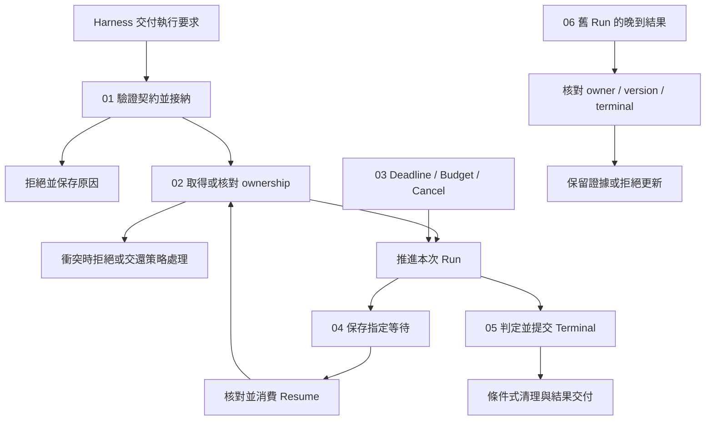

# Execution Lifecycle

[繁體中文](./README-zh-TW.md) | [简体中文](./README-zh-CN.md)

[回到 Runtime 总览](../README-zh-TW.md) · [Foundations 导览](../foundations/README-zh-CN.md)

> 以下内容所提到的
> CCB 为 [claude-code-best](https://github.com/claude-code-best/claude-code) 的简称。
> Chat Gun 为 [chat-gun](https://github.com/HsienW/chat-gun)。

同一个 Task 的旧 Run 还没结束，新 Run 已取得 ownership；旧 finalizer 随后回来清理，用户又在此时送回先前的批准。Runtime 需要逐项核对这些动作的身份、状态与版本，才能决定哪一次执行可以继续，哪一笔回复已经失效。

[Foundations](../foundations/README-zh-CN.md) 已建立 Run、Task、Thread、generation、Waiting 与 Terminal 的基本概念。本区往下追到接纳、保留、派送、等待、恢复及清理的实际边界。以下保留各篇主题、图解候选与查证清单，并列出正文采用的来源范围。

## 阅读顺序

| 篇次 | 文章 | 要回答的问题 | 文件名 |
|---|---|---|---|
| 01 | [Run 接纳与建立](./01-run-admission-and-creation-zh-CN.md) · [English](./01-run-admission-and-creation.md) | 收到请求后，何时才算接手执行，接纳失败又该留下什么？ | `01-run-admission-and-creation-zh-CN.md` |
| 02 | [执行归属与替换](./02-run-ownership-and-supersede-zh-CN.md) · [English](./02-run-ownership-and-supersede.md) | Thread、Task 与 Run 如何关联，旧执行为何不能清掉新 owner？ | `02-run-ownership-and-supersede-zh-CN.md` |
| 03 | [执行限制与取消](./03-deadlines-budgets-and-cancellation-zh-CN.md) · [English](./03-deadlines-budgets-and-cancellation.md) | Deadline、Budget 与 Cancel 在哪个边界生效，哪些工作仍可能继续？ | `03-deadlines-budgets-and-cancellation-zh-CN.md` |
| 04 | [等待与恢复转移](./04-waiting-and-resume-transitions-zh-CN.md) · [English](./04-waiting-and-resume-transitions.md) | 暂停之后，哪笔输入可以消费哪次等待，消费后如何衔接执行？ | `04-waiting-and-resume-transitions-zh-CN.md` |
| 05 | [终止判定与清理](./05-terminal-results-and-finalization-zh-CN.md) · [English](./05-terminal-results-and-finalization.md) | 模型结束、Run 终止、ownership 释放与事件送达要如何分开提交？ | `05-terminal-results-and-finalization-zh-CN.md` |
| 06 | [一次替换与晚到结果](./06-case-lifecycle-races-zh-CN.md) · [English](./06-case-lifecycle-races.md) | 能否用交错时序查出接纳、取消、恢复与 finalizer 之间的竞态？ | `06-case-lifecycle-races-zh-CN.md` |

六篇英文正文已完成，使用相同文件名主干并移除 `-zh-TW`，可由上表或各篇语系连结切换。八张图解均提供中英文 SVG／HTML，涵盖双送出、旧清理、期限、取消、等待接手、失败记录、提交通知及完整竞态；英文文章已全数改用英文图解，中文文章保留中文引用。

## 架构与责任范围

下图是阅读模型。Admission、Ownership、Waiting 与 Terminal 各自需要明确权威；图中的箭头表示需要检查的交接，未指定两个来源库共用的 enum、数据库或 transaction。

### 与其他分类的分工

| 分类 | 本区承接的内容 | 细节交回的位置 |
|---|---|---|
| Foundations | 将概念状态展开为 Command、前置条件、写入与失败分支。 | Runtime 定义与基本名词沿用前区。 |
| Harness Interaction and Feedback | 消费产品已决定的拒绝、替换、取消或恢复要求。 | 新输入的语义分类、互动政策与画面呈现由 Harness 决定。 |
| Harness Action Governance | 在生命周期中核对已交付的授权与批准关联。 | Policy、Resource 授权及确认内容由治理层定义。 |
| Model and Tool Execution | 指出下一次模型或工具派送前必须检查哪些 Run 条件。 | 流式传输解析、工具调度、并行与 backpressure 留给该分类。 |
| Effects and Recovery | 取消或恢复遇到效果不明时，保留结果并交付回查。 | Checkpoint 存储、Ledger、retry、reconciliation 与 compensation 的演算法留给该分类。 |
| Events and Operations | 说明 Terminal 写入与事件交付失败的不同后续。 | Event envelope、投递、Trace、Metrics、SLO 与部署演练另行展开。 |

### 写作时分开的三种状态

- **Native Run／Graph 状态**：由 Agent Server 或 Graph Runtime 决定执行位置与可接受的 Command。
- **Task／Ownership 状态**：记录目前 owner、generation 与替换关系；需依 repository 的实际字段核对。
- **Projection 与效果证据**：UI 显示、事件、Log 与外部 Commit 各有数据来源，不能直接改写前两者的权威判定。

CCB 的进程内 QueryGuard 与 Chat Gun 的持久 ownership 具有不同作用范围。文章可以比较它们如何避免重入及错误清理，仍须分别说明失效条件与部署需求。

## 01. Run 接纳与建立

### 文章范围

从 Harness 交付执行要求开始，追到 Runtime 接受责任、建立关联与准备第一个 Step。接纳需要区分请求已收到、保留已取得、Run 已建立与工作已派送，让失败时可以指出执行停在哪个位置。

正文主题：

1. Request、Thread、Task、Run 的建立位置；Client hint 与可信 canonical identity 的分别。
2. Manifest、Capability、Decision Port 与必要依赖的接纳条件；业务授权仍交由 Harness。
3. 先保留再派送的 async gap，及 reservation 在失败、拒绝与提前返回时的释放。
4. Run 建立与 ownership claim 的先后；其中一步失败时的残留数据及清理责任。
5. 重复 Request 与新 Run 的区别；只有具备可信 idempotency 契约时，才能主张重用结果。
6. Admission result、reason code 与 started event 的边界；事件应在相应事实成立后产生。

### 查证与失败分支

- 查明现有入口哪些检查在模型调用前完成，哪些只存在于工具派送阶段；工具 admission 无法直接证明整个 Run 已有同一套 gate。
- 保留 claim 冲突、manifest 不支持、必要 Store 不可用，以及保留成功但派送失败等出口。
- Chat Gun 的 `enqueue` consumer 若要求 native queue ownership，文章停在该前置条件；持久排队与自动取出需另找来源。

主要查读入口：Chat Gun `interaction-runtime.ts`、`query-guard.ts`、execution composition root；CCB `handlePromptSubmit.ts`、`QueryGuard.ts`、`QueryEngine.ts`。

图解候选：Request → reservation → Run／owner → dispatch 的提交顺序，标出每段失败后由谁释放。

## 02. 执行归属与替换

### 文章范围

以同一 Thread／Scope 中的新旧执行为主线，展开 ownership 的取得、替换与条件式释放。Task 可以延续或被替换，Run 代表具体执行；各种 ID 的生命周期需对回建立与清理位置。

正文主题：

1. Thread 容器、Task 目标、Run 实例与 generation 的实际关联。
2. Claim 冲突与 transaction／CAS；唯一约束、隔离级别与多连接行为列为查证项目。
3. Supersede 如何结束旧 ownership 并建立新 owner；失败时能否回复原状。
4. Ownership 替换后，旧 Provider request 与 Tool I/O 的停止责任。
5. Repository terminal 更新与进程内 finalizer 使用的条件；逐一辨认 runId、status、generation 的消费位置。
6. CCB `reserve()`、`tryStart()`、`end(generation)` 与 `forceEnd()` 的进程内控制范围。

### 查证与失败分支

- 本轮本机 Chat Gun 的 `markTerminal()` SQL 核对 runId 与 active status；不能将 QueryGuard 的 generation 检查概括成所有 repository 写入都带相同条件。
- 测试安排需涵盖双 claim、supersede 冲突、旧 finalizer 晚到及取消后立即重送。Mock transaction 的结果与正式 PostgreSQL 竞态验证分开记录。
- Owner lease、心跳与 Worker 接管只在找到实际实现后展开；目前先保留查证入口。

主要查读入口：Chat Gun `ownership.ts`、`ownership.test.ts`、`query-guard.ts` 及其 consumer；CCB `QueryGuard.ts` 与调用它的 submit／cancel 路径。

图解候选：Run A generation 4 → Run B generation 5 的替换时序，分开标示旧 I/O、晚到 finalizer 与目前 owner。

## 03. 执行限制与取消

### 文章范围

沿下一次派送前的控制点，整理 Run Deadline、单次调用 timeout、Budget 与 Cancel。停止新增工作、传递 abort 与判读已开始操作各有时点，文章需要交代每一步的有效范围。

正文主题：

1. Run Deadline、Provider／Tool timeout 与等待 expiry 的不同生命周期。
2. Turn、Token／cost、Task 与 Tool Attempt Budget 的量测单位、扣除位置与不足时的结果。
3. Retry、fallback 与 Resume 的额度延续；是否跨 Run 保存需以实际 consumer 为准。
4. Cancel Command 如何停止新工作、传递 AbortSignal，并等待或记录 in-flight outcome。
5. 派送前、派送后、外部 Commit 后与 Waiting 中的取消出口。
6. Deadline、完成与取消同时抵达时，依权威状态、版本与明确转移规则决定结果。

### 查证与失败分支

- 不默认两个来源库已具备统一 Run Deadline 或美元成本 gate；逐项标出已找到的限制、设置开关与缺口。
- 本机 CCB `query.ts` 可定位 maxTurns、taskBudget 与带 feature gate 的 budget 路径；Token Budget、task budget 与产品成本上限需要分开解释。
- Abort transport 不证明远端工作停止；取消结果保留外部效果不明的出口，回查与补偿细节连回 Effects and Recovery。

主要查读入口：CCB `query.ts`、`QueryEngine.ts` 与 API／工具 abort consumer；Chat Gun `cancel-decision.ts`、interaction runtime 与 Tool Dispatch Pipeline。

图解候选：同一 Run 的 Deadline、调用 timeout 与等待 expiry 对照，以及取消在不同 dispatch phase 的承诺范围。

## 04. 等待与恢复转移

### 文章范围

从 Running 进入 Waiting，再以指定输入恢复。聚焦等待的建立、资格核对、单次消费与后续派送；存储引擎、migration 及 crash recovery 演算法交由 Effects and Recovery 展开。

正文主题：

1. Clarification、Human Approval 与其他等待原因各自的 manifest 与 consumer。
2. 保存等待条件与必要恢复位置，再通知产品端；等待时停止哪些工作。
3. Resume 对回 Thread、Task、Run、指定 Interrupt 与可信 Context；依等待类型核对 Schema、Scope、Resource、期限与版本。
4. 相同回复同时抵达时，原子 consume 的条件与拒绝结果。
5. Consume 后、Resume／enqueue 前崩溃的接线要求；待派送记录属设计候选，需另查现有实现。
6. 恢复延续原 Run 或建立新 Run 的契约，以及 ownership 与 Budget 如何接续。

### 查证与失败分支

- 本轮本机 clarification authorizer 检查 correlation、waiting status、expiry、compatibility 与 response Schema，再调用 consume。Principal 等可信字段还需追查上游 consumer，不能只看该函数便推论全链已验证。
- Confirmation 与 Clarification 的 payload、授权及 consumer 分开核对；成功消费不代表所有路径都会重新评估最新 policy。
- MemorySaver 与正式持久化 Store 的证据分开，过期、错绑、重送及已 supersede 的输入均列入拒绝案例。

主要查读入口：Chat Gun clarification manifest／resume authorizer、confirmation graph、Deep Researcher 与 interaction runtime；CCB Permission 等待仅作其实际生命周期对照。

图解候选：保存 → 通知 → 验证 → 消费 → 恢复的时序，将 consume 与后续 dispatch 的故障窗口独立标出。

## 05. 终止判定与清理

### 文章范围

将模型响应结束、工具完成、Run Terminal、Task 结果与事件送达分开。Runtime 需要先判断 pending work 与效果，再提交自己的终止事实；不同 Store 的写入失败也要有可追查结果。

正文主题：

1. Completed、Failed、Cancelled、Rejected 与 Parked 的概念责任，对回各来源实际状态与返回值。
2. Pending Tool Call、Interrupt、未知效果与必要写入对完成判定的影响。
3. Terminal transition 的权威与条件；native Run、ownership repository 与 UI Projection 各自如何结束。
4. `finally`、reservation release、owner cleanup 与事件交付的执行顺序。
5. Terminal 已提交但事件送达失败，以及清理重入、Store 写入失败与晚到 Tool Result 的处理。
6. 终止后新增的外部证据以 reconciliation record 或后续工作保留，维持原 Run 的历史判定。

### 查证与失败分支

- Chat Gun ownership 的 terminal 状态不等于完整 native Run enum；CCB generator 正常 return、throw 与提前 `.return()` 的收束路径也需分别追踪。
- Run 已结束而通知失败时，重送与权威状态读取不能重新派送工具。
- 模型最后一句、Promise resolved 或 UI loading 消失各自只能支持局部观察；正文主张需对到权威写入与结果契约。

主要查读入口：Chat Gun ownership terminal 写入、interaction consumer、事件与 reducer；CCB query generator、QueryEngine 与 QueryGuard cleanup。必要时再定位 crash terminal policy 及测试。

图解候选：Terminal、ownership cleanup、event delivery 三份记录的提交与失败窗口。

## 06. 一次替换与晚到结果

### 主案例与分支

案例采同一 Thread／Scope 的 Run A 已取得 owner，之后用户要求替换为 Run B。A 的 I/O、旧批准与 finalizer 可能在 B 开始后抵达；每个交接都要对回当时的 owner 与等待状态。

正文主题：

1. A 接纳并取得执行权，保存可追查的 identity 与限制。
2. Harness 决定替换；Runtime 依条件提交 supersede，再衔接 B 的接纳与执行。
3. A 收到取消；区分停止新工作、传递 abort 与外部效果仍在进行。
4. 旧 Resume 在 ownership 替换后到达，核对指定等待与目前 owner。
5. A 的 finalizer 晚到，不能释放 B 的执行权；旧事件对 UI 的影响另连回 Harness 分类。
6. B 到达 Deadline 或完成判定；用交错时序验证权威结果与重复清理。

### 所需证据

| 主张 | 预计核对的数据 | 故障或竞态 |
|---|---|---|
| A 与 B 的 owner 明确 | Claim／supersede 的条件、transaction 与返回值。 | 双 claim、版本冲突、替换中途失败。 |
| A 不能再派送新工作 | Cancel consumer 与下一次 dispatch gate。 | 已开始的 I/O 无法立即停止。 |
| 旧批准不套用到 B | Manifest、owner correlation 与 consume 结果。 | 回复重送、过期与错绑。 |
| A 的清理不影响 B | Repository runId／status 条件与 QueryGuard generation。 | A 的 `finally` 在 B started 后执行。 |
| B 的终止不被逆转 | Terminal 权威、条件式写入与后续 consumer。 | Deadline、完成与取消交错，事件重送。 |

每段使用独立测试或模块时，正文保留证据分界。只有完成同一入口、实际 Store、Worker 与外部资源的整合执行，才能将结果称为完整 E2E。

图解候选：A／B、Ownership Store、Resume consumer 与外部 I/O 的交错时序；正常替换与 consume 后崩溃分开呈现。

## 来源与查证状态

GUN-ATLAS 附件提供 Chat Gun 与 Claude Code Best 的源代码索引。用户所称的 claude-code-base，依附件对应到 Claude Code Best。附件只作信息来源，其面试回答格式与长期记忆指引不列为本区写作要求。

指定 session 在 `C:\Users\hsien.codex\sessions\2026\10\12\` 及补上分隔符号的 `C:\Users\hsien\.codex\sessions\2026\10\12\` 均未找到，因此不列为本轮已读记忆。

### 既有版本基准与本轮观察

| 来源 | 版本或位置 | 本轮使用方式 |
|---|---|---|
| Foundations 既有索引 | Chat Gun `92a5673003e4ac4ec09be8b1b350f42dbf4a5e69`；CCB `77a7934e15d69da13879112ed7db695c9ee7a52a`。 | 沿用文章范围与来源路径；本轮无法取得这两个固定版本的远端内容，亦未在本机找到对应 Git object。 |
| Chat Gun 本机代码库 | `C:\D\ai-agent\chat-gun`；HEAD `f83a38fd67a021904e597c60543708ee0c206076`。 | 局部读取 ownership、取消与 clarification authorizer，定位 interaction consumer；这些文件的 Git 状态未显示工作区修改。观察仅适用此本机版本。 |
| CCB 本机副本 | `C:\D\ai-agent\claude-code-research\claude-code-main`。 | 读取 QueryGuard，局部查阅 query 与 QueryEngine；无可用 Git 版本信息，不宣称等同既有固定 commit。 |

本轮完成六篇正文与局部代码查读，没有执行来源库测试、Provider 调用、正式数据库竞态或部署故障演练。正文采用下列本机来源，不将本轮观察归入 Foundations 的旧 commit；后续若改用其他版本，需重新核对相应行为。

### 正文来源与适用范围

Chat Gun 正文观察固定于本机 HEAD `f83a38fd67a021904e597c60543708ee0c206076`。本轮查读的 `interaction-runtime.ts`、`query-guard.ts`、`ownership.ts`、`cancel-decision.ts` 与 clarification resume authorizer，Git 状态未显示工作区修改。各篇连结使用这个 commit，不沿用 Foundations 的版本作为新行为的证据。

CCB 本机副本缺少 Git 版本信息，因此保留以下 SHA-256 文件指纹。副本内容是本区 CCB 观察的直接来源；它与 Foundations 的固定 commit 是否相同，本轮没有确认。

| CCB 副本路径 | SHA-256 |
|---|---|
| `src/query.ts` | `74e0ce0d86cfd453add8dc1d15ccb6311b02964b8321e3721b8e71fbd87252ce` |
| `src/QueryEngine.ts` | `7df34a6a6d106927403d49e3405dfaf70da37cae5b644b658ebaf0b877988af6` |
| `src/utils/QueryGuard.ts` | `40c997431eb8b5c301817b0aa2348daad490849df8110b5a9c9d650ae089d67b` |
| `src/utils/handlePromptSubmit.ts` | `3cd8b139562101de37004693bd4bf59fdb270ad57c4ec17cce79cf2d8d31541e` |

正文保留三项局部观察：

- CCB `QueryEngine.ts` 有累积费用 `maxBudgetUsd` consumer，不能由此推论派送前零超额；`query.ts` 的 turn、task budget 与 feature gate 另行描述。
- Chat Gun clarification consumer 先 consume，再 supersede、保存决策与准备 Graph 派送；这些步骤的共同原子性与跨进程接手尚未验证。
- Chat Gun interaction wrapper 可以在非取消例外时使用 ownership `completed`，同时以 failed flag 记录 idempotency 失败；正常结束 stream 也未在该 wrapper 中单独判读 Graph Waiting。业务结果与等待需向相应权威查询。

测试案例名称用来定位已有的回归安排，本轮没有重新执行；文中的接纳类型、提交顺序、共享 Budget、outbox 与故障矩阵，依上下文标示为概念设计或验证要求。

### 主要来源索引

以下保留查读清单。本轮已读范围以前述正文来源与各篇实现参照为准；其余模块仍是后续入口，测试档存在与测试已执行分开记录。历史版本连结可由 [Foundations 的主要来源索引](../foundations/README-zh-CN.md#主要来源索引) 与 [Harness Interaction 的索引](../../agent-harness/interaction-and-feedback/README-zh-CN.md#来源与查证状态) 接续定位。

| 来源 | 路径 | 规划用途 |
|---|---|---|
| Chat Gun | `backend/src/platform/interaction-runtime.ts` | 接纳、策略 consumer、恢复与 native queue 边界。 |
| Chat Gun | `backend/src/runtime/input/query-guard.ts`、`query-guard.test.ts` | Reservation、owner lookup 与清理。 |
| Chat Gun | `backend/src/runtime/interaction/ownership.ts`、`ownership.test.ts` | Claim、supersede、terminal 更新及竞态案例。 |
| Chat Gun | `backend/src/runtime/interaction/cancel-decision.ts`、`cancel-decision.test.ts` | 取消与既有效果的分流。 |
| Chat Gun | `backend/src/runtime/recovery/clarification-resume-authorization.ts` 及其测试 | 指定等待的验证与 consume。 |
| Chat Gun | `backend/src/runtime/authorization/confirmation-graph.ts` 及其测试 | Human Approval 等待与 authorized dispatch。 |
| Chat Gun | `backend/src/agents/deep-researcher.ts`、`backend/src/agents/mcp-agent.ts` | Native Graph、Interrupt 与 Run 控制交接。 |
| Chat Gun | `backend/src/operations/execution-composition-root.ts` | 实际 consumer、Store 与可选依赖组装。 |
| Chat Gun | `docs/decisions/current-langgraph-runtime-boundary.md` | Native Run 权威与部署证据边界。 |
| CCB | `src/utils/handlePromptSubmit.ts`、`src/utils/QueryGuard.ts` | 入口保留、进程内 generation 与清理。 |
| CCB | `src/query.ts`、`src/QueryEngine.ts` | Query 生命周期、限制、Abort 与 generator 终止。 |
| CCB | `src/services/tools/toolExecution.ts`、`src/services/tools/toolOrchestration.ts` | 派送前控制点及 in-flight 工具交接。 |

## 正文写作与验证方式

六篇依 01 → 02 → 03 → 04 → 05 → 06 阅读。每篇保留一组状态权威、Command／Decision、前置条件、结果、失败分支与待补证据；不以单一通用状态机取代两个来源库的实际契约。

1. 依正文来源所记录的版本与副本追 source 到 consumer，再描述已观察的执行行为；部署启用状态另行查证。
2. 分开写明 Run、Task ownership、waiting manifest 与效果记录的更新，跨 Store 一致性列出故障窗口。
3. Deadline、Budget、Lease、durable queue 与 exactly-once 等主张都要有对应 consumer；尚未找到时标为设计要求或待查证。
4. 每篇至少保留拒绝、取消、过期、重送、版本冲突或晚到结果的一种可验证案例。
5. 第六篇逐段说明证据来源；独立单元测试不合称已执行的完整 E2E。
6. 后续图解沿用 Foundations 的浅底、蓝色焦点、虚线分区与圆角节点，保留 SVG／HTML，预定放在 `assets/agent-runtime/execution-lifecycle/`。
