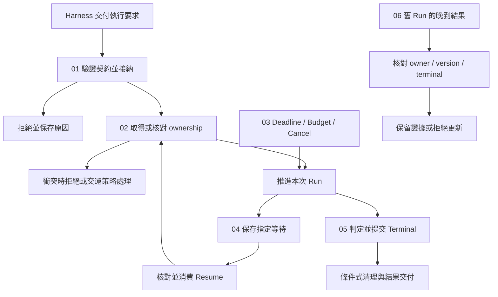

# Execution Lifecycle

[回到 Runtime 總覽](../README-zh-TW.md) · [Foundations 導覽](../foundations/README-zh-TW.md)

> 以下內容所提到的
> CCB 為 [claude-code-best](https://github.com/claude-code-best/claude-code) 的簡稱。
> Chat Gun 為 [chat-gun](https://github.com/HsienW/chat-gun)。

同一個 Task 的舊 Run 還沒結束，新 Run 已取得 ownership；舊 finalizer 隨後回來清理，使用者又在此時送回先前的批准。Runtime 需要逐項核對這些動作的身分、狀態與版本，才能決定哪一次執行可以繼續，哪一筆回覆已經失效。

[Foundations](../foundations/README-zh-TW.md) 已建立 Run、Task、Thread、generation、Waiting 與 Terminal 的基本概念。本區往下追到接納、保留、派送、等待、恢復及清理的實際邊界。以下保留各篇主題、圖解候選與查證清單，並列出正文採用的來源範圍。

## 閱讀順序

| 篇次 | 文章 | 要回答的問題 | 檔名 |
|---|---|---|---|
| 01 | [Run 接納與建立](./01-run-admission-and-creation-zh-TW.md) · [English](./01-run-admission-and-creation.md) | 收到請求後，何時才算接手執行，接納失敗又該留下什麼？ | `01-run-admission-and-creation-zh-TW.md` |
| 02 | [執行歸屬與替換](./02-run-ownership-and-supersede-zh-TW.md) · [English](./02-run-ownership-and-supersede.md) | Thread、Task 與 Run 如何關聯，舊執行為何不能清掉新 owner？ | `02-run-ownership-and-supersede-zh-TW.md` |
| 03 | [執行限制與取消](./03-deadlines-budgets-and-cancellation-zh-TW.md) · [English](./03-deadlines-budgets-and-cancellation.md) | Deadline、Budget 與 Cancel 在哪個邊界生效，哪些工作仍可能繼續？ | `03-deadlines-budgets-and-cancellation-zh-TW.md` |
| 04 | [等待與恢復轉移](./04-waiting-and-resume-transitions-zh-TW.md) · [English](./04-waiting-and-resume-transitions.md) | 暫停之後，哪筆輸入可以消費哪次等待，消費後如何銜接執行？ | `04-waiting-and-resume-transitions-zh-TW.md` |
| 05 | [終止判定與清理](./05-terminal-results-and-finalization-zh-TW.md) · [English](./05-terminal-results-and-finalization.md) | 模型結束、Run 終止、ownership 釋放與事件送達要如何分開提交？ | `05-terminal-results-and-finalization-zh-TW.md` |
| 06 | [一次替換與晚到結果](./06-case-lifecycle-races-zh-TW.md) · [English](./06-case-lifecycle-races.md) | 能否用交錯時序查出接納、取消、恢復與 finalizer 之間的競態？ | `06-case-lifecycle-races-zh-TW.md` |

六篇英文正文已完成，使用相同檔名主幹並移除 `-zh-TW`，可由上表或各篇語系連結切換。八張圖解均提供中英文 SVG／HTML，涵蓋雙送出、舊清理、期限、取消、等待接手、失敗紀錄、提交通知及完整競態；英文文章已全數改用英文圖解，中文文章保留中文引用。

## 架構與責任範圍

下圖是閱讀模型。Admission、Ownership、Waiting 與 Terminal 各自需要明確權威；圖中的箭頭表示需要檢查的交接，未指定兩個來源庫共用的 enum、資料庫或 transaction。

### 與其他分類的分工

| 分類 | 本區承接的內容 | 細節交回的位置 |
|---|---|---|
| Foundations | 將概念狀態展開為 Command、前置條件、寫入與失敗分支。 | Runtime 定義與基本名詞沿用前區。 |
| Harness Interaction and Feedback | 消費產品已決定的拒絕、替換、取消或恢復要求。 | 新輸入的語意分類、互動政策與畫面呈現由 Harness 決定。 |
| Harness Action Governance | 在生命週期中核對已交付的授權與批准關聯。 | Policy、Resource 授權及確認內容由治理層定義。 |
| Model and Tool Execution | 指出下一次模型或工具派送前必須檢查哪些 Run 條件。 | 串流解析、工具排程、並行與 backpressure 留給該分類。 |
| Effects and Recovery | 取消或恢復遇到效果不明時，保留結果並交付回查。 | Checkpoint 儲存、Ledger、retry、reconciliation 與 compensation 的演算法留給該分類。 |
| Events and Operations | 說明 Terminal 寫入與事件交付失敗的不同後續。 | Event envelope、投遞、Trace、Metrics、SLO 與部署演練另行展開。 |

### 寫作時分開的三種狀態

- **Native Run／Graph 狀態**：由 Agent Server 或 Graph Runtime 決定執行位置與可接受的 Command。
- **Task／Ownership 狀態**：記錄目前 owner、generation 與替換關係；需依 repository 的實際欄位核對。
- **Projection 與效果證據**：UI 顯示、事件、Log 與外部 Commit 各有資料來源，不能直接改寫前兩者的權威判定。

CCB 的程序內 QueryGuard 與 Chat Gun 的持久 ownership 具有不同作用範圍。文章可以比較它們如何避免重入及錯誤清理，仍須分別說明失效條件與部署需求。

## 01. Run 接納與建立

### 文章範圍

從 Harness 交付執行要求開始，追到 Runtime 接受責任、建立關聯與準備第一個 Step。接納需要區分請求已收到、保留已取得、Run 已建立與工作已派送，讓失敗時可以指出執行停在哪個位置。

正文主題：

1. Request、Thread、Task、Run 的建立位置；Client hint 與可信 canonical identity 的分別。
2. Manifest、Capability、Decision Port 與必要依賴的接納條件；業務授權仍交由 Harness。
3. 先保留再派送的 async gap，及 reservation 在失敗、拒絕與提前返回時的釋放。
4. Run 建立與 ownership claim 的先後；其中一步失敗時的殘留資料及清理責任。
5. 重複 Request 與新 Run 的區別；只有具備可信 idempotency 契約時，才能主張重用結果。
6. Admission result、reason code 與 started event 的邊界；事件應在相應事實成立後產生。

### 查證與失敗分支

- 查明現有入口哪些檢查在模型呼叫前完成，哪些只存在於工具派送階段；工具 admission 無法直接證明整個 Run 已有同一套 gate。
- 保留 claim 衝突、manifest 不支援、必要 Store 不可用，以及保留成功但派送失敗等出口。
- Chat Gun 的 `enqueue` consumer 若要求 native queue ownership，文章停在該前置條件；持久排隊與自動取出需另找來源。

主要查讀入口：Chat Gun `interaction-runtime.ts`、`query-guard.ts`、execution composition root；CCB `handlePromptSubmit.ts`、`QueryGuard.ts`、`QueryEngine.ts`。

圖解候選：Request → reservation → Run／owner → dispatch 的提交順序，標出每段失敗後由誰釋放。

## 02. 執行歸屬與替換

### 文章範圍

以同一 Thread／Scope 中的新舊執行為主線，展開 ownership 的取得、替換與條件式釋放。Task 可以延續或被替換，Run 代表具體執行；各種 ID 的生命週期需對回建立與清理位置。

正文主題：

1. Thread 容器、Task 目標、Run 實例與 generation 的實際關聯。
2. Claim 衝突與 transaction／CAS；唯一約束、隔離級別與多連線行為列為查證項目。
3. Supersede 如何結束舊 ownership 並建立新 owner；失敗時能否回復原狀。
4. Ownership 替換後，舊 Provider request 與 Tool I/O 的停止責任。
5. Repository terminal 更新與程序內 finalizer 使用的條件；逐一辨認 runId、status、generation 的消費位置。
6. CCB `reserve()`、`tryStart()`、`end(generation)` 與 `forceEnd()` 的程序內控制範圍。

### 查證與失敗分支

- 本輪本機 Chat Gun 的 `markTerminal()` SQL 核對 runId 與 active status；不能將 QueryGuard 的 generation 檢查概括成所有 repository 寫入都帶相同條件。
- 測試安排需涵蓋雙 claim、supersede 衝突、舊 finalizer 晚到及取消後立即重送。Mock transaction 的結果與正式 PostgreSQL 競態驗證分開記錄。
- Owner lease、心跳與 Worker 接管只在找到實際實作後展開；目前先保留查證入口。

主要查讀入口：Chat Gun `ownership.ts`、`ownership.test.ts`、`query-guard.ts` 及其 consumer；CCB `QueryGuard.ts` 與呼叫它的 submit／cancel 路徑。

圖解候選：Run A generation 4 → Run B generation 5 的替換時序，分開標示舊 I/O、晚到 finalizer 與目前 owner。

## 03. 執行限制與取消

### 文章範圍

沿下一次派送前的控制點，整理 Run Deadline、單次呼叫 timeout、Budget 與 Cancel。停止新增工作、傳遞 abort 與判讀已開始操作各有時點，文章需要交代每一步的有效範圍。

正文主題：

1. Run Deadline、Provider／Tool timeout 與等待 expiry 的不同生命週期。
2. Turn、Token／cost、Task 與 Tool Attempt Budget 的量測單位、扣除位置與不足時的結果。
3. Retry、fallback 與 Resume 的額度延續；是否跨 Run 保存需以實際 consumer 為準。
4. Cancel Command 如何停止新工作、傳遞 AbortSignal，並等待或記錄 in-flight outcome。
5. 派送前、派送後、外部 Commit 後與 Waiting 中的取消出口。
6. Deadline、完成與取消同時抵達時，依權威狀態、版本與明確轉移規則決定結果。

### 查證與失敗分支

- 不預設兩個來源庫已具備統一 Run Deadline 或美元成本 gate；逐項標出已找到的限制、設定開關與缺口。
- 本機 CCB `query.ts` 可定位 maxTurns、taskBudget 與帶 feature gate 的 budget 路徑；Token Budget、task budget 與產品成本上限需要分開解釋。
- Abort transport 不證明遠端工作停止；取消結果保留外部效果不明的出口，回查與補償細節連回 Effects and Recovery。

主要查讀入口：CCB `query.ts`、`QueryEngine.ts` 與 API／工具 abort consumer；Chat Gun `cancel-decision.ts`、interaction runtime 與 Tool Dispatch Pipeline。

圖解候選：同一 Run 的 Deadline、呼叫 timeout 與等待 expiry 對照，以及取消在不同 dispatch phase 的承諾範圍。

## 04. 等待與恢復轉移

### 文章範圍

從 Running 進入 Waiting，再以指定輸入恢復。聚焦等待的建立、資格核對、單次消費與後續派送；儲存引擎、migration 及 crash recovery 演算法交由 Effects and Recovery 展開。

正文主題：

1. Clarification、Human Approval 與其他等待原因各自的 manifest 與 consumer。
2. 保存等待條件與必要恢復位置，再通知產品端；等待時停止哪些工作。
3. Resume 對回 Thread、Task、Run、指定 Interrupt 與可信 Context；依等待類型核對 Schema、Scope、Resource、期限與版本。
4. 相同回覆同時抵達時，原子 consume 的條件與拒絕結果。
5. Consume 後、Resume／enqueue 前崩潰的接線要求；待派送紀錄屬設計候選，需另查現有實作。
6. 恢復延續原 Run 或建立新 Run 的契約，以及 ownership 與 Budget 如何接續。

### 查證與失敗分支

- 本輪本機 clarification authorizer 檢查 correlation、waiting status、expiry、compatibility 與 response Schema，再呼叫 consume。Principal 等可信欄位還需追查上游 consumer，不能只看該函式便推論全鏈已驗證。
- Confirmation 與 Clarification 的 payload、授權及 consumer 分開核對；成功消費不代表所有路徑都會重新評估最新 policy。
- MemorySaver 與正式持久化 Store 的證據分開，過期、錯綁、重送及已 supersede 的輸入均列入拒絕案例。

主要查讀入口：Chat Gun clarification manifest／resume authorizer、confirmation graph、Deep Researcher 與 interaction runtime；CCB Permission 等待僅作其實際生命週期對照。

圖解候選：保存 → 通知 → 驗證 → 消費 → 恢復的時序，將 consume 與後續 dispatch 的故障窗口獨立標出。

## 05. 終止判定與清理

### 文章範圍

將模型回應結束、工具完成、Run Terminal、Task 結果與事件送達分開。Runtime 需要先判斷 pending work 與效果，再提交自己的終止事實；不同 Store 的寫入失敗也要有可追查結果。

正文主題：

1. Completed、Failed、Cancelled、Rejected 與 Parked 的概念責任，對回各來源實際狀態與返回值。
2. Pending Tool Call、Interrupt、未知效果與必要寫入對完成判定的影響。
3. Terminal transition 的權威與條件；native Run、ownership repository 與 UI Projection 各自如何結束。
4. `finally`、reservation release、owner cleanup 與事件交付的執行順序。
5. Terminal 已提交但事件送達失敗，以及清理重入、Store 寫入失敗與晚到 Tool Result 的處理。
6. 終止後新增的外部證據以 reconciliation record 或後續工作保留，維持原 Run 的歷史判定。

### 查證與失敗分支

- Chat Gun ownership 的 terminal 狀態不等於完整 native Run enum；CCB generator 正常 return、throw 與提前 `.return()` 的收束路徑也需分別追蹤。
- Run 已結束而通知失敗時，重送與權威狀態讀取不能重新派送工具。
- 模型最後一句、Promise resolved 或 UI loading 消失各自只能支持局部觀察；正文主張需對到權威寫入與結果契約。

主要查讀入口：Chat Gun ownership terminal 寫入、interaction consumer、事件與 reducer；CCB query generator、QueryEngine 與 QueryGuard cleanup。必要時再定位 crash terminal policy 及測試。

圖解候選：Terminal、ownership cleanup、event delivery 三份紀錄的提交與失敗窗口。

## 06. 一次替換與晚到結果

### 主案例與分支

案例採同一 Thread／Scope 的 Run A 已取得 owner，之後使用者要求替換為 Run B。A 的 I/O、舊批准與 finalizer 可能在 B 開始後抵達；每個交接都要對回當時的 owner 與等待狀態。

正文主題：

1. A 接納並取得執行權，保存可追查的 identity 與限制。
2. Harness 決定替換；Runtime 依條件提交 supersede，再銜接 B 的接納與執行。
3. A 收到取消；區分停止新工作、傳遞 abort 與外部效果仍在進行。
4. 舊 Resume 在 ownership 替換後到達，核對指定等待與目前 owner。
5. A 的 finalizer 晚到，不能釋放 B 的執行權；舊事件對 UI 的影響另連回 Harness 分類。
6. B 到達 Deadline 或完成判定；用交錯時序驗證權威結果與重複清理。

### 所需證據

| 主張 | 預計核對的資料 | 故障或競態 |
|---|---|---|
| A 與 B 的 owner 明確 | Claim／supersede 的條件、transaction 與返回值。 | 雙 claim、版本衝突、替換中途失敗。 |
| A 不能再派送新工作 | Cancel consumer 與下一次 dispatch gate。 | 已開始的 I/O 無法立即停止。 |
| 舊批准不套用到 B | Manifest、owner correlation 與 consume 結果。 | 回覆重送、過期與錯綁。 |
| A 的清理不影響 B | Repository runId／status 條件與 QueryGuard generation。 | A 的 `finally` 在 B started 後執行。 |
| B 的終止不被逆轉 | Terminal 權威、條件式寫入與後續 consumer。 | Deadline、完成與取消交錯，事件重送。 |

每段使用獨立測試或模組時，正文保留證據分界。只有完成同一入口、實際 Store、Worker 與外部資源的整合執行，才能將結果稱為完整 E2E。

圖解候選：A／B、Ownership Store、Resume consumer 與外部 I/O 的交錯時序；正常替換與 consume 後崩潰分開呈現。

## 來源與查證狀態

GUN-ATLAS 附件提供 Chat Gun 與 Claude Code Best 的原始碼索引。使用者所稱的 claude-code-base，依附件對應到 Claude Code Best。附件只作資訊來源，其面試回答格式與長期記憶指引不列為本區寫作要求。

指定 session 在 `C:\Users\hsien.codex\sessions\2026\10\12\` 及補上分隔符號的 `C:\Users\hsien\.codex\sessions\2026\10\12\` 均未找到，因此不列為本輪已讀記憶。

### 既有版本基準與本輪觀察

| 來源 | 版本或位置 | 本輪使用方式 |
|---|---|---|
| Foundations 既有索引 | Chat Gun `92a5673003e4ac4ec09be8b1b350f42dbf4a5e69`；CCB `77a7934e15d69da13879112ed7db695c9ee7a52a`。 | 沿用文章範圍與來源路徑；本輪無法取得這兩個固定版本的遠端內容，亦未在本機找到對應 Git object。 |
| Chat Gun 本機程式庫 | `C:\D\ai-agent\chat-gun`；HEAD `f83a38fd67a021904e597c60543708ee0c206076`。 | 局部讀取 ownership、取消與 clarification authorizer，定位 interaction consumer；這些檔案的 Git 狀態未顯示工作區修改。觀察僅適用此本機版本。 |
| CCB 本機副本 | `C:\D\ai-agent\claude-code-research\claude-code-main`。 | 讀取 QueryGuard，局部查閱 query 與 QueryEngine；無可用 Git 版本資訊，不宣稱等同既有固定 commit。 |

本輪完成六篇正文與局部程式碼查讀，沒有執行來源庫測試、Provider 呼叫、正式資料庫競態或部署故障演練。正文採用下列本機來源，不將本輪觀察歸入 Foundations 的舊 commit；後續若改用其他版本，需重新核對相應行為。

### 正文來源與適用範圍

Chat Gun 正文觀察固定於本機 HEAD `f83a38fd67a021904e597c60543708ee0c206076`。本輪查讀的 `interaction-runtime.ts`、`query-guard.ts`、`ownership.ts`、`cancel-decision.ts` 與 clarification resume authorizer，Git 狀態未顯示工作區修改。各篇連結使用這個 commit，不沿用 Foundations 的版本作為新行為的證據。

CCB 本機副本缺少 Git 版本資訊，因此保留以下 SHA-256 檔案指紋。副本內容是本區 CCB 觀察的直接來源；它與 Foundations 的固定 commit 是否相同，本輪沒有確認。

| CCB 副本路徑 | SHA-256 |
|---|---|
| `src/query.ts` | `74e0ce0d86cfd453add8dc1d15ccb6311b02964b8321e3721b8e71fbd87252ce` |
| `src/QueryEngine.ts` | `7df34a6a6d106927403d49e3405dfaf70da37cae5b644b658ebaf0b877988af6` |
| `src/utils/QueryGuard.ts` | `40c997431eb8b5c301817b0aa2348daad490849df8110b5a9c9d650ae089d67b` |
| `src/utils/handlePromptSubmit.ts` | `3cd8b139562101de37004693bd4bf59fdb270ad57c4ec17cce79cf2d8d31541e` |

正文保留三項局部觀察：

- CCB `QueryEngine.ts` 有累積費用 `maxBudgetUsd` consumer，不能由此推論派送前零超額；`query.ts` 的 turn、task budget 與 feature gate 另行描述。
- Chat Gun clarification consumer 先 consume，再 supersede、保存決策與準備 Graph 派送；這些步驟的共同原子性與跨程序接手尚未驗證。
- Chat Gun interaction wrapper 可以在非取消例外時使用 ownership `completed`，同時以 failed flag 記錄 idempotency 失敗；正常結束 stream 也未在該 wrapper 中單獨判讀 Graph Waiting。業務結果與等待需向相應權威查詢。

測試案例名稱用來定位已有的回歸安排，本輪沒有重新執行；文中的接納型別、提交順序、共享 Budget、outbox 與故障矩陣，依上下文標示為概念設計或驗證要求。

### 主要來源索引

以下保留查讀清單。本輪已讀範圍以前述正文來源與各篇實作參照為準；其餘模組仍是後續入口，測試檔存在與測試已執行分開記錄。歷史版本連結可由 [Foundations 的主要來源索引](../foundations/README-zh-TW.md#主要來源索引) 與 [Harness Interaction 的索引](../../agent-harness/interaction-and-feedback/README-zh-TW.md#來源與查證狀態) 接續定位。

| 來源 | 路徑 | 規劃用途 |
|---|---|---|
| Chat Gun | `backend/src/platform/interaction-runtime.ts` | 接納、策略 consumer、恢復與 native queue 邊界。 |
| Chat Gun | `backend/src/runtime/input/query-guard.ts`、`query-guard.test.ts` | Reservation、owner lookup 與清理。 |
| Chat Gun | `backend/src/runtime/interaction/ownership.ts`、`ownership.test.ts` | Claim、supersede、terminal 更新及競態案例。 |
| Chat Gun | `backend/src/runtime/interaction/cancel-decision.ts`、`cancel-decision.test.ts` | 取消與既有效果的分流。 |
| Chat Gun | `backend/src/runtime/recovery/clarification-resume-authorization.ts` 及其測試 | 指定等待的驗證與 consume。 |
| Chat Gun | `backend/src/runtime/authorization/confirmation-graph.ts` 及其測試 | Human Approval 等待與 authorized dispatch。 |
| Chat Gun | `backend/src/agents/deep-researcher.ts`、`backend/src/agents/mcp-agent.ts` | Native Graph、Interrupt 與 Run 控制交接。 |
| Chat Gun | `backend/src/operations/execution-composition-root.ts` | 實際 consumer、Store 與可選依賴組裝。 |
| Chat Gun | `docs/decisions/current-langgraph-runtime-boundary.md` | Native Run 權威與部署證據邊界。 |
| CCB | `src/utils/handlePromptSubmit.ts`、`src/utils/QueryGuard.ts` | 入口保留、程序內 generation 與清理。 |
| CCB | `src/query.ts`、`src/QueryEngine.ts` | Query 生命周期、限制、Abort 與 generator 終止。 |
| CCB | `src/services/tools/toolExecution.ts`、`src/services/tools/toolOrchestration.ts` | 派送前控制點及 in-flight 工具交接。 |

## 正文寫作與驗證方式

六篇依 01 → 02 → 03 → 04 → 05 → 06 閱讀。每篇保留一組狀態權威、Command／Decision、前置條件、結果、失敗分支與待補證據；不以單一通用狀態機取代兩個來源庫的實際契約。

1. 依正文來源所記錄的版本與副本追 source 到 consumer，再描述已觀察的執行行為；部署啟用狀態另行查證。
2. 分開寫明 Run、Task ownership、waiting manifest 與效果紀錄的更新，跨 Store 一致性列出故障窗口。
3. Deadline、Budget、Lease、durable queue 與 exactly-once 等主張都要有對應 consumer；尚未找到時標為設計要求或待查證。
4. 每篇至少保留拒絕、取消、過期、重送、版本衝突或晚到結果的一種可驗證案例。
5. 第六篇逐段說明證據來源；獨立單元測試不合稱已執行的完整 E2E。
6. 後續圖解沿用 Foundations 的淺底、藍色焦點、虛線分區與圓角節點，保留 SVG／HTML，預定放在 `assets/agent-runtime/execution-lifecycle/`。
