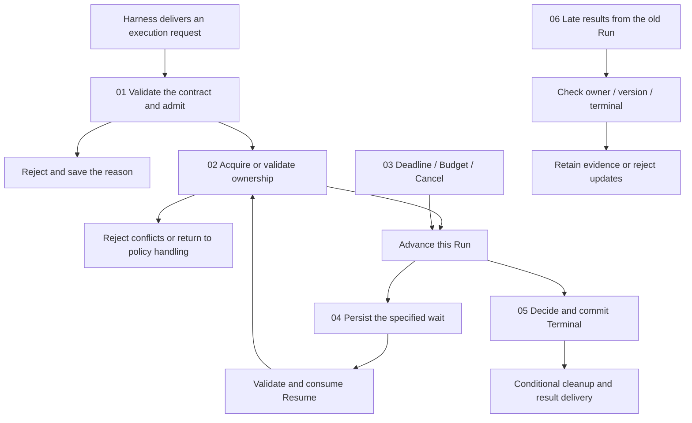

# Execution Lifecycle

[English](./README.md) | [繁體中文](./README-zh-TW.md) | [简体中文](./README-zh-CN.md)

[Back to Runtime overview](../README.md) · [Foundations guide](../foundations/README.md)

> In the following content:
> CCB is short for [claude-code-best](https://github.com/claude-code-best/claude-code).
> Chat Gun refers to [chat-gun](https://github.com/HsienW/chat-gun).

A new Run has acquired ownership while the old Run for the same Task is still active. The old finalizer returns to clean up just as the user submits an earlier approval. The Runtime must check the identity, state, and version of each action to decide which execution may continue and which reply is no longer valid.

[Foundations](../foundations/README.md) established the basic concepts of Run, Task, Thread, generation, Waiting, and Terminal. This section follows the concrete boundaries of admission, reservation, dispatch, waiting, resume, and cleanup. It retains article topics, diagram candidates, verification checklists, and the source scope used by the articles.

## Reading order

| Part | Article | Question to answer | Filename |
|---|---|---|---|
| 01 | [Run admission and creation](./01-run-admission-and-creation.md) · [繁體中文](./01-run-admission-and-creation-zh-TW.md) | When does receiving a request become responsibility for execution, and what should failed admission retain? | `01-run-admission-and-creation.md` |
| 02 | [Run ownership and supersede](./02-run-ownership-and-supersede.md) · [繁體中文](./02-run-ownership-and-supersede-zh-TW.md) | How do Thread, Task, and Run relate, and why must old execution not clear the new owner? | `02-run-ownership-and-supersede.md` |
| 03 | [Deadlines, budgets, and cancellation](./03-deadlines-budgets-and-cancellation.md) · [繁體中文](./03-deadlines-budgets-and-cancellation-zh-TW.md) | Where do Deadline, Budget, and Cancel take effect, and what work may continue? | `03-deadlines-budgets-and-cancellation.md` |
| 04 | [Waiting and resume transitions](./04-waiting-and-resume-transitions.md) · [繁體中文](./04-waiting-and-resume-transitions-zh-TW.md) | Which input may consume which wait, and how does execution continue after consumption? | `04-waiting-and-resume-transitions.md` |
| 05 | [Terminal results and finalization](./05-terminal-results-and-finalization.md) · [繁體中文](./05-terminal-results-and-finalization-zh-TW.md) | How should model completion, Run termination, ownership release, and event delivery commit separately? | `05-terminal-results-and-finalization.md` |
| 06 | [A supersede and late-result case](./06-case-lifecycle-races.md) · [繁體中文](./06-case-lifecycle-races-zh-TW.md) | Can interleaved timing expose races among admission, cancellation, resume, and finalizers? | `06-case-lifecycle-races.md` |

All six English articles are complete. They use the same filename stems without `-zh-TW` and are accessible through the table or each article's language links. Eight diagrams provide Chinese and English SVG/HTML, covering duplicate submission, stale cleanup, deadlines, cancellation, waiting handoff, failure records, commit/notification, and the complete race. English articles use English diagrams; Chinese articles retain Chinese references.

## Architecture and responsibilities

The diagram is a reading model. Admission, Ownership, Waiting, and Terminal each require an explicit authority. Arrows mark handoffs to inspect; they do not prescribe shared enums, databases, or transactions for the two source repositories.

### Division of work with other sections

| Section | What this section takes on | Where details belong |
|---|---|---|
| Foundations | Expand conceptual states into Commands, preconditions, writes, and failure branches. | Retain Runtime definitions and basic terms from the preceding section. |
| Harness Interaction and Feedback | Consume product decisions to reject, replace, cancel, or resume. | The Harness determines new-input semantics, interaction policies, and presentation. |
| Harness Action Governance | Check delivered authorization and approval correlations throughout the lifecycle. | The governance layer defines Policy, Resource authorization, and confirmation content. |
| Model and Tool Execution | Identify Run conditions required before the next model or tool dispatch. | Stream parsing, tool scheduling, concurrency, and backpressure remain in that section. |
| Effects and Recovery | Preserve results and hand off reconciliation when cancellation or resume encounters ambiguous effects. | Checkpoint storage, Ledger, retry, reconciliation, and compensation algorithms remain in that section. |
| Events and Operations | Explain different consequences of Terminal-write and event-delivery failures. | Event envelopes, delivery, Trace, Metrics, SLO, and deployment drills are expanded separately. |

### Three kinds of state to keep separate

- **Native Run/Graph state**: the Agent Server or Graph Runtime determines execution position and acceptable Commands.
- **Task/Ownership state**: records the current owner, generation, and supersede relationships; check the repository's actual fields.
- **Projection and effect evidence**: UI display, events, Logs, and external Commits each have their own sources and cannot directly rewrite the first two authorities.

CCB's in-process QueryGuard and Chat Gun's persistent ownership operate at different scopes. Articles may compare how they prevent reentry and incorrect cleanup, while retaining each one's failure conditions and deployment requirements.

## 01. Run admission and creation

### Article scope

Follow the Harness execution request until the Runtime accepts responsibility, establishes correlation, and prepares the first Step. Admission distinguishes request receipt, reservation acquisition, Run creation, and work dispatch so that failures identify where execution stopped.

Article topics:

1. Where Request, Thread, Task, and Run are created; client hints versus trusted canonical identity.
2. Admission conditions for Manifest, Capability, Decision Port, and required dependencies; business authorization remains with the Harness.
3. The async gap between reservation and dispatch, and reservation release on failure, rejection, or early return.
4. The order of Run creation and ownership claim; leftover records and cleanup responsibility when either fails.
5. Duplicate Requests versus new Runs; result reuse requires a trusted idempotency contract.
6. Boundaries among admission result, reason code, and started event; emit events after the corresponding facts hold.

### Verification and failure branches

- Identify which entry-point checks precede model calls and which occur only during tool dispatch. Tool admission alone cannot prove that an entire Run has the same gate.
- Retain exits for claim conflicts, unsupported manifests, unavailable required Stores, and successful reservation followed by failed dispatch.
- If Chat Gun's `enqueue` consumer requires native queue ownership, stop the claim at that precondition. Persistent queuing and automatic dequeue need separate sources.

Primary reading entry points: Chat Gun `interaction-runtime.ts`, `query-guard.ts`, and execution composition root; CCB `handlePromptSubmit.ts`, `QueryGuard.ts`, and `QueryEngine.ts`.

Diagram candidate: commit order from Request → reservation → Run/owner → dispatch, marking who releases resources after each failure.

## 02. Run ownership and supersede

### Article scope

Follow old and new executions in the same Thread/Scope through ownership acquisition, replacement, and conditional release. A Task may continue or be replaced; a Run represents concrete execution. Each ID's lifecycle must be traced to its creation and cleanup points.

Article topics:

1. Actual relationships among the Thread container, Task goal, Run instance, and generation.
2. Claim conflicts and transaction/CAS; verify unique constraints, isolation levels, and multiple-connection behavior.
3. How Supersede ends old ownership and establishes a new owner, including whether failures can restore the original state.
4. Responsibility for stopping old Provider requests and Tool I/O after ownership replacement.
5. Conditions used by repository terminal updates and in-process finalizers; identify each runId, status, and generation consumer.
6. The in-process control scope of CCB `reserve()`, `tryStart()`, `end(generation)`, and `forceEnd()`.

### Verification and failure branches

- The local Chat Gun `markTerminal()` SQL inspected in this round checks runId and active status. QueryGuard generation checks cannot be generalized to all repository writes.
- Tests should cover dual claims, supersede conflicts, late old finalizers, and immediate resubmission after cancellation. Record mock-transaction results separately from production PostgreSQL race validation.
- Expand owner leases, heartbeats, and Worker takeover only after locating actual implementations; retain verification entry points for now.

Primary reading entry points: Chat Gun `ownership.ts`, `ownership.test.ts`, `query-guard.ts`, and their consumers; CCB `QueryGuard.ts` and its submit/cancel callers.

Diagram candidate: replacement from Run A generation 4 → Run B generation 5, separately marking old I/O, the late finalizer, and the current owner.

## 03. Deadlines, budgets, and cancellation

### Article scope

Follow control points before the next dispatch to organize Run Deadline, per-call timeout, Budget, and Cancel. Stopping new work, propagating abort, and assessing already-started operations take effect at different times; the article states each step's scope.

Article topics:

1. Separate lifecycles of Run Deadline, Provider/Tool timeout, and waiting expiry.
2. Measurement units, deduction points, and exhaustion outcomes for Turn, Token/cost, Task, and Tool Attempt Budgets.
3. Budget continuity through Retry, fallback, and Resume; cross-Run persistence depends on actual consumers.
4. How Cancel Commands stop new work, propagate AbortSignal, and await or record in-flight outcomes.
5. Cancellation exits before dispatch, after dispatch, after external Commit, and during Waiting.
6. When Deadline, completion, and cancellation coincide, decide through authoritative state, versions, and explicit transition rules.

### Verification and failure branches

- Do not assume either source has a unified Run Deadline or dollar-cost gate; identify located limits, configuration switches, and gaps individually.
- Local CCB `query.ts` contains maxTurns, taskBudget, and feature-gated budget paths. Explain Token Budget, task budget, and product cost limits separately.
- Aborting transport does not prove remote work stopped. Preserve ambiguous external effects in cancellation outcomes and link reconciliation/compensation details to Effects and Recovery.

Primary reading entry points: CCB `query.ts`, `QueryEngine.ts`, and API/tool abort consumers; Chat Gun `cancel-decision.ts`, interaction runtime, and Tool Dispatch Pipeline.

Diagram candidate: compare a Run's Deadline, call timeout, and waiting expiry, plus cancellation guarantees at different dispatch phases.

## 04. Waiting and resume transitions

### Article scope

Follow Running into Waiting and back through specified input. Focus on wait creation, eligibility checks, single-use consumption, and subsequent dispatch. Effects and Recovery expands storage engines, migration, and crash-recovery algorithms.

Article topics:

1. Separate manifests and consumers for Clarification, Human Approval, and other waiting reasons.
2. Save waiting conditions and the required recovery position before notifying the product; identify work stopped during waiting.
3. Match Resume to Thread, Task, Run, the specified Interrupt, and trusted Context; check Schema, Scope, Resource, expiry, and version by waiting type.
4. Atomic consume conditions and rejection outcomes when identical responses arrive concurrently.
5. Wiring required for a crash after consume but before Resume/enqueue; pending-dispatch records are a design candidate whose current implementation requires separate inspection.
6. Contracts for continuing the original Run or creating a new one, and continuity of ownership and Budget.

### Verification and failure branches

- The local clarification authorizer inspected in this round checks correlation, waiting status, expiry, compatibility, and response Schema before consume. Trace trusted fields such as Principal through upstream consumers before claiming validation across the full chain.
- Check Confirmation and Clarification payloads, authorization, and consumers separately; successful consumption does not establish that every path reevaluates the latest policy.
- Separate MemorySaver evidence from production persistent Stores. Include expired, misbound, repeated, and superseded inputs among rejection cases.

Primary reading entry points: Chat Gun clarification manifests/resume authorizer, confirmation graph, Deep Researcher, and interaction runtime; compare CCB Permission waits only within their actual lifecycle.

Diagram candidate: save → notify → validate → consume → resume, with the failure window between consume and subsequent dispatch marked separately.

## 05. Terminal results and finalization

### Article scope

Separate model-response completion, tool completion, Run Terminal, Task results, and event delivery. The Runtime must assess pending work and effects before committing its terminal fact. Failed writes to different Stores also need traceable outcomes.

Article topics:

1. Conceptual responsibilities of Completed, Failed, Cancelled, Rejected, and Parked, mapped to each source's actual states and return values.
2. Effects of pending Tool Calls, Interrupts, unknown effects, and required writes on completion decisions.
3. Authority and conditions for Terminal transitions; how native Runs, ownership repositories, and UI Projections end separately.
4. Execution order of `finally`, reservation release, owner cleanup, and event delivery.
5. Handling committed Terminal state with failed event delivery, reentrant cleanup, Store-write failures, and late Tool Results.
6. Retain new external evidence after termination as reconciliation records or follow-up work, preserving the original Run's historical judgment.

### Verification and failure branches

- Chat Gun ownership terminal states are not a complete native Run enum. Trace CCB generator normal return, throw, and early `.return()` finalization paths separately.
- When notification fails after a Run ends, redelivery and authoritative-state reads must not redispatch tools.
- Final model text, a resolved Promise, or a disappearing UI loading indicator supports only a local observation. Claims must map to authoritative writes and result contracts.

Primary reading entry points: Chat Gun ownership terminal writes, interaction consumers, events, and reducers; CCB query generator, QueryEngine, and QueryGuard cleanup. Locate crash terminal policy and tests when needed.

Diagram candidate: commits and failure windows across Terminal, ownership cleanup, and event-delivery records.

## 06. A supersede and late-result case

### Main case and branches

Run A owns execution in a Thread/Scope when the user requests replacement by Run B. A's I/O, old approvals, and finalizer may arrive after B starts. Match each handoff to the owner and waiting state at that moment.

Article topics:

1. Admit A and grant execution ownership, retaining traceable identity and limits.
2. The Harness decides to replace it; the Runtime conditionally commits supersede, then connects B's admission and execution.
3. A receives cancellation; distinguish stopping new work, propagating abort, and external effects still in progress.
4. Old Resume arrives after ownership replacement; check the specified wait and current owner.
5. A's late finalizer must not release B's execution ownership; link old-event UI effects back to the Harness section.
6. B reaches Deadline or completion; use interleaved timing to validate authoritative results and repeated cleanup.

### Required evidence

| Claim | Data to inspect | Failure or race |
|---|---|---|
| A and B have explicit owners | Claim/supersede conditions, transactions, and return values. | Dual claims, version conflicts, and failure during replacement. |
| A can no longer dispatch new work | Cancel consumer and the next dispatch gate. | Already-started I/O cannot stop immediately. |
| Old approval does not apply to B | Manifest, owner correlation, and consume result. | Repeated, expired, and misbound replies. |
| A's cleanup does not affect B | Repository runId/status conditions and QueryGuard generation. | A's `finally` executes after B started. |
| B's termination cannot be reversed | Terminal authority, conditional writes, and downstream consumers. | Interleaved Deadline, completion, cancellation, and event redelivery. |

Retain evidence boundaries when stages use independent tests or modules. A complete E2E claim requires integrated execution through the same entry point, actual Store, Worker, and external resources.

Diagram candidate: interleaved A/B, Ownership Store, Resume consumer, and external I/O timing; show normal replacement separately from a crash after consume.

## Sources and verification status

The GUN-ATLAS attachment supplies source indexes for Chat Gun and Claude Code Best. It identifies the user's claude-code-base as Claude Code Best. The attachment serves as information only; its interview-answer format and long-term-memory guidance are not writing requirements for this section.

The specified session was found in neither `C:\Users\hsien.codex\sessions\2026\10\12\` nor the corrected `C:\Users\hsien\.codex\sessions\2026\10\12\`, so it is not counted as memory read in this round.

### Existing version baseline and observations in this round

| Source | Version or location | Use in this round |
|---|---|---|
| Existing Foundations index | Chat Gun `92a5673003e4ac4ec09be8b1b350f42dbf4a5e69`; CCB `77a7934e15d69da13879112ed7db695c9ee7a52a`. | Retain article scope and source paths. Remote content for these pinned versions was unavailable, and corresponding Git objects were not found locally. |
| Local Chat Gun repository | `C:\D\ai-agent\chat-gun`; HEAD `f83a38fd67a021904e597c60543708ee0c206076`. | Partially inspect ownership, cancellation, and the clarification authorizer, and locate interaction consumers. Git status showed no workspace modifications to these files. Observations apply only to this local version. |
| Local CCB copy | `C:\D\ai-agent\claude-code-research\claude-code-main`. | Read QueryGuard and partially inspect query and QueryEngine. No usable Git version information; no equivalence to the existing pinned commit is claimed. |

This round completed six articles and partial code inspection without running source-repository tests, Provider calls, production-database races, or deployment failure drills. The articles use the local sources below. These observations are not attributed to the older Foundations commit; other versions require behavior checks again.

### Article sources and scope

Chat Gun observations are pinned to local HEAD `f83a38fd67a021904e597c60543708ee0c206076`. Git status showed no workspace modifications to the inspected `interaction-runtime.ts`, `query-guard.ts`, `ownership.ts`, `cancel-decision.ts`, or clarification resume authorizer. Article links use this commit rather than treating the Foundations version as evidence for newly observed behavior.

The local CCB copy lacks Git version information, so the following SHA-256 file fingerprints are retained. That copy directly supports CCB observations in this section; equivalence to the Foundations pinned commit was not established in this round.

| CCB copy path | SHA-256 |
|---|---|
| `src/query.ts` | `74e0ce0d86cfd453add8dc1d15ccb6311b02964b8321e3721b8e71fbd87252ce` |
| `src/QueryEngine.ts` | `7df34a6a6d106927403d49e3405dfaf70da37cae5b644b658ebaf0b877988af6` |
| `src/utils/QueryGuard.ts` | `40c997431eb8b5c301817b0aa2348daad490849df8110b5a9c9d650ae089d67b` |
| `src/utils/handlePromptSubmit.ts` | `3cd8b139562101de37004693bd4bf59fdb270ad57c4ec17cce79cf2d8d31541e` |

The articles retain three local observations:

- CCB `QueryEngine.ts` has an accumulated-cost `maxBudgetUsd` consumer. This does not establish zero overshoot before dispatch; `query.ts` turn, task-budget, and feature-gate paths are described separately.
- Chat Gun's clarification consumer consumes first, then supersedes, saves decisions, and prepares Graph dispatch. Shared atomicity and cross-process takeover for these steps remain unverified.
- Chat Gun's interaction wrapper can mark ownership `completed` on non-cancellation exceptions while recording idempotency failure through a failed flag. The wrapper also does not separately classify Graph Waiting when a stream ends normally. Query the corresponding authorities for business outcomes and waiting.

Test names locate existing regression arrangements; they were not rerun in this round. Admission types, commit order, shared Budget, outbox, and failure matrices are labeled as conceptual designs or validation requirements according to context.

### Primary source index

The reading checklist follows. The article sources above and each article's implementation references define what was read in this round. Other modules remain entry points for later inspection; test-file existence and test execution are recorded separately. Historical links continue through the [Foundations source index](../foundations/README.md#primary-source-index) and [Harness Interaction index](../../agent-harness/interaction-and-feedback/README.md#sources-and-verification-status).

| Source | Path | Planned use |
|---|---|---|
| Chat Gun | `backend/src/platform/interaction-runtime.ts` | Admission, policy consumers, resume, and native-queue boundaries. |
| Chat Gun | `backend/src/runtime/input/query-guard.ts`, `query-guard.test.ts` | Reservation, owner lookup, and cleanup. |
| Chat Gun | `backend/src/runtime/interaction/ownership.ts`, `ownership.test.ts` | Claim, supersede, terminal updates, and race cases. |
| Chat Gun | `backend/src/runtime/interaction/cancel-decision.ts`, `cancel-decision.test.ts` | Cancellation and existing-effect branching. |
| Chat Gun | `backend/src/runtime/recovery/clarification-resume-authorization.ts` and its tests | Validation and consumption of a specified wait. |
| Chat Gun | `backend/src/runtime/authorization/confirmation-graph.ts` and its tests | Human Approval waiting and authorized dispatch. |
| Chat Gun | `backend/src/agents/deep-researcher.ts`, `backend/src/agents/mcp-agent.ts` | Native Graph, Interrupt, and Run-control handoffs. |
| Chat Gun | `backend/src/operations/execution-composition-root.ts` | Actual consumers, Stores, and optional-dependency composition. |
| Chat Gun | `docs/decisions/current-langgraph-runtime-boundary.md` | Native Run authority and deployment-evidence boundaries. |
| CCB | `src/utils/handlePromptSubmit.ts`, `src/utils/QueryGuard.ts` | Entry reservation, in-process generation, and cleanup. |
| CCB | `src/query.ts`, `src/QueryEngine.ts` | Query lifecycle, limits, Abort, and generator termination. |
| CCB | `src/services/tools/toolExecution.ts`, `src/services/tools/toolOrchestration.ts` | Pre-dispatch control points and in-flight tool handoffs. |

## Article writing and validation

Read 01 → 02 → 03 → 04 → 05 → 06. Each article retains state authority, Command/Decision, preconditions, results, failure branches, and missing evidence. A generic state machine cannot replace the two repositories' actual contracts.

1. Trace source to consumers using the recorded versions and copies, then describe observed execution behavior. Verify deployment enablement separately.
2. Describe Run, Task ownership, waiting-manifest, and effect-record updates separately, listing failure windows for cross-Store consistency.
3. Deadline, Budget, Lease, durable-queue, and exactly-once claims need corresponding consumers; label missing ones as design requirements or pending verification.
4. Retain at least one verifiable rejection, cancellation, expiry, resubmission, version-conflict, or late-result case in each article.
5. Identify evidence sources stage by stage in the sixth article; independent unit tests cannot collectively be called an executed complete E2E run.
6. Future diagrams retain Foundations' light background, blue focus, dashed regions, and rounded nodes, with SVG/HTML planned under `assets/agent-runtime/execution-lifecycle/`.
