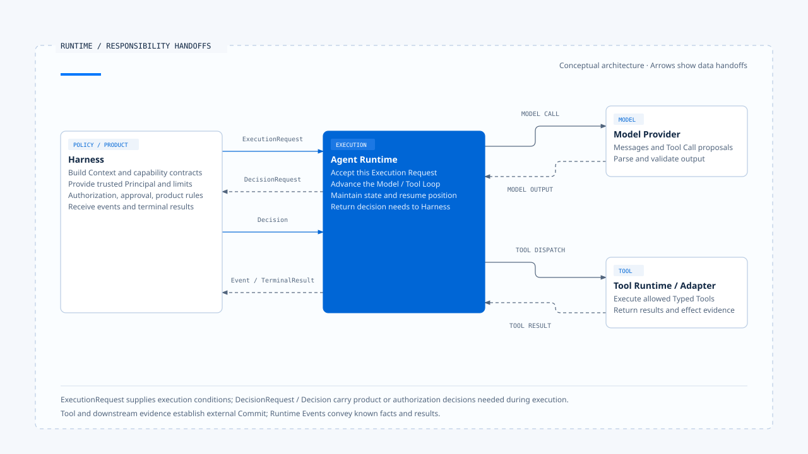

# 实际落地的 Agent Runtime 是什么？

[English](./01-what-is-agent-runtime.md) | [繁體中文](./01-what-is-agent-runtime-zh-TW.md) | [简体中文](./01-what-is-agent-runtime-zh-CN.md)

> 以下内容所提到的
> CCB 为 [claude-code-best](https://github.com/claude-code-best/claude-code) 的简称。
> Chat Gun 为 [chat-gun](https://github.com/HsienW/chat-gun)。

- 我认为 Agent Runtime 是接住一次受治理的执行要求，并把它推进到可判读结果的执行核心。
  - 它建立或取得这次 Run 的识别。
  - 维护执行状态与合法转移。
  - 调用模型，接收流式传输、消息与 Tool Call。
  - 调度工具，将 Tool Result 回灌模型。
  - 处理等待、取消、超时、重试与恢复。
  - 产生事件、终止结果，以及能供后续查验的执行证据。

> 这个定义从「谁持有执行状态」判断 Runtime 的位置。while-loop、StateGraph 都可以承担执行核心；Queue、Worker 与 Checkpointer 则可能由既有 Agent Server 提供。
> 沿着一次执行追踪状态、顺序与停止条件，就能看出 Runtime 的责任落在哪里。

## Runtime 位于哪里

把 Agent Product 拆成几个责任层后，Runtime 位于 Harness 之后，模型、工具与外部系统之前：

~~~text
產品入口
  → Harness：準備輸入、Context、能力、政策與執行限制
  → Runtime：推進 Run、模型、工具、等待、取消與恢復
  → Model Provider／Tool Adapter／External System
  → Runtime：整理結果、事件與證據
  → Harness：轉成使用者可見的互動
~~~

这条路径会往返：

- 模型提出敏感工具调用时，Runtime 向 Harness 请求授权。
- 工具执行完毕后，Runtime 把结果送回模型。
- 需要人工确认时，Runtime 保存等待状态与恢复条件，再由 Harness 显示确认内容。

Runtime 与 Harness 可以写在同一个文件，也可以部署成不同服务。两者依责任分工：
- Harness 决定这次执行允许在什么条件下发生。
- Runtime 持有执行中的状态、顺序与停止条件。

[开启 HTML 图解](../../assets/agent-runtime/foundations/01-what-is-agent-runtime/01-runtime-responsibility-handoffs-en.html)

图中的交接分开 Execution Request、决策与结果返回。这些是概念责任，实际接口名称与通道依 Runtime 契约决定。

## Runtime 接手时需要什么

Harness 应将身份、能力与执行限制整理成可验证的条件，再交给 Runtime。这份概念契约可以写成：

~~~ts
interface ExecutionRequest {
  context: ExecutionContext;
  input: NormalizedAgentInput;
  contextPack: GovernedContext;
  capabilities: CapabilitySet;
  limits: ExecutionLimits;
  manifest: ExecutionManifest;
  decisionPorts: DecisionPorts;
}
~~~

上述类型是本知识库用来检查交接是否完整的概念模型。Chat Gun 与 CCB 各有自己的实现，字段可能分散在函数参数、Graph State、Session 或远端 API。

核对交接时，要追到各字段的可信来源与验证位置。若必要条件只靠隐含全域状态、任意 Header 或 Prompt 文字传递，Runtime 就难以确认这次执行的身份、能力与限制。

| 交付内容 | Runtime 需要知道的事 |
|---|---|
| Execution Context | Principal、Tenant、Scope、Request、Task 与 Run 如何关联。 |
| Normalized Input | 这次输入是新任务、补充、Resume、Cancel，还是其他受支持类型。 |
| Governed Context | 哪些消息、记忆与外部数据可进入本次模型请求。 |
| Capability Set | 模型可见工具与实际可派送工具的范围。 |
| Execution Limits | Turn、时间、Token、成本与重试上限。 |
| Manifest | Schema、模型、工具、政策与恢复兼容性版本。 |
| Decision Ports | Runtime 遇到授权、确认或互动决策时，应向谁请求。 |

必要字段缺少时，Runtime 应在开始前拒绝，或进入明确的 degraded mode。它不应用方便的默认值补出可信身份，也不应在授权服务不可用时自行放宽政策。

## Runtime 持有的六项执行责任

### 1. 接纳与识别

Runtime 接到要求后，先验证版本、必要依赖与执行限制，再建立或取得权威 Run。这一步决定后续的模型请求、Tool Call、事件与终止结果要挂在哪个执行识别下。

接纳成功表示 Runtime 已承接这次执行，后续每个 Step 都能对回这次 Run；任务结果则由后续模型与工具执行决定。若同一 Task 已有 active owner，Runtime 需依 ownership policy 拒绝、排队或替换，确保目前执行者有明确归属。

### 2. 状态与控制循环

Runtime 需要知道现在可以做什么。Running 可以调用模型或工具；Waiting 必须等待符合条件的 Decision 或 Resume；Terminal Run 不再接受一般 Progress Event。这些状态未必以同一个 enum 实现，但合法转移必须有单一权威。

控制循环在每一步检查 Abort、Deadline、Budget 与目前状态，再决定继续取样、执行工具、请求决策、等待或结束。

### 3. 模型执行

Runtime 组装已核准的模型请求，接收并处理流式传输事件，累积可用消息，再辨识模型产生的是一般内容、Structured Output 或 Tool Call。Provider 回应超时、格式不合法或模型不支持指定能力时，Runtime 依已交付的策略回报失败，或切换至获准的 fallback 模型。

流式传输文字提供执行进度。即使用户已看见完整句子，Runtime 仍须确认工具结果、持久化与 terminal transition，才能交付终止结果。

### 4. 工具执行

模型提出 Tool Call 后，Runtime 保存调用识别与参数，核对 Registry、Schema、执行 Context 与治理结果，再交给 Tool Runtime。工具可以序列或并行执行，但并行条件需要由程序判断，不能只看模型一次提出了几个调用。

Tool Result 回灌模型前，Runtime 还要保持消息结构完整。被拒绝、输入不合法、派送前取消与派送后结果不明，应保留不同语义；把它们压成同一段 `error` 字符串，会让下一次模型推理与后续恢复失去依据。

### 5. 等待与恢复

Clarification、Human Approval 与其他 Interrupt 都会让执行暂停。Runtime 需要留下等待原因、关联识别、Resume Schema、期限与兼容版本，才能在另一个请求或另一个程序中判断回复是否属于这次等待。

恢复前，系统要先验证 waiting state、manifest 与一次性消费条件，再决定从哪一步继续。若工具可能已产生外部效果，还要先查 effect evidence，避免同一操作被再次派送。

### 6. 事件、结果与证据

Runtime Event 描述已发生的事情，例如模型请求开始、工具等待授权、尝试失败或 Run 结束。Terminal Result 则表达 Runtime 对这次执行的最终判定。两者可以相关，不能互相取代。

涉及退款、寄信或建立资源时，还需要外部效果的证据。Tool wrapper 成功返回，表示调用路径已取得结果；操作是否 Commit，仍要由外部 Operation ID、查询结果或 Side-effect Ledger 支持。

## Runtime 与周边组件的分工

### 模型 SDK：连接 Provider

模型 SDK 处理认证、请求、流式传输与 Provider 错误。Runtime 透过 SDK 调用模型，同时维护 Run、Tool Call、Budget、取消、等待与终止语义。检查一个系统时，可以从 SDK 调用往外追踪，确认这些执行责任由谁承担。

### 工具 Registry：提供能力契约

Registry 说明有哪些工具及其 Schema；Runtime 根据这些契约，决定这次调用何时可以执行、如何调度、结果如何回到模型，以及失败后能否继续。

### Queue 与 Worker：承接工作派送

Queue 保存工作并交给 Worker；Agent Runtime 则处理 Tool Result 与 assistant tool use 的关联、Interrupt Manifest、模型 Budget，以及效果不明时的分流。Agent Server 若已提供 Run Queue、Worker 与 Checkpoint，产品端可以沿用这些执行机制，再补上业务需要的状态与政策。

### Harness：提供产品决策

Harness 决定谁有权退款、哪些操作需要人工批准，再透过 Decision Port 交付结果。Runtime 依 Permission Decision 执行或拒绝工具，需要 Human Approval 时便停下来等待。集中产品政策，能让不同入口沿用相同规则。

## CCB 的 imperative Runtime

在本文参照的 CCB 固定版本中，`src/query.ts` 的 `query()`／`queryLoop()` 是最清楚的执行核心。外层传入 messages、system prompt、tools、`canUseTool`、Abort、turn 与 task budget 等条件，内层循环调用模型、辨识 tool use、执行工具、加入 Tool Result，再决定继续或结束。

`query()` 以 AsyncGenerator 对外送出消息与进度。Interactive REPL 可以直接消费这条路径；Headless／SDK 模式则由 `QueryEngine` 维护跨提交的 messages、Abort Controller、usage 与 permission denials，再调用相同的底层 query。由此可见，`QueryEngine` 是特定入口的 Session orchestrator，不能拿它代表所有 Runtime。

CCB 的 `toolOrchestration.ts` 会依工具是否可安全并行分批，保守工具维持序列执行，并限制 concurrency。这是 Runtime 的调度责任；跨进程锁、外部 idempotency 与 durable resume 则需要其他机制，不能由批次排序推论成立。

## Chat Gun 的 Graph Runtime 与扩展层

Chat Gun 以 LangGraph 注册多个 Graph。Graph Runtime 持有 Thread、Run、Graph State、node／edge、interrupt 与 checkpoint 等原生语义；Chat Gun 再补入产品需要的 execution context、interaction ownership、authorization、tool dispatch、side-effect 与 operations 模块。

`mcp-agent.ts` 呈现一条可观察的路径：模型节点产生 Tool Call 后进入 authorization gate，需要确认时停在 confirmation node，获准后才到 physical dispatch，再将 ToolMessage 接回模型循环。这条 Graph 可以说明控制点，不代表所有 Graph 自动套用同一套治理；仍需逐一追到 Registry、composition root 与正式入口。

`deep-researcher.ts` 则使用 StateGraph、`interrupt()` 与 checkpointer 处理厘清。固定版本使用 `MemorySaver` 组装，可以支持进程内测试与教学分析，不能据此宣称正式 Agent Server 已具备 PostgreSQL checkpoint、跨进程 durable resume 或多 Worker 竞态保证。

## 如何判断一个系统有没有 Runtime

| 要检查的问题 | 只有组件时常见的答案 | Runtime 应提供的答案 |
|---|---|---|
| 一次执行由谁识别 | 只有 conversation ID | Run 与 Task／Thread、Step、Tool Call 可关联 |
| 状态由谁持有 | UI 显示 loading | 权威 state 与合法 transition |
| 何时停止 | 模型没有再调用工具 | Terminal、budget、deadline、abort 与 waiting 条件 |
| 工具如何回到模型 | 把字符串附到历史 | 保持 tool use／result 关联与顺序 |
| 等待后怎么继续 | 收到新消息就再跑一次 | 验证 manifest、identity、schema 与一次性消费 |
| 崩溃后怎么判断 | 读最后一则 log | 查 checkpoint、ownership 与 effect evidence |
| 如何说明完成 | 模型说「已完成」 | Terminal Result 与必要的外部结果证据 |

若这些问题只能靠 UI 文案、全域变数或人工读 Log 回答，系统或许能完成 Demo，却还没有清楚的 Runtime contract。

## 场景：一次需要读文件与写文件的任务

### 读文件与修改提案

用户要求修改 README。Harness 先决定工作区、Context、工具集合与文件权限，再把执行条件交给 Runtime。Runtime 建立 Run，调用模型，收到 FileRead Tool Call，执行后把内容以 Tool Result 接回消息；模型接着提出 FileEdit，Runtime 把具体路径与修改交给 Permission Port。

### 授权与失败分支

- Harness 回复 allow：Runtime 执行写入，将结果回灌模型。
- Harness 回复 deny：Runtime 保存拒绝结果，模型据此说明无法完成的部分。
- 写入工具回应超时：Runtime 依派送与效果证据，分类为未提交或结果不明。

### 完成与中断恢复

Runtime 完成 terminal transition 后，Harness 才能依事件与结果更新完成状态。若 Runtime 在文件已写入、Tool Result 尚未保存时崩溃，恢复流程要先查工作区或 effect evidence，再决定如何处理 FileEdit。

## Runtime 的定义

> Agent Runtime 是持有一次 Agent 执行之识别、状态转移与停止条件的核心。它在 Harness 交付的规则内调用模型与工具，处理等待、取消与恢复，最后产生可由产品消费、也能由工程人员查验的结果与证据。

采用 while-loop、Graph 或独立服务时，都需要明确的执行权威。模型文字、UI reducer 与工具 wrapper 各自提供内容、显示与调用结果，Runtime 再依权威状态判定下一步。

## 实现参照与适用范围

本文对照以下固定版本：

### [Claude Code Best](https://github.com/claude-code-best/claude-code)

- `src/query.ts`：`query()`／`queryLoop()`、AsyncGenerator、turn、budget、abort 与 Tool Result 流程。
- `src/QueryEngine.ts`：Headless／SDK Session、messages、usage 与 permission denials。
- `src/services/tools/toolOrchestration.ts`：工具分批、序列／并行与 concurrency cap。
- `src/services/tools/toolExecution.ts`：工具输入、Permission 往返与实际执行。

CCB 固定于 `77a7934e15d69da13879112ed7db695c9ee7a52a`。它是第三方 Coding Agent 项目，本文不把其行为写成 Anthropic 官方 Claude Code 的唯一实现。

### [Chat Gun](https://github.com/HsienW/chat-gun)

- `backend/langgraph.json`：Graph 注册。
- `backend/src/agents/mcp-agent.ts`：模型、授权、确认、派送与循环。
- `backend/src/agents/deep-researcher.ts`：StateGraph、interrupt 与 checkpointer 组装。
- `backend/src/operations/execution-composition-root.ts`：Runtime 扩展的共同组装入口。
- `docs/decisions/current-langgraph-runtime-boundary.md`：LangGraph 原生权威、Chat Gun 扩展与部署证据边界。

Chat Gun 固定于 `92a5673003e4ac4ec09be8b1b350f42dbf4a5e69`。本文依已读源代码、测试与既有 boundary 记录说明；没有重新执行来源库测试，也不以本机开发行为推论正式部署状态。

## 接续阅读

- [Execution Identity 与状态权威](./02-execution-identity-and-state-authority-zh-CN.md)
- [Harness 与 Runtime 的边界](../../agent-harness/foundations/03-harness-runtime-boundary-zh-CN.md)
