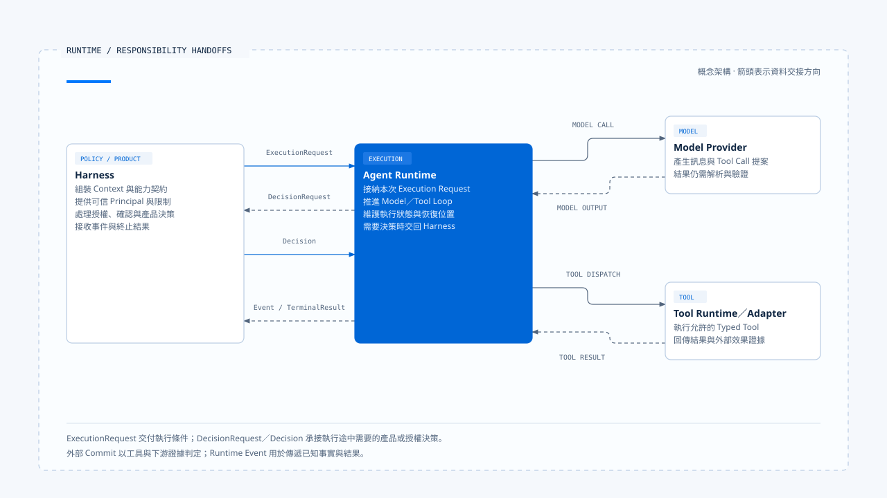

# 實際落地的 Agent Runtime 是什麼？

[English](./01-what-is-agent-runtime.md) | [繁體中文](./01-what-is-agent-runtime-zh-TW.md)

- 我認為 Agent Runtime 是接住一次受治理的執行要求，並把它推進到可判讀結果的執行核心。
  - 它建立或取得這次 Run 的識別。
  - 維護執行狀態與合法轉移。
  - 呼叫模型，接收串流、訊息與 Tool Call。
  - 排程工具，將 Tool Result 回灌模型。
  - 處理等待、取消、逾時、重試與恢復。
  - 產生事件、終止結果，以及能供後續查驗的執行證據。

> 這個定義從「誰持有執行狀態」判斷 Runtime 的位置。while-loop、StateGraph 都可以承擔執行核心；Queue、Worker 與 Checkpointer 則可能由既有 Agent Server 提供。
> 沿著一次執行追蹤狀態、順序與停止條件，就能看出 Runtime 的責任落在哪裡。

## Runtime 位於哪裡

把 Agent Product 拆成幾個責任層後，Runtime 位於 Harness 之後，模型、工具與外部系統之前：

~~~text
產品入口
  → Harness：準備輸入、Context、能力、政策與執行限制
  → Runtime：推進 Run、模型、工具、等待、取消與恢復
  → Model Provider／Tool Adapter／External System
  → Runtime：整理結果、事件與證據
  → Harness：轉成使用者可見的互動
~~~

這條路徑會往返：

- 模型提出敏感工具呼叫時，Runtime 向 Harness 請求授權。
- 工具執行完畢後，Runtime 把結果送回模型。
- 需要人工確認時，Runtime 保存等待狀態與恢復條件，再由 Harness 顯示確認內容。

Runtime 與 Harness 可以寫在同一個檔案，也可以部署成不同服務。兩者依責任分工：
- Harness 決定這次執行允許在什麼條件下發生。
- Runtime 持有執行中的狀態、順序與停止條件。

[開啟 HTML 圖解](../../assets/agent-runtime/foundations/01-what-is-agent-runtime/01-runtime-responsibility-handoffs.html)

圖中的交接分開 Execution Request、決策與結果回傳。這些是概念責任，實際介面名稱與通道依 Runtime 契約決定。

## Runtime 接手時需要什麼

Harness 應將身分、能力與執行限制整理成可驗證的條件，再交給 Runtime。這份概念契約可以寫成：

~~~ts
interface ExecutionRequest {
  context: ExecutionContext;
  input: NormalizedAgentInput;
  contextPack: GovernedContext;
  capabilities: CapabilitySet;
  limits: ExecutionLimits;
  manifest: ExecutionManifest;
  decisionPorts: DecisionPorts;
}
~~~

上述型別是本知識庫用來檢查交接是否完整的概念模型。Chat Gun 與 CCB 各有自己的實作，欄位可能分散在函式參數、Graph State、Session 或遠端 API。

核對交接時，要追到各欄位的可信來源與驗證位置。若必要條件只靠隱含全域狀態、任意 Header 或 Prompt 文字傳遞，Runtime 就難以確認這次執行的身分、能力與限制。

| 交付內容 | Runtime 需要知道的事 |
|---|---|
| Execution Context | Principal、Tenant、Scope、Request、Task 與 Run 如何關聯。 |
| Normalized Input | 這次輸入是新任務、補充、Resume、Cancel，還是其他受支援類型。 |
| Governed Context | 哪些訊息、記憶與外部資料可進入本次模型請求。 |
| Capability Set | 模型可見工具與實際可派送工具的範圍。 |
| Execution Limits | Turn、時間、Token、成本與重試上限。 |
| Manifest | Schema、模型、工具、政策與恢復相容性版本。 |
| Decision Ports | Runtime 遇到授權、確認或互動決策時，應向誰請求。 |

必要欄位缺少時，Runtime 應在開始前拒絕，或進入明確的 degraded mode。它不應用方便的預設值補出可信身分，也不應在授權服務不可用時自行放寬政策。

## Runtime 持有的六項執行責任

### 1. 接納與識別

Runtime 接到要求後，先驗證版本、必要依賴與執行限制，再建立或取得權威 Run。這一步決定後續的模型請求、Tool Call、事件與終止結果要掛在哪個執行識別下。

接納成功表示 Runtime 已承接這次執行，後續每個 Step 都能對回這次 Run；任務結果則由後續模型與工具執行決定。若同一 Task 已有 active owner，Runtime 需依 ownership policy 拒絕、排隊或替換，確保目前執行者有明確歸屬。

### 2. 狀態與控制迴圈

Runtime 需要知道現在可以做什麼。Running 可以呼叫模型或工具；Waiting 必須等待符合條件的 Decision 或 Resume；Terminal Run 不再接受一般 Progress Event。這些狀態未必以同一個 enum 實作，但合法轉移必須有單一權威。

控制迴圈在每一步檢查 Abort、Deadline、Budget 與目前狀態，再決定繼續取樣、執行工具、請求決策、等待或結束。

### 3. 模型執行

Runtime 組裝已核准的模型請求，接收並處理串流事件，累積可用訊息，再辨識模型產生的是一般內容、Structured Output 或 Tool Call。Provider 回應逾時、格式不合法或模型不支援指定能力時，Runtime 依已交付的策略回報失敗，或切換至獲准的 fallback 模型。

串流文字提供執行進度。即使使用者已看見完整句子，Runtime 仍須確認工具結果、持久化與 terminal transition，才能交付終止結果。

### 4. 工具執行

模型提出 Tool Call 後，Runtime 保存呼叫識別與參數，核對 Registry、Schema、執行 Context 與治理結果，再交給 Tool Runtime。工具可以序列或並行執行，但並行條件需要由程式判斷，不能只看模型一次提出了幾個呼叫。

Tool Result 回灌模型前，Runtime 還要保持訊息結構完整。被拒絕、輸入不合法、派送前取消與派送後結果不明，應保留不同語意；把它們壓成同一段 `error` 字串，會讓下一次模型推理與後續恢復失去依據。

### 5. 等待與恢復

Clarification、Human Approval 與其他 Interrupt 都會讓執行暫停。Runtime 需要留下等待原因、關聯識別、Resume Schema、期限與相容版本，才能在另一個請求或另一個程序中判斷回覆是否屬於這次等待。

恢復前，系統要先驗證 waiting state、manifest 與一次性消費條件，再決定從哪一步繼續。若工具可能已產生外部效果，還要先查 effect evidence，避免同一操作被再次派送。

### 6. 事件、結果與證據

Runtime Event 描述已發生的事情，例如模型請求開始、工具等待授權、嘗試失敗或 Run 結束。Terminal Result 則表達 Runtime 對這次執行的最終判定。兩者可以相關，不能互相取代。

涉及退款、寄信或建立資源時，還需要外部效果的證據。Tool wrapper 成功返回，表示呼叫路徑已取得結果；操作是否 Commit，仍要由外部 Operation ID、查詢結果或 Side-effect Ledger 支持。

## Runtime 與周邊元件的分工

### 模型 SDK：連接 Provider

模型 SDK 處理認證、請求、串流與 Provider 錯誤。Runtime 透過 SDK 呼叫模型，同時維護 Run、Tool Call、Budget、取消、等待與終止語意。檢查一個系統時，可以從 SDK 呼叫往外追蹤，確認這些執行責任由誰承擔。

### 工具 Registry：提供能力契約

Registry 說明有哪些工具及其 Schema；Runtime 根據這些契約，決定這次呼叫何時可以執行、如何排程、結果如何回到模型，以及失敗後能否繼續。

### Queue 與 Worker：承接工作派送

Queue 保存工作並交給 Worker；Agent Runtime 則處理 Tool Result 與 assistant tool use 的關聯、Interrupt Manifest、模型 Budget，以及效果不明時的分流。Agent Server 若已提供 Run Queue、Worker 與 Checkpoint，產品端可以沿用這些執行機制，再補上業務需要的狀態與政策。

### Harness：提供產品決策

Harness 決定誰有權退款、哪些操作需要人工批准，再透過 Decision Port 交付結果。Runtime 依 Permission Decision 執行或拒絕工具，需要 Human Approval 時便停下來等待。集中產品政策，能讓不同入口沿用相同規則。

## CCB 的 imperative Runtime

在本文參照的 CCB 固定版本中，`src/query.ts` 的 `query()`／`queryLoop()` 是最清楚的執行核心。外層傳入 messages、system prompt、tools、`canUseTool`、Abort、turn 與 task budget 等條件，內層循環呼叫模型、辨識 tool use、執行工具、加入 Tool Result，再決定繼續或結束。

`query()` 以 AsyncGenerator 對外送出訊息與進度。Interactive REPL 可以直接消費這條路徑；Headless／SDK 模式則由 `QueryEngine` 維護跨提交的 messages、Abort Controller、usage 與 permission denials，再呼叫相同的底層 query。由此可見，`QueryEngine` 是特定入口的 Session orchestrator，不能拿它代表所有 Runtime。

CCB 的 `toolOrchestration.ts` 會依工具是否可安全並行分批，保守工具維持序列執行，並限制 concurrency。這是 Runtime 的排程責任；跨程序鎖、外部 idempotency 與 durable resume 則需要其他機制，不能由批次排序推論成立。

## Chat Gun 的 Graph Runtime 與擴充層

Chat Gun 以 LangGraph 註冊多個 Graph。Graph Runtime 持有 Thread、Run、Graph State、node／edge、interrupt 與 checkpoint 等原生語意；Chat Gun 再補入產品需要的 execution context、interaction ownership、authorization、tool dispatch、side-effect 與 operations 模組。

`mcp-agent.ts` 呈現一條可觀察的路徑：模型節點產生 Tool Call 後進入 authorization gate，需要確認時停在 confirmation node，獲准後才到 physical dispatch，再將 ToolMessage 接回模型迴圈。這條 Graph 可以說明控制點，不代表所有 Graph 自動套用同一套治理；仍需逐一追到 Registry、composition root 與正式入口。

`deep-researcher.ts` 則使用 StateGraph、`interrupt()` 與 checkpointer 處理釐清。固定版本使用 `MemorySaver` 組裝，可以支持程序內測試與教學分析，不能據此宣稱正式 Agent Server 已具備 PostgreSQL checkpoint、跨程序 durable resume 或多 Worker 競態保證。

## 如何判斷一個系統有沒有 Runtime

| 要檢查的問題 | 只有元件時常見的答案 | Runtime 應提供的答案 |
|---|---|---|
| 一次執行由誰識別 | 只有 conversation ID | Run 與 Task／Thread、Step、Tool Call 可關聯 |
| 狀態由誰持有 | UI 顯示 loading | 權威 state 與合法 transition |
| 何時停止 | 模型沒有再呼叫工具 | Terminal、budget、deadline、abort 與 waiting 條件 |
| 工具如何回到模型 | 把字串附到歷史 | 保持 tool use／result 關聯與順序 |
| 等待後怎麼繼續 | 收到新訊息就再跑一次 | 驗證 manifest、identity、schema 與一次性消費 |
| 崩潰後怎麼判斷 | 讀最後一則 log | 查 checkpoint、ownership 與 effect evidence |
| 如何說明完成 | 模型說「已完成」 | Terminal Result 與必要的外部結果證據 |

若這些問題只能靠 UI 文案、全域變數或人工讀 Log 回答，系統或許能完成 Demo，卻還沒有清楚的 Runtime contract。

## 場景：一次需要讀檔與寫檔的任務

### 讀檔與修改提案

使用者要求修改 README。Harness 先決定工作區、Context、工具集合與檔案權限，再把執行條件交給 Runtime。Runtime 建立 Run，呼叫模型，收到 FileRead Tool Call，執行後把內容以 Tool Result 接回訊息；模型接著提出 FileEdit，Runtime 把具體路徑與修改交給 Permission Port。

### 授權與失敗分支

- Harness 回覆 allow：Runtime 執行寫入，將結果回灌模型。
- Harness 回覆 deny：Runtime 保存拒絕結果，模型據此說明無法完成的部分。
- 寫入工具回應逾時：Runtime 依派送與效果證據，分類為未提交或結果不明。

### 完成與中斷恢復

Runtime 完成 terminal transition 後，Harness 才能依事件與結果更新完成狀態。若 Runtime 在檔案已寫入、Tool Result 尚未保存時崩潰，恢復流程要先查工作區或 effect evidence，再決定如何處理 FileEdit。

## Runtime 的定義

> Agent Runtime 是持有一次 Agent 執行之識別、狀態轉移與停止條件的核心。它在 Harness 交付的規則內呼叫模型與工具，處理等待、取消與恢復，最後產生可由產品消費、也能由工程人員查驗的結果與證據。

採用 while-loop、Graph 或獨立服務時，都需要明確的執行權威。模型文字、UI reducer 與工具 wrapper 各自提供內容、顯示與呼叫結果，Runtime 再依權威狀態判定下一步。

## 實作參照與適用範圍

本文對照以下固定版本：

### [Claude Code Best](https://github.com/claude-code-best/claude-code)

- `src/query.ts`：`query()`／`queryLoop()`、AsyncGenerator、turn、budget、abort 與 Tool Result 流程。
- `src/QueryEngine.ts`：Headless／SDK Session、messages、usage 與 permission denials。
- `src/services/tools/toolOrchestration.ts`：工具分批、序列／並行與 concurrency cap。
- `src/services/tools/toolExecution.ts`：工具輸入、Permission 往返與實際執行。

CCB 固定於 `77a7934e15d69da13879112ed7db695c9ee7a52a`。它是第三方 Coding Agent 專案，本文不把其行為寫成 Anthropic 官方 Claude Code 的唯一實作。

### [Chat Gun](https://github.com/HsienW/chat-gun)

- `backend/langgraph.json`：Graph 註冊。
- `backend/src/agents/mcp-agent.ts`：模型、授權、確認、派送與循環。
- `backend/src/agents/deep-researcher.ts`：StateGraph、interrupt 與 checkpointer 組裝。
- `backend/src/operations/execution-composition-root.ts`：Runtime 擴充的共同組裝入口。
- `docs/decisions/current-langgraph-runtime-boundary.md`：LangGraph 原生權威、Chat Gun 擴充與部署證據邊界。

Chat Gun 固定於 `92a5673003e4ac4ec09be8b1b350f42dbf4a5e69`。本文依已讀原始碼、測試與既有 boundary 記錄說明；沒有重新執行來源庫測試，也不以本機開發行為推論正式部署狀態。

## 接續閱讀

- [Execution Identity 與狀態權威](./02-execution-identity-and-state-authority-zh-TW.md)
- [Harness 與 Runtime 的邊界](../../agent-harness/foundations/03-harness-runtime-boundary-zh-TW.md)
