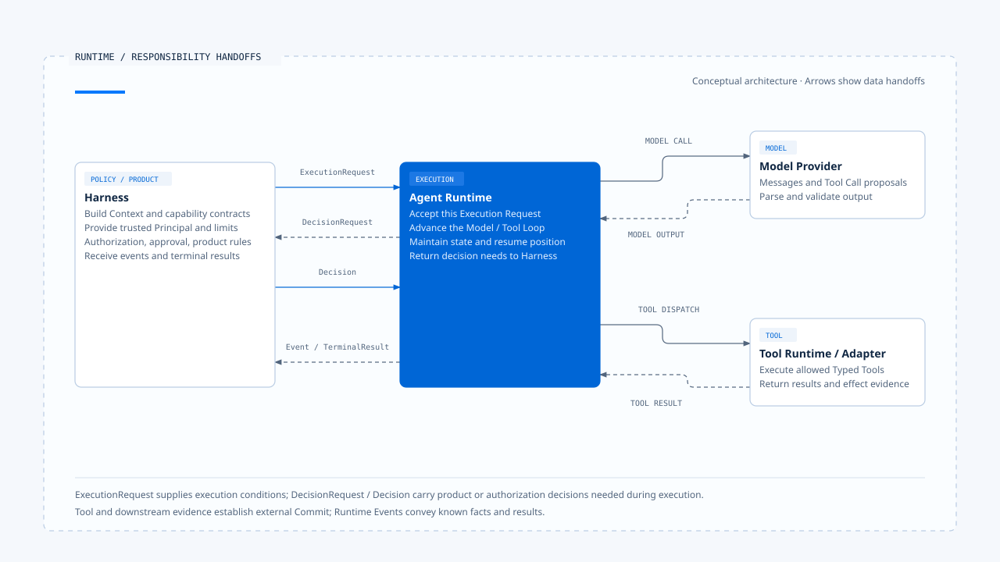

# What is an Agent Runtime in practice?

[English](./01-what-is-agent-runtime.md) | [繁體中文](./01-what-is-agent-runtime-zh-TW.md)

- I view an Agent Runtime as the execution core that accepts a governed execution request and advances it toward a result the system can interpret.
  - It creates or retrieves the identity of this Run.
  - It maintains execution state and valid transitions.
  - It calls models and receives streams, messages, and Tool Calls.
  - It schedules tools and feeds Tool Results back to the model.
  - It handles waiting, cancellation, timeouts, retries, and recovery.
  - It produces events, terminal results, and execution evidence for later inspection.

> This definition locates the Runtime by asking who owns execution state. A while-loop or StateGraph can serve as the execution core; an existing Agent Server may provide the Queue, Workers, and Checkpointer.
> Tracing state, ordering, and stopping conditions through one execution reveals where the Runtime responsibilities belong.

## Where the Runtime sits

When an Agent Product is divided into responsibility layers, the Runtime sits after the Harness and before models, tools, and external systems:

~~~text
產品入口
  → Harness：準備輸入、Context、能力、政策與執行限制
  → Runtime：推進 Run、模型、工具、等待、取消與恢復
  → Model Provider／Tool Adapter／External System
  → Runtime：整理結果、事件與證據
  → Harness：轉成使用者可見的互動
~~~

This path includes exchanges in both directions:

- When the model proposes a sensitive tool call, the Runtime requests authorization from the Harness.
- After a tool finishes, the Runtime returns its result to the model.
- When human confirmation is required, the Runtime saves the waiting state and recovery conditions, then the Harness displays the confirmation request.

The Runtime and Harness can share a file or run as separate services. They divide responsibilities as follows:
- The Harness decides the conditions under which this execution is allowed.
- The Runtime owns the state, ordering, and stopping conditions during execution.

[Open the HTML diagram](../../assets/agent-runtime/foundations/01-what-is-agent-runtime/01-runtime-responsibility-handoffs-en.html)

The diagram separates the Execution Request, decisions, and returned results. These are conceptual responsibilities; the Runtime contract determines the actual interface names and channels.

## What the Runtime needs at handoff

The Harness should turn identity, capabilities, and execution limits into verifiable conditions before handing them to the Runtime. This conceptual contract can be written as:

~~~ts
interface ExecutionRequest {
  context: ExecutionContext;
  input: NormalizedAgentInput;
  contextPack: GovernedContext;
  capabilities: CapabilitySet;
  limits: ExecutionLimits;
  manifest: ExecutionManifest;
  decisionPorts: DecisionPorts;
}
~~~

These types form a conceptual model used in this knowledge base to check whether a handoff is complete. Chat Gun and CCB have their own implementations; fields may appear in function parameters, Graph State, a Session, or a remote API.

Checking a handoff requires tracing each field to its trusted source and validation point. If required conditions travel only through implicit global state, arbitrary Headers, or Prompt text, the Runtime will struggle to verify the identity, capabilities, and limits of this execution.

| Delivered item | What the Runtime needs to know |
|---|---|
| Execution Context | How Principal, Tenant, Scope, Request, Task, and Run relate. |
| Normalized Input | Whether this input starts a new task, adds information, resumes, cancels, or uses another supported type. |
| Governed Context | Which messages, memories, and external data may enter this model request. |
| Capability Set | The scope of tools visible to the model and tools available for actual dispatch. |
| Execution Limits | Limits on turns, time, tokens, cost, and retries. |
| Manifest | Versions for schemas, models, tools, policies, and recovery compatibility. |
| Decision Ports | Whom the Runtime should ask for authorization, confirmation, or interaction decisions. |

When required fields are missing, the Runtime should reject the request before starting or enter an explicit degraded mode. It should neither invent a trusted identity through convenient defaults nor relax policy when the authorization service is unavailable.

## Six execution responsibilities owned by the Runtime

### 1. Admission and identity

After receiving a request, the Runtime validates versions, required dependencies, and execution limits, then creates or retrieves the authoritative Run. This step determines which execution identity will link subsequent model requests, Tool Calls, events, and terminal results.

Successful admission means the Runtime has accepted responsibility for this execution, and each subsequent Step can be traced back to this Run; later model and tool execution determines the task outcome. If the same Task already has an active owner, the Runtime must reject, queue, or replace it according to ownership policy so the current executor has an explicit assignment.

### 2. State and the control loop

The Runtime needs to know which actions are currently valid. Running permits model or tool calls; Waiting requires a qualifying Decision or Resume; a Terminal Run no longer accepts ordinary Progress Events. Implementations may use different enums, but valid transitions must have a single authority.

At each step, the control loop checks Abort, Deadline, Budget, and current state before deciding whether to sample again, execute tools, request a decision, wait, or finish.

### 3. Model execution

The Runtime assembles approved model requests, receives and processes streaming events, accumulates usable messages, and identifies whether the model produced ordinary content, Structured Output, or a Tool Call. If a Provider response times out, has an invalid format, or comes from a model that lacks a required capability, the Runtime reports failure under the supplied strategy or switches to an approved fallback model.

Streaming text provides execution progress. Even after the user has seen complete sentences, the Runtime must still verify tool results, persistence, and the terminal transition before delivering a terminal result.

### 4. Tool execution

After the model proposes a Tool Call, the Runtime saves its identity and arguments, checks the Registry, Schema, execution Context, and governance outcome, then hands it to the Tool Runtime. Tools may execute sequentially or concurrently, but code must determine whether concurrency is allowed; the number of calls proposed by the model does not establish that condition.

Before feeding Tool Results back to the model, the Runtime must also preserve message structure. Rejection, invalid input, cancellation before dispatch, and an unknown outcome after dispatch need distinct meanings; collapsing them into one `error` string removes information needed for the next model inference and later recovery.

### 5. Waiting and recovery

Clarification, Human Approval, and other Interrupts pause execution. The Runtime needs to retain the waiting reason, correlation identities, Resume Schema, expiry, and compatible versions so another request or process can determine whether a response belongs to this wait.

Before recovery, the system validates the waiting state, manifest, and conditions for consumption exactly once, then decides where to continue. If a tool may already have produced an external effect, it must first inspect effect evidence to avoid dispatching the same operation again.

### 6. Events, results, and evidence

Runtime Events describe facts that have occurred, such as a model request starting, a tool waiting for authorization, an attempt failing, or a Run ending. A Terminal Result expresses the Runtime's final determination for this execution. The two may be related, but each serves its own purpose.

Refunds, emails, and resource creation also require evidence of external effects. A successful return from a tool wrapper means the calling path obtained a result; an external Operation ID, query result, or Side-effect Ledger must still support whether the operation committed.

## How the Runtime shares responsibilities with surrounding components

### Model SDK: connecting to a Provider

A model SDK handles authentication, requests, streams, and Provider errors. The Runtime calls models through the SDK while maintaining Run, Tool Call, Budget, cancellation, waiting, and terminal semantics. When inspecting a system, trace outward from the SDK call to establish who owns these execution responsibilities.

### Tool Registry: providing capability contracts

The Registry describes available tools and their Schemas. Using these contracts, the Runtime decides when a call can execute, how to schedule it, how to return its result to the model, and whether execution can continue after failure.

### Queue and Workers: accepting dispatched work

A Queue stores work and hands it to Workers; an Agent Runtime handles the relationship between Tool Results and assistant tool use, Interrupt Manifests, model Budgets, and routing when effects are unknown. If an Agent Server already provides a Run Queue, Workers, and Checkpoints, the product can reuse those execution mechanisms and add the state and policies its business requires.

### Harness: providing product decisions

The Harness decides who may issue refunds and which operations require human approval, then delivers decisions through a Decision Port. The Runtime executes or rejects tools according to the Permission Decision and pauses when Human Approval is required. Keeping product policy in one place lets different entry points reuse the same rules.

## CCB's imperative Runtime

In the pinned CCB version referenced here, `query()`/`queryLoop()` in `src/query.ts` provide the clearest execution core. The outer layer supplies messages, the system prompt, tools, `canUseTool`, Abort, turn and task budgets, and other conditions; the inner loop calls the model, identifies tool use, executes tools, adds Tool Results, and decides whether to continue or finish.

`query()` emits messages and progress through an AsyncGenerator. The Interactive REPL can consume this path directly; in Headless/SDK mode, `QueryEngine` maintains messages across submissions, an Abort Controller, usage, and permission denials, then calls the same underlying query. Thus, `QueryEngine` is the Session orchestrator for specific entry points and cannot represent every Runtime.

CCB's `toolOrchestration.ts` batches tools according to whether they can run concurrently, keeps conservative tools sequential, and caps concurrency. This is a Runtime scheduling responsibility; locks across processes, external idempotency, and durable resume require other mechanisms and cannot be inferred from batch ordering.

## Chat Gun's Graph Runtime and extension layer

Chat Gun registers multiple Graphs through LangGraph. The Graph Runtime owns native semantics such as Thread, Run, Graph State, nodes/edges, interrupts, and checkpoints; Chat Gun adds execution context, interaction ownership, authorization, tool dispatch, side-effect, and operations modules for product needs.

`mcp-agent.ts` shows an observable path: a model node produces Tool Calls and enters an authorization gate, stops at a confirmation node when needed, reaches physical dispatch only after approval, and returns ToolMessages to the model loop. This Graph explains the control points, but each Graph still needs inspection of its Registry, composition root, and production entry point before claiming the same governance applies.

`deep-researcher.ts` uses StateGraph, `interrupt()`, and a checkpointer for clarification. The pinned version uses `MemorySaver` in its composition, which supports tests within one process and teaching analysis. It does not establish that the production Agent Server has PostgreSQL checkpoints, durable resume across processes, or concurrency guarantees across multiple Workers.

## How to tell whether a system has a Runtime

| Question to check | Common answer when only components exist | Answer a Runtime should provide |
|---|---|---|
| Who identifies an execution | Only a conversation ID | Run linked to Task/Thread, Step, and Tool Call |
| Who owns state | The UI displays loading | Authoritative state and valid transitions |
| When execution stops | The model stops calling tools | Terminal, budget, deadline, abort, and waiting conditions |
| How tools return to the model | Append a string to history | Preserve tool use/result correlation and ordering |
| How execution continues after waiting | Run again on any new message | Validate manifest, identity, schema, and consumption exactly once |
| How to decide after a crash | Read the last log entry | Check checkpoints, ownership, and effect evidence |
| How completion is justified | The model says "done" | Terminal Result and required evidence of external results |

If these questions can only be answered through UI text, global variables, or manual Log inspection, the system may support a Demo but still lacks a clear Runtime contract.

## Scenario: a task that reads and edits a file

### Reading the file and proposing an edit

The user asks to edit a README. The Harness first determines the workspace, Context, tool set, and file permissions, then hands execution conditions to the Runtime. The Runtime creates a Run, calls the model, receives a FileRead Tool Call, and returns the file content as a Tool Result; the model then proposes FileEdit, and the Runtime sends the concrete path and edits to the Permission Port.

### Authorization and failure branches

- The Harness returns allow: the Runtime performs the write and feeds the result back to the model.
- The Harness returns deny: the Runtime saves the rejection result, and the model explains which part it could not complete.
- The write tool times out: the Runtime classifies the outcome as not committed or unknown using dispatch and effect evidence.

### Completion and recovery after interruption

Only after the Runtime completes its terminal transition can the Harness update completion status from events and results. If the Runtime crashes after the file is written but before the Tool Result is saved, recovery must inspect the workspace or effect evidence before deciding how to handle FileEdit.

## Defining the Runtime

> An Agent Runtime is the core that owns the identity, state transitions, and stopping conditions of one Agent execution. It calls models and tools within the rules supplied by the Harness, handles waiting, cancellation, and recovery, and produces results and evidence that the product can consume and engineers can inspect.

A while-loop, Graph, or separate service all require explicit execution authority. Model text, UI reducers, and tool wrappers provide content, display, and call results respectively; the Runtime determines the next action from authoritative state.

## Implementation references and scope

This article compares the following pinned versions:

### [Claude Code Best](https://github.com/claude-code-best/claude-code)

- `src/query.ts`: `query()`/`queryLoop()`, AsyncGenerator, turn, budget, abort, and Tool Result flow.
- `src/QueryEngine.ts`: Headless/SDK Sessions, messages, usage, and permission denials.
- `src/services/tools/toolOrchestration.ts`: tool batching, sequential/concurrent execution, and concurrency caps.
- `src/services/tools/toolExecution.ts`: tool input, Permission exchanges, and actual execution.

CCB is pinned to `77a7934e15d69da13879112ed7db695c9ee7a52a`. It is a third-party Coding Agent project; this article does not present its behavior as the sole implementation of Anthropic's official Claude Code.

### [Chat Gun](https://github.com/HsienW/chat-gun)

- `backend/langgraph.json`: Graph registration.
- `backend/src/agents/mcp-agent.ts`: models, authorization, confirmation, dispatch, and looping.
- `backend/src/agents/deep-researcher.ts`: StateGraph, interrupt, and checkpointer composition.
- `backend/src/operations/execution-composition-root.ts`: shared composition entry point for Runtime extensions.
- `docs/decisions/current-langgraph-runtime-boundary.md`: LangGraph native authority, Chat Gun extensions, and deployment evidence boundaries.

Chat Gun is pinned to `92a5673003e4ac4ec09be8b1b350f42dbf4a5e69`. This article draws on inspected source code, tests, and existing boundary records; it does not rerun source repository tests or infer production deployment status from local development behavior.

## Further reading

- [Execution Identity and state authority](./02-execution-identity-and-state-authority-zh-TW.md)
- [The boundary between Harness and Runtime](../../agent-harness/foundations/03-harness-runtime-boundary-zh-TW.md)
