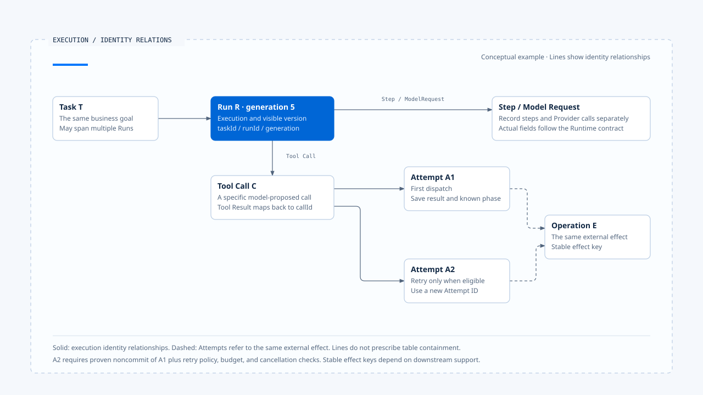

# Execution Identity 与状态权威

[English](./02-execution-identity-and-state-authority.md) | [繁體中文](./02-execution-identity-and-state-authority-zh-TW.md) | [简体中文](./02-execution-identity-and-state-authority-zh-CN.md)

> 以下内容所提到的
> CCB 为 [claude-code-best](https://github.com/claude-code-best/claude-code) 的简称。
> Chat Gun 为 [chat-gun](https://github.com/HsienW/chat-gun)。

用户在同一个对话里补了一句话，产品建立了新 Run；旧 Run 随后才送回一个 progress event。若前端只看 Thread ID，它可能把旧进度画到新任务上；若 finalizer 只知道「任务结束」，它甚至可能清掉新 Run 刚取得的 ownership。

这类错误出在系统没有分清楚「同一个对话」「同一个目标」与「同一次执行」。Execution Identity 把这些关系变成可验证字段，让 Runtime 在恢复、重试与接收晚到输出时，能判断数据的归属。

## 为什么一个 ID 不够

Conversation ID 可以定位对话历史；进入执行流程后，系统还需要回答：

- 同一对话目前有几次执行？
- 哪次执行正在等待确认？
- 这个 Tool Result 应接回哪个 Tool Call？
- Retry 是同一次业务操作的下一个 attempt，还是新的操作？
- 旧 Run 的事件能否更新现在的画面？

取消、Resume 或并行会让同一对话包含多段执行。各种识别需要各自记录关联，事件产生端与处理端才能直接核对数据属于哪个范围，减少依时间与文案推测的情况。

## 一组可检查的识别关系

下表整理识别的概念与生命周期。Chat Gun 与 CCB 使用各自的 Schema，实际项目也可以采用别名或省略某一层；调整之前，仍要确认相应责任由谁承担。

| Identity | 它识别什么 | 常见生命周期 |
|---|---|---|
| Request ID | 一次进入产品或 API 的请求 | 从入口到回应或断线 |
| Thread ID | 可延续的对话或 Graph 容器 | 跨多个 Run |
| Task ID | 用户想完成的业务目标 | 可跨澄清、替换与恢复 |
| Run ID | Runtime 的一次执行实例 | 从 admission 到 terminal／waiting |
| Generation | 同一 Task 目前可见 owner 的版本 | 每次 claim 或 supersede 递增 |
| Step ID | Run 内的一个可重放或可观察步骤 | 模型节点、工具节点或工作流步骤 |
| Model Request ID | 一次 Provider 调用 | 从送出到完整结果或失败 |
| Tool Call ID | 模型提出的一次具体工具调用 | 从提案到 Tool Result |
| Attempt ID | 某次工具或外部操作的执行尝试 | 一次派送 |
| Operation／Effect ID | 外部系统中的同一业务效果 | 可跨 Runtime retry 与 crash |
| Event ID／Sequence | 一笔事件及其 Run 内顺序 | 事件建立后保持不变 |

### Thread、Task 与 Run

Thread 保存可延续的对话或 Graph 状态。Task 表示产品希望完成的目标，例如「整理报告」；Run 则是某次具体执行。用户回答厘清问题时，系统可能在同一 Thread 内 Resume 原 Graph，也可能为同一 Task 建立新 Run，两者取决于 Runtime 与产品契约。

核对识别时，要分别查明 Thread、Task、Run 与 attempt 的生命周期。文章与事件若只写 session 或 turn，还需要追到建立与结束位置，才能判断它对应哪一层执行。

### Tool Call、Attempt 与 Operation

模型重新提出相同参数，可能产生新的 Tool Call ID；Runtime 对同一 Tool Call retry，则可能建立新的 Attempt ID。若两次尝试都要代表同一笔退款或同一封通知，还需要稳定的 Operation／Effect Identity，让下游可以去重或查询。

这三层解决的问题不同：Tool Call 属于模型消息结构，Attempt 属于执行记录，Operation 属于外部业务效果。将它们都称为 request ID，会让 crash recovery 无法判断「重新取得结果」与「再做一次」的差别。

## Identity Chain

一条完整关联可以表示为：

~~~text
Request
  └─ Thread
      └─ Task
          └─ Run + Generation
              ├─ Model Request
              ├─ Step
              │   └─ Tool Call
              │       └─ Attempt
              │           └─ External Operation／Effect
              └─ Runtime Events + Sequence
~~~

各数据表可以依用途保存所需字段，每个交接边界则需保留足以验证上下游关系的识别：

- Tool Result 对回 Tool Call。
- Approval 对回 Run、resource 与 pending decision。
- UI activity 核对 Run 与目前 generation。

[开启 HTML 图解](../../assets/agent-runtime/foundations/02-execution-identity-and-state-authority/02-execution-identity-relations-en.html)

这张图聚焦 Tool Call 以下的识别。两次 Attempt 可以关联同一外部效果，但是否能重试、沿用哪个 effect key，仍需由效果证据与下游契约判定。连接只表示概念关联，不限定数据表的包含关系。

## 状态权威与数据副本

同一个 Run 会出现在 Graph State、Task Repository、Event Store、UI reducer 与 Log 中。数据可以有多份，改变 Runtime 真实状态的权力只能有一个来源；其他副本是 Projection、Cache 或 Evidence。

| 状态 | 权威来源 | 其他副本的用途 |
|---|---|---|
| Run lifecycle | Runtime／Agent Server | UI、Metrics 与 Audit 投影 |
| Thread／Graph state | Graph Runtime／Checkpointer | Transcript 或产品索引 |
| 业务 Task 与目前 owner | Task／Ownership Repository | UI 显示与排队信息 |
| Tool execution | Tool Runtime／runner | Progress Event、Trace |
| 外部 Business Effect | 下游系统与 Side-effect Ledger | Runtime result、Audit |
| Human Approval | Approval／Confirmation Store | Interrupt 显示与 Resume command |
| 可见 generation | Ownership Repository | Client reducer 的 stale event guard |

UI 根据事件更新显示，Run 的合法转移仍由 Runtime 判定；Log 记录工具开始，外部 Commit 则由下游结果与效果证据确认。每种事实都应有明确的判定来源，即使数据分散在不同数据库，仍可维持这项分工。

## Generation 解决哪一类竞态

Run ID 能分辨两次执行，generation 则帮助 consumer 判断哪次执行目前拥有可见权。假设 Task T 先由 Run A 取得 generation 4，后来 Run B supersede 它并取得 generation 5；Run A 的网络请求可能尚未停止，事件也可能在 B 开始后才抵达。

此时 consumer 应核对 `(taskId, runId, generation)`：

1. A 的 late progress 带 generation 4，UI reducer 不再把它设成目前活动。
2. A 的 finalizer 只能 release 自己持有的 generation 4，不能清掉 B 的 generation 5。
3. B 的事件带 runId B 与 generation 5，才能更新目前可见状态。

Generation 用来阻止旧 owner 清理新 owner。若产品同时要停止 A 的 I/O，还需调用 Runtime cancel／abort，并判读派送后效果；ownership replacement 与 execution cancellation 各有自己的控制点。

## Chat Gun 的 ownership 路径

固定版本的 `backend/src/runtime/interaction/ownership.ts` 将 Task、Run 与 generation 放进 ownership repository，支持 claim、terminal 更新与 transactional supersede。`query-guard.ts` 则在输入到派送的间隙保存 reservation，并以 owner 与 generation 条件释放。

这两个模块处理的范围不同。Ownership Repository 提供跨请求的 durable authority；Query Guard 管理本地查询与派送保留。只有本地 lock 而没有 durable owner，多实例时仍可能同时启动；只有 durable owner 而没有 generation-aware cleanup，旧 finalizer 仍可能误清新状态。

既有测试包含 ownership claim／supersede 与 stale finalizer 类型的案例。这表示来源库安排了相应控制与回归情境；本文没有重新执行测试，也不把 repository mock 推论成正式数据库在隔离级别、连接中断与 Worker crash 下皆已验证。

## Runtime Event 如何携带关联

事件至少要回答「谁、在哪次执行、做了什么、顺序如何」。概念封套可以写成：

~~~ts
interface RuntimeEvent<T> {
  schemaVersion: string;
  eventId: string;
  requestId?: string;
  threadId: string;
  taskId?: string;
  runId: string;
  generation?: number;
  sequence: number;
  type: string;
  emittedAt: string;
  payload: T;
}
~~~

`eventId` 支持单笔去重，`sequence` 用来判断同一 Run 内的顺序；两者不等价。跨 partition 或跨 Run 的事件未必有全域顺序，consumer 不应拿 wall-clock timestamp 取代明确 sequence。

Chat Gun 的 `agent-runtime-events.ts` 与 interaction event 模块提供关联与对外封套，前端 activity state 及 task reducer 再依 Run、generation 与 terminal 状态更新 Projection。这条路径的保护范围需要逐 consumer 核对；某一类 activity event 有 generation guard，不代表所有文字 chunk、callback 与 BFF 转送都自动具备同一检查。

## CCB 的 Session、Query 与 Tool Use

CCB 的 `query.ts` 以 messages、tool use／result block、turn 与 Abort 推进一次 query loop；`QueryEngine.ts` 则为 Headless／SDK 保存跨 submit 的 conversation state。这套结构可以追到哪个 Tool Result 对应哪个 Tool Use，也能在 abort 后修复未配对消息。

CCB 的本地 Interactive 流程主要面对单程序 Session；Chat Gun 则处理 Browser、BFF、远端 Graph、Task ownership 与 UI late event。对照两者时，可以沿着「谁持有目前执行」「旧输出如何被拒绝」追踪各自的实现，再说明字段与生命周期的差异。

## Retry、Resume、Replay 与 Supersede

这四个词都可能产生另一段执行，Identity 却不该被任意沿用：

| 动作 | 应保持的关联 | 通常会改变的识别 |
|---|---|---|
| Retry | 原 Tool Call／Operation、retry policy 与 budget | Attempt ID |
| Resume | Thread／waiting manifest／原 Task | Run 是否沿用依 Runtime 契约而定 |
| Replay | 原始输入、manifest 与 replay reason | 新 Run／Event／Attempt；外部 effect key 视政策而定 |
| Supersede | Task 与被替换 owner 的关系 | Run ID、generation |

同一个 Operation ID 是否可以跨 retry 沿用，要看下游 idempotency 契约；若外部系统不支持去重，重用一串字也不会自然产生 exactly-once。Resume 是否沿用 Run ID，同样不能从「恢复同一任务」推论，需要看 Agent Server 与产品 wrapper 的实际 API。

## 常见的 Identity 错误

### 只使用 Thread ID

旧 Run 与新 Run 的事件进入同一对话后，UI 无法判断目前 owner，取消也可能命中错误执行。

### 用 Message ID 代替 Tool Call ID

一则 assistant message 可以含有多个 Tool Call。只关联 message，Tool Result 的顺序、拒绝与 retry 都会失去精确目标。

### Retry 建立新 Operation

Runtime timeout 后再次派送，若每次都生成新的业务 effect key，下游即使支持 idempotency 也无法去重。

### Resume 只核对 Interrupt ID

Interrupt ID 对得上，仍可能来自错误 Principal、Tenant、Scope 或已过期 manifest。恢复处理端要核对这组可信关联，确认回复者与等待目标一致。

### Event 只有 timestamp

多进程的时间可能偏移，网络也会重排。没有 Run-scoped sequence 或明确 terminal guard，晚到事件就可能覆盖新状态。

## 如何验证 Identity 与权威真的成立

### Contract Test

- 缺少 Run ID、Tool Call ID 或必要 correlation 时拒绝事件与结果。
- Schema version 未知时不进入正常 consumer。

### Concurrency Test

- 两个 Run 同时 claim 同一 Task，只允许符合 policy 的 owner 成功。
- Supersede 后，旧 finalizer 不能 release 新 generation。

### Replay Test

- 相同 Event ID 重送不重复套用。
- 相同 Resume 或 Approval 只能被合法消费一次。

### Late Event Test

- Terminal 后收到 progress 不复活 Run。
- 旧 generation 的活动不覆盖新 owner。

### Effect Correlation Test

- Tool Call、Attempt、replay key 与 external operation 可以串回同一 Task／Run。
- 外部结果不明时，reconciliation 以原 Operation 查询既有效果。

## 本篇的工程判断

Execution Identity 让 Runtime 在状态转移前核对目前 owner、结果所属的调用，以及重试或恢复是否仍在处理同一项外部效果。每个识别都应对应到具体检查位置。

写入端、finalizer、Resume handler 与显示层都要在处理前核对 identity。Trace 可以串起这些检查，Log 可以留下结果；只有把核对放进正式处理路径，系统才能拒绝旧事件与错绑回复。

## 实现参照与适用范围

### [Chat Gun](https://github.com/HsienW/chat-gun)

- `backend/src/runtime/interaction/ownership.ts`
- `backend/src/runtime/interaction/ownership.test.ts`
- `backend/src/runtime/input/query-guard.ts`
- `backend/src/runtime/input/query-guard.test.ts`
- `backend/src/platform/agent-runtime-events.ts`
- `backend/src/runtime/interaction/events.ts`
- `backend/src/runtime/side-effect/identity.ts`
- `frontend/src/lib/stream-activity-state.ts`
- `frontend/src/lib/task-event-reducer.ts`

### [Claude Code Best](https://github.com/claude-code-best/claude-code)

- `src/query.ts`
- `src/QueryEngine.ts`
- `src/utils/QueryGuard.ts`
- `src/services/tools/toolExecution.ts`

来源版本沿用本区 README 的固定 commit。本文使用的识别树是跨实现概念模型，不声称任一来源库完整实现所有字段；既有单元测试也不能代替多进程、正式数据库与真实外部系统的竞态验证。

## 接续阅读

- [Run Loop 与状态转移](./03-run-loop-and-state-transitions-zh-CN.md)
- [Run 归属与可见状态](../../agent-harness/interaction-and-feedback/02-run-ownership-and-visible-state-zh-CN.md)
