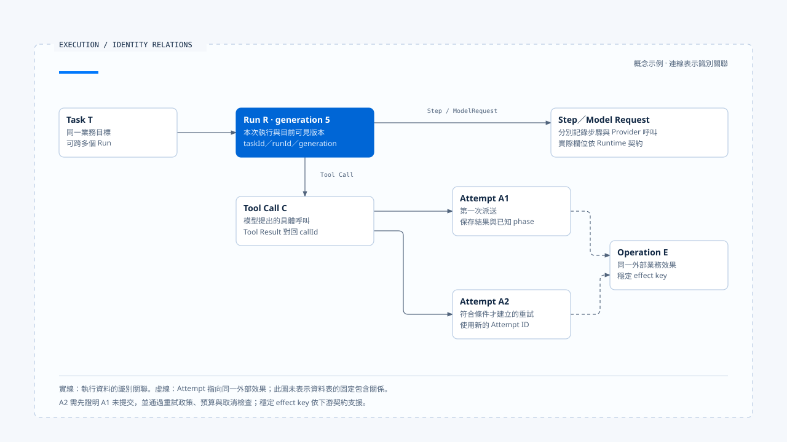

# Execution Identity 與狀態權威

[English](./02-execution-identity-and-state-authority.md) | [繁體中文](./02-execution-identity-and-state-authority-zh-TW.md)

> 以下內容所提到的
> CCB 為 [claude-code-best](https://github.com/claude-code-best/claude-code) 的簡稱。
> Chat Gun 為 [chat-gun](https://github.com/HsienW/chat-gun)。

使用者在同一個對話裡補了一句話，產品建立了新 Run；舊 Run 隨後才送回一個 progress event。若前端只看 Thread ID，它可能把舊進度畫到新任務上；若 finalizer 只知道「任務結束」，它甚至可能清掉新 Run 剛取得的 ownership。

這類錯誤出在系統沒有分清楚「同一個對話」「同一個目標」與「同一次執行」。Execution Identity 把這些關係變成可驗證欄位，讓 Runtime 在恢復、重試與接收晚到輸出時，能判斷資料的歸屬。

## 為什麼一個 ID 不夠

Conversation ID 可以定位對話歷史；進入執行流程後，系統還需要回答：

- 同一對話目前有幾次執行？
- 哪次執行正在等待確認？
- 這個 Tool Result 應接回哪個 Tool Call？
- Retry 是同一次業務操作的下一個 attempt，還是新的操作？
- 舊 Run 的事件能否更新現在的畫面？

取消、Resume 或並行會讓同一對話包含多段執行。各種識別需要各自記錄關聯，事件產生端與處理端才能直接核對資料屬於哪個範圍，減少依時間與文案推測的情況。

## 一組可檢查的識別關係

下表整理識別的概念與生命週期。Chat Gun 與 CCB 使用各自的 Schema，實際專案也可以採用別名或省略某一層；調整之前，仍要確認相應責任由誰承擔。

| Identity | 它識別什麼 | 常見生命週期 |
|---|---|---|
| Request ID | 一次進入產品或 API 的請求 | 從入口到回應或斷線 |
| Thread ID | 可延續的對話或 Graph 容器 | 跨多個 Run |
| Task ID | 使用者想完成的業務目標 | 可跨澄清、替換與恢復 |
| Run ID | Runtime 的一次執行實例 | 從 admission 到 terminal／waiting |
| Generation | 同一 Task 目前可見 owner 的版本 | 每次 claim 或 supersede 遞增 |
| Step ID | Run 內的一個可重放或可觀察步驟 | 模型節點、工具節點或工作流步驟 |
| Model Request ID | 一次 Provider 呼叫 | 從送出到完整結果或失敗 |
| Tool Call ID | 模型提出的一次具體工具呼叫 | 從提案到 Tool Result |
| Attempt ID | 某次工具或外部操作的執行嘗試 | 一次派送 |
| Operation／Effect ID | 外部系統中的同一業務效果 | 可跨 Runtime retry 與 crash |
| Event ID／Sequence | 一筆事件及其 Run 內順序 | 事件建立後保持不變 |

### Thread、Task 與 Run

Thread 保存可延續的對話或 Graph 狀態。Task 表示產品希望完成的目標，例如「整理報告」；Run 則是某次具體執行。使用者回答釐清問題時，系統可能在同一 Thread 內 Resume 原 Graph，也可能為同一 Task 建立新 Run，兩者取決於 Runtime 與產品契約。

核對識別時，要分別查明 Thread、Task、Run 與 attempt 的生命週期。文章與事件若只寫 session 或 turn，還需要追到建立與結束位置，才能判斷它對應哪一層執行。

### Tool Call、Attempt 與 Operation

模型重新提出相同參數，可能產生新的 Tool Call ID；Runtime 對同一 Tool Call retry，則可能建立新的 Attempt ID。若兩次嘗試都要代表同一筆退款或同一封通知，還需要穩定的 Operation／Effect Identity，讓下游可以去重或查詢。

這三層解決的問題不同：Tool Call 屬於模型訊息結構，Attempt 屬於執行紀錄，Operation 屬於外部業務效果。將它們都稱為 request ID，會讓 crash recovery 無法判斷「重新取得結果」與「再做一次」的差別。

## Identity Chain

一條完整關聯可以表示為：

~~~text
Request
  └─ Thread
      └─ Task
          └─ Run + Generation
              ├─ Model Request
              ├─ Step
              │   └─ Tool Call
              │       └─ Attempt
              │           └─ External Operation／Effect
              └─ Runtime Events + Sequence
~~~

各資料表可以依用途保存所需欄位，每個交接邊界則需保留足以驗證上下游關係的識別：

- Tool Result 對回 Tool Call。
- Approval 對回 Run、resource 與 pending decision。
- UI activity 核對 Run 與目前 generation。

[開啟 HTML 圖解](../../assets/agent-runtime/foundations/02-execution-identity-and-state-authority/02-execution-identity-relations.html)

這張圖聚焦 Tool Call 以下的識別。兩次 Attempt 可以關聯同一外部效果，但是否能重試、沿用哪個 effect key，仍需由效果證據與下游契約判定。連線只表示概念關聯，不限定資料表的包含關係。

## 狀態權威與資料副本

同一個 Run 會出現在 Graph State、Task Repository、Event Store、UI reducer 與 Log 中。資料可以有多份，改變 Runtime 真實狀態的權力只能有一個來源；其他副本是 Projection、Cache 或 Evidence。

| 狀態 | 權威來源 | 其他副本的用途 |
|---|---|---|
| Run lifecycle | Runtime／Agent Server | UI、Metrics 與 Audit 投影 |
| Thread／Graph state | Graph Runtime／Checkpointer | Transcript 或產品索引 |
| 業務 Task 與目前 owner | Task／Ownership Repository | UI 顯示與排隊資訊 |
| Tool execution | Tool Runtime／runner | Progress Event、Trace |
| 外部 Business Effect | 下游系統與 Side-effect Ledger | Runtime result、Audit |
| Human Approval | Approval／Confirmation Store | Interrupt 顯示與 Resume command |
| 可見 generation | Ownership Repository | Client reducer 的 stale event guard |

UI 根據事件更新顯示，Run 的合法轉移仍由 Runtime 判定；Log 記錄工具開始，外部 Commit 則由下游結果與效果證據確認。每種事實都應有明確的判定來源，即使資料分散在不同資料庫，仍可維持這項分工。

## Generation 解決哪一類競態

Run ID 能分辨兩次執行，generation 則幫助 consumer 判斷哪次執行目前擁有可見權。假設 Task T 先由 Run A 取得 generation 4，後來 Run B supersede 它並取得 generation 5；Run A 的網路請求可能尚未停止，事件也可能在 B 開始後才抵達。

此時 consumer 應核對 `(taskId, runId, generation)`：

1. A 的 late progress 帶 generation 4，UI reducer 不再把它設成目前活動。
2. A 的 finalizer 只能 release 自己持有的 generation 4，不能清掉 B 的 generation 5。
3. B 的事件帶 runId B 與 generation 5，才能更新目前可見狀態。

Generation 用來阻止舊 owner 清理新 owner。若產品同時要停止 A 的 I/O，還需呼叫 Runtime cancel／abort，並判讀派送後效果；ownership replacement 與 execution cancellation 各有自己的控制點。

## Chat Gun 的 ownership 路徑

固定版本的 `backend/src/runtime/interaction/ownership.ts` 將 Task、Run 與 generation 放進 ownership repository，支援 claim、terminal 更新與 transactional supersede。`query-guard.ts` 則在輸入到派送的間隙保存 reservation，並以 owner 與 generation 條件釋放。

這兩個模組處理的範圍不同。Ownership Repository 提供跨請求的 durable authority；Query Guard 管理本地查詢與派送保留。只有本地 lock 而沒有 durable owner，多實例時仍可能同時啟動；只有 durable owner 而沒有 generation-aware cleanup，舊 finalizer 仍可能誤清新狀態。

既有測試包含 ownership claim／supersede 與 stale finalizer 類型的案例。這表示來源庫安排了相應控制與回歸情境；本文沒有重新執行測試，也不把 repository mock 推論成正式資料庫在隔離級別、連線中斷與 Worker crash 下皆已驗證。

## Runtime Event 如何攜帶關聯

事件至少要回答「誰、在哪次執行、做了什麼、順序如何」。概念封套可以寫成：

~~~ts
interface RuntimeEvent<T> {
  schemaVersion: string;
  eventId: string;
  requestId?: string;
  threadId: string;
  taskId?: string;
  runId: string;
  generation?: number;
  sequence: number;
  type: string;
  emittedAt: string;
  payload: T;
}
~~~

`eventId` 支援單筆去重，`sequence` 用來判斷同一 Run 內的順序；兩者不等價。跨 partition 或跨 Run 的事件未必有全域順序，consumer 不應拿 wall-clock timestamp 取代明確 sequence。

Chat Gun 的 `agent-runtime-events.ts` 與 interaction event 模組提供關聯與對外封套，前端 activity state 及 task reducer 再依 Run、generation 與 terminal 狀態更新 Projection。這條路徑的保護範圍需要逐 consumer 核對；某一類 activity event 有 generation guard，不代表所有文字 chunk、callback 與 BFF 轉送都自動具備同一檢查。

## CCB 的 Session、Query 與 Tool Use

CCB 的 `query.ts` 以 messages、tool use／result block、turn 與 Abort 推進一次 query loop；`QueryEngine.ts` 則為 Headless／SDK 保存跨 submit 的 conversation state。這套結構可以追到哪個 Tool Result 對應哪個 Tool Use，也能在 abort 後修復未配對訊息。

CCB 的本地 Interactive 流程主要面對單程序 Session；Chat Gun 則處理 Browser、BFF、遠端 Graph、Task ownership 與 UI late event。對照兩者時，可以沿著「誰持有目前執行」「舊輸出如何被拒絕」追蹤各自的實作，再說明欄位與生命週期的差異。

## Retry、Resume、Replay 與 Supersede

這四個詞都可能產生另一段執行，Identity 卻不該被任意沿用：

| 動作 | 應保持的關聯 | 通常會改變的識別 |
|---|---|---|
| Retry | 原 Tool Call／Operation、retry policy 與 budget | Attempt ID |
| Resume | Thread／waiting manifest／原 Task | Run 是否沿用依 Runtime 契約而定 |
| Replay | 原始輸入、manifest 與 replay reason | 新 Run／Event／Attempt；外部 effect key 視政策而定 |
| Supersede | Task 與被替換 owner 的關係 | Run ID、generation |

同一個 Operation ID 是否可以跨 retry 沿用，要看下游 idempotency 契約；若外部系統不支援去重，重用一串字也不會自然產生 exactly-once。Resume 是否沿用 Run ID，同樣不能從「恢復同一任務」推論，需要看 Agent Server 與產品 wrapper 的實際 API。

## 常見的 Identity 錯誤

### 只使用 Thread ID

舊 Run 與新 Run 的事件進入同一對話後，UI 無法判斷目前 owner，取消也可能命中錯誤執行。

### 用 Message ID 代替 Tool Call ID

一則 assistant message 可以含有多個 Tool Call。只關聯 message，Tool Result 的順序、拒絕與 retry 都會失去精確目標。

### Retry 建立新 Operation

Runtime timeout 後再次派送，若每次都生成新的業務 effect key，下游即使支援 idempotency 也無法去重。

### Resume 只核對 Interrupt ID

Interrupt ID 對得上，仍可能來自錯誤 Principal、Tenant、Scope 或已過期 manifest。恢復處理端要核對這組可信關聯，確認回覆者與等待目標一致。

### Event 只有 timestamp

多程序的時間可能偏移，網路也會重排。沒有 Run-scoped sequence 或明確 terminal guard，晚到事件就可能覆蓋新狀態。

## 如何驗證 Identity 與權威真的成立

### Contract Test

- 缺少 Run ID、Tool Call ID 或必要 correlation 時拒絕事件與結果。
- Schema version 未知時不進入正常 consumer。

### Concurrency Test

- 兩個 Run 同時 claim 同一 Task，只允許符合 policy 的 owner 成功。
- Supersede 後，舊 finalizer 不能 release 新 generation。

### Replay Test

- 相同 Event ID 重送不重複套用。
- 相同 Resume 或 Approval 只能被合法消費一次。

### Late Event Test

- Terminal 後收到 progress 不復活 Run。
- 舊 generation 的活動不覆蓋新 owner。

### Effect Correlation Test

- Tool Call、Attempt、replay key 與 external operation 可以串回同一 Task／Run。
- 外部結果不明時，reconciliation 以原 Operation 查詢既有效果。

## 本篇的工程判斷

Execution Identity 讓 Runtime 在狀態轉移前核對目前 owner、結果所屬的呼叫，以及重試或恢復是否仍在處理同一項外部效果。每個識別都應對應到具體檢查位置。

寫入端、finalizer、Resume handler 與顯示層都要在處理前核對 identity。Trace 可以串起這些檢查，Log 可以留下結果；只有把核對放進正式處理路徑，系統才能拒絕舊事件與錯綁回覆。

## 實作參照與適用範圍

### [Chat Gun](https://github.com/HsienW/chat-gun)

- `backend/src/runtime/interaction/ownership.ts`
- `backend/src/runtime/interaction/ownership.test.ts`
- `backend/src/runtime/input/query-guard.ts`
- `backend/src/runtime/input/query-guard.test.ts`
- `backend/src/platform/agent-runtime-events.ts`
- `backend/src/runtime/interaction/events.ts`
- `backend/src/runtime/side-effect/identity.ts`
- `frontend/src/lib/stream-activity-state.ts`
- `frontend/src/lib/task-event-reducer.ts`

### [Claude Code Best](https://github.com/claude-code-best/claude-code)

- `src/query.ts`
- `src/QueryEngine.ts`
- `src/utils/QueryGuard.ts`
- `src/services/tools/toolExecution.ts`

來源版本沿用本區 README 的固定 commit。本文使用的識別樹是跨實作概念模型，不聲稱任一來源庫完整實作所有欄位；既有單元測試也不能代替多程序、正式資料庫與真實外部系統的競態驗證。

## 接續閱讀

- [Run Loop 與狀態轉移](./03-run-loop-and-state-transitions-zh-TW.md)
- [Run 歸屬與可見狀態](../../agent-harness/interaction-and-feedback/02-run-ownership-and-visible-state-zh-TW.md)
