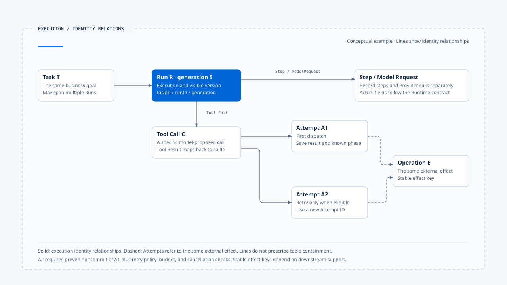

# Execution Identity and state authority

[English](./02-execution-identity-and-state-authority.md) | [繁體中文](./02-execution-identity-and-state-authority-zh-TW.md)

A user adds a sentence in the same conversation, and the product creates a new Run; a progress event from the old Run arrives afterward. If the frontend checks only the Thread ID, it may display old progress on the new task; if the finalizer knows only that "the task ended," it may even clear the ownership the new Run just acquired.

These errors arise when the system fails to distinguish the same conversation, the same goal, and the same execution. Execution Identity makes these relationships verifiable fields so the Runtime can determine where data belongs during recovery, retries, and the arrival of late output.

## Why one ID is insufficient

A Conversation ID locates conversation history; once execution begins, the system also needs to answer:

- How many executions currently belong to this conversation?
- Which execution is waiting for confirmation?
- Which Tool Call should receive this Tool Result?
- Is this retry the next attempt at the same business operation, or a new operation?
- May an event from the old Run update the current display?

Cancellation, Resume, or concurrency can introduce multiple execution segments within a conversation. Each identity needs explicit correlation so event producers and handlers can check the scope of data directly instead of inferring it from timing or wording.

## A set of verifiable identity relationships

The table below summarizes identity concepts and lifecycles. Chat Gun and CCB use their own Schemas, and a project may adopt aliases or omit a layer; before making those adjustments, it must still establish who handles the corresponding responsibility.

| Identity | What it identifies | Typical lifecycle |
|---|---|---|
| Request ID | One request entering the product or API | From entry to response or disconnection |
| Thread ID | A continuing conversation or Graph container | Across multiple Runs |
| Task ID | The business goal the user wants to accomplish | May span clarification, replacement, and recovery |
| Run ID | One Runtime execution instance | From admission to terminal/waiting |
| Generation | The version of the currently visible owner of a Task | Increments with each claim or supersede |
| Step ID | One replayable or observable step within a Run | A model node, tool node, or workflow step |
| Model Request ID | One Provider call | From sending to a complete result or failure |
| Tool Call ID | One specific tool call proposed by the model | From proposal to Tool Result |
| Attempt ID | One execution attempt for a tool or external operation | One dispatch |
| Operation/Effect ID | The same business effect in an external system | May span Runtime retries and crashes |
| Event ID/Sequence | One event and its ordering within a Run | Remains unchanged after event creation |

### Thread, Task, and Run

A Thread stores a continuing conversation or Graph state. A Task represents the product goal, such as "prepare a report"; a Run is a specific execution. When a user answers a clarification question, the system may Resume the original Graph within the same Thread or create a new Run for the same Task, depending on the Runtime and product contract.

When checking identities, determine the separate lifecycles of Thread, Task, Run, and attempt. If an article or event uses only session or turn, trace where it is created and ended to establish which execution layer it represents.

### Tool Call, Attempt, and Operation

When a model proposes the same arguments again, it may generate a new Tool Call ID; when the Runtime retries the same Tool Call, it may create a new Attempt ID. If both attempts must represent the same refund or notification, a stable Operation/Effect Identity is also needed so the downstream system can deduplicate or query it.

These three layers address different concerns: Tool Call belongs to the model message structure, Attempt to execution records, and Operation to external business effects. Calling all three a request ID prevents crash recovery from distinguishing retrieval of an existing result from execution of the operation again.

## Identity Chain

A complete correlation can be represented as:

~~~text
Request
  └─ Thread
      └─ Task
          └─ Run + Generation
              ├─ Model Request
              ├─ Step
              │   └─ Tool Call
              │       └─ Attempt
              │           └─ External Operation／Effect
              └─ Runtime Events + Sequence
~~~

Each table can store the fields it needs, while each handoff boundary must retain enough identity information to verify upstream and downstream relationships:

- Tool Result maps back to Tool Call.
- Approval maps back to Run, resource, and pending decision.
- UI activity checks Run and the current generation.

[Open the HTML diagram](../../assets/agent-runtime/foundations/02-execution-identity-and-state-authority/02-execution-identity-relations-en.html)

This diagram focuses on identity from Tool Call downward. Two Attempts can refer to the same external effect, but effect evidence and the downstream contract still determine whether retry is allowed and which effect key to retain. Lines indicate conceptual relationships without prescribing containment between tables.

## State authority and data copies

The same Run appears in Graph State, Task Repository, Event Store, UI reducers, and Logs. Data may have multiple copies, but only one source may authorize changes to the Runtime's actual state; the other copies serve as Projections, Caches, or Evidence.

| State | Authoritative source | Purpose of other copies |
|---|---|---|
| Run lifecycle | Runtime/Agent Server | UI, Metrics, and Audit projections |
| Thread/Graph state | Graph Runtime/Checkpointer | Transcript or product indexes |
| Business Task and current owner | Task/Ownership Repository | UI display and queue information |
| Tool execution | Tool Runtime/runner | Progress Events, Traces |
| External Business Effect | Downstream system and Side-effect Ledger | Runtime results, Audit |
| Human Approval | Approval/Confirmation Store | Interrupt display and Resume commands |
| Visible generation | Ownership Repository | Stale event guards in client reducers |

The UI updates its display from events, while the Runtime determines valid Run transitions; a Log records a tool starting, while downstream results and effect evidence confirm an external Commit. Each fact needs a clear source for determination, even when data lives in different databases.

## Which races Generation addresses

Run ID distinguishes two executions, while generation helps consumers identify the execution that currently owns visibility. Suppose Run A first claims generation 4 for Task T, then Run B supersedes it and acquires generation 5; Run A's network requests may still be active, and its events may arrive after B has started.

Consumers should then check `(taskId, runId, generation)`:

1. A's late progress carries generation 4, so the UI reducer no longer makes it the current activity.
2. A's finalizer may release only the generation 4 it owns; it cannot clear B's generation 5.
3. B's events must carry runId B and generation 5 to update the current visible state.

Generation prevents an old owner from cleaning up a new owner. If the product also needs to stop A's I/O, it must invoke Runtime cancel/abort and assess effects after dispatch; ownership replacement and execution cancellation have separate control points.

## Chat Gun's ownership path

In the pinned version, `backend/src/runtime/interaction/ownership.ts` stores Task, Run, and generation in an ownership repository and supports claim, terminal updates, and transactional supersede. `query-guard.ts` retains reservations between input and dispatch and releases them under owner and generation conditions.

The two modules have different scopes. The Ownership Repository provides durable authority across requests; the Query Guard manages local queries and dispatch reservations. A local lock without a durable owner may still allow simultaneous starts across instances; a durable owner without cleanup that checks generation may still let an old finalizer clear new state.

Existing tests include ownership claim/supersede and stale finalizer cases. This shows that the source repository includes corresponding controls and regression scenarios; this article does not rerun those tests or treat repository mocks as verification of production database behavior under isolation levels, connection loss, and Worker crashes.

## How Runtime Events carry correlation

An event must at least identify who acted, which execution it belongs to, what happened, and its order. A conceptual envelope can be written as:

~~~ts
interface RuntimeEvent<T> {
  schemaVersion: string;
  eventId: string;
  requestId?: string;
  threadId: string;
  taskId?: string;
  runId: string;
  generation?: number;
  sequence: number;
  type: string;
  emittedAt: string;
  payload: T;
}
~~~

`eventId` supports deduplication of individual events, while `sequence` determines ordering within one Run; they are different mechanisms. Events across partitions or Runs may lack a global order, so consumers should not replace explicit sequence with wall-clock timestamps.

Chat Gun's `agent-runtime-events.ts` and interaction event modules provide correlation and external envelopes; frontend activity state and task reducers update Projections using Run, generation, and terminal state. The protection offered by this path must be checked for each consumer; a generation guard on one activity event type does not establish the same checks for every text chunk, callback, or BFF relay.

## CCB's Session, Query, and Tool Use

CCB's `query.ts` advances a query loop through messages, tool use/result blocks, turns, and Abort; `QueryEngine.ts` retains conversation state across submissions for Headless/SDK mode. This structure supports tracing each Tool Result to its Tool Use and repairing unpaired messages after abort.

CCB's local Interactive flow primarily handles Sessions within a single process; Chat Gun handles Browser, BFF, remote Graphs, Task ownership, and late UI events. Comparing them requires tracing who owns current execution and how stale output is rejected, then explaining the differences in fields and lifecycles.

## Retry, Resume, Replay, and Supersede

All four actions may create another execution segment, but they must preserve or replace Identity deliberately:

| Action | Correlation to preserve | Identities that usually change |
|---|---|---|
| Retry | Original Tool Call/Operation, retry policy, and budget | Attempt ID |
| Resume | Thread/waiting manifest/original Task | Whether Run is retained depends on the Runtime contract |
| Replay | Original input, manifest, and replay reason | New Run/Event/Attempt; external effect key depends on policy |
| Supersede | Task and its relationship to the replaced owner | Run ID, generation |

Whether the same Operation ID can survive a retry depends on downstream idempotency contracts; reusing a string cannot produce exactly-once behavior if the external system lacks deduplication. Likewise, retaining the Run ID on Resume cannot be inferred from "resuming the same task"; it requires checking the actual Agent Server and product wrapper APIs.

## Common Identity errors

### Using only Thread ID

When events from old and new Runs enter the same conversation, the UI cannot identify the current owner, and cancellation may target the wrong execution.

### Replacing Tool Call ID with Message ID

One assistant message may contain multiple Tool Calls. Correlating only the message removes the precise target needed for Tool Result ordering, rejection, and retry.

### Creating a new Operation on retry

If the Runtime generates a new business effect key each time it dispatches after a timeout, even a downstream system that supports idempotency cannot deduplicate the operation.

### Checking only Interrupt ID on Resume

A matching Interrupt ID may still come from the wrong Principal, Tenant, Scope, or an expired manifest. The recovery handler must check this trusted correlation to establish that the responder matches the waiting target.

### Giving an Event only a timestamp

Clocks across processes may drift, and networks may reorder delivery. Without a sequence scoped to the Run or an explicit terminal guard, late events can overwrite new state.

## How to verify Identity and authority

### Contract Test

- Reject events and results missing Run ID, Tool Call ID, or required correlation.
- Keep unknown Schema versions out of normal consumers.

### Concurrency Test

- When two Runs claim the same Task concurrently, allow only the owner permitted by policy to succeed.
- After Supersede, prevent the old finalizer from releasing the new generation.

### Replay Test

- Redelivery of the same Event ID does not apply the event twice.
- The same Resume or Approval can be validly consumed only once.

### Late Event Test

- Progress received after Terminal does not revive the Run.
- Activity from an old generation does not overwrite the new owner.

### Effect Correlation Test

- Tool Call, Attempt, replay key, and external operation can be traced to the same Task/Run.
- When the external outcome is unknown, reconciliation queries the original Operation for existing effects.

## Engineering judgment

Execution Identity lets the Runtime check the current owner, the call to which a result belongs, and whether a retry or recovery still concerns the same external effect before changing state. Each identity should correspond to a concrete check.

Writers, finalizers, Resume handlers, and display layers must all check identity before processing. Traces can connect these checks, and Logs can retain their results; checks must sit in production handling paths for the system to reject stale events and incorrectly bound responses.

## Implementation references and scope

### [Chat Gun](https://github.com/HsienW/chat-gun)

- `backend/src/runtime/interaction/ownership.ts`
- `backend/src/runtime/interaction/ownership.test.ts`
- `backend/src/runtime/input/query-guard.ts`
- `backend/src/runtime/input/query-guard.test.ts`
- `backend/src/platform/agent-runtime-events.ts`
- `backend/src/runtime/interaction/events.ts`
- `backend/src/runtime/side-effect/identity.ts`
- `frontend/src/lib/stream-activity-state.ts`
- `frontend/src/lib/task-event-reducer.ts`

### [Claude Code Best](https://github.com/claude-code-best/claude-code)

- `src/query.ts`
- `src/QueryEngine.ts`
- `src/utils/QueryGuard.ts`
- `src/services/tools/toolExecution.ts`

Source versions use the pinned commits in this section's README. The identity tree in this article is a conceptual model across implementations; it does not claim that either repository implements every field. Existing unit tests also cannot replace concurrency verification across processes, production databases, and real external systems.

## Further reading

- [Run Loop and state transitions](./03-run-loop-and-state-transitions-zh-TW.md)
- [Run ownership and visible state](../../agent-harness/interaction-and-feedback/02-run-ownership-and-visible-state-zh-TW.md)
