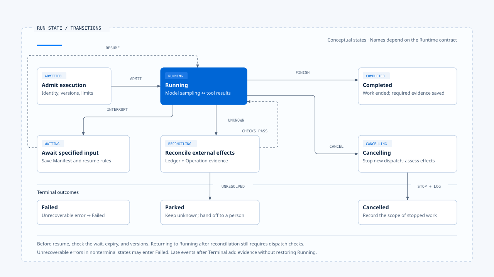
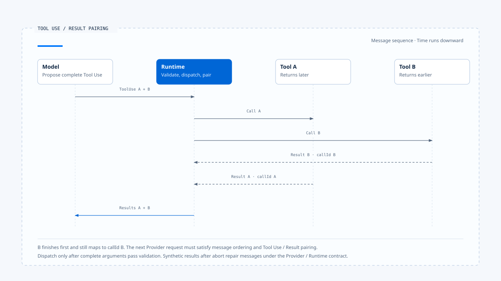

# Run Loop 与状态转移

[English](./03-run-loop-and-state-transitions.md) | [繁體中文](./03-run-loop-and-state-transitions-zh-TW.md) | [简体中文](./03-run-loop-and-state-transitions-zh-CN.md)

> 以下内容所提到的
> CCB 为 [claude-code-best](https://github.com/claude-code-best/claude-code) 的简称。
> Chat Gun 为 [chat-gun](https://github.com/HsienW/chat-gun)。

模型返回一段文字后，Runtime 可能还在处理工具或保存状态；模型提出 Tool Call 后，也要等待授权与派送。Run Loop 依序处理这些中间结果，直到执行进入完成、失败、取消、拒绝或可恢复的等待状态。

若系统只用 `isLoading` 表示全部过程，模型流式传输、工具调度与人工等待都会共用同一个布尔值。Runtime 需要更明确的状态，才能判断下一步是否合法，以及外部操作是否仍在进行。

## Run Loop 管理的是状态与下一步

Agent Loop 常被缩写成：

~~~text
呼叫模型 → 执行工具 → 把结果送回模型 → 重复
~~~

这段描述呈现模型与工具的主循环。每次准备执行下一步前，Runtime 还要核对：

- Run 是否已取消或正在等待外部输入。
- Tool Call 是否获准。
- Budget 是否耗尽、Deadline 是否已到。
- 前一步结果是否已完成必要的持久化。

这些条件共同决定 Runtime 能否继续，也影响中断后可以从哪里恢复。

概念上可以写成：

~~~ts
while (!state.isTerminal) {
  assertRunOwnership(state);
  enforceDeadlineAndBudget(state);
  observeCancellation(state);

  const next = decideNextStep(state);

  if (next.kind === "wait") return persistInterrupt(next);
  if (next.kind === "model") state = await runModel(next);
  if (next.kind === "tools") state = await runTools(next);
  if (next.kind === "finish") state = commitTerminal(next);
}
~~~

上述代码示意 Runtime 需要承担的责任。Imperative loop 可以直接写成循环，Graph Runtime 则把 `decideNextStep()` 分散在 node、edge、command 与 interrupt；实际实现各有不同，仍需维持这些执行条件。

## 概念状态

本文以几组概念状态说明合法转移。阅读 Chat Gun 或 CCB 时，仍须对回各自的 enum、Graph State 与返回值。

| 状态 | Runtime 可以做什么 | 不应发生的事 |
|---|---|---|
| Admitted | 建立 Run、验证 manifest 与必要依赖 | 尚未接纳便发出已开始事件 |
| Running | 调用模型、调度工具、写入进度 | 忽略取消或继续超出 Budget |
| Waiting | 保存 checkpoint／interrupt，等待指定输入 | 接受任意新消息直接续跑 |
| Cancelling | 停止新派送，传播 abort，处理已开始工作 | 宣称已取消就代表外部效果不存在 |
| Reconciling | 查询 Ledger 与外部 Operation | 在效果不明时直接重试 |
| Terminal | 回报 Completed、Cancelled、Failed 或其他终止判定 | 被晚到 progress 或旧 finalizer 改回 Running |

- 图中整理概念状态与主要转移，具体名称依 Runtime 契约而定。回查后重新进入 Running，仍需核对后续派送条件；终止后取得的新证据保存在效果记录中。
- [开启图解与实现注记](../../assets/agent-runtime/foundations/03-run-loop-and-state-transitions/03-run-state-transitions-en.html)。

Waiting 是否算 Terminal，要看产品与 Runtime 契约。对一次 HTTP 请求而言，等待可能是本次回应的终点；对一个可持久化 Task 而言，它仍是可恢复的非终止状态。文章与 API 必须说明自己的观察范围，不能只看到请求结束就把 Task 标成 Completed。

## 从模型请求到下一个 Step

### 准备模型输入

Runtime 从 Graph State 或 message history 取得本次可见内容，加入 Harness 已选定的 system prompt、Context 与 Tool descriptors，再套用模型与 Token 限制。Harness 持有 Context 的来源权威与选取规则，Runtime 依契约送出内容，并记录实际使用的版本。

模型请求至少应关联 Run、Step、Model Request 与 manifest。Provider timeout 或格式失败时，Runtime 才能知道哪次请求需要失败、retry 或使用已允许的 fallback。

### 接收与整理流式传输

Provider 可能先送 text delta、thinking／reasoning metadata、tool use delta、usage，最后才形成完整 assistant message。Runtime 可以把安全的进度转成 Event，却不能让 UI delta 直接成为权威 message；若流式传输中断，还要判断已有内容能否保存、工具区块是否完整，以及是否允许再次取样。

### 流式传输中断与不完整输出

已送到用户的文字可以保留为进度，进入下一轮的 assistant message 仍要通过结构检查。Tool use block 若缺少参数结尾，Runtime 应将它标为不完整输出，停止派送并依策略处理。

### 判断模型结果

完整模型结果通常分成几类：

- 只有一般内容，且没有其他待处理工作，可以进入完成判断。
- 包含 Tool Call，先保存消息与调用识别，再进入工具路径。
- 输出需要 Clarification，经产品契约保存等待原因与恢复条件。
- 格式不合法、Provider 失败或 Budget 耗尽，进入失败、fallback 或受限回复。

模型说「完成」只是内容。Runtime 仍要确认没有未完成 Tool Call、未写入 checkpoint、未处理取消及效果不明的操作，才可以提交 Completed。

## Tool Call 如何回到 Loop

Tool Call 必须保留模型产生的 call ID、工具名称与输入，Runtime 再进行以下处理：

1. 核对 Tool 是否存在于本次 Capability Set。
2. 验证输入 Schema 与可信 Execution Context。
3. 向 Harness 的 Authorization／Confirmation Port 取得决策。
4. 依 scheduler、concurrency、lock、rate limit 与 execution profile 派送。
5. 将 typed outcome 转成模型可消费且仍可追踪的 Tool Result。

若任一步拒绝，Runtime 要保留具体原因。模型取得输入不合法、未授权、已取消、未提交或效果不明等结果后，才能决定改写提案、向用户说明或停止。

### 并行结果与消息顺序

多个工具并行时，完成顺序可能与提案顺序不同。Runtime 回写消息时，仍须遵守 Provider 的 tool use／result contract，并保留每笔 call ID。少一笔结果或插入不合法消息，都可能让下一次模型请求被拒绝。

[开启 HTML 图解](../../assets/agent-runtime/foundations/03-run-loop-and-state-transitions/03-tool-use-result-pairing-en.html)

图中 B 比 A 早完成；Runtime 依 call ID 保留配对，收齐本轮所需的合法结果后，再组装下一次模型请求。结果在请求内的排列仍依 Provider 契约决定。

## CCB 的 imperative query loop

固定版本的 `src/query.ts` 直接呈现 while-loop 形状：外层准备 QueryParams，内层依 messages 调用模型、检查 tool use、交给 `runTools`，再把结果接回下一轮。AsyncGenerator 向调用者送出 message、progress 与结果，AbortSignal、turn count、task budget 与 compaction 也在这条路径被消费。

`toolOrchestration.ts` 会把被证明可安全并行的工具分组，其余工具保守地序列执行。这解决单次 query 内的调度顺序，并不等于跨进程资源锁；若两个独立 query 同时改同一文件，仍需更高层 ownership 或工具本身的冲突控制。

### Abort 后的消息修复

Query 被 abort 时，message history 可能留下没有 Tool Result 的 tool use。CCB 会处理这类未配对消息，维持后续请求的对话结构；若直接保留不完整历史，下一次 Provider request 可能因违反消息契约而失败。

## Chat Gun 的 Graph loop

Chat Gun 的 `mcp-agent.ts` 以 node 与 conditional edge 表达相同责任。模型调用后，Graph 检查是否有 Tool Call；具体调用先进 authorization gate，需要确认时转到 confirmation，获准后才进 physical dispatch，完成的 ToolMessage 再回到模型节点。

Graph 表达等待与分支，相关控制则由组装设置与 adapter 提供。核对时要继续追踪 Authorization 的可信 Principal、confirmation store 的持久化方式、tool dispatch pipeline 的启用条件，以及外部效果的 reconciliation 能力。

`deep-researcher.ts` 展示另一种分支：Planner 可以把输入导向 direct、weather、calculation、research 或 clarify。Clarify 使用 interrupt 停下 Graph；恢复后仍要通过回复 Schema 与任务条件。语义 Router 决定下一个业务 node，不能取代 Runtime 的并发锁、ownership 或 terminal guard。

## Turn、Step、Run 与 Task

一次 Task 可以有多个 Run，一个 Run 可以有多个模型 turn，一个 turn 也可能产生多个 Tool Call。命名在各框架间不一致，写限制时要把量测单位说清楚：

| 限制 | 防止的问题 | 常见误解 |
|---|---|---|
| Max turns | 模型与工具无止境循环 | 不一定限制单一 turn 内的并行工具数 |
| Token budget | Context 或生成成本失控 | 不等于美元成本上限 |
| Deadline | 整次 Run 超过可接受时间 | 不表示外部 I/O 已被撤销 |
| Tool attempt budget | 单一效果反覆派送 | 不等于模型不能重新提出另一个 Tool Call |
| Task budget | 跨多个 Step 或 subtask 的总限制 | 实现需说明是否跨 Run 保存 |

Budget 要在执行前具体化，Runtime 每次准备调用 Provider 或 Tool 时扣除或保留额度。等到回应完成才发现超限，已经无法阻止成本或副作用。

## Retry 与下一轮模型提案不同

工具失败后，模型可能根据 Tool Result 改用另一组参数；Runtime 也可能在不回到模型的情况下 retry 同一 Attempt。前者是新的行动提案，后者是执行策略，两者应有不同 Budget 与 Evidence。

只有已确认未提交、错误被分类为 retryable、剩余 Budget 足够且取消尚未生效时，Runtime 才适合自动 retry。派送后效果不明必须先 reconcile；否则「再试一次」很容易变成做两次。

### 模型 fallback 的条件

换模型可能改变 Tool Calling、Context Window 或 Structured Output 能力。Harness 应先提供允许的替代策略，Runtime 再依 Provider 失败类型判断是否切换，并记录新请求使用的模型与版本。

## 取消如何进入状态机

Cancel Command 改变 Runtime 对后续工作的允许范围。Runtime 先停止新的模型与工具派送，向可取消的工作传递 AbortSignal，再等待或判读已开始的操作；已提交的外部效果仍需保留与处理。

| 取消时点 | Runtime 可以做的事 |
|---|---|
| 模型请求前 | 不送出请求，收敛为 Cancelled。 |
| 模型流式传输中 | abort transport，保存必要事件并判读 Provider 结果。 |
| 工具派送前 | 不调用底层工具，记录 cancelled before dispatch。 |
| 外部 I/O 中 | 尝试 abort；效果仍可能成功、失败或未知。 |
| 外部 Commit 后 | 不宣称撤销，改走 reconciliation 或 compensation。 |
| Waiting 中 | 关闭等待或建立取消决策，避免后续 Resume 复活旧工作。 |

UI 的停止按钮可以同时中止流式传输连接与提交 business cancel，两条路径仍要分开追踪。关掉浏览器 response body，并不保证远端 Run 或工具已停止。

## Terminal Result 要表达什么

Terminal Result 是 Runtime 对 Run 的最后判定。概念字段可以包含：

~~~ts
interface TerminalResult {
  runId: string;
  status: "completed" | "cancelled" | "failed" | "rejected" | "parked";
  reasonCode?: string;
  finalMessageId?: string;
  usage: ExecutionUsage;
  evidenceRefs: string[];
}
~~~

若 Waiting 被建模成可恢复的非终止状态，API 结束回应时就要保留 Task／Run 的等待原因，避免将它标成 `completed`。Status 与 reason code 供程序判读，Harness 再依结果产生显示文案。

### 终止后的晚到结果

Terminal State 必须单向收敛。Completed 之后收到旧 progress，可以保留为 Audit Evidence 或丢弃，不能把状态改回 Running。Cancelled 之后若查到外部效果已 Commit，则建立 effect reconciliation 结果，保留原 Run 的取消判定与后来取得的证据。

## 失败从哪一层回来

| 失败 | Runtime 应保留的语义 | 后续可能动作 |
|---|---|---|
| Provider unavailable | 模型请求未完成 | 依已允许 policy retry／fallback／fail |
| Malformed model output | 无法建立合法消息或 Tool Call | 修复、重新取样或 fail |
| Tool input invalid | 未进入实际派送 | Tool Result 回灌或拒绝 |
| Authorization denied | 政策不允许 | 不派送，让模型／产品说明 |
| Timeout before dispatch | 明确未提交 | 符合条件时 retry |
| Timeout after dispatch | 效果不明 | Reconcile，不能盲目 retry |
| Cancel observed | 停止新工作 | 判读 in-flight effect 后收敛 |
| Budget exhausted | 不再新增模型／工具工作 | 受限回复或 Failed |
| Event delivery failed | 执行状态未必失败 | 重送事件或由 consumer replay |

把这些情况全部包成 Exception 丢到最外层，会同时失去 retry eligibility、用户说明与运营证据。Runtime 需要 typed outcome，模型可见的 Tool Result 则是它的一种投影。

## 如何验证状态转移

### Transition Test

- Running 可以进入 Waiting、Cancelling 或 Terminal。
- Terminal 收到一般 progress、late Tool Result 或旧 finalizer 时拒绝改变状态。

### Budget Test

- 每次 Provider／Tool 派送前检查剩余额度。
- Retry 与模型新提案分别计算，不靠同一个模糊 counter。

### Cancellation Test

- 派送前取消时底层工具未被调用。
- 派送后取消保留 outcome，不把 abort 当成外部未提交证据。

### Message Contract Test

- 每个 tool use 都有对应 result 或明确 repair。
- 多工具完成顺序改变时，下一次模型请求仍符合 Provider Schema。

### Late Event Test

- Terminal 后的 delta／progress 不复活 Run。
- 不同 generation 的事件不更新目前可见 activity。

## 本篇的工程判断

检查 Run Loop 时，应核对每次循环前后的合法状态、剩余 Budget 与执行结果。模型输出、工具结果与用户输入都可能改变下一步，Runtime 的 state authority 再依契约判定能否继续。

Graph 以 node 与 edge 表达分支，while-loop 则直接呈现控制流。采用任一方式，都要把取消、Tool Result 关联与 terminal guard 放进正式路径，才能在故障与晚到事件出现时维持一致状态。

## 实现参照与适用范围

### [Claude Code Best](https://github.com/claude-code-best/claude-code)

- `src/query.ts`
- `src/QueryEngine.ts`
- `src/services/tools/toolOrchestration.ts`
- `src/services/tools/toolExecution.ts`
- `src/services/api/claude.ts`

### [Chat Gun](https://github.com/HsienW/chat-gun)

- `backend/src/agents/mcp-agent.ts`
- `backend/src/agents/deep-researcher.ts`
- `backend/src/runtime/tool-dispatch/pipeline.ts`
- `backend/src/runtime/tool-dispatch/scheduler.ts`
- `backend/src/runtime/side-effect/governed-outcome.ts`
- `backend/src/platform/agent-runtime-events.ts`

本文以固定版本源代码与既有测试安排说明；表中的状态用来对照责任，具体名称依各来源库而定。本轮没有执行真实 Provider、外部 MCP、跨进程 cancellation 或数据库故障演练。

## 接续阅读

- [持久化、Interrupt 与 Resume](./04-persistence-interrupt-and-resume-zh-CN.md)
- [重试与副作用处理](../../agent-harness/action-governance/05-retry-and-side-effects-zh-CN.md)
