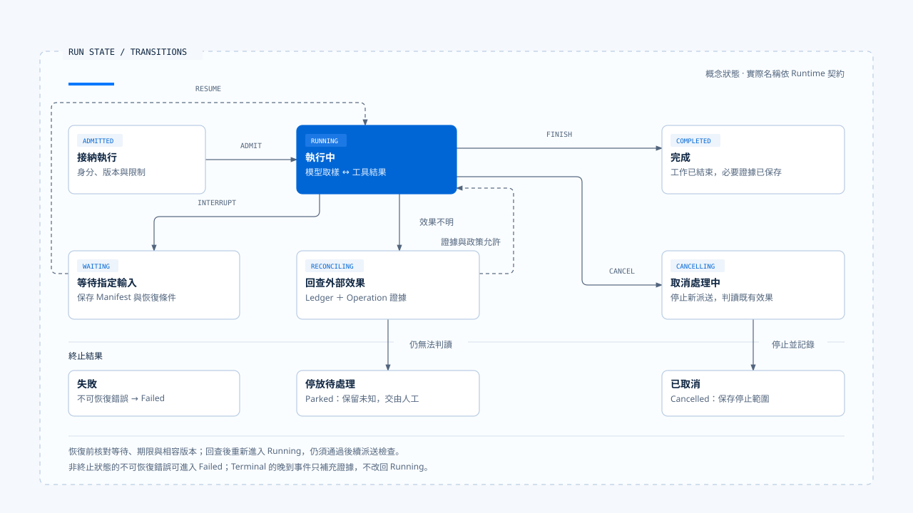
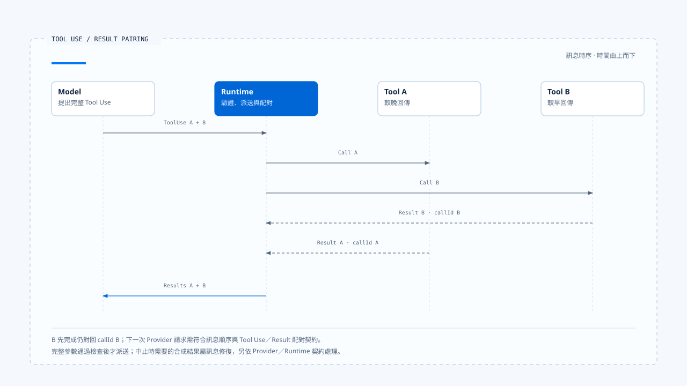

# Run Loop 與狀態轉移

[English](./03-run-loop-and-state-transitions.md) | [繁體中文](./03-run-loop-and-state-transitions-zh-TW.md)

模型回傳一段文字後，Runtime 可能還在處理工具或保存狀態；模型提出 Tool Call 後，也要等待授權與派送。Run Loop 依序處理這些中間結果，直到執行進入完成、失敗、取消、拒絕或可恢復的等待狀態。

若系統只用 `isLoading` 表示全部過程，模型串流、工具排程與人工等待都會共用同一個布林值。Runtime 需要更明確的狀態，才能判斷下一步是否合法，以及外部操作是否仍在進行。

## Run Loop 管理的是狀態與下一步

Agent Loop 常被縮寫成：

~~~text
呼叫模型 → 執行工具 → 把結果送回模型 → 重複
~~~

這段描述呈現模型與工具的主循環。每次準備執行下一步前，Runtime 還要核對：

- Run 是否已取消或正在等待外部輸入。
- Tool Call 是否獲准。
- Budget 是否耗盡、Deadline 是否已到。
- 前一步結果是否已完成必要的持久化。

這些條件共同決定 Runtime 能否繼續，也影響中斷後可以從哪裡恢復。

概念上可以寫成：

~~~ts
while (!state.isTerminal) {
  assertRunOwnership(state);
  enforceDeadlineAndBudget(state);
  observeCancellation(state);

  const next = decideNextStep(state);

  if (next.kind === "wait") return persistInterrupt(next);
  if (next.kind === "model") state = await runModel(next);
  if (next.kind === "tools") state = await runTools(next);
  if (next.kind === "finish") state = commitTerminal(next);
}
~~~

上述程式碼示意 Runtime 需要承擔的責任。Imperative loop 可以直接寫成迴圈，Graph Runtime 則把 `decideNextStep()` 分散在 node、edge、command 與 interrupt；實際實作各有不同，仍需維持這些執行條件。

## 概念狀態

本文以幾組概念狀態說明合法轉移。閱讀 Chat Gun 或 CCB 時，仍須對回各自的 enum、Graph State 與返回值。

| 狀態 | Runtime 可以做什麼 | 不應發生的事 |
|---|---|---|
| Admitted | 建立 Run、驗證 manifest 與必要依賴 | 尚未接納便發出已開始事件 |
| Running | 呼叫模型、排程工具、寫入進度 | 忽略取消或繼續超出 Budget |
| Waiting | 保存 checkpoint／interrupt，等待指定輸入 | 接受任意新訊息直接續跑 |
| Cancelling | 停止新派送，傳播 abort，處理已開始工作 | 宣稱已取消就代表外部效果不存在 |
| Reconciling | 查詢 Ledger 與外部 Operation | 在效果不明時直接重試 |
| Terminal | 回報 Completed、Cancelled、Failed 或其他終止判定 | 被晚到 progress 或舊 finalizer 改回 Running |

- 圖中整理概念狀態與主要轉移，具體名稱依 Runtime 契約而定。回查後重新進入 Running，仍需核對後續派送條件；終止後取得的新證據保存在效果紀錄中。
- [開啟圖解與實作註記](../../assets/agent-runtime/foundations/03-run-loop-and-state-transitions/03-run-state-transitions.html)。

Waiting 是否算 Terminal，要看產品與 Runtime 契約。對一次 HTTP 請求而言，等待可能是本次回應的終點；對一個可持久化 Task 而言，它仍是可恢復的非終止狀態。文章與 API 必須說明自己的觀察範圍，不能只看到請求結束就把 Task 標成 Completed。

## 從模型請求到下一個 Step

### 準備模型輸入

Runtime 從 Graph State 或 message history 取得本次可見內容，加入 Harness 已選定的 system prompt、Context 與 Tool descriptors，再套用模型與 Token 限制。Harness 持有 Context 的來源權威與選取規則，Runtime 依契約送出內容，並記錄實際使用的版本。

模型請求至少應關聯 Run、Step、Model Request 與 manifest。Provider timeout 或格式失敗時，Runtime 才能知道哪次請求需要失敗、retry 或使用已允許的 fallback。

### 接收與整理串流

Provider 可能先送 text delta、thinking／reasoning metadata、tool use delta、usage，最後才形成完整 assistant message。Runtime 可以把安全的進度轉成 Event，卻不能讓 UI delta 直接成為權威 message；若串流中斷，還要判斷已有內容能否保存、工具區塊是否完整，以及是否允許再次取樣。

### 串流中斷與不完整輸出

已送到使用者的文字可以保留為進度，進入下一輪的 assistant message 仍要通過結構檢查。Tool use block 若缺少參數結尾，Runtime 應將它標為不完整輸出，停止派送並依策略處理。

### 判斷模型結果

完整模型結果通常分成幾類：

- 只有一般內容，且沒有其他待處理工作，可以進入完成判斷。
- 包含 Tool Call，先保存訊息與呼叫識別，再進入工具路徑。
- 輸出需要 Clarification，經產品契約保存等待原因與恢復條件。
- 格式不合法、Provider 失敗或 Budget 耗盡，進入失敗、fallback 或受限回覆。

模型說「完成」只是內容。Runtime 仍要確認沒有未完成 Tool Call、未寫入 checkpoint、未處理取消及效果不明的操作，才可以提交 Completed。

## Tool Call 如何回到 Loop

Tool Call 必須保留模型產生的 call ID、工具名稱與輸入，Runtime 再進行以下處理：

1. 核對 Tool 是否存在於本次 Capability Set。
2. 驗證輸入 Schema 與可信 Execution Context。
3. 向 Harness 的 Authorization／Confirmation Port 取得決策。
4. 依 scheduler、concurrency、lock、rate limit 與 execution profile 派送。
5. 將 typed outcome 轉成模型可消費且仍可追蹤的 Tool Result。

若任一步拒絕，Runtime 要保留具體原因。模型取得輸入不合法、未授權、已取消、未提交或效果不明等結果後，才能決定改寫提案、向使用者說明或停止。

### 並行結果與訊息順序

多個工具並行時，完成順序可能與提案順序不同。Runtime 回寫訊息時，仍須遵守 Provider 的 tool use／result contract，並保留每筆 call ID。少一筆結果或插入不合法訊息，都可能讓下一次模型請求被拒絕。

[開啟 HTML 圖解](../../assets/agent-runtime/foundations/03-run-loop-and-state-transitions/03-tool-use-result-pairing.html)

圖中 B 比 A 早完成；Runtime 依 call ID 保留配對，收齊本輪所需的合法結果後，再組裝下一次模型請求。結果在請求內的排列仍依 Provider 契約決定。

## CCB 的 imperative query loop

固定版本的 `src/query.ts` 直接呈現 while-loop 形狀：外層準備 QueryParams，內層依 messages 呼叫模型、檢查 tool use、交給 `runTools`，再把結果接回下一輪。AsyncGenerator 向呼叫者送出 message、progress 與結果，AbortSignal、turn count、task budget 與 compaction 也在這條路徑被消費。

`toolOrchestration.ts` 會把被證明可安全並行的工具分組，其餘工具保守地序列執行。這解決單次 query 內的排程順序，並不等於跨程序資源鎖；若兩個獨立 query 同時改同一檔案，仍需更高層 ownership 或工具本身的衝突控制。

### Abort 後的訊息修復

Query 被 abort 時，message history 可能留下沒有 Tool Result 的 tool use。CCB 會處理這類未配對訊息，維持後續請求的對話結構；若直接保留不完整歷史，下一次 Provider request 可能因違反訊息契約而失敗。

## Chat Gun 的 Graph loop

Chat Gun 的 `mcp-agent.ts` 以 node 與 conditional edge 表達相同責任。模型呼叫後，Graph 檢查是否有 Tool Call；具體呼叫先進 authorization gate，需要確認時轉到 confirmation，獲准後才進 physical dispatch，完成的 ToolMessage 再回到模型節點。

Graph 表達等待與分支，相關控制則由組裝設定與 adapter 提供。核對時要繼續追蹤 Authorization 的可信 Principal、confirmation store 的持久化方式、tool dispatch pipeline 的啟用條件，以及外部效果的 reconciliation 能力。

`deep-researcher.ts` 展示另一種分支：Planner 可以把輸入導向 direct、weather、calculation、research 或 clarify。Clarify 使用 interrupt 停下 Graph；恢復後仍要通過回覆 Schema 與任務條件。語義 Router 決定下一個業務 node，不能取代 Runtime 的並發鎖、ownership 或 terminal guard。

## Turn、Step、Run 與 Task

一次 Task 可以有多個 Run，一個 Run 可以有多個模型 turn，一個 turn 也可能產生多個 Tool Call。命名在各框架間不一致，寫限制時要把量測單位說清楚：

| 限制 | 防止的問題 | 常見誤解 |
|---|---|---|
| Max turns | 模型與工具無止境循環 | 不一定限制單一 turn 內的並行工具數 |
| Token budget | Context 或生成成本失控 | 不等於美元成本上限 |
| Deadline | 整次 Run 超過可接受時間 | 不表示外部 I/O 已被撤銷 |
| Tool attempt budget | 單一效果反覆派送 | 不等於模型不能重新提出另一個 Tool Call |
| Task budget | 跨多個 Step 或 subtask 的總限制 | 實作需說明是否跨 Run 保存 |

Budget 要在執行前具體化，Runtime 每次準備呼叫 Provider 或 Tool 時扣除或保留額度。等到回應完成才發現超限，已經無法阻止成本或副作用。

## Retry 與下一輪模型提案不同

工具失敗後，模型可能根據 Tool Result 改用另一組參數；Runtime 也可能在不回到模型的情況下 retry 同一 Attempt。前者是新的行動提案，後者是執行策略，兩者應有不同 Budget 與 Evidence。

只有已確認未提交、錯誤被分類為 retryable、剩餘 Budget 足夠且取消尚未生效時，Runtime 才適合自動 retry。派送後效果不明必須先 reconcile；否則「再試一次」很容易變成做兩次。

### 模型 fallback 的條件

換模型可能改變 Tool Calling、Context Window 或 Structured Output 能力。Harness 應先提供允許的替代策略，Runtime 再依 Provider 失敗類型判斷是否切換，並記錄新請求使用的模型與版本。

## 取消如何進入狀態機

Cancel Command 改變 Runtime 對後續工作的允許範圍。Runtime 先停止新的模型與工具派送，向可取消的工作傳遞 AbortSignal，再等待或判讀已開始的操作；已提交的外部效果仍需保留與處理。

| 取消時點 | Runtime 可以做的事 |
|---|---|
| 模型請求前 | 不送出請求，收斂為 Cancelled。 |
| 模型串流中 | abort transport，保存必要事件並判讀 Provider 結果。 |
| 工具派送前 | 不呼叫底層工具，記錄 cancelled before dispatch。 |
| 外部 I/O 中 | 嘗試 abort；效果仍可能成功、失敗或未知。 |
| 外部 Commit 後 | 不宣稱撤銷，改走 reconciliation 或 compensation。 |
| Waiting 中 | 關閉等待或建立取消決策，避免後續 Resume 復活舊工作。 |

UI 的停止按鈕可以同時中止串流連線與提交 business cancel，兩條路徑仍要分開追蹤。關掉瀏覽器 response body，並不保證遠端 Run 或工具已停止。

## Terminal Result 要表達什麼

Terminal Result 是 Runtime 對 Run 的最後判定。概念欄位可以包含：

~~~ts
interface TerminalResult {
  runId: string;
  status: "completed" | "cancelled" | "failed" | "rejected" | "parked";
  reasonCode?: string;
  finalMessageId?: string;
  usage: ExecutionUsage;
  evidenceRefs: string[];
}
~~~

若 Waiting 被建模成可恢復的非終止狀態，API 結束回應時就要保留 Task／Run 的等待原因，避免將它標成 `completed`。Status 與 reason code 供程式判讀，Harness 再依結果產生顯示文案。

### 終止後的晚到結果

Terminal State 必須單向收斂。Completed 之後收到舊 progress，可以保留為 Audit Evidence 或丟棄，不能把狀態改回 Running。Cancelled 之後若查到外部效果已 Commit，則建立 effect reconciliation 結果，保留原 Run 的取消判定與後來取得的證據。

## 失敗從哪一層回來

| 失敗 | Runtime 應保留的語意 | 後續可能動作 |
|---|---|---|
| Provider unavailable | 模型請求未完成 | 依已允許 policy retry／fallback／fail |
| Malformed model output | 無法建立合法訊息或 Tool Call | 修復、重新取樣或 fail |
| Tool input invalid | 未進入實際派送 | Tool Result 回灌或拒絕 |
| Authorization denied | 政策不允許 | 不派送，讓模型／產品說明 |
| Timeout before dispatch | 明確未提交 | 符合條件時 retry |
| Timeout after dispatch | 效果不明 | Reconcile，不能盲目 retry |
| Cancel observed | 停止新工作 | 判讀 in-flight effect 後收斂 |
| Budget exhausted | 不再新增模型／工具工作 | 受限回覆或 Failed |
| Event delivery failed | 執行狀態未必失敗 | 重送事件或由 consumer replay |

把這些情況全部包成 Exception 丟到最外層，會同時失去 retry eligibility、使用者說明與營運證據。Runtime 需要 typed outcome，模型可見的 Tool Result 則是它的一種投影。

## 如何驗證狀態轉移

### Transition Test

- Running 可以進入 Waiting、Cancelling 或 Terminal。
- Terminal 收到一般 progress、late Tool Result 或舊 finalizer 時拒絕改變狀態。

### Budget Test

- 每次 Provider／Tool 派送前檢查剩餘額度。
- Retry 與模型新提案分別計算，不靠同一個模糊 counter。

### Cancellation Test

- 派送前取消時底層工具未被呼叫。
- 派送後取消保留 outcome，不把 abort 當成外部未提交證據。

### Message Contract Test

- 每個 tool use 都有對應 result 或明確 repair。
- 多工具完成順序改變時，下一次模型請求仍符合 Provider Schema。

### Late Event Test

- Terminal 後的 delta／progress 不復活 Run。
- 不同 generation 的事件不更新目前可見 activity。

## 本篇的工程判斷

檢查 Run Loop 時，應核對每次循環前後的合法狀態、剩餘 Budget 與執行結果。模型輸出、工具結果與使用者輸入都可能改變下一步，Runtime 的 state authority 再依契約判定能否繼續。

Graph 以 node 與 edge 表達分支，while-loop 則直接呈現控制流。採用任一方式，都要把取消、Tool Result 關聯與 terminal guard 放進正式路徑，才能在故障與晚到事件出現時維持一致狀態。

## 實作參照與適用範圍

### [Claude Code Best](https://github.com/claude-code-best/claude-code)

- `src/query.ts`
- `src/QueryEngine.ts`
- `src/services/tools/toolOrchestration.ts`
- `src/services/tools/toolExecution.ts`
- `src/services/api/claude.ts`

### [Chat Gun](https://github.com/HsienW/chat-gun)

- `backend/src/agents/mcp-agent.ts`
- `backend/src/agents/deep-researcher.ts`
- `backend/src/runtime/tool-dispatch/pipeline.ts`
- `backend/src/runtime/tool-dispatch/scheduler.ts`
- `backend/src/runtime/side-effect/governed-outcome.ts`
- `backend/src/platform/agent-runtime-events.ts`

本文以固定版本原始碼與既有測試安排說明；表中的狀態用來對照責任，具體名稱依各來源庫而定。本輪沒有執行真實 Provider、外部 MCP、跨程序 cancellation 或資料庫故障演練。

## 接續閱讀

- [持久化、Interrupt 與 Resume](./04-persistence-interrupt-and-resume-zh-TW.md)
- [重試與副作用處理](../../agent-harness/action-governance/05-retry-and-side-effects-zh-TW.md)
